<!-- source: ja/getting-started/quick-tour.md @ 6cacee7 -->

# Quick tour

This tour follows the shortest path from launching CueMol3 to loading a structure, adjusting its display, exporting an image, and saving the scene.
For details of each screen, see [User interface](../ui/index.md);
for details of each menu item, see the [Menu reference](../menu/index.md).

## 1. Launch CueMol3

Launching CueMol3 opens a single window.
Scenes are lined up as **tabs** at the top of the window.

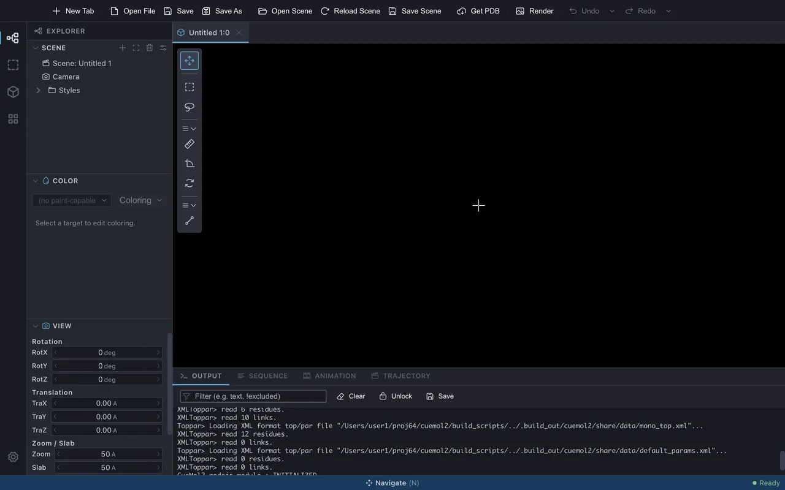{ .on-glb }

## 2. Load a structure

As an example, load the small protein crambin (PDB ID: **1CRN**).
For a structure whose PDB ID is known, **File &gt; Get PDB...** is the easiest way to fetch it.

1. Choose **File &gt; Get PDB...** (the `Get PDB` toolbar button does the same)

    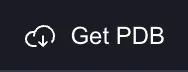{ width="94" }

2. Enter `1CRN` in **PDB Accession Code** and press **Download**

    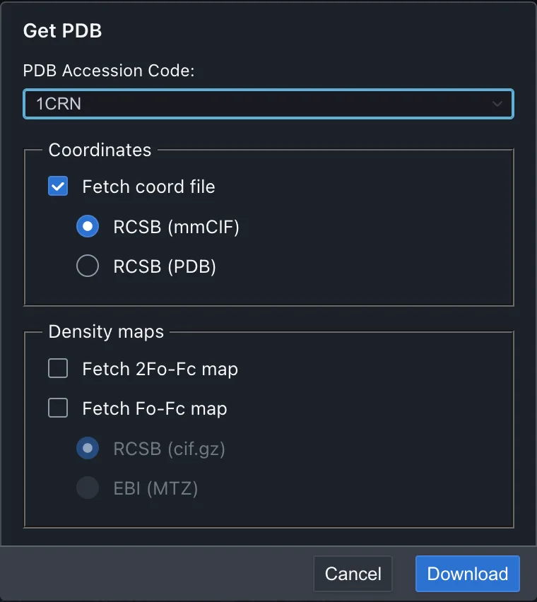{ width="380" .on-glb }

3. An options dialog for loading appears. Choose **simple** from **Renderer type** and
   press **Open**

    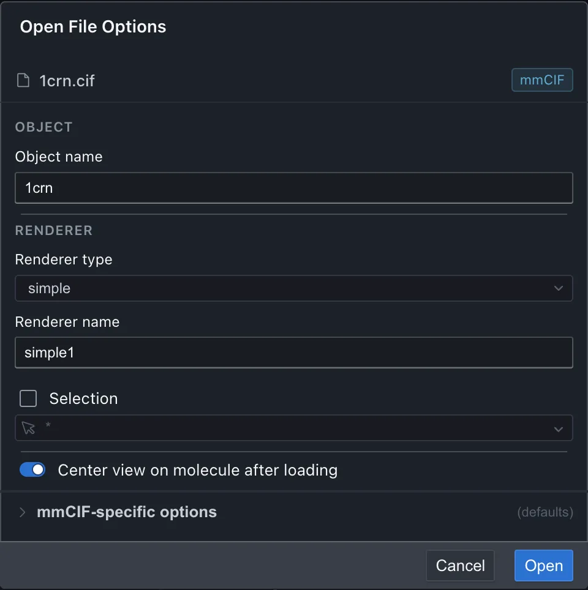{ width="480" .on-glb }

The whole molecule is displayed as a thin line drawing. simple is the lightest
display method, drawing bonds as lines only, and is well suited for getting an overview first.

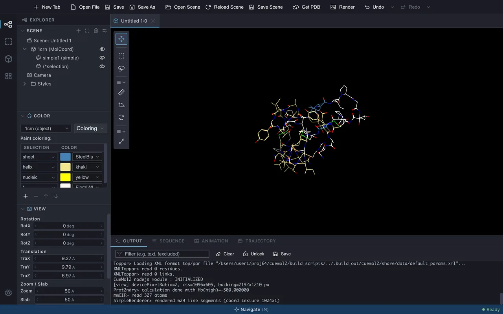{ .on-glb }

In addition to coordinates, electron density maps (cif.gz from RCSB, MTZ from EBI) can also be fetched.
A download can be interrupted with Cancel in the progress dialog. To open a local file,
use **File &gt; Open File...** (the same options dialog appears).

## 3. Adjust the display

A loaded structure is drawn in the **molecular view** (the 3D display area in the center)
through **Renderers** (display methods). Multiple Renderers can be stacked on one Object.

### Add a Renderer

To show the secondary structure, add a **ribbon**.

1. In the **Explorer &gt; Scene** tree (scene tree) in the left side panel, right-click the Object (`1crn`)
   and choose **New Renderer**

    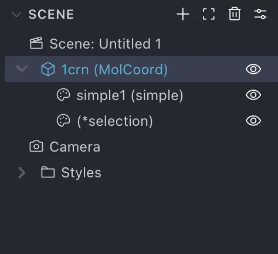{ width="237" .on-glb }

2. Choose **ribbon** from **Renderer type** and press **Create**

    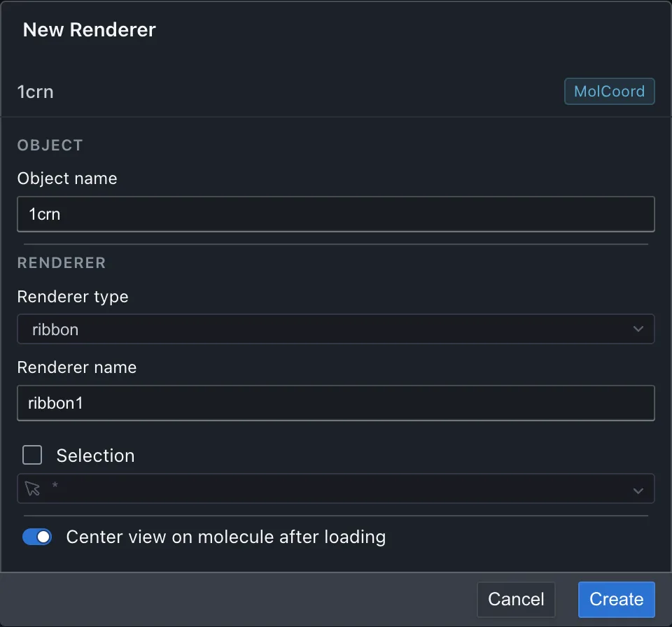{ width="480" .on-glb }

Over the line drawing, helices and sheets are drawn as flat ribbons and everything else as thin tubes.

Next, display only the Cys residues that form disulfide bonds with **ballstick** (a model that draws
atoms as spheres and bonds as cylinders). A Renderer can narrow its target atoms with a **selection expression**
(→ [Selection expression syntax](../reference/selection.md)). Here, instead of writing the expression by hand,
build it with the [selection builder](../ui/selection-builder.md).

1. In the same way, right-click the Object (`1crn`) and choose **New Renderer**
2. Choose **ballstick** from **Renderer type**
3. Check **Selection**
4. Press the ▼ at the right end of the selection expression field to open the selection builder
5. Switch to the **Term** tab and choose **resn** (residue name) from the keywords
6. Open the candidates with the ▼ of the value field and choose **CYS**
7. Press **Set**. `resn CYS` is entered in the selection expression field

    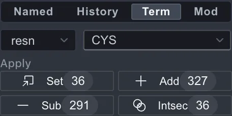{ width="228" .on-glb }

8. Press **Create**

    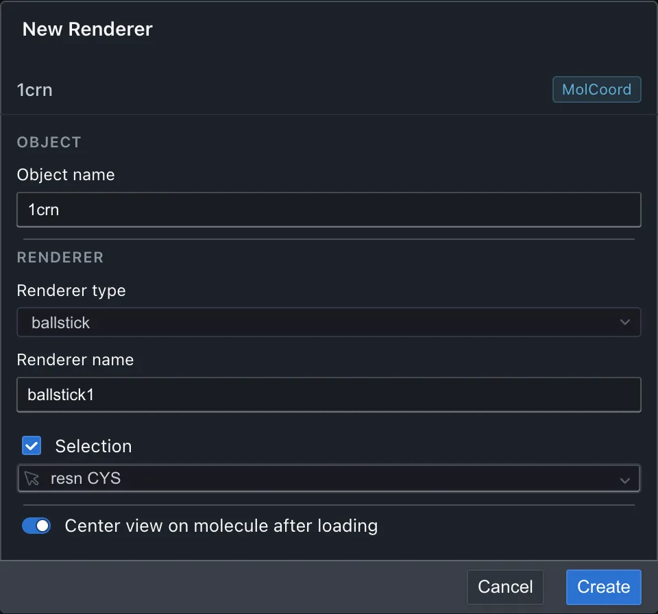{ width="480" .on-glb }

Over the ribbon, only the six Cys residues are drawn as spheres and cylinders. In crambin,
they form three disulfide bonds.

The initial line drawing is no longer needed, so click the **eye icon** on the `simple1` row
of the scene tree to hide it. The eye icon toggles the visibility of each Renderer
at any time.

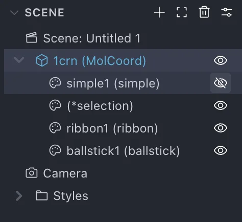{ width="237" .on-glb }

- When a type is chosen, a Renderer is **created immediately with default values**, and detailed settings are adjusted
  afterward in the inspector (for this policy, see [Changes in the operation paradigm](../changes/ui-paradigm.md))
- Choosing a predefined combination (preset) creates a group of multiple Renderers at once

### Adjust the appearance

**Double-click** `ballstick1` in the scene tree, and its settings are shown in the **property inspector**
on the right. Open the **Ball and stick** section and raise **Atom radius**
(the radius of the atom spheres, in Å) from the default 0.3 to `0.5`.
The spheres become larger, giving a display that emphasizes the atoms. Changes to values are reflected
in the molecular view immediately, and can be undone with ++cmd+z++ / ++ctrl+z++.

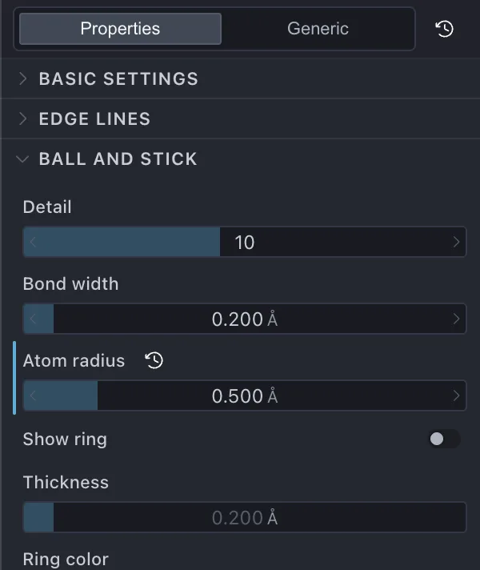{ width="300" .on-glb }

### Change the colors

Colors are set in the **Explorer &gt; Color** panel in the left side panel. Coloring can be set
for each Renderer or on the molecular Object. The default color of a Renderer refers to
the color of the Object (`$molcol`), so recoloring the Object is reflected in all
Renderers that refer to it. Here, recolor the Object.

1. Select `1crn (object)` at the top

    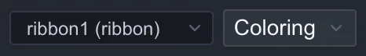{ width="233" }

2. Press the adjacent **Coloring** button and choose **Rainbow coloring**

    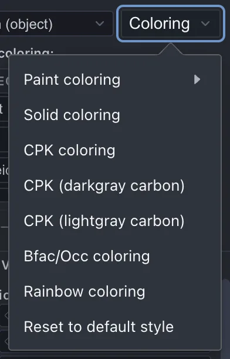{ width="196" .on-glb }

The ribbon is recolored in rainbow colors from the N-terminus to the C-terminus, and the carbon atoms of the ballstick
follow. Coloring comes in several kinds, such as Paint / CPK / B-factor / electrostatic potential
(→ [Coloring](../reference/coloring.md)).

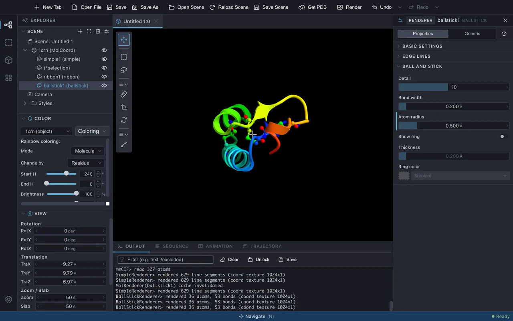{ .on-glb }

### Move the viewpoint

Mouse operations in the molecular view are as follows (defaults).

| Operation | Action |
|---|---|
| Left drag | Rotate |
| Wheel | Zoom |
| Two-finger scroll on a trackpad | Translate (when the pointing device setting is Mac trackpad / Auto-detect) |

For details and for changing the settings, see [Mouse and trackpad input](../ui/mouse-input.md).

## 4. Export an image

There are two ways, depending on the purpose.

### Export the screen as is

Choose **Rendering &gt; Export scene &gt; PNG image...** to specify the destination, size, DPI, and background transparency
and write out a PNG.

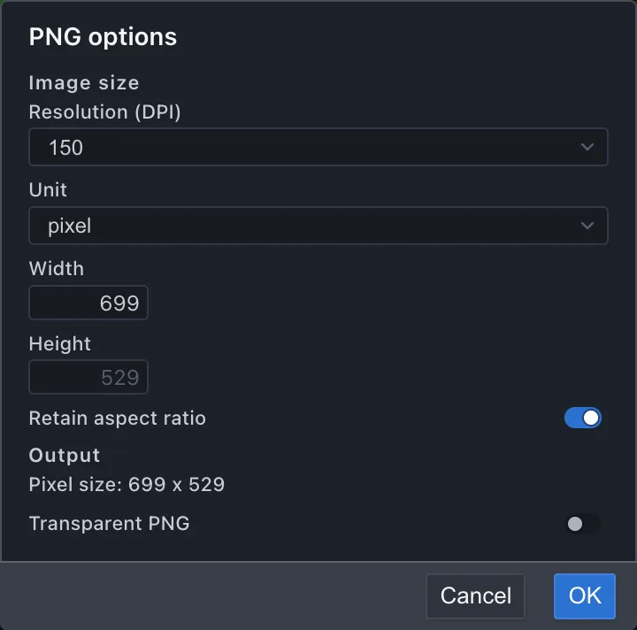{ width="360" .on-glb }

### Produce a high-quality ray-traced image

Choose **Rendering &gt; Image rendering...** to open a separate **rendering window**
in Still mode.

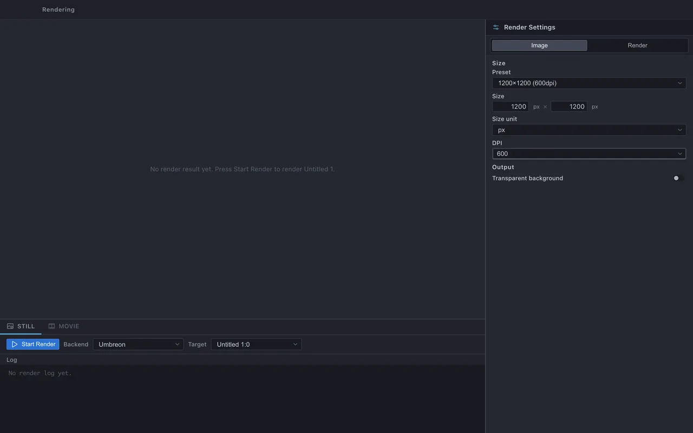{ .on-glb }

1. Choose the target view (Target). The backend can stay at the default **Umbreon**

    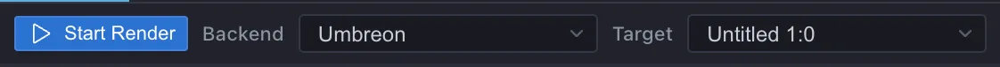{ width="561" .on-glb }

2. Set the quality and size

    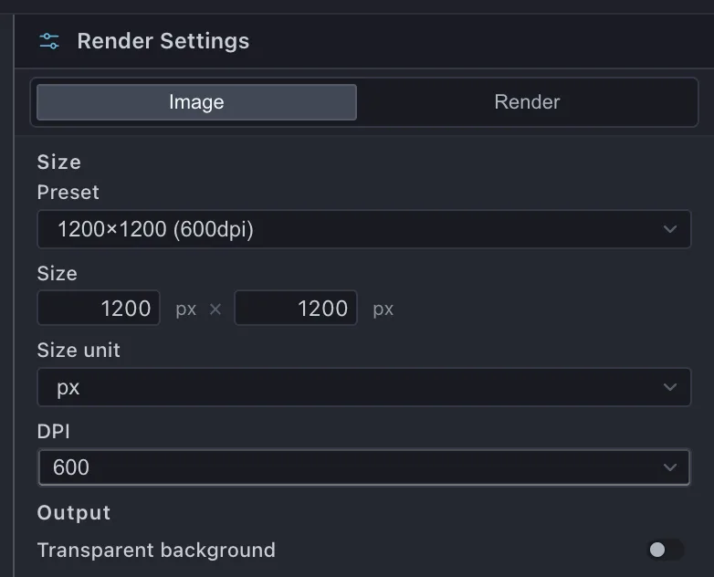{ width="307" .on-glb }

3. Press **Start Render**. Progress is shown, and when it finishes the resulting image appears in the same window

    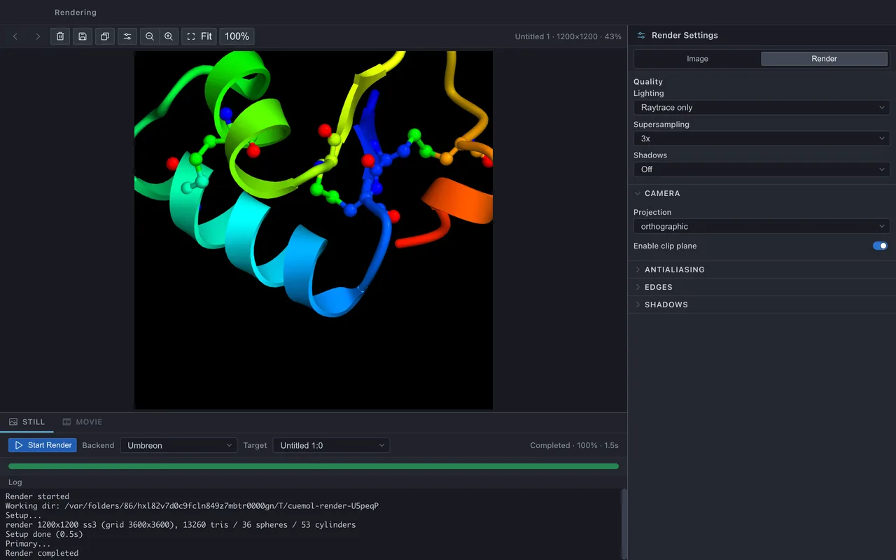{ .on-glb }

To make a movie, use Movie mode of the same window via **Rendering &gt; Movie rendering...**
(→ [Rendering window](../ui/rendering-window.md)).

## 5. Save the scene

Save the scene to a `.qsc` file with **File &gt; Save Scene** (++cmd+s++ / ++ctrl+s++).
On the first save, as with **Save Scene As...**, a dialog appears for specifying the destination and options (embedding / compatibility / compression / encoding).

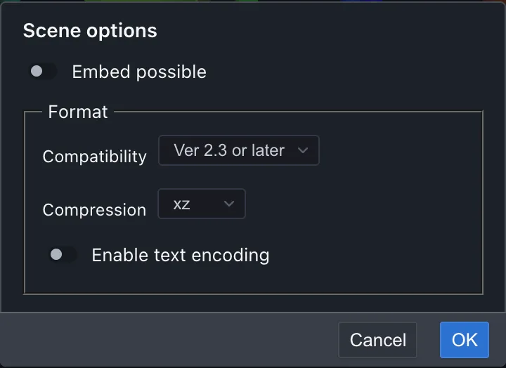{ width="360" .on-glb }

`.qsc` is compatible with CueMol2, so scenes created in CueMol2 can also be opened in CueMol3.

## Next steps

- [Tutorials](../tutorials/index.md) — a run-through of drawing procedures by purpose
- [User interface](../ui/index.md) — the role of each panel in detail
- [Menu reference](../menu/index.md) — a list of all menu items
- [Changes from CueMol2](../changes/index.md) — for CueMol2 users

---

*Verified against: CueMol3 2.3.8.495*
