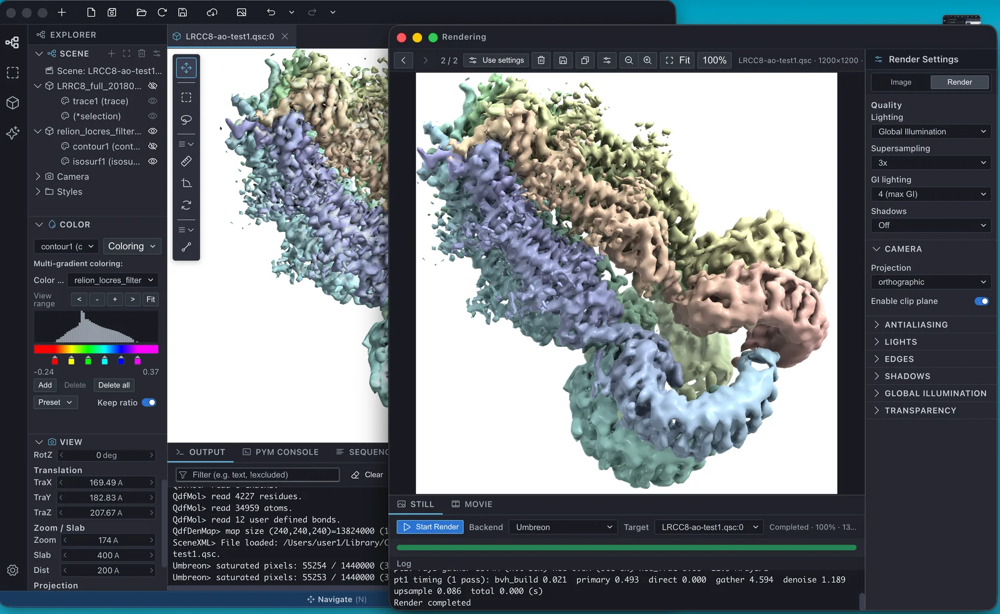

# CueMol3

**CueMol3** (development codename *tritium*) is a program for visualizing the three-dimensional
structures of biological macromolecules. It inherits the CueMol2 visualization engine (libcuemol2)
while the GUI has been rebuilt from scratch on Electron + React.

{ .on-glb }

!!! warning "This is a development build"
    CueMol3 builds can be downloaded from
    [GitHub Releases](https://github.com/CueMol/cuemol2/releases/latest), but they are still
    **under development**, and they carry no code signature identifying their origin (the macOS
    app is ad-hoc signed only). If you need a stable version for day-to-day work, please use
    CueMol2 — see the [CueMol2 documentation site](https://cuemol.github.io/cuemol2_docs/).

!!! note "Documentation language"
    The documentation is written in Japanese first and translated into English section by section.
    Getting started, Installation, User interface, Menu reference and the basic tutorials are
    available in English. The other sections are not translated yet: their links below are marked
    "(Japanese only)" (or "(partly translated)") and open the Japanese pages.

## Contents

| Section | Contents |
|---|---|
| [Getting started](getting-started/index.md) | What CueMol3 is, supported file formats, system requirements, license |
| [Quick tour](getting-started/quick-tour.md) | From launching the app to exporting an image |
| [Installation](install/index.md) | How to obtain and install CueMol3 on each OS |
| [User interface](ui/index.md) | The parts of the main window and what they do |
| [Menu reference](menu/index.md) | Every menu item, including which ones do not work yet |
| [Tutorials](tutorials/index.md) (partly translated) | Step-by-step procedures by purpose |
| [Reference](reference/index.md) (Japanese only) | Selection syntax, Objects, Renderers, rendering, settings and plugins |
| [Changes from CueMol2](changes/index.md) (Japanese only) | What changed, what moved, what was removed |
| [Release history](releases.md) (Japanese only) | Main changes in each release |

## Related links

| Link | Contents |
|---|---|
| [GitHub Releases](https://github.com/CueMol/cuemol2/releases) | Downloads and release notes (CueMol3 assets are the `CueMol3-*` files) |
| [CueMol2 documentation](https://cuemol.github.io/cuemol2_docs/) | Documentation for CueMol2 (stable). Frozen for CueMol2 |
| [Gallery](https://cuemol.github.io/cuemol2_docs/en/Gallery/) | Example images made with CueMol (on the CueMol2 site) |
| [GitHub: CueMol/cuemol2](https://github.com/CueMol/cuemol2) | Source repository (CueMol3 lives under `tritium/`) |

## License

CueMol is distributed under the **MIT License**, with **NO WARRANTY** — please use it at your own risk.

For non-profit (academic) users, CueMol is free of charge for both binary and source code.
Commercial users may also use CueMol free of charge, but we would appreciate hearing about
your main use of the software.
