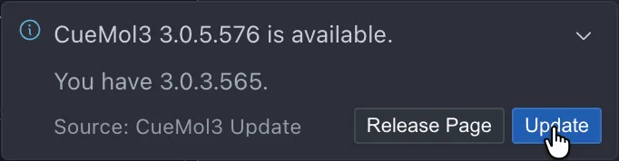
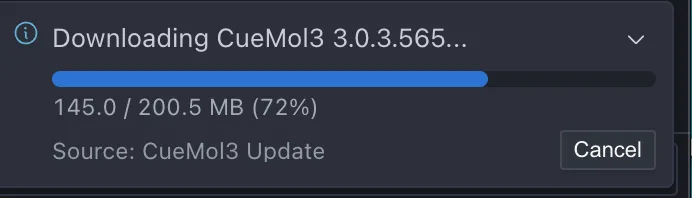
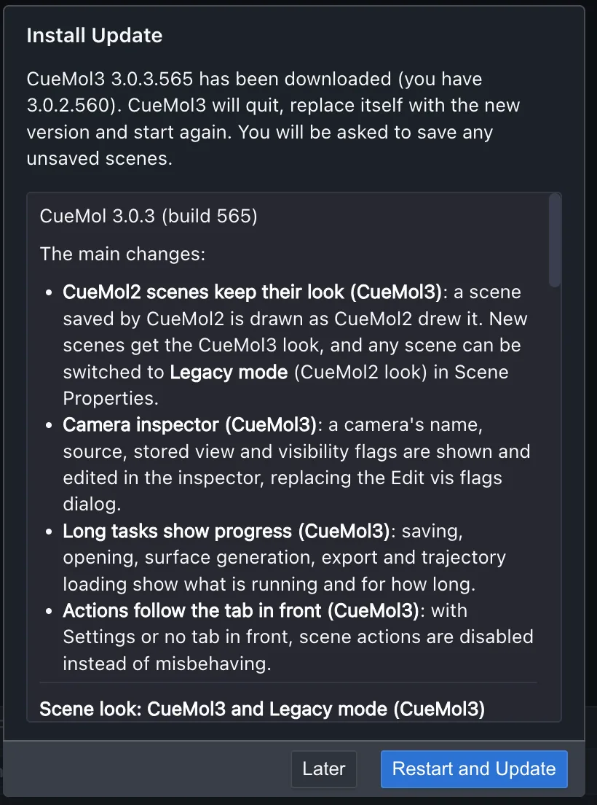
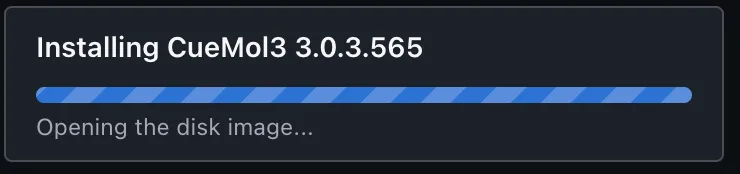
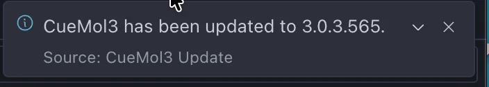
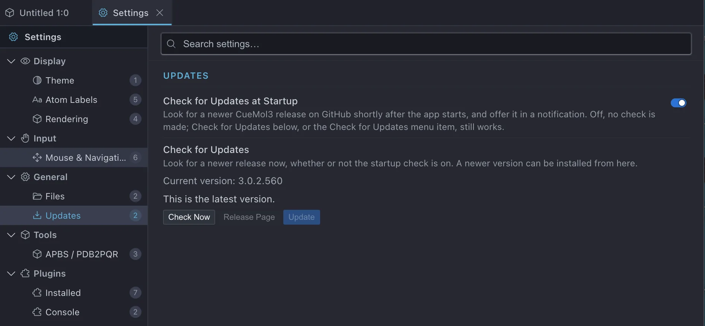

<!-- source: ja/install/update.md @ c730ead -->

# Updating

The **macOS (Apple Silicon)** and **Windows (x64)** versions of CueMol3 can check for new releases and replace themselves from within the app. For the Linux version, download the new release assets and reinstall
(→ [Download](index.md#download)).

!!! warning "From 2.3.21.544 or earlier, install manually once"
    In-app updating was introduced in 2.4.0.546. CueMol3 2.3.21.544 and earlier do not have this mechanism, so [install manually](macos.md) a build of 2.4.0.546 or later once. Subsequent releases can be installed from within the app.

!!! warning "On Windows, install manually once from 2.4.1.547 or earlier"
    In-app updating on Windows was introduced in 2.4.2.550. [Install manually](windows.md) a build of 2.4.2.550 or later once. Subsequent releases can be installed from within the app.

{ width="341" .on-glb }

## Checking for new releases

- **Check at startup**: Shortly after launch, CueMol3 checks GitHub for a new release. If one exists, a notification is shown. If the check fails (for example, when offline), nothing is shown. The check can be turned off with **Check for Updates at Startup** in **Settings &gt; General &gt; Updates** (ON by default).
- **Manual check**: Use **Check for Updates...** in the application menu (the **Help** menu on Windows), or **Check Now** in **Settings &gt; General &gt; Updates**, to check at any time. If you are already running the latest version, this is indicated.

On Linux, **Help &gt; Check for Updates...** is also present, but it only displays "Updates are not available in this build."

## Installing the update

1. Click **Update** in the new-release notification (or in the Settings row). Click **Release Page** to open the release's page on GitHub.
2. The download starts and its progress is shown (**Cancel** aborts it). The downloaded file is verified.

    { width="346" .on-glb }

3. The **Install Update** dialog shows the release notes. Click **Restart and Update** to proceed with the update. If you click **Later**, you can continue afterward from **Restart to Update** in the notification.

    { width="410" .on-glb }

4. The **Installing CueMol3 &lt;version&gt;** screen shows the progress of preparing the new version (the app cannot be operated during this step). When it finishes, after the check for unsaved scenes, CueMol3 quits, is replaced with the new version, and restarts.

    { width="370" .on-glb }

5. After startup, "CueMol3 has been updated to &lt;version&gt;." is displayed.

    { width="352" .on-glb }

If the new version fails to start, the original version is restored and restarted, and a notification reports this. The restored version is not offered again by the startup check.

Release assets fetched by the app do not get the quarantine attribute, so the [first-launch warning](macos.md#working-around-the-first-launch-warning) does not appear.

### On Windows

On Windows, an administrator permission prompt (UAC) appears for each update. The prompt shows
`CueMol3 Updater.exe` (publisher: unknown); allow it. If it is not allowed, the update is
cancelled and the original version restarts. Release assets fetched by the app do not trigger the
[SmartScreen warning](windows.md#working-around-the-first-run-warning).

### When Update is not shown

In the following cases the app cannot be replaced in place, so **Update** is not shown and only **Release Page** is available. Download the release assets and install manually.

- The app does not have write permission for the folder it resides in (macOS)
- The app is running without having been moved from where it was downloaded (App Translocation, macOS).
  Move `CueMol3.app` to the `Applications` folder and launch it from there.
- The app is running from a location other than where the installer installed it (Windows)

## Notification center

Update notifications are collected in the notification center, opened from the **bell** icon at the right end of the status bar. The bell is marked when there are unread notifications, and during a download its progress is shown next to the bell. New notifications also appear at the lower right of the screen.

## Settings &gt; General &gt; Updates

{ width="474" .on-glb }

| Item | Default | Description |
|---|---|---|
| Check for Updates at Startup | ON | Checks for a new release after startup and notifies if there is one. Manual checks are still possible when OFF. |
| Check for Updates | — | Shows the current version and status. It has **Check Now** / **Release Page** / **Update** buttons, from which the update can be run. |

## See also

- [Installing on macOS](macos.md)
- [Installing on Windows](windows.md)
- [Release history](../releases.md) — main changes for each release
- [Settings reference](../reference/settings.md#general)

---

*Verified against: CueMol3 2.4.2.550*
