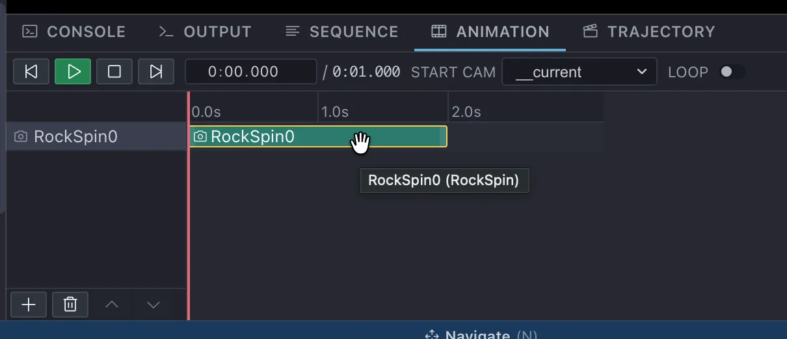
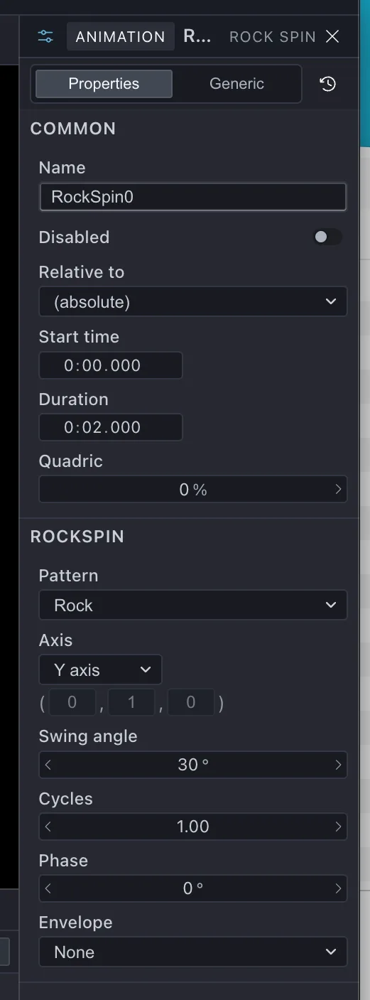

<!-- source: ja/reference/animation/rockspin.md @ f8502b6 -->

# RockSpin (swing)

An animation that makes the view oscillate.
It is added with **Rock** in the add menu of the Animation panel. Movements corresponding to
rock / nutate / wobble in PyMOL and ChimeraX can be created with a single element.

{ width="605" .on-glb }

{ width="200" .on-glb }

## Properties

For the common properties (name, start time, duration, etc.),
see [Animation](index.md#common-properties).

Pattern
:   The kind of swing. The default is Rock.

    | Pattern | Movement |
    |---|---|
    | **Rock** | Rocking around the Axis |
    | **Nutate** | Rotation in which the line of sight traces a circle |
    | **Wobble** | Rocking that traces a figure eight |

Axis
:   The axis to swing around. Choose **X axis** / **Y axis** (default) / **Z axis**, or specify
    (x, y, z) with **Cartesian**. The axis is expressed in screen coordinates (x to the right, y up, z toward the viewer).

Swing angle
:   The full amplitude of the swing (degrees). The default is 30°, and the view actually swings by half of it to each side.
    There is no range limit, and a negative value oscillates in the opposite direction.

Cycles
:   The number of repetitions within the duration of the element. The default is 1, and fractional values can be specified.

Phase
:   The phase at which the swing starts (degrees). The default is 0°.

Aspect
:   Shown only for Nutate / Wobble. The ratio of the amplitude of the second axis, perpendicular to both the Axis and the line of sight, to the amplitude of the Axis.
    Switching the Pattern resets it to the default of that Pattern (1 for Nutate, 0.3 for Wobble).

Envelope
:   How the amplitude changes over time. With **None** (default), the amplitude is constant. With **Grow**, it starts at 0 at the
    start of the element and gradually increases; with **Shrink**, it gradually decreases and reaches 0 at the end of the element.

## View at the start and end

- The element starts moving from the preceding view. However the Pattern, Phase and Envelope are set,
  the view never jumps at the start of the element.
- For this reason, with Nutate the circle traced by the line of sight passes through the preceding view rather than being centered on it.
  To center the circle on the preceding view, set Envelope to Grow.
- When Envelope is None and Cycles is an integer, the view returns to the original view at the end of the element.

## See also

- [List of animations](index.md)
- [SimpleSpin](simplespin.md)
- [Animation panel](../../ui/bottom-panels/animation.md)
- [ChX console](../plugins/console/chx_console.md) / [PyM console](../plugins/console/pymconsole.md) —
  this element can be added with commands such as `rock`.

---

*Verified against: CueMol3 3.0.2.560*
