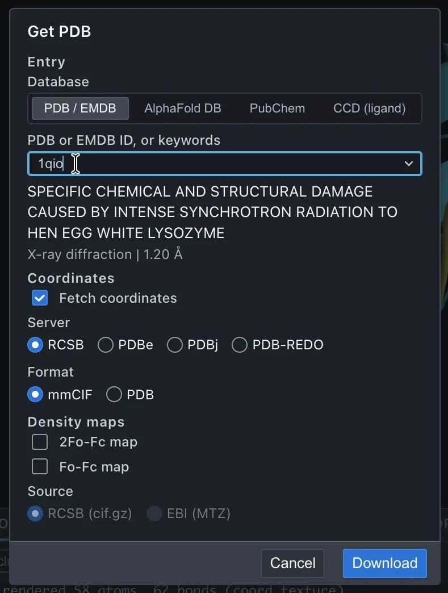

<!-- source: ja/reference/get-pdb.md @ f8502b6 -->

# Fetching from the PDB (Get PDB)

Fetches the coordinates and density maps of a PDB entry from the network and loads them.
Predicted structures from AlphaFold DB, compounds from PubChem, and ligands from the CCD can also be fetched.
**File &gt; Get PDB...** (or the **Get PDB** button on the toolbar) opens the **Get PDB** dialog;
enter a PDB ID or an EMDB ID and press **Download**. When the ID is not known, entries can be
searched for by keywords.

Files are loaded directly without going through temporary files. A progress dialog is shown while fetching,
and **Cancel** aborts it.

## Entering an ID

{ width="296" .on-glb }

**Database** under **Entry** chooses the database to fetch from. The default is **PDB / EMDB**,
and the dialog returns to it each time it opens.

| Database | Input field | Description |
|---|---|---|
| **PDB / EMDB** | **PDB or EMDB ID, or keywords** | PDB entries and EMDB maps (this section) |
| **AlphaFold DB** | **UniProt accession or AlphaFold ID** | Predicted structures from AlphaFold DB (→ [AlphaFold DB](#alphafold-db)) |
| **PubChem** | **PubChem compound ID (CID)** | Compounds from PubChem (→ [PubChem](#pubchem)) |
| **CCD (ligand)** | **CCD code (Chemical Component Dictionary)** | Ideal coordinates of ligands (small molecules) (→ [CCD (ligand)](#ccd-ligand)) |

With **PDB / EMDB**, enter one of the following in **PDB or EMDB ID, or keywords**.

| Input | Example | What can be fetched |
|---|---|---|
| PDB ID | `1mbn` | The coordinates and, depending on the entry, density maps |
| EMDB ID | `EMD-11638` / `emd_11638` | Only that cryo-EM map (no coordinates) |

Prefix an EMDB ID with `EMD`. Digits alone (`1234`) are treated as a PDB ID.

After an ID is entered, the entry information is shown below the input field: for a PDB ID, the title and
"method | resolution | EMDB ID"; for an EMDB ID, the title and "Cryo-EM map, no coordinates".
The fetch items shown below it depend on the kind of entry.

| Entry | Items shown |
|---|---|
| Crystal structure (X-ray / neutron) | **Coordinates** and **Density maps** |
| Cryo-EM structure (with an EMDB map) | **Coordinates** and **Cryo-EM maps** |
| Others (NMR, etc.) | **Coordinates** only |
| EMDB ID entered directly | **Cryo-EM maps** (that map only) |

For an ID that does not exist, "No entry ... was found." is shown and nothing can be fetched.
If a four-letter word happens to look like a PDB ID, **Search as keywords** searches for it as
a keyword.

Fetching is still possible when the entry information cannot be read (when offline, for example). In that case,
**Coordinates** and **Density maps** are shown for a PDB ID.

The button to the right of the input field chooses from the input history (fetched IDs and searched keywords, up to 20 items).

## Coordinates

| Item | Description |
|---|---|
| **Fetch coordinates** | Fetches the coordinates (ON by default). |
| **Server** | Where to fetch from: **RCSB** (default) / **PDBe** / **PDBj** / **PDB-REDO**. |
| **Format** | **mmCIF** (default) or **PDB**. For large entries that do not fit in the PDB format, only mmCIF is available. |

**PDB-REDO** can fetch only X-ray entries re-refined by PDB-REDO.
**Server** decides only where the coordinates are fetched from. Where density maps are fetched from is chosen with **Source** in the next section.

When coordinates are fetched, the screen for specifying the Object name and Renderer appears, as when opening a file.
The default Object name is the PDB ID in lowercase.

## Density maps

Shown for crystal structure entries.

| Item | Description |
|---|---|
| **2Fo-Fc map** / **Fo-Fc map** | Fetches each map (OFF by default). |
| **Source** | Where to fetch from: **RCSB (cif.gz)** (default) or **EBI (MTZ)**. |

No screen for specifying the Renderer appears for maps; they are shown as contours with a fixed color and level
(→ [Overlaying an electron density map](../tutorials/density-map.md)).

## Cryo-EM maps

Shown for cryo-EM structure entries and when an EMDB ID is entered.

| Item | Description |
|---|---|
| **&lt;EMDB ID&gt; map** | Fetches that map (ON by default). If the entry has several maps, one row is listed per map. Below each row, the file size, grid size and recommended level are shown. |
| **Source** | Where to fetch from: **wwPDB** (default) / **EBI** / **PDBj**. |

A fetched map is shown as an isosurface (isosurf). The level is the contour level recommended by the depositor.
For a map without a recommended level, the level encloses the top 1 % of the grid point values
(→ [DensityMap](objects/densitymap.md)). The Object name is `emd_<number>`.

!!! note "Some maps have a recommended level that is too high"
    For some maps, the recommended level encloses only part of the structure (EMD-11640, for example).
    In that case, lower it with **Level** in the Density map panel.

## Searching by keywords

Keyword search is available only when **Database** is **PDB / EMDB**.
Entering text other than an ID in the input field shows "Press Enter to search the PDB for these keywords.".
Pressing ++enter++ or **Search** searches for entries with the RCSB full-text search.

The results are listed under **Search results**. To the right of the heading, the number of results shown and the total are displayed.

| Item | Description |
|---|---|
| **Method** | Filters by method: **All methods** (default) / **X-ray** / **Electron microscopy**. |
| **Sort** | The order: **Relevance** (default) / **Best resolution** / **Newest**. |
| **More** | Appends further results to the end of the list. |

Changing Method or Sort searches again with the same keywords. Each row of the list shows the ID, title,
and method and resolution.

Choosing a row shows the entry information and fetch items below the list, just as when that ID is entered.
Rows can also be chosen with ++arrow-up++ / ++arrow-down++ while the focus stays in the input field.
Entering an ID again closes the list.

## AlphaFold DB

Choosing **AlphaFold DB** in **Database** fetches predicted structures from AlphaFold DB.
Enter one of the following in the input field.

| Input | Example |
|---|---|
| UniProt accession | `P29474` |
| UniProt accession with an isoform number | `Q8N9C0-2` |
| AlphaFold ID | `AF-P29474-F1-v6` |

UniProt entry names such as `NOS3_HUMAN` cannot be used. Enter the accession (`P29474`).

After an input is entered, the entry information is shown below the input field: the title is the protein name,
followed by "gene | organism | number of residues | mean pLDDT".
The only fetch item is **Format** under **Model** (**mmCIF** (default) or **PDB**).

When the coordinates are fetched, the screen for specifying the Object name and Renderer appears, as for PDB entries.
The default Object name is `AF-<accession>-F1`. The loaded structure is colored by the prediction confidence (pLDDT)
(→ [Coloring](coloring.md#bfacocc)).

## PubChem

Choosing **PubChem** in **Database** fetches the 3D conformer of a PubChem compound in SDF format.
Enter the compound ID (CID, a number) in the input field (for example, `2244`). Compound names cannot be used.

After a CID is entered, the compound name and "molecular formula | molecular weight | IUPAC name" are shown below the input field.

A fetched compound is shown with ball &amp; stick ([ballstick](renderers/ballstick.md)) as an Object named
`pubchem_<CID>`, without the screen for specifying the Object name and Renderer.

## CCD (ligand)

Choosing **CCD (ligand)** in **Database** fetches the ideal coordinates (including hydrogens) of a ligand
in the PDB Chemical Component Dictionary (CCD) from RCSB in SDF format. Enter a CCD code of 1 to 5 characters
in the input field (for example, `ATP`, `HEM`, `NAG`).

After a code is entered, the compound name and "molecular formula | molecular weight | type" are shown below the input field.

As with PubChem, a fetched ligand is shown with ball &amp; stick as an Object named after the CCD code,
without the screen for specifying the Object name and Renderer.

In ChX console, it can be fetched with `open ccd:ATP` (→ [ChX console](plugins/console/chx_console.md)).

## Fetching from the Console

In the native mode of the [Console](plugins/console/index.md), `fetch_pdb` (`fetch`) fetches coordinates,
`fetch_map` fetches density maps of crystal structures, and `fetch_emdb` fetches cryo-EM maps.
`fetch_entry` fetches from PDBe / PDBj / PDB-REDO / AlphaFold DB / PubChem / CCD, and `fetch_map_url` fetches
a CCP4 / MRC map at a URL
(→ [Command list](plugins/console/commands.md)).

## See also

- [File menu](../menu/file.md)
- [DensityMap (density map)](objects/densitymap.md)
- [Overlaying an electron density map](../tutorials/density-map.md)
- [Loading and displaying a structure](../tutorials/basic/loading.md)

---

*Verified against: CueMol3 3.0.2.560*
