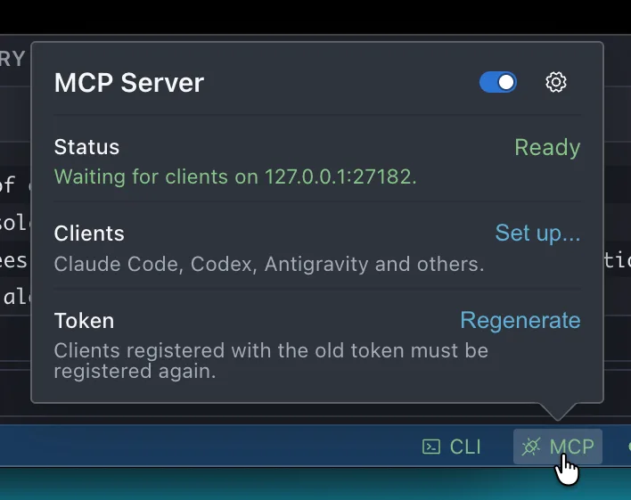
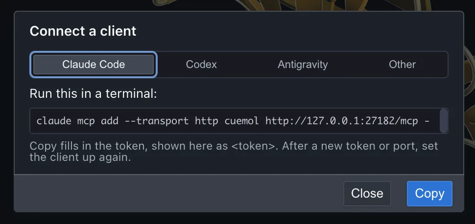

<!-- source: ja/reference/plugins/mcp-server.md @ 5008883 -->

# MCP Server

A plugin that lets an AI client running on the same computer (Claude Code / Codex / Antigravity, etc.) operate CueMol3 through **MCP** (Model Context Protocol).
It is **disabled by default**.

The client can call almost the same operations as the [Console](console/index.md) commands as tools
(see [What it can do](#what-it-can-do)).
No API key is needed on the CueMol3 side; model usage follows the client's own settings.

## Enabling it

Enable **MCP Server** in **Settings &gt; Plugins &gt; Installed**
(see [Plugins](index.md)). Once enabled, **MCP** appears at the right end of the status bar
and the server starts accepting connections.

The settings are in **Settings &gt; Plugins &gt; MCP Server**.

| Item | Default | Description |
|---|---|---|
| Accept connections | ON | Accepts connections. Turning it OFF closes the port (MCP stays in the status bar, and you can turn it back ON from there). |
| Port | 27182 | The port to listen on (1024-65535). The value is applied when you press ++enter++ or move focus away (++esc++ restores the original value). A value out of range shows an error and is not applied. The listening state is shown below the field, and when the value is not the default you can restore it with **Reset to 27182**. After changing it, register the client again. |

## MCP in the status bar

{ width="354" .on-glb }

**MCP** in the status bar shows the state of the server. While a tool is running,
it shows **MCP: &lt;tool name&gt;**.

| State | Meaning |
|---|---|
| Off | Not accepting connections. |
| Starting | Opening the port. |
| Ready | Waiting for connections from a client. |
| Running | Running a tool. |
| Error | The server could not be started (for example, the port is in use by another program) |

The popover that opens when you click it contains the following.

- A toggle switch at the top (the same setting as **Accept connections**) and a gear button that opens the settings page
- **Status** - the state, the address being listened on (`127.0.0.1:<port>`), and the name of the running tool
- **Set up...** under **Clients** - opens the dialog for registering a client.
- **Regenerate** under **Token** - regenerates the token used for connections. Clients registered with the old token
  must be registered again.

## Registering a client

{ width="485" .on-glb }

In the **Connect a client** dialog opened with **Set up...**, choose the client type
(**Claude Code** / **Codex** / **Antigravity** / **Other**) to see the command or the
configuration file entry used for registration. Use what you copy with **Copy**.

- While displayed, the token is hidden as `<token>`; the actual value is filled in when you copy with **Copy**.
- For Claude Code, run the displayed command (`claude mcp add --transport http cuemol ...`)
  in a terminal.
- For Codex, add it to `~/.codex/config.toml`; for Antigravity, add it to `~/.gemini/config/mcp_config.json`
  (the configuration file of Antigravity CLI).
  The Codex configuration includes `tool_timeout_sec` so that long-running renders
  are not cut off midway.
- For **Other**, the URL (`http://127.0.0.1:<port>/mcp`) and the header to send
  (`Authorization: Bearer <token>`) are shown. Any MCP client that supports Streamable HTTP
  and can send headers will work.

When you change the token or the port, register the client again.

### Registering with tritium_cli mcp

`tritium_cli mcp` of [tritium_cli](console/cli.md) connects to an MCP client over standard input / output (stdio)
and relays to the MCP Server of the running CueMol3. For Claude Code, register it as follows.

```
claude mcp add cuemol -- tritium_cli mcp
```

- If CueMol3 is not running, it is launched (suppressed with `--no-launch`).
- **Even if the MCP Server plugin is disabled, the MCP Server is opened for that session only.** The plugin setting
  does not change.
- The port and token are read from `~/.cuemol/local-api.json` each time, so no token is needed for registration,
  and there is no need to register again after the token or port changes.

Clients such as Claude Desktop, whose configuration file lists servers launched over standard input / output,
are registered this way too. For Claude Desktop, write the following in its configuration file
`claude_desktop_config.json` (opened with **Edit Config** in **Settings &gt; Developer**) and restart
Claude Desktop. The `"command"` is a macOS example; the path of tritium_cli can be checked under
**Command line tool** in **Settings &gt; Plugins &gt; Console**.

```json
{
  "mcpServers": {
    "cuemol": {
      "command": "/Applications/CueMol3.app/Contents/Resources/cli/tritium_cli",
      "args": ["mcp"]
    }
  }
}
```

## What it can do

- Of the [Console](console/commands.md) (native mode) commands, those that correspond to CueMol3 operations
  can be called as tools. There is also `capture_view`, which returns the current view as an image.
- Console-only commands are not available as tools: Undo / Redo and the operation record (`undo` / `redo` /
  `list_actions` / `export_actions`), the shorthand for reading and writing properties (`get` / `set` / `get_prop` /
  `set_prop` / `props`), `run` / `cd` / `quit` / `help`, and so on. Properties are handled with `list_node_props` /
  `set_node_prop` / `reset_prop`. Undo is done on the CueMol3 side.
- You can list, create, switch and close scenes (`list_scenes` / `create_scene` / `switch_scene` /
  `close_scene`). `close_scene` does not close a scene with unsaved changes
  (specify `discardChanges` to discard the changes and close it). You can also save with `save_scene`
  and open a `.qsc` file.
- **One tool call is grouped into one Undo step** (the Undo name is `MCP: <tool name>`).
  Calls are recorded in the [History panel of the Actions view](../actions.md).
- While an AI Agent instruction or a Console command is running, tool calls are refused.
  Only one client can edit at a time, and calls are also refused while another MCP client or tritium_cli
  is running (`CueMol is busy`).
  If the client cancels a call, the running operation stops as well.
- Errors are returned in a form the client can read (`{ok: false, error}`).

!!! note "Argument names changed in 2.4.0.546"
    Coloring and Paint operations (`add_paint` / `set_paint` / `clear_paint` / `set_default_color` /
    `set_renderer_coloring`, etc.) take `nodeId` and `nodeType`
    (`renderer` or `object`) instead of `rendId`. The argument `molId`, which refers to an Object, is now `objId`
    (`fromMolId` of `add_morph_frame` is now `fromObjId`).

## Security

- The server listens only on `127.0.0.1` (inside this computer).
- A token is required to connect. The token is stored in CueMol3's user data folder as a file
  readable only by the user.
- Requests from web pages are rejected.
- While listening, the port and token are written to `~/.cuemol/local-api.json` (a file readable only by the user).
  [tritium_cli](console/cli.md) also uses the same server.

## See also

- [Console](console/index.md) / [AI Agent](ai-agent.md)
- [Plugins](index.md) / [Settings](../settings.md#plugins)
- [Driving CueMol3 from AI clients (MCP)](../../tutorials/scripting/mcp-client.md) (tutorial)

---

*Verified against: CueMol3 3.0.6.577*
