<!-- source: ja/reference/renderers/cartoon.md @ e4bd8cd -->

# cartoon

A Renderer dedicated to proteins. It draws helices as cylinders, sheets as plates, and coils as tubes.
Target Object: molecule (MolCoord). The implementation class is Ribbon2Renderer.

The display is similar to [ribbon](ribbon.md). By default, however, ribbon passes through the Cα atoms
everywhere except in β sheets, whereas cartoon is smoothed so that it emphasizes only the fold of the molecule
(you can also force it to pass through them by setting Smoothing or Anchor, described below).

The figures below show cartoon (left) and ribbon (right) for the same molecule with default parameter values.

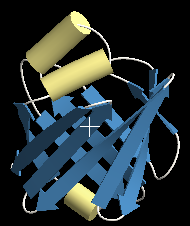{ .on-glb }
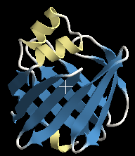{ .on-glb }

## Properties

For the common properties, see [Common Renderer properties](common.md).
The meaning of the cross-section settings (Section type / Section width / Tuber / Sharpness) is the same as in
[ribbon](ribbon.md#helix).

### Cartoon

Axial detail
:   Number of polygon subdivisions along the chain

Smooth color
:   Whether to color the transition between adjacent residues as a gradient

Pivot atom name
:   Name of the atom that the backbone display passes through (default: CA)

Start cap / End cap
:   Shape of the ends (sphere / flat / none)

Anchor selection
:   [Selection expression](../selection.md) for residues that should pass through their Cα as closely as possible.
    When you show side chains on a cartoon display, the backbone display does not pass through the Cα positions,
    so the side chains appear to float in the air. This setting helps in that case. 
    The figures below show the case where Coil Smoothing = -1 (default) and the residue `A.76.*` at the tip of a loop
    is specified in Anchor selection 
    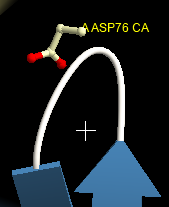{ .on-glb }
    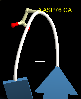{ .on-glb } 
    It works well for about one residue in a loop or sheet, but with many residues it ends up the same as
    lowering Smoothing, so to make the display pass through many Cα atoms it is better to adjust
    Smoothing

Anchor weight
:   Strength with which the residues specified in Anchor selection are pulled toward their Cα

### Helix

Smoothing
:   Specifies the smoothness of the helix cylinder as a real number. The default is 3.0, which is fairly straight.

    - Decreasing it brings the cylinder closer to a helix that follows the Cα atoms
    - Increasing it makes the cylinder almost straight

    The figures below show 1.0, 2.0, and 4.0 from the left 
    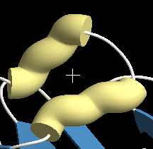{ .on-glb }
    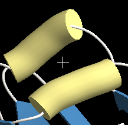{ .on-glb }
    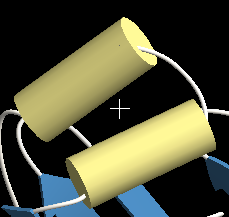{ .on-glb } 
    At 4 and above the cylinder is almost straight and there is little difference. At 1 and below it takes on
    a twisted, wrung-out shape. Negative and fractional values can also be specified, but the reasonable range is about 2 to 4

Width mode
:   By default the cylinder has a constant thickness equal to the average.
    If you switch this, the thickness varies according to how far the Cα atoms deviate
    from the center line of the cylinder

Width smooth
:   Effective only when Width mode is set to variable; specifies the smoothness of the cylinder thickness.
    The larger the value, the smoother it is. The default is 5.0, which is
    almost the same as a constant thickness; lowering it makes the thickness variation appear. 
    The figures below show 0.0, 1.0, and 2.0 (the others are fixed at variable width, Smoothing = 3.0) 
    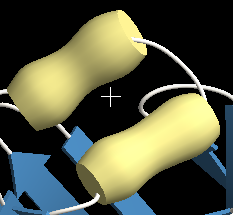{ .on-glb }
    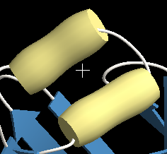{ .on-glb }
    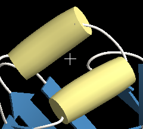{ .on-glb } 
    The appearance also changes considerably with the value of Smoothing

Add width
:   Depending on the structure, the coil may stick out at the junction between a helix cylinder and a coil.
    Increasing this value enlarges the cylinder radius by that amount,
    so you can adjust it to hide the coil. 
    The figures below show 0.0 and 0.5 
    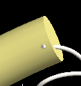{ .on-glb }
    { .on-glb } 
    The default is the same as the coil thickness of 0.2, which hides it in most cases.
    You can also deliberately specify a negative value to get a thin cylinder display

Extend
:   Amount by which the helix segment is extended forward and backward

### Sheet

Smoothing
:   Smoothness of the sheet display. The default is 3.0, a setting that captures the curvature of the sheet
    while making it reasonably straight. 
    The figures below show -5.0, 0.0, and 3.0. At -2 and below it passes roughly through the Cα atoms, and
    at 3 and above it becomes almost straight 
    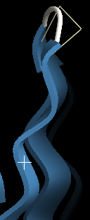{ .on-glb }
    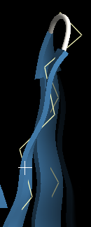{ .on-glb }
    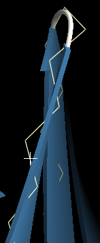{ .on-glb }

Width smooth
:   Smoothness of the change in sheet width

### Coil

Smoothing
:   Smoothness of the coil display. The default is -1.0, a setting that captures the curvature of the coil
    while giving a clean appearance. 
    The figures below show -5.0, -2.0, -1.0, and 0.0. At -2 and below it passes roughly through the Cα atoms, and
    at 0 and above it may deviate too far from the actual Cα positions 
    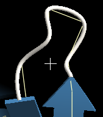{ .on-glb }
    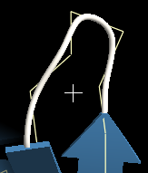{ .on-glb }
    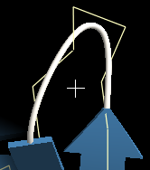{ .on-glb }
    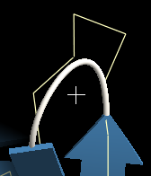{ .on-glb }

## Limitations

- If you display only part of a secondary structure element with a selection expression, it may not be drawn as intended.
  When showing a partial display, adjust the selection so that it breaks at a coil segment.

!!! note "About detailed cross-section settings"
    Some properties of the cross-section (TubeSection) and the junction (JctTable) are edited
    not on the Properties tab but on the **Generic** tab
    (→ [Property inspector](../../ui/inspector.md)).

## See also

- [Renderer list](index.md)
- [ribbon](ribbon.md) — the classic ribbon display that passes through the Cα atoms
- [Material](material.md) / [Edge lines](edge-lines.md)

---

*Last checked: 2026-08-11 / Verified against: development build (tritium)*
