<!-- source: ja/reference/renderers/disorder.md @ e4bd8cd -->

# disorder

A Renderer that displays the backbone of disordered regions in proteins and nucleic acids.
Target Object: molecule (MolCoord).

Parts of a crystal structure that are invisible because of disorder can be shown as a dotted line (Bezier curve) that connects smoothly to a backbone display such as [ribbon](ribbon.md).

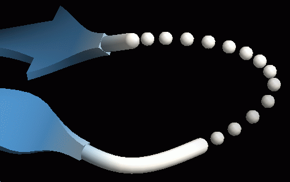{ width="320" .on-glb }

!!! note "Can be created only after the Object is in the scene"
    disorder does not work on its own; it needs a backbone Renderer to target.
    For this reason, it is not listed among the Renderer types shown when opening a file.
    It can be created from the New Renderer dialog, in which case the first of the
    tube / ribbon / cartoon / nucl Renderers in the scene is set as the Target.

## Detecting disordered regions

If residue numbers are not consecutive within the same chain (so that the backbone display of ribbon or similar is broken), the gap is judged to be disordered and becomes a target of the dotted display. If the chain differs before and after the gap, nothing is displayed.

## Color

Colors are set in the [Color panel](../coloring.md), as with other Renderers.
The dotted line is colored with the colors of the residues at both ends of the disordered region; if the two ends differ in color, the line forms a gradient between them.

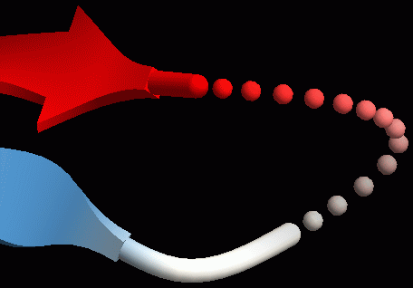{ width="320" .on-glb }

## Properties

For the common properties, see [Common Renderer properties](common.md).

The displayed part can be restricted with a selection expression (`sel`). By default it is `*`, which targets all disordered regions in the molecule. If it is changed to, for example, `A.1:100.*`, only the disordered regions within residues 1 to 100 of chain A are targeted.
This can be used to attach several disorder Renderers to one molecule and change the shape of the dotted line for each. The figure below is an example in which separate Renderers were created for the right and left disordered regions, with different dot sizes and spacing.

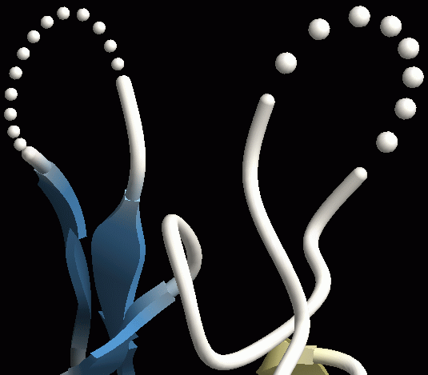{ width="320" .on-glb }

As with other Renderers, an outline can be drawn with [edge lines](edge-lines.md), and the [material](material.md) can be changed to nolighting (flat fill).

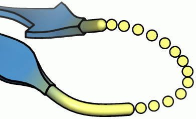{ width="320" .on-glb }

### Disorder

Target
:   The Renderer on which the dotted line of the disordered region is displayed. At creation, it is chosen automatically from the Renderers that exist at that time, such as ribbon / cartoon / nucl.
    If an unintended Target has been chosen, change it here

Detail
:   Polygon subdivision level of the dots (spheres) of the dotted line. Larger values give a finer, smoother result

Dot size
:   Size of the dots (spheres) of the dotted line. The default is 0.3. In the figure below, the left is 0.1 and the right is 0.5 
    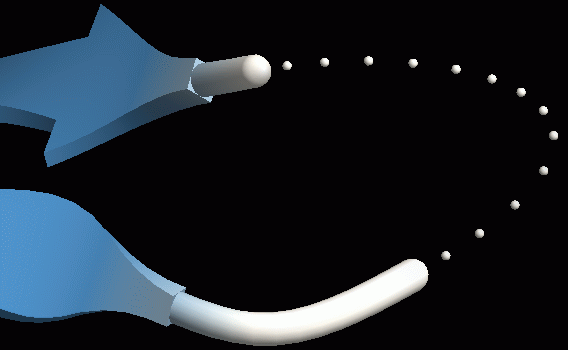{ width="200" .on-glb }
    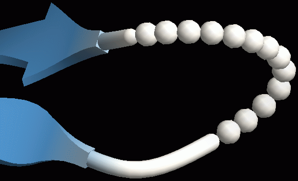{ width="200" .on-glb }

Dot separation
:   Spacing of the dotted line. In the figure below, the left is 0.6 and the right is 1.8 
    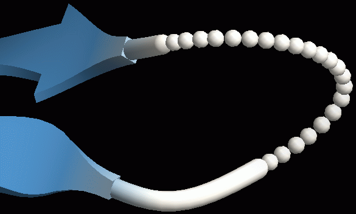{ width="200" .on-glb }
    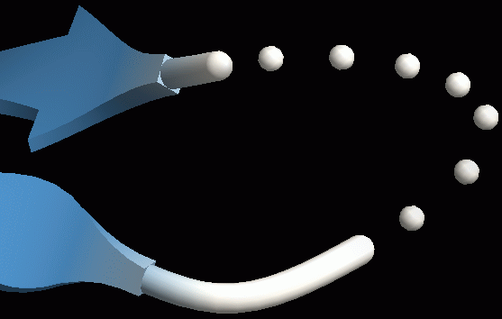{ width="200" .on-glb }

Loop size
:   How the disordered part connects to the backbone. A larger value gives a smoother, more protruding shape (it affects the positions of the Bezier curve control points). The default is 2.0.
    In the figure below, the left is 1.0 and the right is 6.0 
    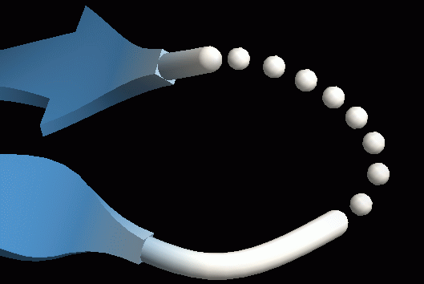{ width="200" .on-glb }
    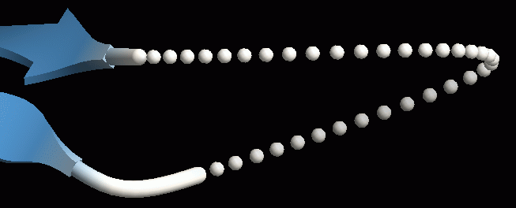{ width="200" .on-glb }

Loop size 2
:   How the disordered part connects to the C-terminal side of the backbone (for proteins).
    The default is -1, in which case the Loop size value is used for both the N-terminus and the C-terminus.
    If a value of 0 or more is given, Loop size sets the smoothness of the connection on the N-terminal side and Loop size 2 on the C-terminal side. 
    The figure below shows Loop size = 0.5 and Loop size 2 = 4. On the N-terminal side (the near β-sheet), the value is very small, so the connection is discontinuous, as if bent; on the C-terminal side (the far β-sheet), the value is large, so the connection is smooth 
    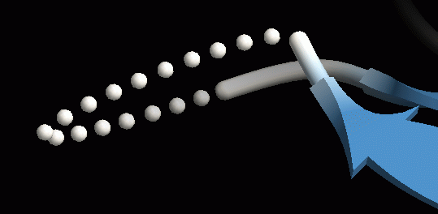{ width="320" .on-glb }

Color
:   Default color

## See also

- [Renderer list](index.md)
- [ribbon](ribbon.md) / [cartoon](cartoon.md) / [nucl](nucl.md): backbone Renderers that can be the Target
- [Material](material.md) / [Edge lines](edge-lines.md)

---

*Verified against: CueMol3 2.3.12.517*
