<!-- source: ja/reference/renderers/edge-lines.md @ e4bd8cd -->

# Edge lines

Edge lines draw lines (edge lines) along the outlines of rendered objects.
This is a common property of all Renderers, set in the **Common**
section of the property inspector. However, this setting is not shown for Renderers
that have no faces and therefore no outline to draw
(simple / trace / spline / contour / gpu_mapmesh, selection highlights, unit cells,
[namelabel](namelabel.md)).

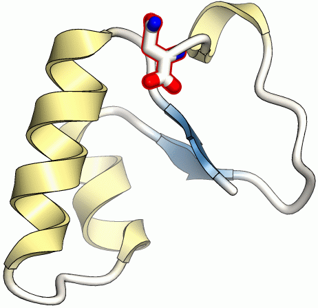{ width="280" .on-glb }
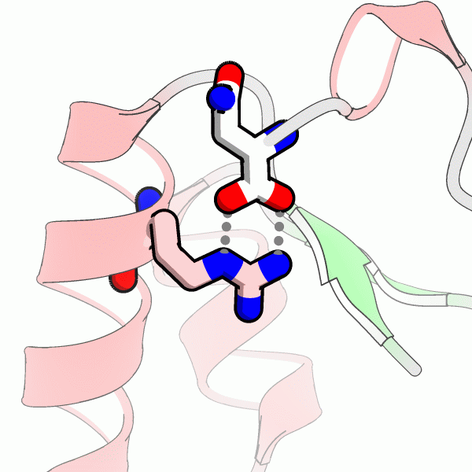{ width="280" .on-glb }

!!! note "Also shown in the molecular view"
    Edge lines are drawn in **both** the molecular view (real-time display) and the
    [rendering](../rendering.md) result.
    The two use different drawing methods, but they are tuned to look as similar as possible.
    Details do not match exactly, so check the rendering result for the final appearance.

## Properties

### Edge type

None
:   No edge lines (default)

Edges
:   Draws edge lines

Silhouette
:   Draws silhouette lines. Lines are drawn only along the outline

The lines for each setting look as follows.

- Edges (0.06 Å) 
  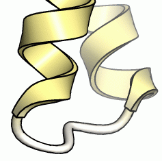{ .on-glb }
- Silhouette (0.03 Å) 
  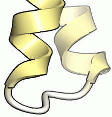{ .on-glb }

### Width

Specifies the line width in **Å**. Because the unit is not pixels,
lines get thicker accordingly when the image size is increased at rendering time.

Commonly used widths are as follows.

| Width | Value | Example |
|---|---|---|
| Normal | 0.06 Å | { width="160" .on-glb } |
| Thick | 0.15 Å | 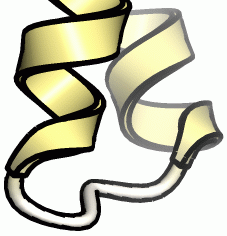{ width="160" .on-glb } |
| Thin | 0.03 Å | 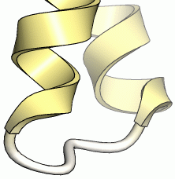{ width="160" .on-glb } |

### Color

Specifies the line color. Black is usually used,
but any color can be specified, such as white lines on a black background.

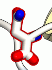{ .on-glb }
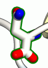{ .on-glb }
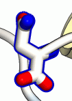{ .on-glb }

## Edge line accuracy and the detail value

How accurately edge lines are extracted and drawn depends largely on the Renderer's
polygon subdivision (the detail value). The figures below use a line width of 0.1 Å and show,
from left to right, the [ballstick](ballstick.md) detail value increased to 2, 5, 10 and 20.

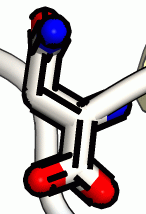{ .on-glb }
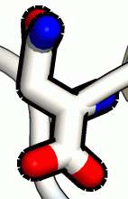{ .on-glb }
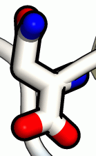{ .on-glb }
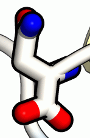{ .on-glb }

The larger the detail value, the smoother and more continuous the lines. With a small detail value,
lines tend to be broken, and this is more noticeable the thicker the line is.
When making lines thicker, also increase the detail value.

The default detail value of ballstick is 5, but the example above shows that
with a line width of 0.1 Å, a value of 10 or more is preferable.

## Setting by style

Edge line settings are also provided as styles,
and can be applied together from the right-click menu of the scene tree
(→ [Styles](../styles.md)).

<!-- TODO(verify): whether the tritium style list still has the equivalent of Edge line
     (normal/thick/thin). Check default_style.xml and write the actual names -->

## See also

- [Common Renderer properties](common.md)
- [Material](material.md)
- [Rendering](../rendering.md) — backend and quality settings
- [Rendering window](../../ui/rendering-window.md)

---

*Verified against: CueMol3 2.3.21.544*
