<!-- source: ja/reference/renderers/material.md @ d6bebaf -->

# Material

Separately from color, you can specify a **material** (surface finish) for the 3D objects drawn by a Renderer.
It is a common property of all Renderers, and is set in the **Basic settings**
section of the property inspector.

!!! note "Reflected in both the molecular view and the rendering window"
    The material is reflected both in the molecular view (real-time WebGL display) and in the images
    exported from the rendering window. However, some materials (see the table below) and
    [per-color specifications](#per-color) are reflected only in the rendering window.

## Material types

The following materials are available. **The specified color is reflected in every material.**

| Name | Appearance | Molecular view |
|---|---|---|
| `default` | The default finish. Matte plastic, the same as `matte_plastic` | Reflected |
| `matte_plastic` | Matte plastic. Weak, broad highlights | Reflected |
| `plastic` | Polished plastic. Small white highlights | Reflected |
| `ceramic` | Glazed ceramic. Sharp highlights and a bright sheen at the outline | Reflected |
| `matte` | A matte finish | Reflected |
| `spec_metal` | A metallic finish with very strong shininess | Reflected |
| `diff_metal` | A matte metallic finish | Reflected |
| `metallic_chrome` | Chrome-like metal with sharp reflections | Looks the same as `default` |
| `metallic_copper` | Copper-like metal, somewhat rough | Looks the same as `default` |
| `stone35` | A rough matte finish like stone | Looks the same as `default` |
| `wood31` | A slightly glossy finish like wood | Looks the same as `default` |
| `shadow` | A shadow-like finish with no shininess | Reflected |
| `nolighting` | Flat fill with no shading | Reflected |
| `toon1` / `toon2` | Toon-style shading | Reflected |

`shadow` has no highlights (shininess), so it is suitable for making an object
translucent and overlaying it on other objects.

Metallic materials reflect the surrounding ambient light, so they may look dark
depending on the environment.

If a material name that does not exist is specified, `default` is used.

!!! note "The appearance differs from the POV-Ray backend"
    The finishes in the rendering window in the table above are those of the default rendering backend, **Umbreon**.
    The deprecated POV-Ray backend differs in the following points
    (see [Rendering](../rendering.md)).

    - `stone35` / `wood31` are drawn as stone-grain and wood-grain **patterns**. Umbreon has
      no ability to generate patterns, so they become matte finishes of different roughness.
    - `metallic_chrome` / `metallic_copper` / `stone35` / `wood31` **ignore the
      color specification**.
    - `metallic_chrome` / `metallic_copper` look like plastic instead of metal.

## Comparison of appearance

These figures compare only the material of the molecular surface of 1CRN (dsurface, gray). The left is the molecular view
(with Fast GI ambient occlusion enabled), and the right is an image exported from the rendering window
(Umbreon, Global Illumination). `default` looks the same as `matte_plastic`, so it is
omitted.

### Plastic family

The color (diffuse light) dominates, and highlights shine white. The highlights of `matte_plastic` (`default`) are weak and broad,
those of `plastic` are small and sharp, and those of `ceramic` are sharper still. `ceramic` reflects its surroundings and shines white
on surfaces that lie at a grazing angle to the line of sight (near the outline). In the rendering window, this sheen at the outline
is not as strong as in the molecular view.

| Name | Molecular view | Rendering window (Umbreon) |
|---|---|---|
| `matte_plastic` | 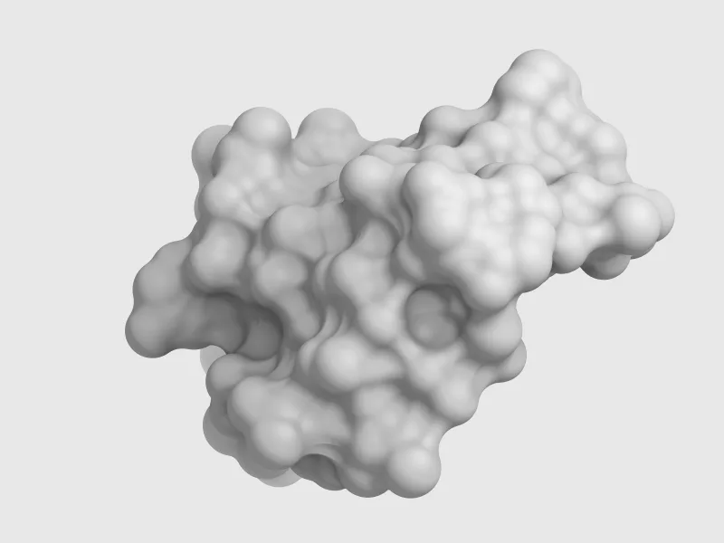{ width="200" .on-glb } | { width="200" .on-glb } |
| `plastic` | { width="200" .on-glb } | 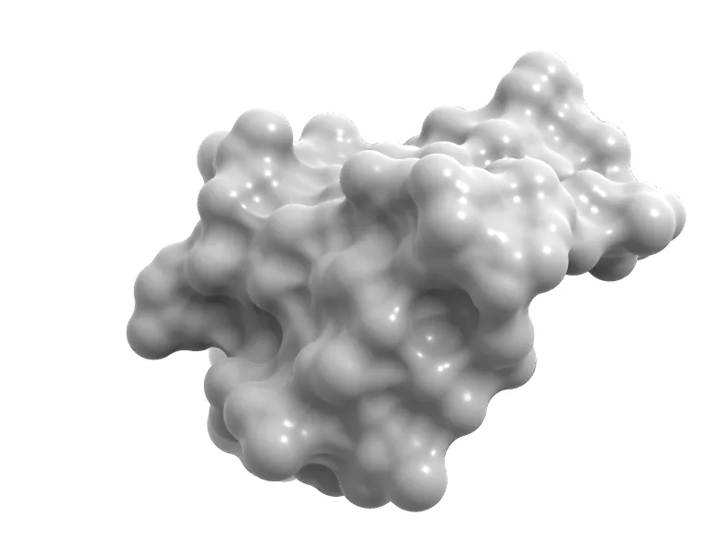{ width="200" .on-glb } |
| `ceramic` | 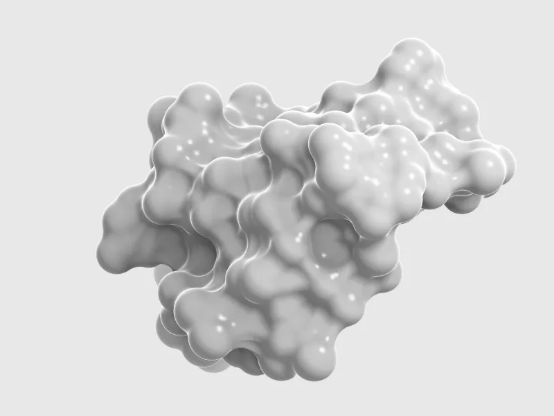{ width="200" .on-glb } | { width="200" .on-glb } |

### Matte

`matte` has no highlights.

| Name | Molecular view | Rendering window (Umbreon) |
|---|---|---|
| `matte` | 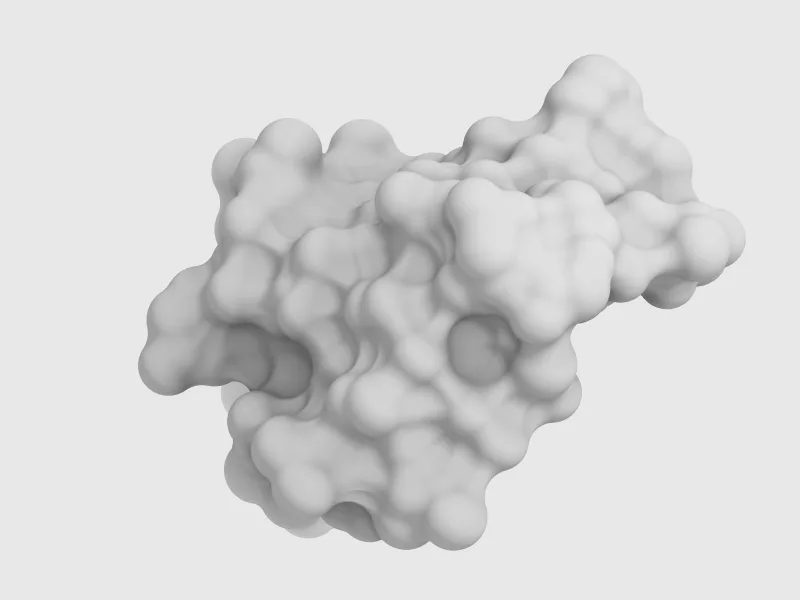{ width="200" .on-glb } | 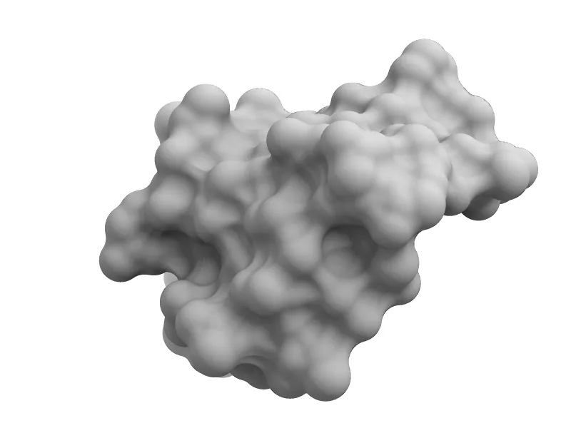{ width="200" .on-glb } |

### Metal family

The base color (diffuse light) is weakened, and strong highlights are added. The highlights of `diff_metal` are broad,
and those of `spec_metal` are strong and sharp. In the molecular view, the highlights take on the base color and reflect a sky gradient
that is bright at the top and dark at the bottom (surrounding molecules are not reflected).

| Name | Molecular view | Rendering window (Umbreon) |
|---|---|---|
| `diff_metal` | { width="200" .on-glb } | 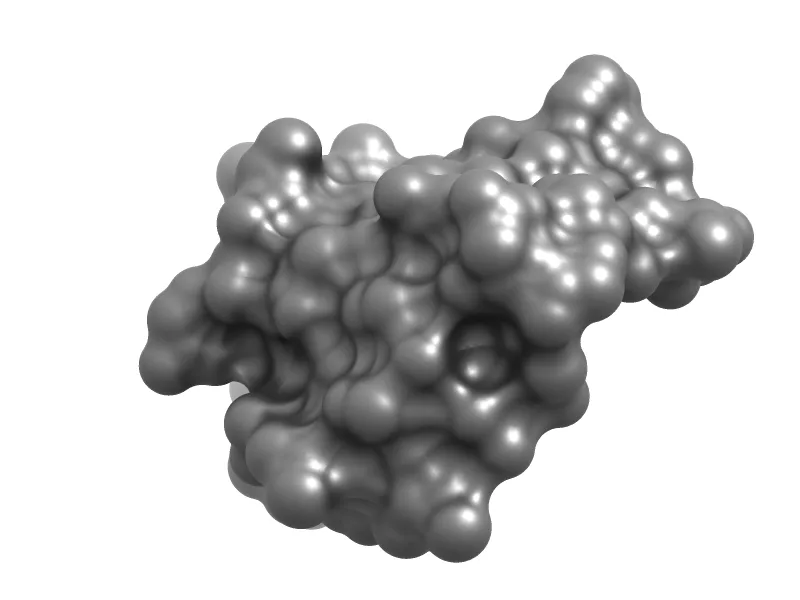{ width="200" .on-glb } |
| `spec_metal` | 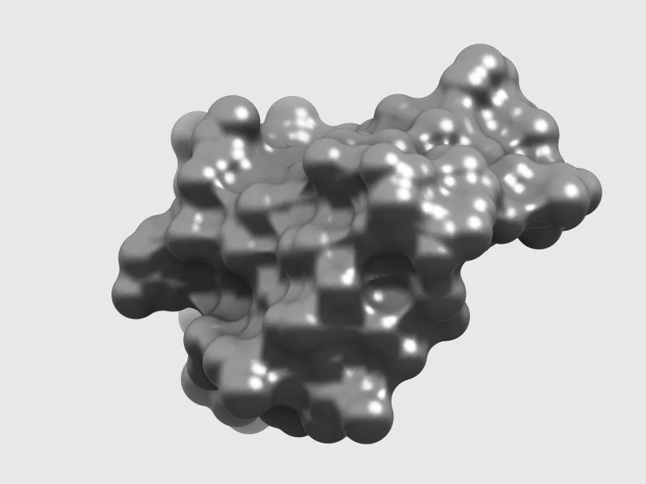{ width="200" .on-glb } | { width="200" .on-glb } |

### Toon

Shading is made into two flat levels of color: the lit side and the opposite side. `toon2` adds a white dot highlight.
In the molecular view, when ambient occlusion is disabled, the appearance is close to the toon style of POV-Ray
(in the molecular view in the figures below, ambient occlusion is disabled). When it is enabled, the two levels are made under
the same light as the other materials, and ambient occlusion is also applied.
In the rendering window (Umbreon), it is darker than in POV-Ray.

| Name | Molecular view | Rendering window (Umbreon) |
|---|---|---|
| `toon1` | 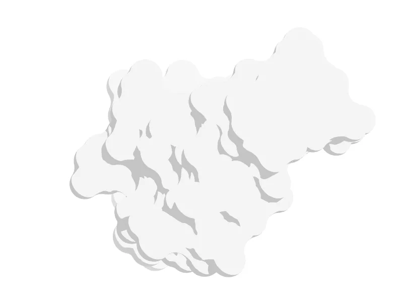{ width="200" .on-glb } | 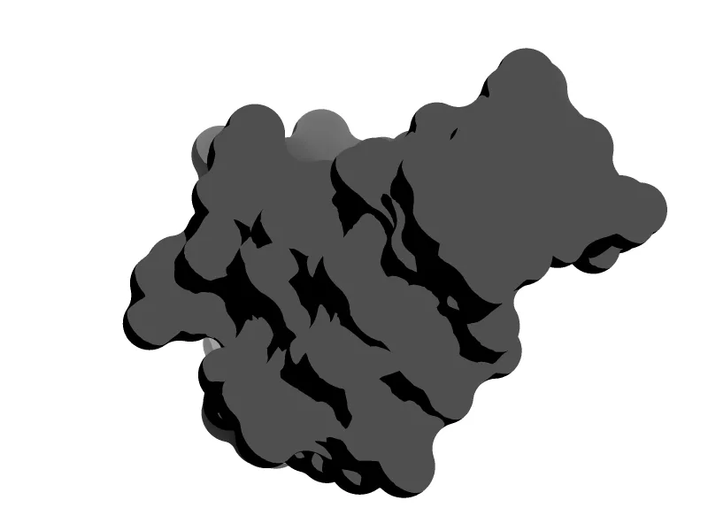{ width="200" .on-glb } |
| `toon2` | 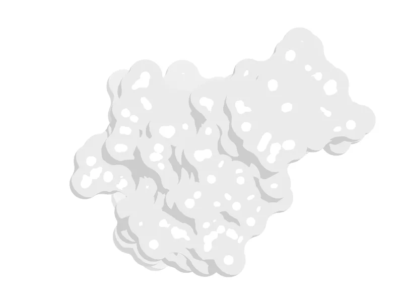{ width="200" .on-glb } | 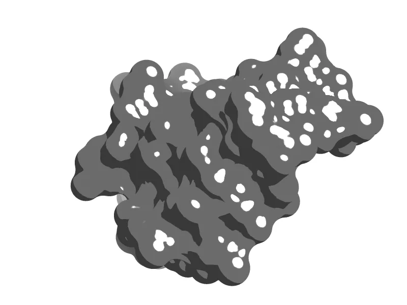{ width="200" .on-glb } |

### No shading

`shadow` is lit only by ambient light, and `nolighting` is a flat fill without shading.
In the molecular view, ambient occlusion is not applied to these two.

| Name | Molecular view | Rendering window (Umbreon) |
|---|---|---|
| `shadow` | 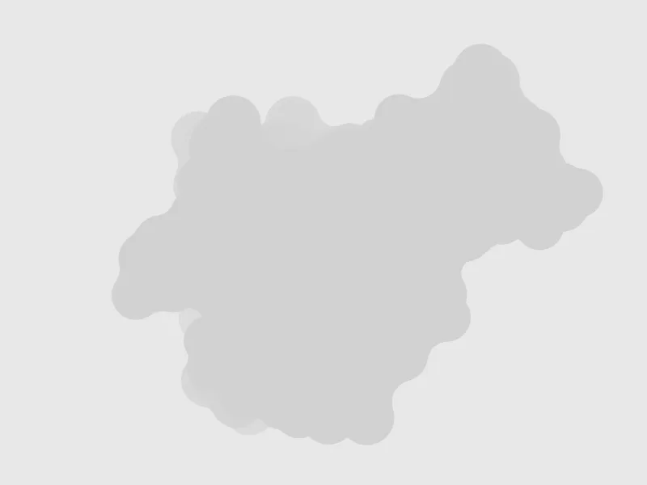{ width="200" .on-glb } | 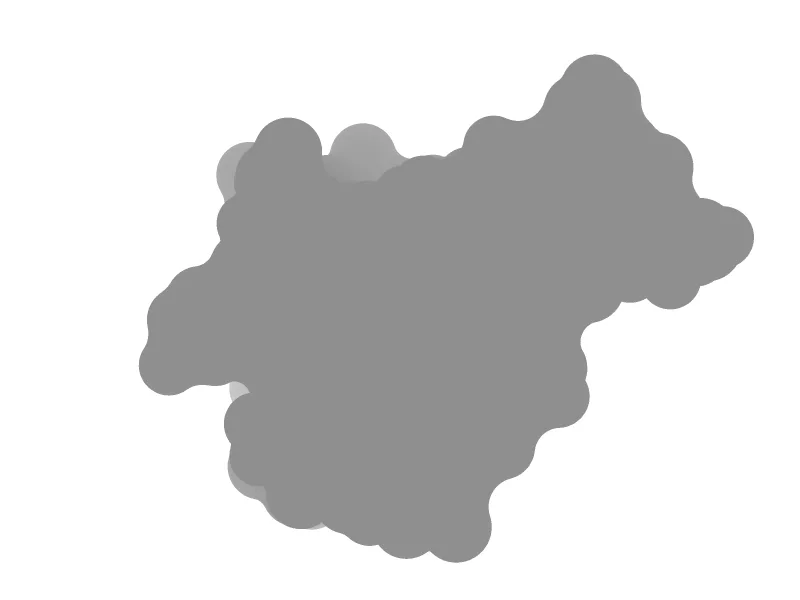{ width="200" .on-glb } |
| `nolighting` | { width="200" .on-glb } | { width="200" .on-glb } |

In the molecular view, bright colors and highlights roll off smoothly toward white instead of clipping to white.
The brightness of the whole scene can be changed with **Lighting &gt; Brightness** of the Scene
(→ [Scene](../scene.md#lighting)).

## How to specify

### For the whole Renderer

Specify it in **Material** in the **Basic settings** section of the property inspector.
It is empty (unspecified) by default, in which case the `default` material is applied.

### Per color

You can specify the material as a [modifier](../color-syntax.md#modifiers) of a color.

```
<color>{material: <material name>}
```

To set the color to yellow and the material to `shadow`, specify as follows
(the three differ only in how the color is written; all are the same pure yellow).

```
yellow{material:shadow}
rgb(1,1,0){material:shadow}
#FF0{material:shadow}
```

If you specify a different material for each Paint row in Coloring,
you can also change the finish for each secondary structure.

Sheet
:   `SteelBlue{material:ceramic}`

Helix
:   `khaki{material:diff_metal}`

Others (`*`)
:   `FloralWhite{material:matte}`

A material cannot be specified on its own, so always specify it together with a color.

Materials specified per color are not reflected in the molecular view (the molecular view is drawn with the material of the
whole Renderer). They are reflected only in images exported from the rendering window.

!!! tip "Fineness of patterns in POV-Ray"
    When you use `wood31` or `stone35` with the POV-Ray backend, the wood-grain and stone patterns are fine,
    so you cannot see them unless you zoom in considerably. Umbreon does not draw the patterns at all.

## See also

- [Common Renderer properties](common.md)
- [Color syntax](../color-syntax.md)
- [Edge lines](edge-lines.md)
- [Rendering](../rendering.md) — backend and quality settings
- [Rendering window](../../ui/rendering-window.md)
- [Scene](../scene.md) — ambient occlusion and brightness

---

*Verified against: CueMol3 3.0.5.576*
