<!-- source: ja/reference/renderers/nucl.md @ e4bd8cd -->

# nucl (nucleic acid)

A Renderer dedicated to nucleic acids such as RNA and DNA. Target Object: molecule (MolCoord).
In addition to a backbone tube display like [tube](tube.md), it can display base residues in
a variety of shapes, such as sticks.

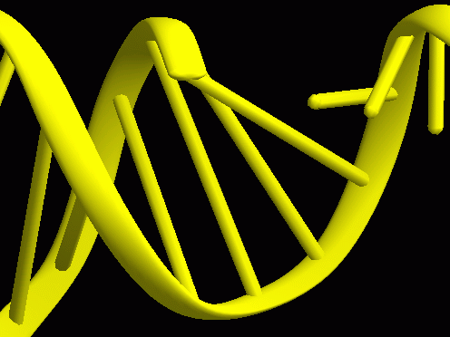{ width="320" .on-glb }

## Properties

For the common properties, see [Common Renderer properties](common.md).

### Nucleic acid

Show tube
:   Whether to display the backbone tube. By turning the tube display OFF and showing the
    backbone with a separate [tube](tube.md) Renderer, you can create more complex displays.
    The left figure below shows Show tube turned OFF, and the right shows an example that
    combines two different backbone displays using a separate tube Renderer 
    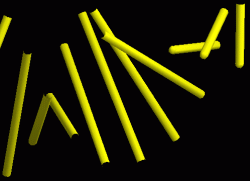{ width="240" .on-glb }
    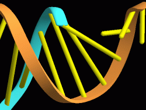{ width="240" .on-glb }

Connect base pair
:   When residues form a base pair, whether to display the two residues with a single stick (ON)
    or with two separate sticks (OFF). The figure below shows the OFF case 
    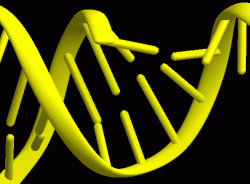{ width="240" .on-glb }

Base type
:   The display shape of the base part.

    **basepair**
    :   Displays residues as sticks (default)

    **simple1**
    :   Displayed as sticks like basepair, but with a shape that bends at the N-glycosidic
        bond between the base and the sugar. The left figure below is Connect base pair = ON, and the right is OFF 
        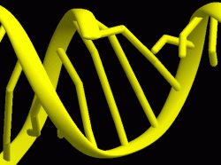{ width="220" .on-glb }
        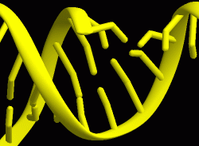{ width="220" .on-glb }

    **detail1**
    :   A mode in which the base part is displayed as a plate (the display does not change depending on base pairing) 
        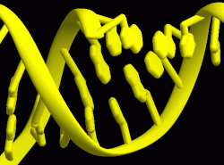{ width="220" .on-glb }
        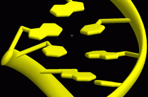{ width="220" .on-glb }

    **detail2**
    :   A mode in which, in addition to detail1, the ribose part is also displayed as a plate 
        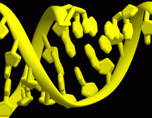{ width="220" .on-glb }
        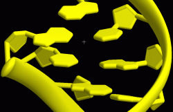{ width="220" .on-glb }

Detail
:   The fineness of the residue display. Larger values give a smoother display, but increase
    the number of polygons and make processing heavier. In ray tracing, it is ignored
    except when [edge lines](edge-lines.md) are used

Base size
:   The size of the residue display. Specifies the radius of the cylinders of the stick-like parts, in Å

Base thick
:   The thickness of the plate-like bases and so on when Base type is detail1 / detail2.
    At 100%, the plate thickness equals the stick thickness; for example, at 50%
    the plate thickness is halved (the figure below is for detail2) 
    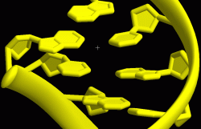{ width="240" .on-glb }

### Tube / Section / Putty

The backbone display is the same as [tube](tube.md), so the settings are also shared with it.
Only the items that are often changed in nucl are shown here.

Pivot atom name
:   The name of the atom the tube passes through. The default is P (the phosphorus atom of the
    backbone phosphate), but with this the tube tends to swing too wide of the actual residues.
    In some cases, changing it to C5' (the 5' carbon of the ribose) or similar gives a better
    appearance (especially depending on Base type) 
    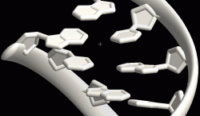{ width="280" .on-glb }

## Base pair detection

When a PDB file is loaded, the structure is checked, and if two residues are judged to form
a Watson-Crick base pair, they are automatically marked as forming a base pair.
The judgment takes into account the hydrogen bond distance and the planarity of the two bases.

The nucl Renderer displays base pairs only for those judged to form base pairs at load time.
You cannot manually force specified residues to form a base pair, or delete a base pair.

## See also

- [Renderer list](index.md)
- [tube](tube.md) — Settings for the backbone tube display
- [Material](material.md) / [Edge lines](edge-lines.md)

---

*Last checked: 2026-08-11 / Verified against: development build (tritium)*
