<!-- source: ja/reference/renderers/ribbon.md @ e4bd8cd -->

# ribbon

A Renderer that draws the backbone of a protein or polypeptide as a ribbon along a spline curve.
Target Object: molecule (MolCoord).

- Helices are drawn as ribbons
- Sheets are drawn as flat plates
- Coils are drawn as tubes

For the ribbon to be drawn correctly, secondary structure must be assigned to the protein molecule.
Secondary structure is normally assigned automatically when a file is loaded.
To reassign it manually, use **Reassign secondary str...** in the Tools menu
(see [Assigning secondary structure](../tools/secondary-structure.md)).

If you create a ribbon for a chain polymer other than a protein, such as RNA or DNA,
it is simply drawn as a tube, the same as [tube](tube.md).

## Preset styles

Commonly used ribbon settings are provided as styles.
Right-click the Renderer in the scene tree and choose a style from the list to apply it
(see [Styles](../styles.md)).

Default
:   The default ribbon display. Coils are thick tubes; helices and sheets are plate-like ribbons with a rectangular cross-section (figure below, left)

Fancy1
:   A Molscript-style ribbon display. The inside of helices and the sides of sheets are colored whitish,
    and the cross-section of helices is dumbbell-shaped (figure below, center)

Round
:   Coils are thin tubes; helices and sheets are rounded ribbons with an elliptical cross-section (figure below, right)

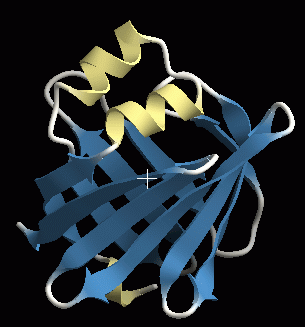{ width="240" .on-glb }
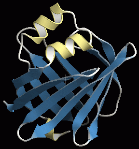{ width="240" .on-glb }
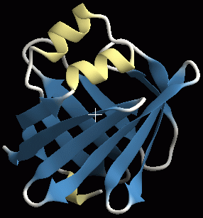{ width="240" .on-glb }

## Properties

For the common properties (name, visibility, material, edge lines, etc.), see
[Common Renderer properties](common.md).

### Ribbon

Section detail
:   Number of polygon divisions in the cross-section direction. The larger the value, the finer the
    division and the smoother the display, but the slower the rendering

Axial detail
:   Number of polygon divisions along the chain. The larger the value, the finer the
    division and the smoother the display, but the slower the rendering

Smooth color
:   When the colors of adjacent residues differ, ON makes the coloring between residues a gradient (figure below, left),
    and OFF makes the color change at the midpoint (figure below, right) 
    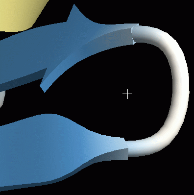{ width="240" .on-glb }
    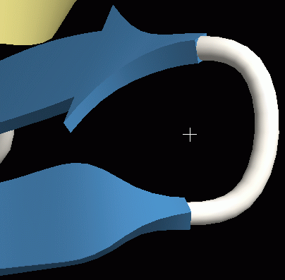{ width="240" .on-glb }

Pivot atom name
:   Name of the atom that the ribbon or tube passes through. For proteins it defaults to CA (Cα carbon atom),
    and normally you do not need to change it

Cap type
:   Shape of the ends. **sphere** gives a spherical end (figure below, left), **flat** gives a flat end (figure below, center),
    and with **none** no polygons are generated at the ends, so they look open (figure below, right) 
    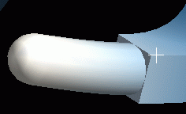{ width="200" .on-glb }
    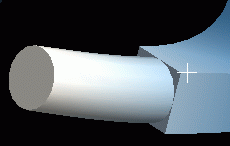{ width="200" .on-glb }
    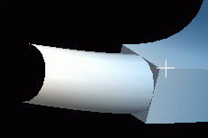{ width="200" .on-glb }

Segment-end fade out
:   Whether to fade out the ends of segments

### Helix

Settings for the cross-section shape of helices and for the connection shape at the start (Tail) and end (Head).

Section type
:   Cross-section shape. From the left in the figure below: **Elliptical** (ellipse), **Rectangle** (rectangle),
    **Round rectangle** (rectangle without corners), **Fancy** (dumbbell) 
    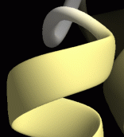{ .on-glb }
    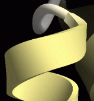{ .on-glb }
    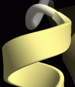{ .on-glb }
    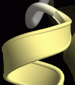{ .on-glb }

Back color
:   Color of the inside of the helix. When OFF, the inside and outside have the same color. The default is OFF 
    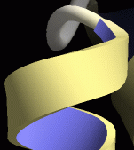{ .on-glb }

Width
:   Thickness of the helix. The unit is Å

Tuber
:   Width of the helix, specified as a multiple of Width

Sharpness
:   The meaning depends on Section type. 
    For **Round rectangle**, it is how much the corners of the rectangle are rounded off. At 1 the shape is almost angular,
    and the closer to 0, the rounder the shape. 
    For **Fancy**, it is the size of the circles at both ends of the dumbbell. A value close to 0 makes the section thinner
    with a pronounced edge (figure below, left, value = 0); closer to 0.5 gives a shape close to Round rectangle
    (figure below, center, value = 0.5); above 0.5 gives a shape like the figure below, right (value = 0.75) 
    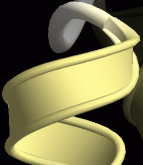{ .on-glb }
    { .on-glb }
    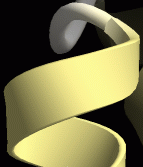{ .on-glb }

Smoothness
:   At 0 the helix is a curve passing through the position of the pivot atom (Cα atom by default);
    at lower values it becomes a smooth curve that does not pass through the pivot atom

Head type / Tail type
:   Shape of the end (Head) and start (Tail) of the helix.
    **Round** (smooth connection, figure below, left), **Flat** (discontinuous, figure below, center),
    **Arrow** (arrow-shaped, figure below, right) 
    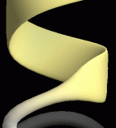{ .on-glb }
    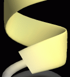{ .on-glb }
    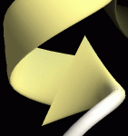{ .on-glb } 
    You will rarely make the end of a helix an arrow. For the arrow settings, see
    [Sheet](#sheet) below

Head power / Tail power
:   Smoothness of the connection. The figure below shows the values 1, 1.5 and 3 with the type set to round
    (for round, values of 1 or less have no effect) 
    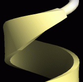{ .on-glb }
    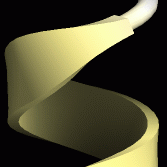{ .on-glb }
    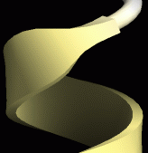{ .on-glb }

Head arrow height / width
:   Effective only when type is arrow. Specifies the height and width of the arrow (see [Sheet](#sheet))

### Sheet

The settings are the same as for helices, and their meanings are also almost the same, so see
[Helix](#helix). Only the settings whose meaning differs for sheets are described below.

Side color
:   For sheets, the color of the **sides**, not the back, changes 
    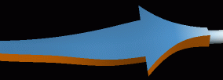{ .on-glb }

Smoothness
:   For sheets, 0 makes the ribbon wave too much, so the default is 0.5 (giving an extended β sheet).
    However, when side chains are displayed, 0.5 makes the side chains look as if they float,
    so it may be better to change it to 0 
    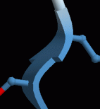{ .on-glb }
    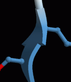{ .on-glb }
    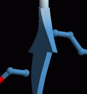{ .on-glb }

Head type = Arrow
:   The tip of the β sheet becomes arrow-shaped (you will rarely make the Tail an arrow).
    In this case Head power affects how sharp the arrow tip is.
    The figure below shows 0.5 on the right, 1 in the center and 2 on the left 
    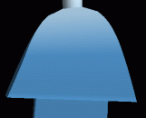{ .on-glb }
    { .on-glb }
    { .on-glb }

Head arrow width
:   Width of the arrowhead. At 100% the arrow is three times as wide as the body of the sheet,
    and at 0% its width equals the body of the sheet (that is, there is no arrowhead)

Head arrow height
:   Height of the arrowhead. Decreasing the value reduces the height of the arrowhead 
    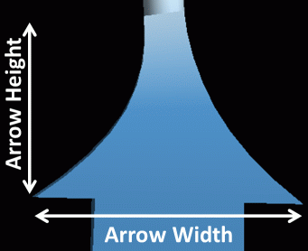{ width="320" .on-glb }

### Coil

Coils have no concept of Head / Tail, so there are only settings for the cross-section shape.
Each setting has the same meaning as the cross-section settings in [Helix](#helix).

## See also

- [Renderer list](index.md)
- [cartoon](cartoon.md) — secondary structure display with cylindrical helices
- [tube](tube.md) — tube display independent of secondary structure
- [Material](material.md) / [Edge lines](edge-lines.md)

---

*Verified against: CueMol3 2.4.0.546*
