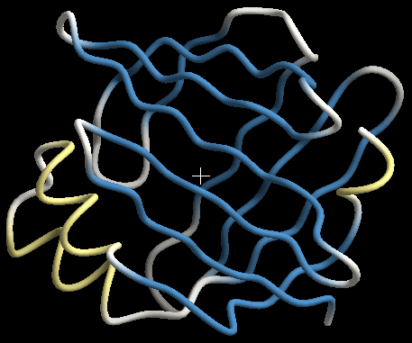
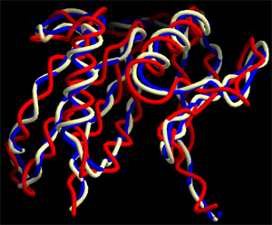
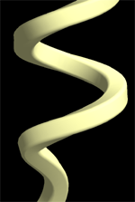
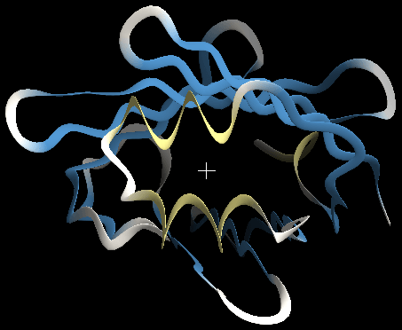
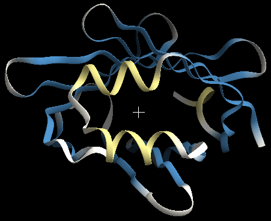
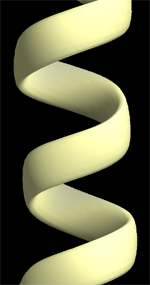
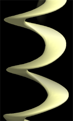
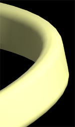
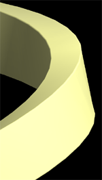
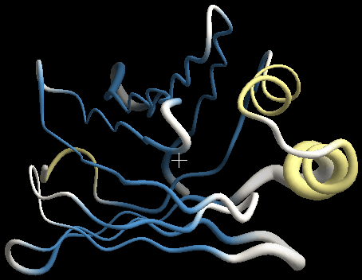

<!-- source: ja/reference/renderers/tube.md @ e4bd8cd -->

# tube

A Renderer that displays the backbone of proteins and nucleic acids as a smooth tube.
Target Object: molecule (MolCoord). The backbone is drawn as a uniform tube regardless of the secondary structure assignment.

{ width="320" .on-glb }

## Properties

For the common properties, see [Common Renderer properties](common.md).

### Tube

Axial detail
:   Number of polygon subdivisions along the chain. Larger values give a smoother tube but slow down rendering

Smoothness
:   At 0, the tube is a curve passing through the positions of the pivot atoms.
    Below that, it is a smooth curve that does not pass through the pivot atoms

Smooth color
:   When the colors of adjacent residues differ, ON makes the coloring between residues a gradient

Pivot atom name
:   Name of the atom the tube passes through. The default for proteins is CA (Cα carbon atom).
    The figure below compares different pivot atoms 
    { .on-glb }

Start / End type
:   Shape of the ends (sphere / flat / none)

### Section

Settings for the cross-section shape of the tube.

Type
:   Shape of the cross section. The default is **elliptical**. The other options are **round_square** (rectangle with rounded corners, left in the figure below) and
    **rectangle** (rectangle with sharp corners, right in the figure below) 
    { .on-glb }
    { .on-glb }

Detail
:   Number of polygon subdivisions around the cross section. Larger values give a smoother surface but increase the load
    (minimum 2). If the rendered image looks angular, increasing this
    together with Axial detail fixes it

Width1, Width2
:   Thickness of the tube in Å. Width1 is the radius in the horizontal direction and Width2 is the radius in the vertical direction. 
    Left: Width1 (0.5 Å) > Width2 (0.1 Å). Right: Width1 (0.1 Å) < Width2 (0.5 Å)
    (Type is elliptical) 
    { width="240" .on-glb }
    { width="240" .on-glb }

Tuber
:   Flatness of the tube. Specifies the ratio of the thickness in the normal direction to that in the binormal direction.
    A value other than 1 gives a tube with an elliptical cross section. 
    Left in the figure below: tuber = 3 (width = 0.35). Right: tuber = 0.3 (width = 1.16).
    Cases that use tuber < 1 are rare 
    { .on-glb }
    { .on-glb }

Sharpness
:   Effective only when Type is round_square. Specifies how rounded the corners are.
    At 1, the shape is as angular as rectangle; close to 0, it approaches elliptical.
    In the figure below, left is 0.1 and right is 0.9 
    { .on-glb }
    { .on-glb }

### Putty

Putty is a display setting that varies the thickness of the tube according to a parameter such as the B-factor.
At the maximum value of the parameter, the thickness becomes High scale times larger; at the minimum value, it becomes 1/Low scale of the original.
Parts with values in between change continuously (linear interpolation).

{ width="320" .on-glb }

Mode
:   **off** does not use putty (constant thickness). **Linear** and **Scaling** vary the thickness
    according to the parameter specified in Target

Target
:   The parameter that drives the thickness. B-factor or Occupancy can be selected

Low scale
:   Thickness scaling value at the minimum value of the parameter. At the residue with the smallest parameter value,
    the tube thins to 1/Low scale of its thickness. The default is 1/3

High scale
:   Thickness scaling value at the maximum value of the parameter. At the residue with the largest parameter value,
    the tube thickens by a factor of High scale. The default is 3

## See also

- [Renderer list](index.md)
- [nucl](nucl.md) — tube + base display for nucleic acids
- [spline](spline.md) — smoothed backbone display with lines
- [ribbon](ribbon.md) — ribbon display according to secondary structure
- [Material](material.md) / [Edge lines](edge-lines.md)

---

*Last checked: 2026-08-11 / Verified against: development build (tritium)*
