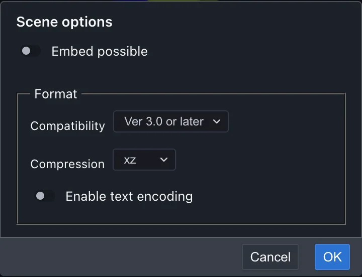

<!-- source: ja/reference/save-scene.md @ f8502b6 -->

# Saving the scene (Save Scene)

Saves the whole scene (Objects, Renderers, colors, cameras, animations, etc.) to a scene file (`.qsc`).

| Menu | Action |
|---|---|
| **File &gt; Save Scene** (++cmd+s++) | Overwrites the file the scene was loaded from (or the file it was last saved to). When there is no target file (a new scene), or that file no longer exists, it behaves like **Save Scene As...**. |
| **File &gt; Save Scene As...** (++cmd+shift+s++) | After the target file is chosen, the save options are set in the **Scene options** dialog and the scene is saved. |

- If the file name does not end with `.qsc`, `.qsc` is added.
- When saving to an existing file, the original file is renamed to `<file name>.bak` and kept before the new file is written.
- Saving changes the scene name to the file name.
- **Saving clears the Undo / Redo history of that scene.**
- Just before saving, the current view is recorded in the `__current` camera. When the scene is opened, it is shown from this view
  (→ [Camera](camera.md#__current)).

## Scene options dialog

{ width="360" .on-glb }

| Item | Default | Description |
|---|---|---|
| **Embed possible** | OFF | Embeds all embeddable data in the scene file (→ [Embedding data](#embedding-data-embed-possible)). |
| **Format &gt; Compatibility** | Ver 3.0 or later | Which versions can open the file (→ [Compatibility](#compatibility)). |
| **Format &gt; Compression** | xz | The compression method for embedded data. Choose from **xz** / **gzip** / **none**. |
| **Format &gt; Enable text encoding** | OFF | Writes embedded data as base64 text. |

Each time the dialog opens, it returns to the defaults in the table above. Pressing **Cancel** does not save.

When overwriting with **File &gt; Save Scene**, the dialog does not appear, and the Compatibility, Compression and
Enable text encoding used when the scene was last saved are used (these values are recorded in the scene file).
Embed possible is not recorded, so it is treated as OFF when overwriting.
When a scene file with no recorded settings is overwritten, embedded data is written in the old format (QDF0) without compression.

## Embedding data (Embed possible)

A scene file can store the data of an Object (molecular coordinates, density maps, molecular surfaces, etc.) in one of two ways:
as a reference to the original file, or embedded in the scene file.

Even when **Embed possible** is OFF, the following Objects are embedded.

- Objects without an original file (such as a molecular surface created in the scene)
- Objects that are already embedded (loaded from a scene saved with embedding)
- Objects changed after loading

Other Objects are saved as references to their original files. If an original file is moved or deleted,
that Object cannot be loaded when the scene is opened. Turning **Embed possible** ON embeds
all Objects, so the scene can be carried around as a single scene file.

Embedded data is written together after the XML of the scene file. **Compression** and
**Enable text encoding** apply only to this embedded data; the XML part is written as is.
In a scene with no data to embed, these two settings do not affect the result.

## Compatibility

| Compatibility | Format of embedded data | Description |
|---|---|---|
| **Ver 3.0 or later** (default) | QDF1 | Writes the CueMol3 look (→ [Scene](scene.md#compatibility)) as a reference to the style file bundled with the app. |
| **Ver 2.3 or later** | QDF1 | Embeds the CueMol3 look in the scene file. |
| **Ver 2.2 or later** | QDF0 | Same as above. Embedded data is written in the old format (QDF0). |

The available settings depend on the format of the embedded data.

QDF1
:   Embeds molecular coordinates in CueMol's own binary format. **Compression** (xz / gzip) and
    **Enable text encoding** can be used.

QDF0
:   A format for old versions of CueMol2. Molecular coordinates are embedded as PDB-format text.
    Compression and text encoding are not supported, so choosing **Ver 2.2 or later** makes
    **Compression** and **Enable text encoding** unavailable, and the scene is saved without compression or encoding.

A scene file saved with **Ver 3.0 or later** cannot be opened by CueMol2 versions earlier than 3.0.3.565.
To open it in an old CueMol2, save it with **Ver 2.3 or later** or an earlier setting.

!!! tip "Compression method and save time"
    xz produces the smallest files, but compression takes time. Embedding a large molecular surface, for example,
    can make saving take more than ten seconds. When time matters more, choose gzip or none.

## See also

- [File menu](../menu/file.md)
- [Scene file (`.qsc`)](qsc-format.md)
- [Scene](scene.md)

---

*Verified against: CueMol3 3.0.3.565*
