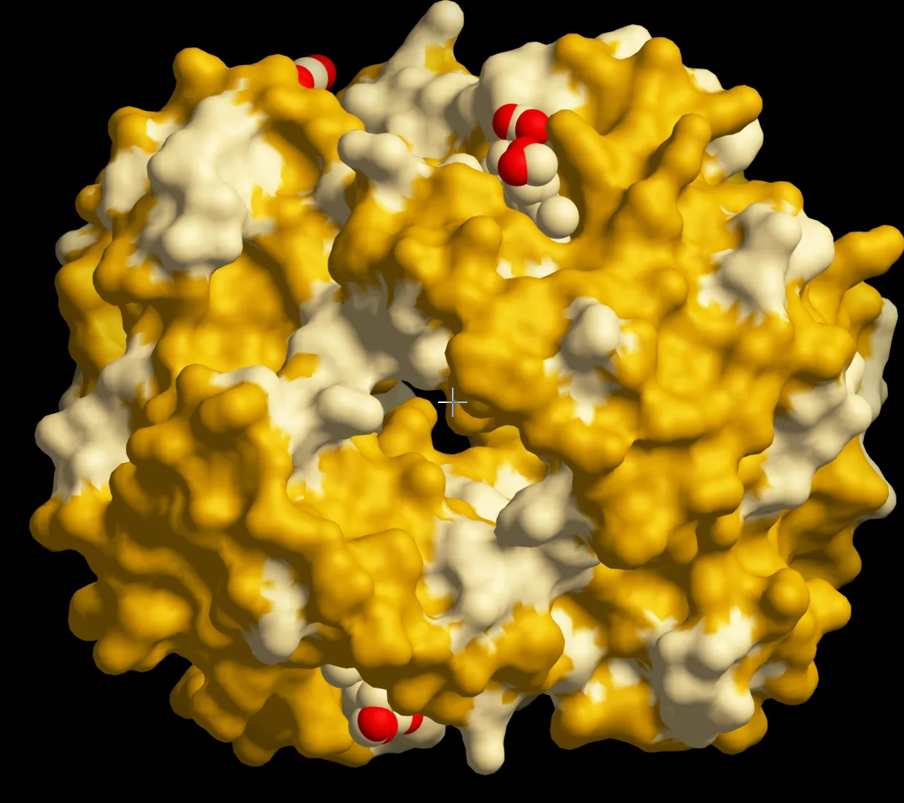
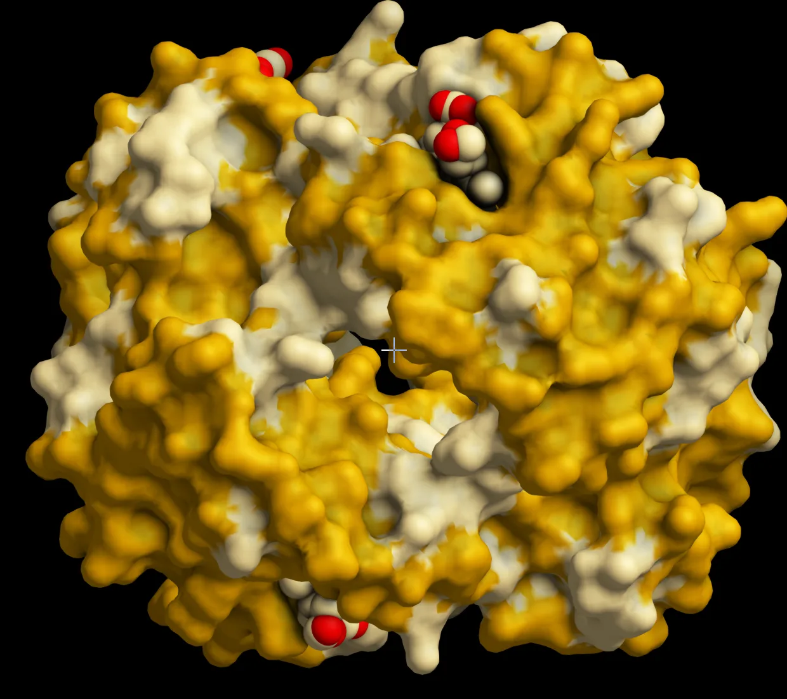
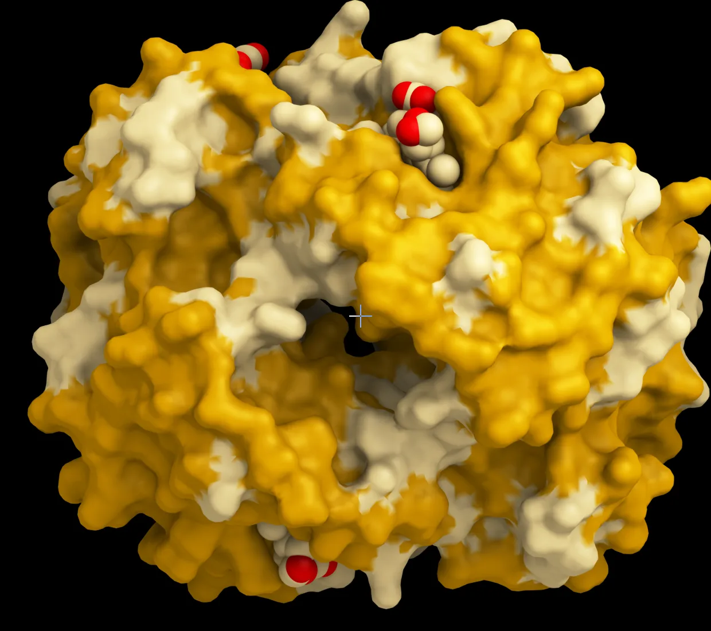

<!-- source: ja/reference/scene.md @ d6bebaf -->

# Scene

A **Scene** is the top-level element of the scene tree. It holds [Objects](objects/index.md),
[Renderers](renderers/index.md), the [camera](camera.md), style sets, and
[animations](animation/index.md).
Display settings that apply to the whole scene are also stored as Scene properties.

One scene is shown per tab. The same scene can also be shown in multiple tabs (views)
(→ New Tab in the [File menu](../menu/file.md)).
The display settings for a new scene (anti-aliasing / ambient occlusion / background color /
color proofing / [Legacy mode](#compatibility)) can be specified under **New Scene** in the New Tab dialog, and the confirmed values
become the defaults for subsequent new scenes. With the factory settings, new scenes are created with
anti-aliasing set to **High** and ambient occlusion **enabled** (Preset **Medium**).
"Default" below means the default value of the property (for anti-aliasing and ambient
occlusion, this rather than the value in the New Tab dialog).

## Opening the properties

Choose **Properties...** from the Scene menu, or select the scene row in the scene tree.
The properties appear in the **Properties** tab of the property inspector
(→ [Property inspector](../ui/inspector.md)).
Changes are applied to the molecular view immediately. Sections are not collapsible; all of them are shown at the same time.

There is no modal dialog as in CueMol2.

## Ambient occlusion

Settings for screen-space ambient occlusion.
It casts shadows into recessed parts of a molecule to emphasize depth.

| No ambient occlusion | GTAO | Fast GI |
|---|---|---|
| { width="200" .on-glb } | { width="200" .on-glb } | { width="200" .on-glb } |

The same molecular surface shown without ambient occlusion, with GTAO, and with Fast GI. With Fast GI,
even the central hole and the large recesses between subunits become dark, and the depth is clearer.

Enabled
:   Enables or disables ambient occlusion. The default is **disabled**.

Method
:   How the shading is computed. Choose from **Fast GI** (default) and **GTAO**. Not selectable while disabled.
    Switching it sets the Preset to **Medium** of that method (this can be undone with a single Undo).

Preset
:   Preset for how the shading is applied. Not selectable while disabled. The contents differ per Method (see below).

Indirect light
:   Shown only for Fast GI. The strength of the light that nearby surfaces bounce into recesses (0 to 2, default 0.5).
    At 0, only the shading remains.

Baked occlusion
:   Shown only for Fast GI. The strength of the darkness in large recesses and between subunits (0 to 1, default 0.8).
    At 0, only the shading computed within the screen remains.

### Fast GI

A method modeled on the feature of the same name in Blender, which applies the shading only to ambient light. It combines the fine shading
computed within the screen with the shading of large recesses baked into a 3 Å grid of the scene. The baking is redone when the shape
or display of the molecules changes, and not when the view is only rotated. For molecular surfaces, CPK and cartoon, it gives a
clearer sense of depth than GTAO.

| Preset | Description |
|---|---|
| Low | Searches a narrow range for shading, with fewer samples. |
| Medium | Intermediate (default) |
| High | Searches a wide range for shading, with more samples. |

With every Preset, the shading is computed at half resolution while the view is moving, and redrawn at full resolution
when the view stops (when zoomed in, it stays at half resolution). Image export always uses full resolution.

### GTAO

The earlier method.

| Preset | Description |
|---|---|
| Low | Shading reaches a short distance, emphasizing fine surface detail (default) |
| Medium | Intermediate |
| High | Shading reaches a long distance, emphasizing the overall shape of the molecule. |

A preset bundles the shading reach, the number of samples, and the intensity into one set.
When the reach is increased, the number of steps is increased so that sampling does not become coarse,
and the intensity is lowered so that wide areas do not become too dark.

**Medium** and **High** are computationally expensive, so they are computed at half resolution
only while the view is being moved, and redrawn at full resolution when the view stops. Image export always uses full resolution.

!!! note "Scenes saved before Fast GI open with GTAO"
    Scene files saved with 3.0.3.565 or earlier open with GTAO and the defaults of that time. Saving them again
    keeps the same appearance.

### Individual adjustments

!!! note "Individual adjustments are in the Generic tab"
    Individual values such as radius, intensity, number of slices, number of steps, and half-resolution rendering
    do not appear in the Properties tab. They can be edited
    in the **Generic** tab of the inspector. When a value is changed in the Generic tab, the Preset display changes to **Custom**.

The items that can be edited in the Generic tab are as follows.

| Property | Default | Description |
|---|---|---|
| `aoEnabled` | false | Enable / disable (same as Enabled in the Properties tab) |
| `aoMethod` | fastgi | Method. `fastgi` / `gtao` (same as Method in the Properties tab) |
| `aoRadius` | 10.0 | Range searched for shading (Fast GI) / radius of the sphere in which shading is computed (GTAO) |
| `aoIntensity` | 2.2 | Contrast. The larger the value, the lighter the shading. Used only by GTAO. |
| `aoSlices` | 8 | Number of horizontal slices. Larger values are smoother but slower |
| `aoSteps` | 8 | Number of samples per slice |
| `aoHalfRes` | true | Computes at half resolution only while the view is moving, and redraws at full resolution when it is still. Export always uses full resolution. |
| `aoBounce` | 0.5 | Strength of the Fast GI bounce light (same as Indirect light in the Properties tab) |
| `aoProbeStrength` | 0.8 | Strength of the baked Fast GI shading (same as Baked occlusion in the Properties tab) |

## Lighting

Brightness
:   Brightness of the whole scene (0.5 to 1.5, default 1.0). The same factor is applied to all light, so only the brightness changes
    while the shading (the sense of depth from ambient occlusion) is preserved.
    It is used whether or not ambient occlusion is enabled.

## Anti-aliasing

Settings for the post-processing that reduces jagged edges in the molecular view.
They can be set independently of ambient occlusion.

Quality
:   Anti-aliasing quality

| Quality | Description |
|---|---|
| Off | No post-processing (direct rendering with hardware MSAA) |
| Standard (FXAA) | Edge smoothing with FXAA (default) |
| High (FXAA + 8x SS) | FXAA plus 8-sample supersampling |
| Ultra (FXAA + 32x SS) | FXAA plus 32-sample supersampling |

!!! tip "Supersampling takes effect once the view is still"
    The supersampling of High / Ultra accumulates samples **only while the view
    is still**. Rendering while the view is moving does not become heavier;
    image quality improves progressively after you stop. Moving the view restarts the accumulation.

The items that can be edited in the Generic tab are as follows.

| Property | Default | Description |
|---|---|---|
| `aa_method` | fxaa | Method. Choose from `none` / `fxaa` / `smaa`. |
| `aaJitterLevel` | 0 | Supersampling level. 0 is disabled; 1 to 5 correspond to 2 / 4 / 8 / 16 / 32 samples |
| `aaSmaaThreshold` | 0.05 | Edge detection threshold for SMAA. The smaller the value, the more edges are processed. |

SMAA is not included in the Quality presets, so to use it, set
`aa_method` to `smaa` in the Generic tab. The Quality display then changes to **Custom**.

## Background

Color
:   Background color. The default is black.

The Scene menu and the right-click menu of the scene tree have a white / black toggle,
but to specify an arbitrary color, set it here (→ [Scene menu](../menu/scene.md)).

## Color proofing

A display that simulates color reproduction in CMYK output. It lets you check on screen how colors will look when printed.

Enabled
:   Enables or disables color proofing. The default is disabled.
    If it is enabled while no ICC profile is set, the default CMYK profile
    is assigned.

Profile
:   ICC profile to use

Intent
:   Rendering intent. Choose from **Perceptual** (default) / **Relative colorimetric** /
    **Saturation** / **Absolute colorimetric**.

The profile and intent settings are retained when proofing is disabled again.

## Compatibility

Switches the look of the scene between the CueMol3 look and the same look as CueMol2 (Legacy mode).

Legacy mode (CueMol2 look)
:   When ON, the scene looks the same as in CueMol2. When OFF (the CueMol3 look),
    ribbons are thinner, nucl bases are smaller, and the nucl backbone tube has a rounded-square cross-section.
    Switching can be undone with a single Undo.

- New scenes are created with the CueMol3 look. Turning ON **Legacy mode (CueMol2 look)** in the New Tab dialog
  or **Legacy mode for new scenes** in Settings &gt; Display &gt; Compatibility
  creates subsequent new scenes in Legacy mode
  (both are the same setting; open scenes do not change).
- Scene files made with CueMol2 open in Legacy mode and look the same as when shown in CueMol2.
- The look is determined by styles, so switching changes the look of existing Renderers immediately as well
  (items whose values were set again per Renderer stay as they are).
- The colors of molecules at load time also follow the look: with the CueMol3 look,
  each molecule gets its own color; in Legacy mode, the four CueMol2 colors (sheet SteelBlue, helix khaki, nucleic
  yellow, everything else FloralWhite) are used. The colors of molecules already painted do not change
  (→ [Coloring](coloring.md#paint)).
- The CueMol3 look is held as the read-only style set `cuemol3_look` of the scene
  (→ [Styles](styles.md)).

## Scene information

The following items are read-only and are shown in the Generic tab.

| Property | Description |
|---|---|
| `name` | Scene name |
| `src` | Path the scene was loaded from |
| `srctype` | Format of the source |
| `basePath` | Directory used as the base for resolving relative paths |

## See also

- [Scene menu](../menu/scene.md)
- [Property inspector](../ui/inspector.md)
- [Object](objects/index.md) / [Renderer](renderers/index.md)
- [Scene file (`.qsc`)](qsc-format.md)

---

*Verified against: CueMol3 3.0.6.577*
