<!-- source: ja/tutorials/animation/animation-movie.md @ 1002eeb -->

# Making an animation and exporting a movie

This tutorial follows the whole process: arranging molecule rotations, camera movements and display switches on a timeline to build an animation, then writing it out as a movie file.
The first half uses the scene (3UG9) finished in [Making a protein ribbon figure](../figures/ribbon-figure.md), and the morphing in the second half uses two structures of transducin-α (1TND / 1TAG).

!!! abstract "About this tutorial"
    - **Subject**: The channelrhodopsin (3UG9) scene, transducin-α (1TND / 1TAG)
    - **What you learn**: Editing the timeline, camera motion, switching the display, morphing, exporting a movie
    - **Prerequisites**: [Making a protein ribbon figure](../figures/ribbon-figure.md) (uses the scene finished there in the first half)

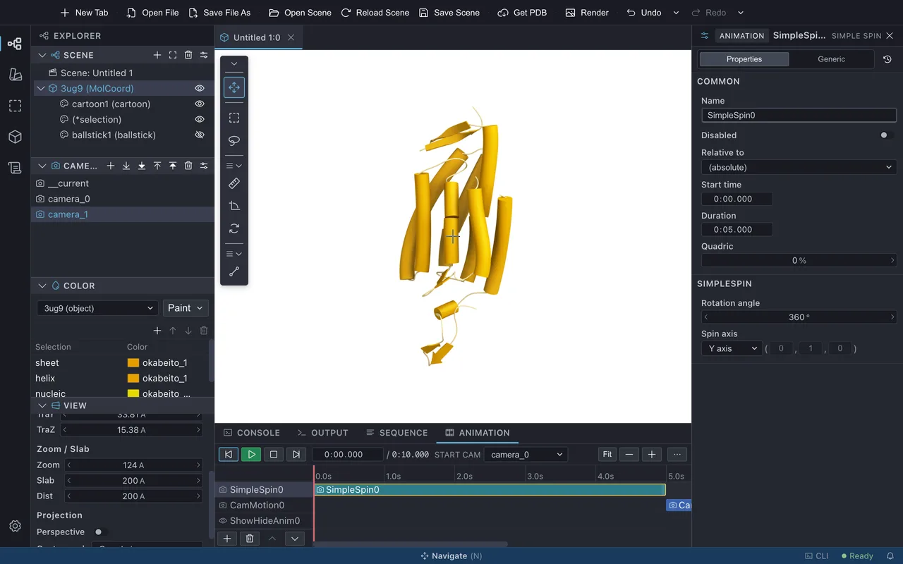{ .on-glb }

## 1. How animation works

An animation is built by placing **animation elements** (rotation, camera movement, display switching, etc.) on a timeline. Each element is shown as a band (strip); the position of the band is the start time and its length is the duration
(→ [Animation](../../reference/animation/index.md)).

## 2. Open the Animation panel

With the 3UG9 scene open, open the **Animation** tab in the bottom panel
(→ [Animation panel](../../ui/bottom-panels/animation.md)).

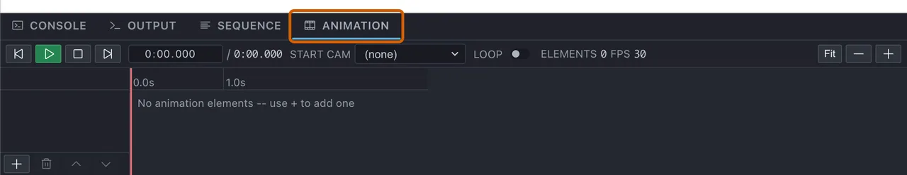{ .on-glb }

## 3. Rotate the molecule

First, create the classic animation in which the molecule keeps spinning in place.

1. Press the **+** button (Add element) at the lower left of the panel and choose **Simple spin** from the menu.

    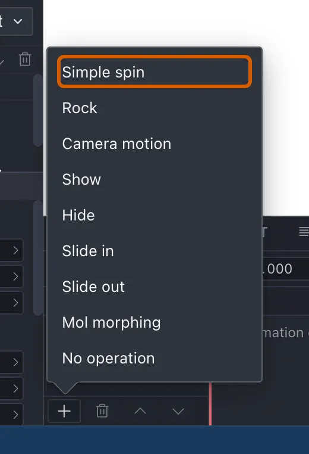{ width="260" .on-glb }

2. A strip is added. Select it and check the inspector on the right.
3. Adjust **Rotation angle** and **Spin axis**. Here, set them to 360° and **Y axis**.
   At 360°, the molecule makes one full turn and returns to its original orientation (→ [SimpleSpin](../../reference/animation/simplespin.md)).
4. Set **Duration** (the time taken for the rotation) in the **Common** section to 5 seconds. In a time field, click and
   press ++enter++ to type a value such as `5s` (→ [Entering times](../../ui/inspector.md#entering-times)).

    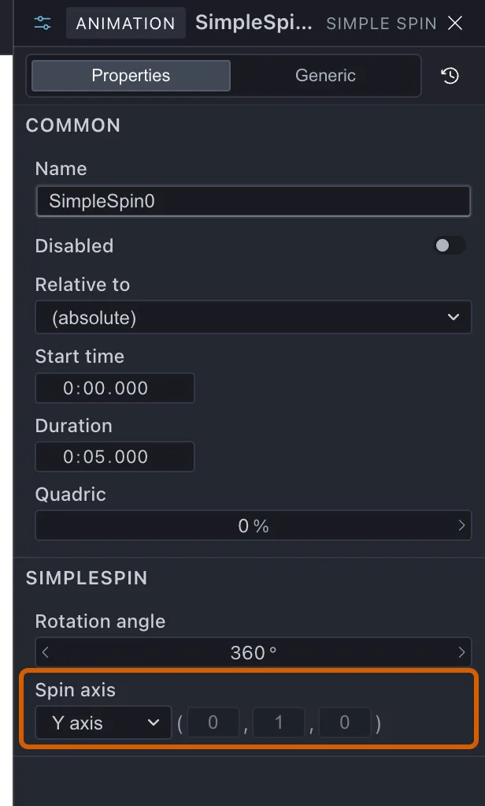{ width="308" .on-glb }

You can also drag the band on the timeline to change its start position, and drag its edge to change its length.

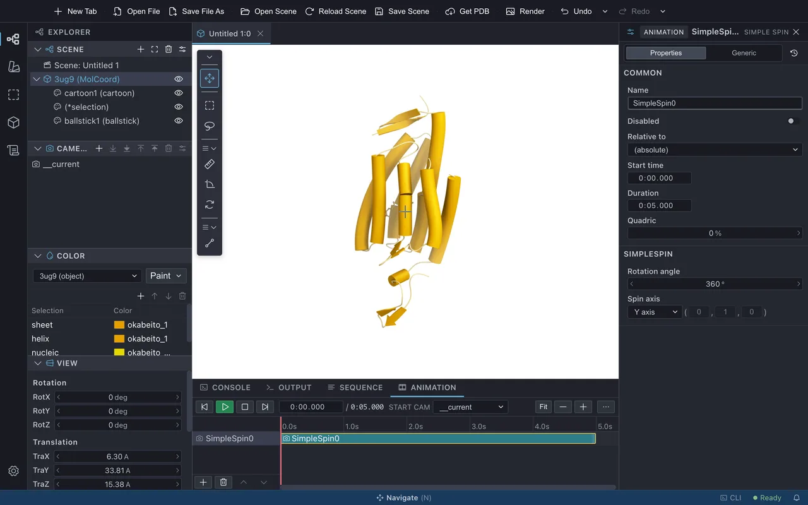{ .on-glb }

## 4. Play it back to check

Press the play button (▷) at the upper left of the panel to play the animation on the molecular view.
You can also check the state at any point in time by dragging the current position on the timeline, or by typing a time into the current time field and pressing ++enter++.

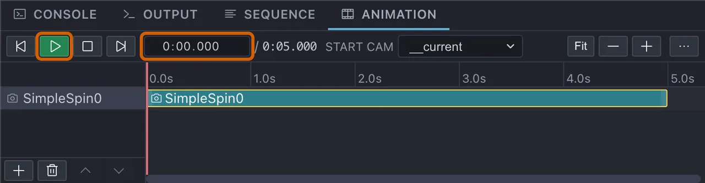{ .on-glb }

## 5. Add a camera motion

The view moves smoothly to a saved camera. This is used for effects such as zooming from the overall view to a region of interest.

1. In a scene with a white background, first widen **Slab** (the depth range displayed) in the **Explorer &gt; View** panel to about
   200 Å so that the back is not washed out white by fog. Cameras save the slab as well.
2. Set the molecular view to the viewpoint you want as the start (here, the whole molecule), and press **New camera from view** (the **+** button) in the **Explorer &gt; Camera** panel of the left side panel to save it (→ [Camera](../../reference/camera.md)).

    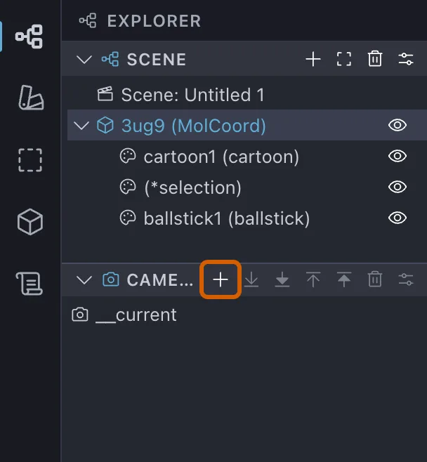{ width="304" .on-glb }

3. In the same way, set the view to the viewpoint you want as the end (here, zoomed in around the retinal) and save another camera.
4. In **Start cam** in the header of the timeline, specify the start camera (`camera_0`).

    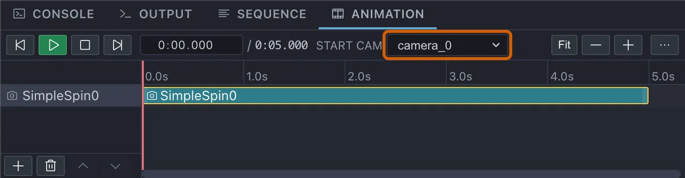{ .on-glb }

5. Choose **Camera motion** from the menu of the **+** button. An added element is placed so that it starts at the end of
   the element before it (Simple spin) (**Relative to** in the inspector).
6. Select the added strip and specify the end camera (`camera_1`) in **Target camera** of the inspector (→ [CamMotion](../../reference/animation/cammotion.md)).
7. Set **Duration** to 3 seconds.

    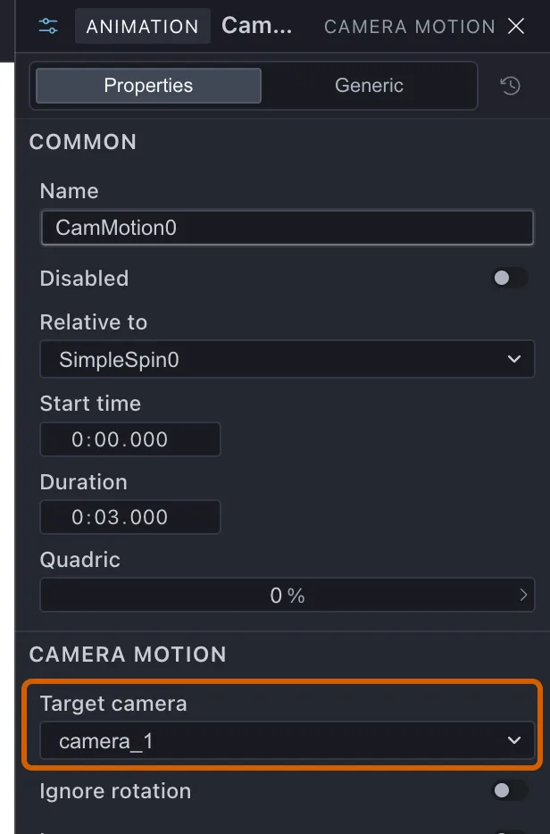{ width="308" .on-glb }

On playback, the view is interpolated from the start camera to the end camera over the span of the strip. If a start camera is specified, the animation always starts from the viewpoint of that camera, regardless of the viewpoint at the time you press play. To add acceleration and deceleration to the viewpoint movement, set the common property **Quadric** (→ [Animation](../../reference/animation/index.md)).

## 6. Add a display switch

This is a display switch such as making the ballstick of a ligand appear partway through.
Show / Hide are animations in which a Renderer gradually **fades in / fades out** over the span of the strip.

1. Choose **Show** (fade in) or **Hide** (fade out) from the menu of the **+** button. Here, choose **Show**.
2. In **Target renderers** of the inspector, check the target Renderer (`3ug9/ballstick1`)
   (→ [Show / Hide](../../reference/animation/showhide.md)).
3. Set **Duration** to 2 seconds.

    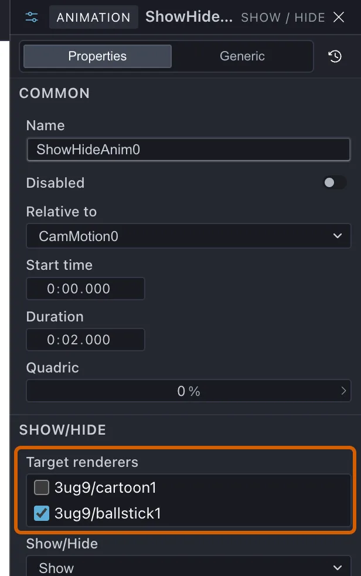{ width="308" .on-glb }

You now have a 10-second animation: the molecule makes one turn (5 s), the view zooms in around the retinal (3 s), and the
retinal ballstick appears (2 s). The target Renderer of Show is not displayed before its strip.

There are also **Slide in / Slide out**, which bring objects in and out with a movement from off-screen
(→ [SlideInOutAnim](../../reference/animation/slideinout.md)). To leave a span with no elements placed, secure the length with the do-nothing **No operation** element.

## 7. Add morphing

Morphing animates a structural change by linearly interpolating the coordinates of corresponding atoms between two structures of the same molecule. Here, the structural change between the GTP-bound form (**1TND**) and the GDP-bound form (**1TAG**) of transducin-α is used as an example.

### Load the two structures

1. Choose **File &gt; New Tab** and create a new scene with **New Scene**.
2. Fetch `1TND` with **File &gt; Get PDB...**. On the Renderer specification screen, choose **cartoon** and specify `c; A` in **Selection** (1TND contains three copies of the same molecule (chains A / B / C), so only chain A is displayed).
3. In the same way, fetch `1TAG` with **File &gt; Get PDB...** (Renderer is **cartoon**. It has only chain A, so no Selection is needed).

### Superpose 1TAG onto 1TND

The two structures are almost the same as molecules, but the positions of the molecules contained in the PDB entries differ.
Because morphing interpolation uses the coordinates as they are, superpose the two first.

1. Open **Tools &gt; Molecular superposition...**
2. Choose **SSM** in **Method** under **Algorithm**.
3. Choose 1TND in **Molecule** under **Reference** and specify `c; A` in **Selection**.
4. Choose 1TAG in **Molecule** under **Moving**.

    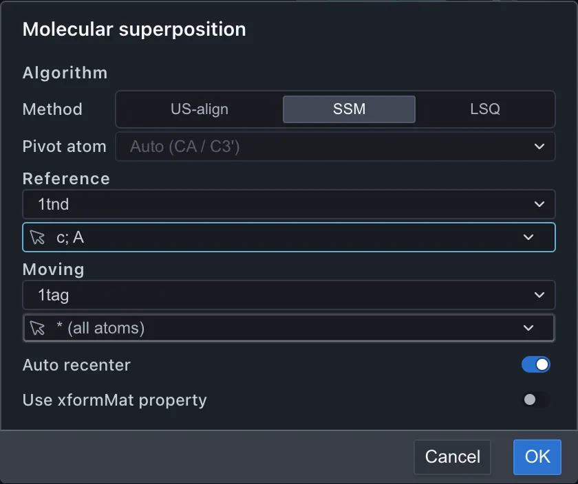{ width="420" .on-glb }

5. Press **OK**, and 1TAG moves to a position where it overlaps chain A of 1TND.

The result of the superposition (RMSD and the number of aligned residues) can be checked in the log of **Output** in the bottom panel. Note that SSM superposes by matching secondary structures, so it can be used only for proteins.

### Convert to MorphMol and add a frame

1. Open **Tools &gt; Mol morphing animation...**
2. In **Target**, choose 1TND, the starting point of the change.
3. Press **Convert to MorphMol**. The molecule is converted to a **MorphMol**, which can hold multiple frames (structures).

    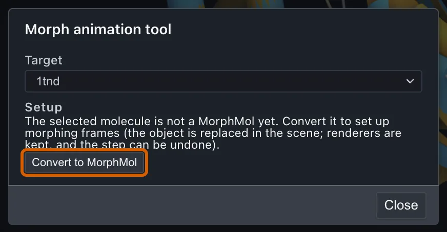{ width="436" .on-glb }

4. Press **Add mol...**, choose 1TAG, the end point of the change, in **Molecule to add**, and press **Add as frame**. The coordinates are copied as a frame.
5. Confirm that the frame list shows the original structure (`(this)`) and the added structure, then close the dialog.

The 1TAG Object that was the copy source is no longer needed, so you can delete it or hide it in the scene tree.

### Place it on the timeline and play

1. Choose **Mol morphing** from the add menu of the Animation panel.
2. Select the added strip and specify the converted 1TND in **Target MorphMol** of the inspector (→ [MolAnim](../../reference/animation/molanim.md)).
3. On playback, the molecule deforms between the GTP-bound form and the GDP-bound form.

Chains B and C, ligands and water molecules that exist only on the 1TND side have no correspondence, so they stay still, but they are not visible because only the cartoon of chain A is displayed.

!!! tip "To make a back-and-forth loop"
    Add another **Mol morphing** strip after the first, and set **Start value** to 1 and **End value** to 0 in the inspector to get the change in the reverse direction.
    Placing the two side by side gives a "there and back" loop animation
    (→ [MolAnim](../../reference/animation/molanim.md)).

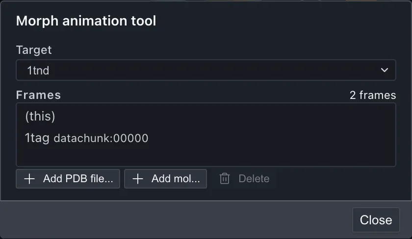{ width="420" .on-glb }
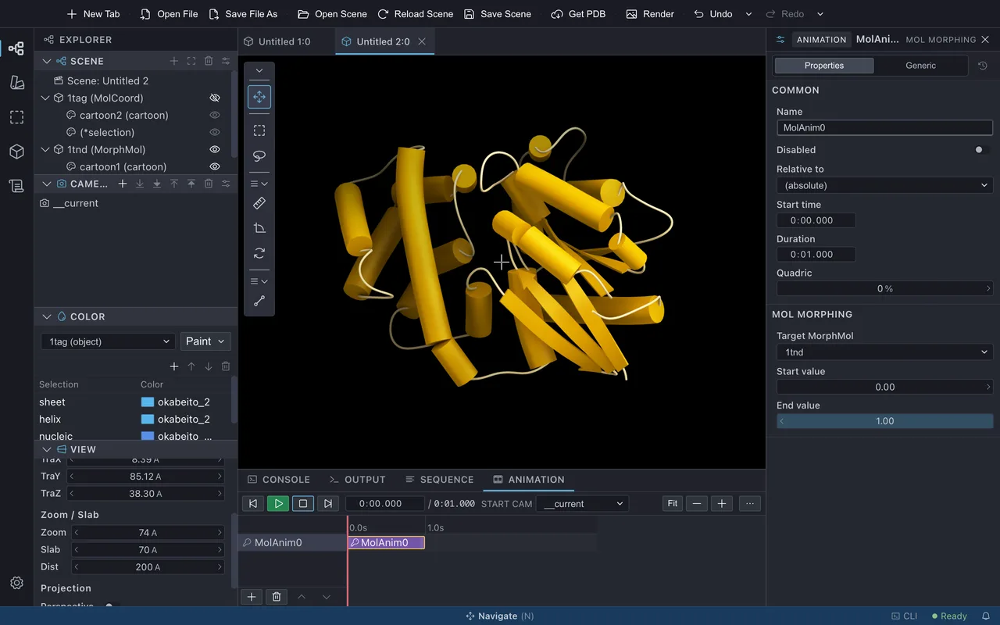{ .on-glb }

!!! note "To create morphing with your own structures"
    Atoms are matched between frames by **chain name, residue number and atom name** (the order of atoms in the file does not matter). Failure to match is not an error: atoms present only in the original structure (`(this)`) **stay still**, and atoms present only in the added structure are ignored. To deform the whole molecule cleanly, prepare structures with water, ligands, hydrogens, etc. removed and with consistent chain names and residue numbers.
    Also, linear interpolation is a method suited to representing local structural changes. For large domain motions, create intermediate structures with other software and insert them as frames to make the transition natural.

!!! note "Differences from CueMol2"
    In CueMol2, choosing the menu displayed a prompt to select the target and implicitly converted it to a MorphMol. In CueMol3, the target is chosen in **Target** in the dialog and converted explicitly with the **Convert to MorphMol** button (this can be undone with Undo).

## 8. Export as a movie

Choose **Rendering &gt; Movie rendering...** and the rendering window opens in Movie mode (→ [Rendering window](../../ui/rendering-window.md)).

1. In **Target**, choose the view of the scene to make the movie from. Here, choose the view of the 3UG9 scene made in the first half
   (such as `Untitled 1:0`: the scene name and the view number). **Backend** can be left at the default **Umbreon**.

    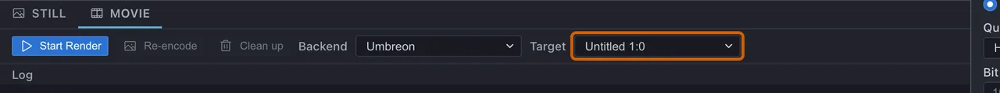{ .on-glb }
2. Choose the size in the **Image** tab (e.g. **VGA (640×480)**).
3. Press **Start Render**. The frames are rendered one by one, and when finished they are encoded into a movie file with ffmpeg (bundled with the macOS / Windows release assets; → [Configuring external tools](../../install/external-tools.md))
4. By default the output is created in a temporary folder. Use **Save movie as...** to save the finished movie wherever you like.

A **Frame rate** of 24 to 30 is usually sufficient. Movie rendering takes "number of frames × time per still image", so it is safest to try the size and quality on a single still image first. For presentations, a size around VGA / SVGA is enough.
Output settings such as the frame rate and movie format are remembered next time.
The settings for raising quality are shared with still images
(→ [Exporting high-resolution images for publication](../figures/publication-images.md)).

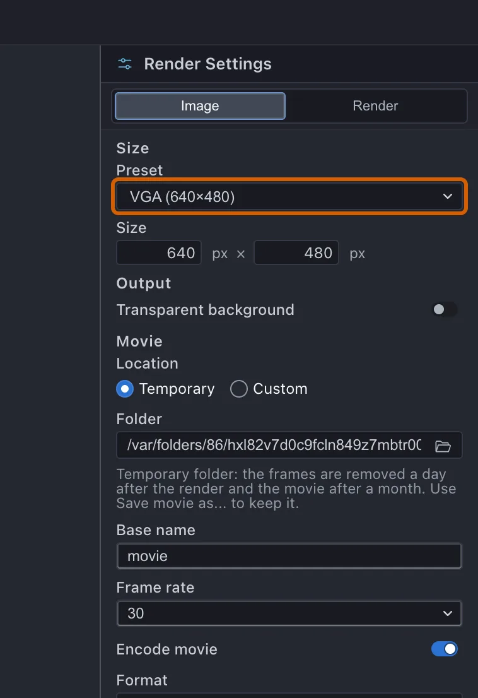{ width="380" .on-glb }
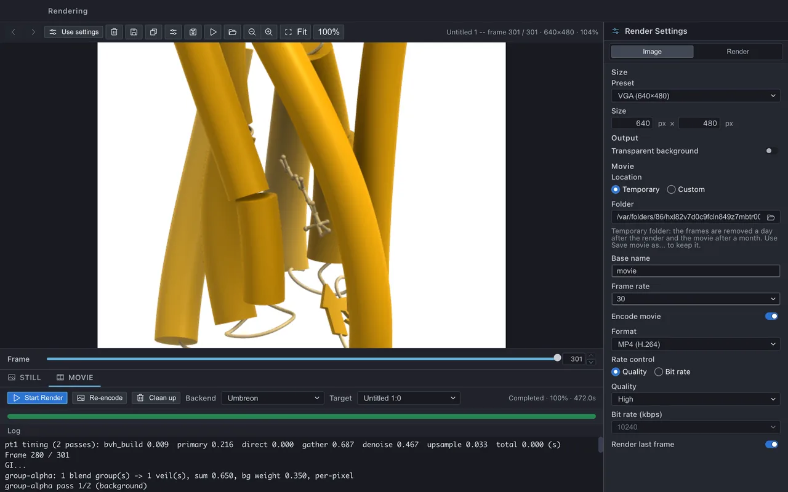{ .on-glb }

## The same with commands

The steps on this page can be written as native-mode commands of the [Console](../../reference/plugins/console/index.md) as follows. Enter them in the Console one line at a time (they can also be run from [tritium_cli](../../reference/plugins/console/cli.md)). To check the arguments of each command, run `help <command>` in the Console (→ [Console command list](../../reference/plugins/console/commands.md)).

```
# 3. Rotate the molecule (one turn in 5 seconds)
add_anim spin, name=spin1
set_anim_prop spin1, angle, 360
set_anim_prop spin1, axis, "0 1 0"
set_anim_time spin1, 0, 5000
# 4. Play back and check
animate play
# 5. Add a camera motion (adjust the view before saving each one)
save_camera start
save_camera end
set_anim_options startCamera=start
add_anim camera, name=cam1
set_anim_prop cam1, endcam, end
set_anim_time cam1, 0, 3000
# 6. Add a display switch
add_anim show, name=show1
set_anim_prop show1, rend, 3ug9/ballstick1
set_anim_time show1, 0, 2000
# 7. Add morphing
create_scene
fetch_pdb 1TND, mmcif, cartoon, selection="c; A"
fetch_pdb 1TAG, mmcif, cartoon
superpose 1tag, 1tnd, refSel="c; A", algo=SSM
convert_to_morph 1tnd
add_morph_frame 1tnd, fromObjId=1tag
hide 1tag
add_anim mol, name=morph1
set_anim_prop morph1, mol, 1tnd
animate play
# 8. Export a movie (GUI only)
```

- There is no command for step 2 (opening the Animation panel). `list_anims` lists the elements.
- `add_anim` adds the element at the end of the timeline (after the previous element). The start and end of `set_anim_time`
  are times (in milliseconds) from the end of the element before it.
- Enclose selection expressions that contain `;` (`c; A`) in quotes.

## Next steps

- [Animation](../../reference/animation/index.md) — element types and common properties
- [Rendering window](../../ui/rendering-window.md) — settings of the movie mode
- [Camera](../../reference/camera.md) — saving viewpoints and display flags

---

*Verified against: CueMol3 3.0.6.577*
