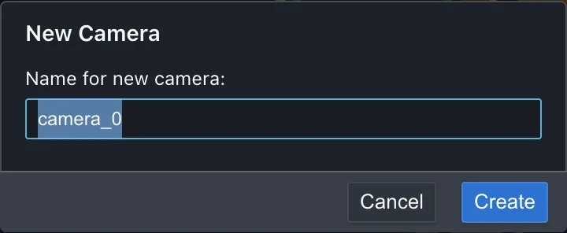
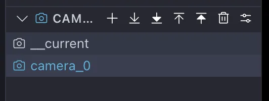
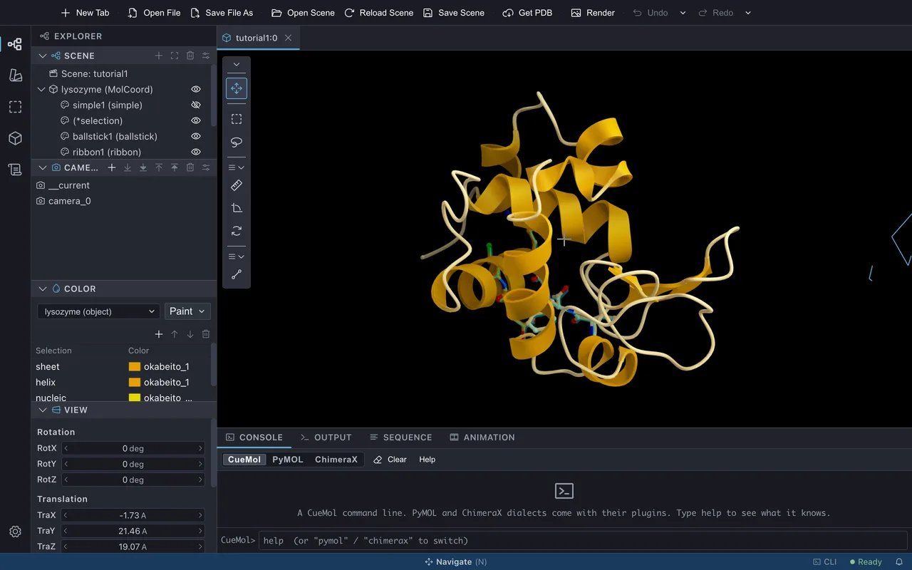
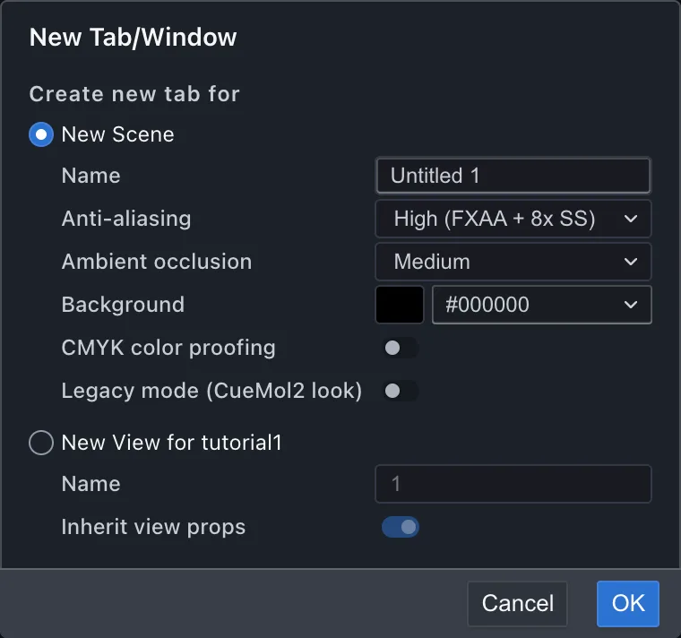
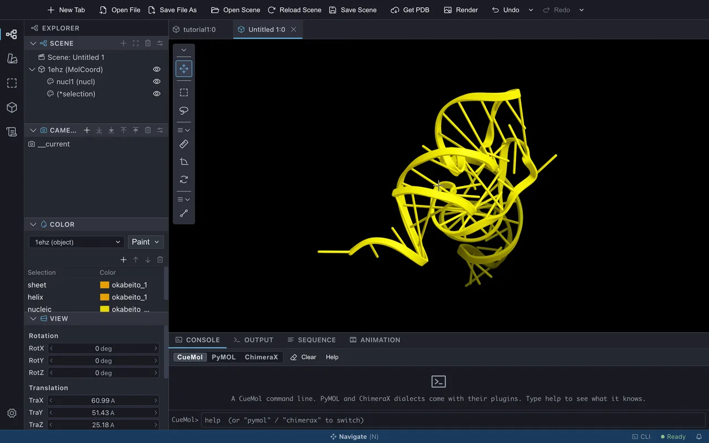
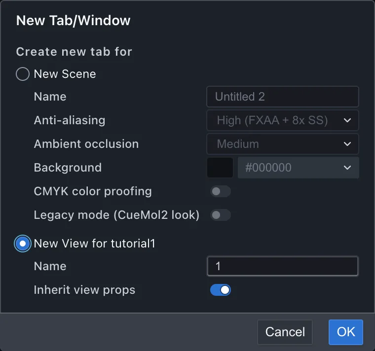

<!-- source: ja/tutorials/basic/camera-scene.md @ 1002eeb -->

# Saving the camera and the scene

This page shows how to keep a favorite viewpoint as a **camera**, and how to save the whole working state to a **scene file** (`.qsc`) and resume from it.
It continues from the previous page ([Coloring Renderers](coloring.md)).

!!! abstract "About this tutorial"
    - **Subject**: Lysozyme (`lysozyme`) and 1G59
    - **What you learn**: Saving viewpoints with cameras, saving and loading scenes, tabs
    - **Prerequisites**: [Coloring Renderers](coloring.md)

## 1. Save a viewpoint as a camera

While examining a molecule, you often want to come back to a particular view later.
The position, orientation, zoom and slab of a view can be saved as a named **camera**.

1. Set up the view you want to save.
2. Click **Explorer** in the activity bar and open the **Camera** panel.
3. Press the **New camera from view** button at the top of the panel.
4. Give it a name in the **New Camera** dialog and press **Create** (the default name `camera_0` is fine).

    { width="360" .on-glb }

The new camera appears in the list. Move the view around, then
**double-click** the camera row. The saved view is restored.

The right-click menu of a camera row offers renaming, deleting, copy &amp; paste,
reading and writing camera files (`.cam`), editing display flags, and more
(→ [Camera](../../reference/camera.md)).

{ width="266" .on-glb }

## 2. Save the scene

The whole scene (Objects, Renderers, colors and cameras) is saved to a `.qsc` file with **File &gt; Save Scene**
(++cmd+s++ / ++ctrl+s++).
Save it as `tutorial1.qsc` here.

When saving, the current view is automatically recorded as a camera named `__current`.
This camera is applied when the scene is opened, so the scene looks exactly as it did when saved.

!!! note "Links and embedding"
    For a `.qsc` file, the save options let you choose whether to store **links** to the loaded data files or to **embed** the data itself (→ [File menu](../../menu/file.md)).
    With links, the scene cannot be opened if the original files are moved or deleted.
    Objects that have no original file, such as those fetched from the network, are embedded.
    Embedding is the safe choice when you want to carry the scene as a single file.

## 3. Open a scene

Quit CueMol3 and start it again, then open
`tutorial1.qsc` with **File &gt; Open Scene...**. The saved state is restored as it was
(it can also be opened from **File &gt; Open Recent**).

{ .on-glb }

## 4. Work with multiple scenes in tabs

Each scene corresponds to a **tab** at the top of the window, and several scenes can be open at once.
Scenes are independent and do not affect each other.

1. Choose **File &gt; New Tab** (++cmd+t++), leave **New Scene** selected and press **OK** to create a new scene.

    { width="380" .on-glb }

2. The new scene is empty, so nothing is displayed.
3. Fetch `1EHZ` (a tRNA structure) with **File &gt; Get PDB...** and choose **nucl**, the type for nucleic acids, as the **Renderer type**.
4. Click the tabs to switch between scenes. The contents of the scene tree also
   switch to the scene of that tab.

{ .on-glb }

### Close a tab

Close a scene with the close button of its tab (or **File &gt; Close Tab**).
For a scene with unsaved changes, a confirmation asks whether to save
(→ [File menu](../../menu/file.md)).

## 5. View the same scene from another viewpoint

If you choose **New View for &lt;scene name&gt;** in **File &gt; New Tab**, a tab is created that holds
**another view of the current scene**, instead of a new scene
(**Inherit view props** lets you choose whether to inherit the settings of the current view).

{ width="380" .on-glb }

The scene is shared by both tabs, so selection and color changes are reflected in both.
The viewpoint, on the other hand, is independent for each view, so you can switch quickly between two ways of looking at the scene.
To keep the viewpoint itself, a camera is more suitable than a view
(cameras are saved in the scene file).

## Next steps

- [Measurement and interaction display](measure.md) — measure distances and angles and keep them in a figure
- [Camera](../../reference/camera.md) / [File menu](../../menu/file.md)

---

*Verified against: CueMol3 3.0.6.577*
