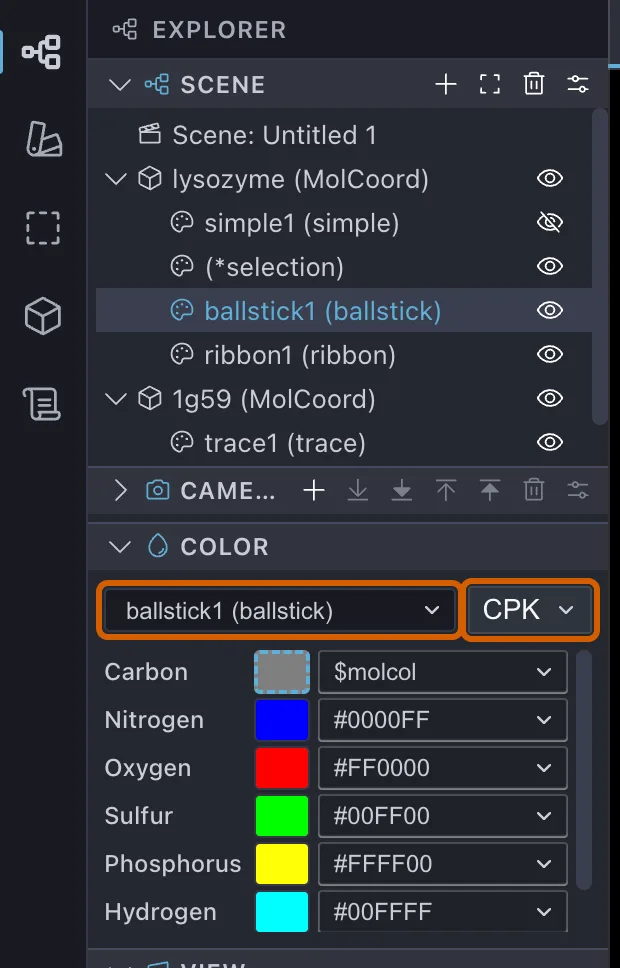
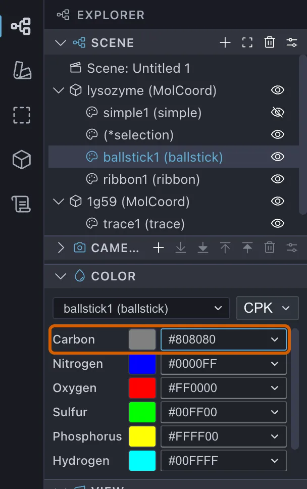
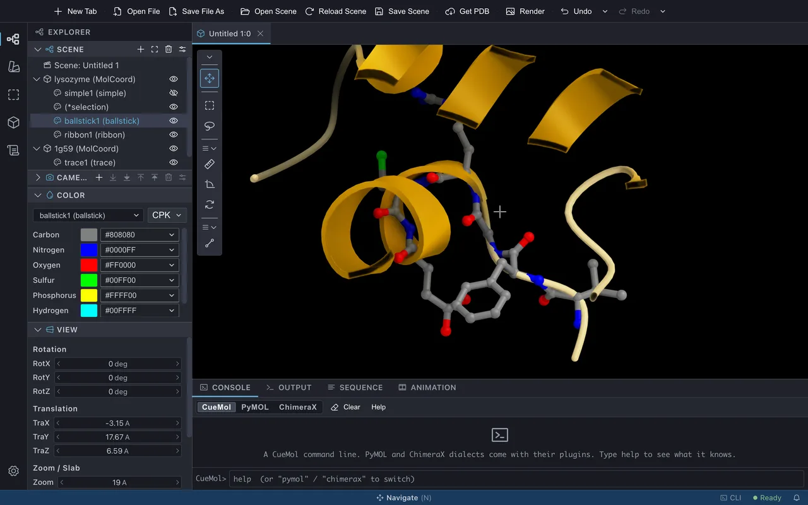
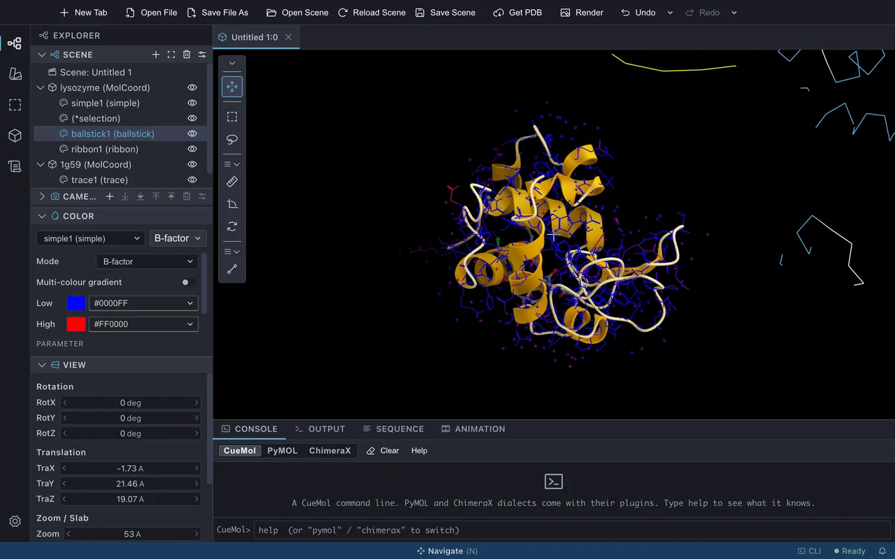
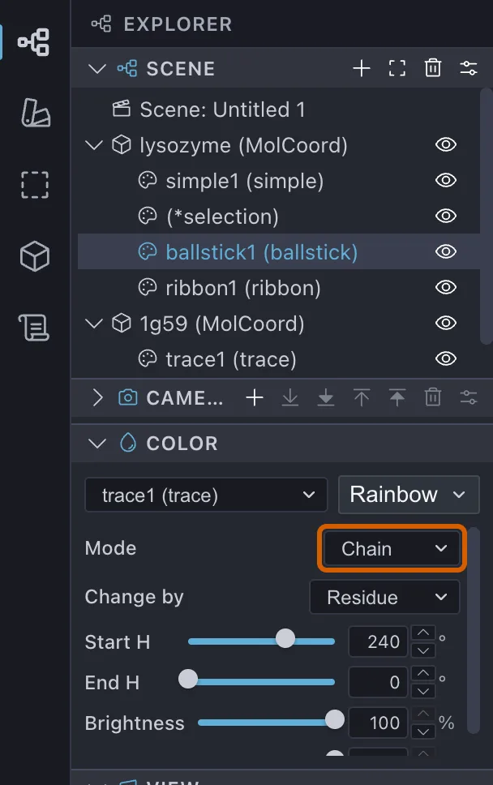
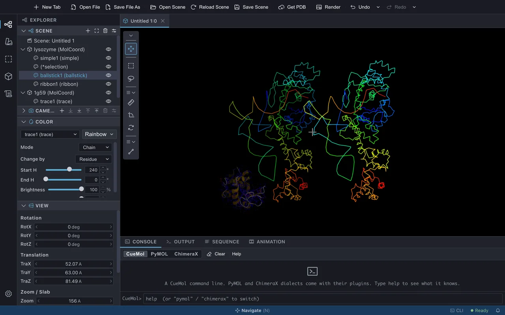
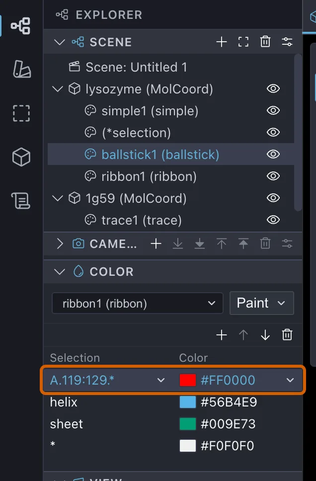
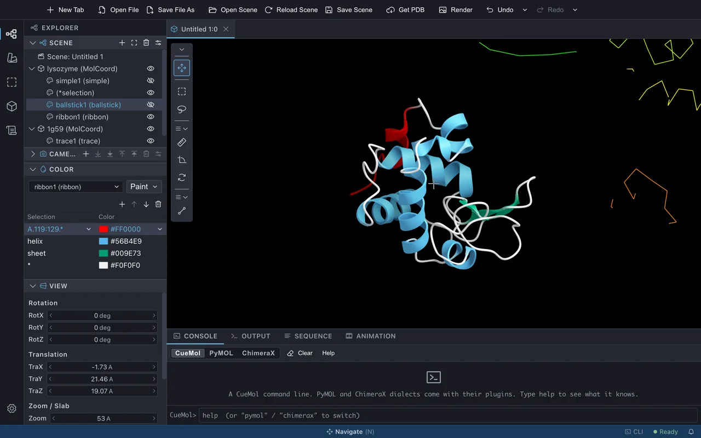

<!-- source: ja/tutorials/basic/coloring.md @ 1002eeb -->

# Coloring Renderers

The color of a Renderer is changed in the **Color panel**, which handles only the
Coloring part of the settings. This page tries the main Coloring types in turn,
using `lysozyme` (simple + ballstick + ribbon) and `1G59` (trace) from the
previous page ([Adding, removing and configuring Renderers](renderers.md)).

!!! abstract "About this tutorial"
    - **Subject**: Lysozyme (`lysozyme`) and 1G59
    - **What you learn**: The Color panel, coloring by CPK / B-factor / Rainbow / Paint
    - **Prerequisites**: [Adding, removing and configuring Renderers](renderers.md)

## 1. Using the Color panel

Open the **Explorer &gt; Color** panel in the left side panel
(→ [Side panels](../../ui/side-panels.md)).

1. Select the target Renderer at the top (selecting a Renderer in the scene tree also updates this).
2. Then select the Coloring **type** with the button next to it; the settings for that type appear below.
   The button shows the current type.

{ width="310" .on-glb }

For the list of types and their settings, see [Coloring](../../reference/coloring.md).

## 2. CPK — color by element

**CPK** assigns a color to each element, and is the standard choice for simple and ballstick.

1. Select `lysozyme/ballstick1` as the target.
2. Select **CPK coloring** as the Coloring type.
3. Change the color of **Carbon** to gray (for example, `#808080`).

    { width="304" .on-glb }

Only the carbon parts of the ballstick turn gray. For how to specify colors (color names,
color codes, etc.), see [Color syntax](../../reference/color-syntax.md).

{ .on-glb }

## 3. B-factor — gradient by value

**B-factor** changes the color continuously according to values such as the temperature factor.

1. Select `lysozyme/simple1` as the target (if you hid it, restore it with the eye icon).
2. Select **Bfac/Occ coloring** as the Coloring type.

The structure is painted with a gradient from low to high temperature factors.
The colors at the lower and upper limits (**Low** / **High**) and the value range (**Auto** / **Manual**) can also be set.

{ .on-glb }

## 4. Rainbow — rainbow from end to end

**Rainbow** changes the hue along the residue sequence.

1. Select `1g59/trace1` as the target.
2. Select **Rainbow coloring** as the Coloring type.
3. Switch **Mode** from **Molecule** (whole molecule) to **Chain** (per chain).

    { width="304" .on-glb }

In 1G59 the protein and the tRNA are separate chains, so each is painted
with its own rainbow (the protein from the N-terminus to the C-terminus, the RNA
from the 5' end to the 3' end).

{ .on-glb }

## 5. Paint — color by pairs of selection and color

**Paint** offers the most freedom. Pairs of a "selection expression and a color" are
listed as rows of a table, and **the rows are evaluated from the top, with the color of
the first matching row** used for painting.

1. Select `lysozyme/ribbon1` as the target.
2. Select **Paint coloring** &gt; **Okabe-Ito** &gt; **Orange** as the Coloring type. A table appears containing the
   standard secondary-structure coloring (four rows: sheet / helix / nucleic / `*`).
3. Rewrite the table as the following three rows (in this order from the top)

| Selection expression | Example color |
|---|---|
| `helix` | light blue |
| `sheet` | green |
| `*` | whitish |

`helix` and `sheet` are predefined selections that represent secondary structure
(→ [Selection expression syntax](../../reference/selection.md)). The `*` (everything) row is at
the bottom, so only the coil regions, which are neither helix nor sheet, get this color.

### Add a paint

Change the color of only the C-terminal helix (residues 119 to 129).

1. Add a row at the **top** of the table.
2. Specify `A.119:129.*` as the selection expression and red as the color.

The C-terminal region turns red. Because this row is above the `helix` row, red
takes precedence in this range. Layering paints while keeping the row order in mind
is how Paint is used. Rows that are no longer needed can be deleted.

{ width="318" .on-glb }

{ .on-glb }

!!! tip "Presets are also available"
    The Paint coloring submenu lists the colors of palettes other than the Okabe-Ito used above,
    **CueMol2 default** / **CueMol1 (woody)**, and single-color schemes (Red, etc.). Applying a preset first and then rewriting
    its rows is also a quick approach.

## Next steps

- [Saving the camera and the scene](camera-scene.md) — keep the viewpoint and working state
- [Coloring](../../reference/coloring.md) / [Color syntax](../../reference/color-syntax.md)

---

*Verified against: CueMol3 3.0.6.577*
