<!-- source: ja/tutorials/basic/loading.md @ 6cacee7 -->

# Loading and displaying a structure

This page covers loading and displaying a molecular structure, and the
**Scene / Object / Renderer** concepts at the core of CueMol3.
The example is the 1.2 Å resolution crystal structure of lysozyme (PDB ID: **1QIO**).

The pages of the basic course carry over the state of the previous page when followed in order.

## 1. Load a structure

Open **File &gt; Get PDB...**, enter `1QIO` in **PDB Accession Code**, and download it.
To open a local file, use **File &gt; Open File...** (++cmd+o++)
(→ [File menu](../../menu/file.md)).

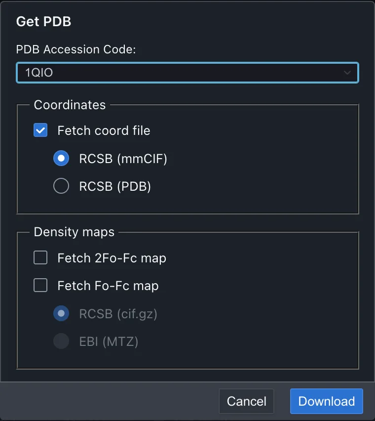{ width="380" .on-glb }

While downloading, a `Downloading 1QIO…` progress screen appears. Press **Cancel** to abort.
If a nonexistent ID is entered, a **Get PDB failed** error is shown.

When the download finishes, the **Open File Options** screen appears. At the top it shows the
name of the file to be loaded (`1qio.cif`) and the file format CueMol3 detected (`mmCIF`).

1. Change **Object name** to `lysozyme`. The loaded data is called an **Object**, and
   CueMol identifies it by this name (by default, a name derived from the file name is filled in)
2. Choose **simple** from **Renderer type**
3. **Renderer name** is set automatically from the chosen type (`simple1`). Leave it at the default.
   This name is used as is in the scene tree and in the rest of the tutorial
4. Leave the other options at their defaults and press **Open**

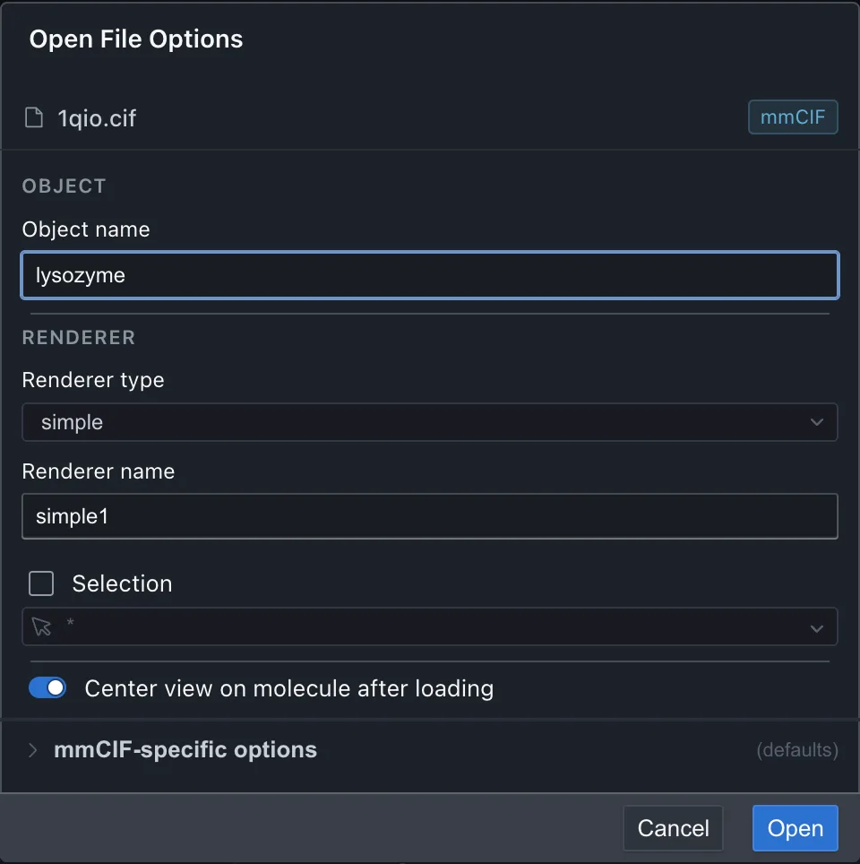{ width="480" .on-glb }

The molecule is displayed as a line drawing (stick model).

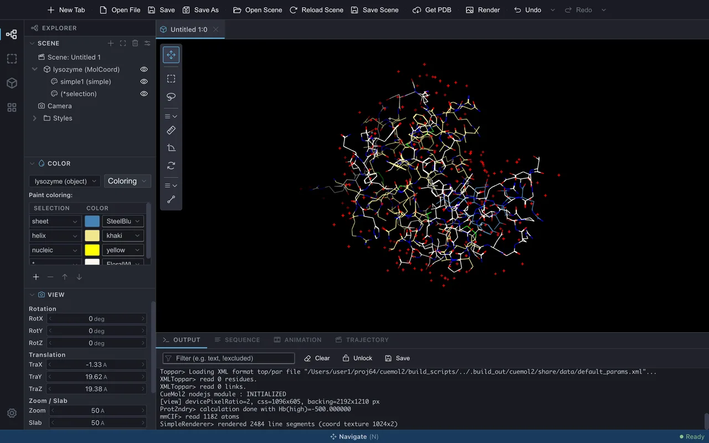{ .on-glb }

### Renderer types

Commonly used display styles include the following.

simple
:   Line-drawing stick model. Second fastest after trace. Suited to viewing details

trace
:   Line-drawing Cα trace (for proteins) or phosphorus-atom trace (for nucleic acids).
    The fastest. Suited to a rough overview

ballstick
:   Ball-and-stick model

cpk
:   CPK model, also called a space-filling model

tube
:   Tube model of the main chain. A kind of extension of trace

ribbon / cartoon
:   The so-called ribbon model. cartoon draws helices as cylinders

nucl
:   An extension of tube for DNA and RNA. Bases are displayed as sticks

For the full list and details, see [Renderer list](../../reference/renderers/index.md).

At the top of the **Renderer type** list there is a group called **Presets**. Choosing
**Default preset 1** or similar there creates not a single Renderer but a **group of
several Renderers** at once, for example ribbon for proteins, nucl for nucleic acids, and
ballstick for everything else. When a preset is chosen, **Selection** below becomes unavailable.

### Other options

- **Renderer name** — The name of the Renderer to be created. It is filled in automatically
  when a type is chosen (for a preset, it becomes the group name)
- **Selection** — When checked, the adjacent field is enabled and the **range to display**
  can be narrowed with a selection expression. Loading itself is performed on the whole molecule,
  so the displayed range can be changed later (→ [Selecting part of a molecule](selection.md))
- **Center view on molecule after loading** — Moves the view to the loaded molecule.
  Uncheck it to keep the current view
- **&lt;format&gt;-specific options** — A collapsible section at the bottom. When opened, it lists the
  loading settings specific to that format (for mmCIF / PDB, **Load MODEL records**,
  **Load anisotropic U (ANISOU)**, **Load alternate conformations**,
  **Calculate secondary structure**, and so on).
  `(defaults)` is shown to the right of the heading when the settings are at their defaults,
  and `(modified)` when they have been changed

## 2. Manipulate the view

Look at the loaded molecule from various directions.

1. **Left-drag** on the molecular view. The molecule rotates in the direction of the drag
2. Turn the **wheel** to zoom the display in and out
3. In the **View &gt; View** panel in the left side panel, click the **Zoom** value under
   **Zoom / Slab**, enter `40`, and press ++enter++. Zoom is set to 40

    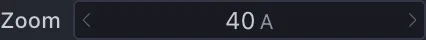{ width="213" }

Zoom is the height (Å) of the range shown in the molecular view. The smaller the value,
the larger the molecule appears.

Each row of the View panel can be operated in three ways.

- Press the **left/right arrows** to increase or decrease the value one step at a time
- **Drag left or right** over the number to change it continuously
- **Click** the number to make it directly editable, and press ++enter++ to confirm

The View panel is thus useful when the view needs to be set more precisely than is possible with the mouse.
**Rotation** (RotX / RotY / RotZ) values are **relative**: the view rotates by the entered angle,
and the value returns to 0 after the operation. **Translation** (TraX / TraY / TraZ, Å) and
**Zoom / Slab** (Zoom, Slab, Dist, Å) values are **absolute**: the values of the current view
are displayed as they are.

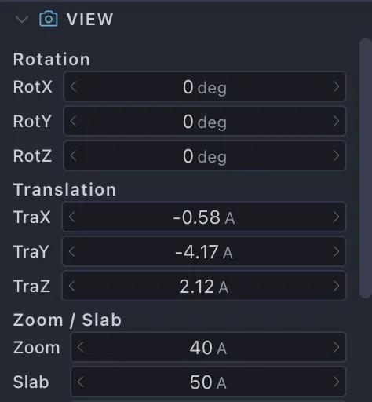{ width="237" .on-glb }

For the full list of operations, including translation and slab (the range displayed by clipping
the near and far sides), see [Mouse and trackpad input](../../ui/mouse-input.md); for each
item of the View panel, see [Side panels](../../ui/side-panels.md).

### Show atom names and information

Click at an atom's position to show the name of that atom in the molecular view
(click again to hide it).

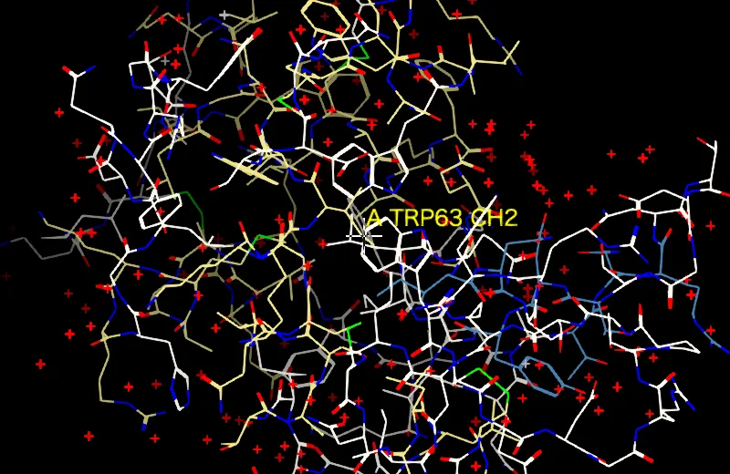{ width="400" .on-glb }

Detailed information on the atom, such as its coordinates and temperature factor, is also shown in
the **status bar at the bottom of the window** (the same content remains in the **Output** panel).
It lists the molecular Object name, chain name, residue name and number, and atom name in that order,
followed by the occupancy (O), temperature factor (B), and coordinates.

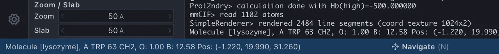{ width="640" .on-glb }

Right-clicking at an atom's position shows a context menu. The top entry shows the same atom
information as above; selecting it does nothing. Selecting the next entry, **Center at this atom**,
moves the view so that the atom comes to the center. The Select-related menu items below that are
described in [Selecting part of a molecule](selection.md).

## 3. Load another molecule

Multiple Objects can be loaded into the same scene. Here, add `1G59`
(a complex of glutamyl-tRNA synthetase and tRNA).

1. Open **File &gt; Get PDB...**, enter `1G59` in **PDB Accession Code**, and press
   **Download**
2. Choose **trace** from **Renderer type**

    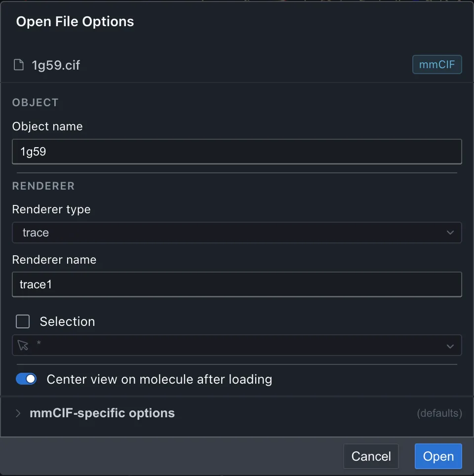{ width="480" .on-glb }

3. Leave **Object name** at the default (`1g59`) and press **Open**

This draws a lightweight display connecting only Cα atoms for the protein and phosphorus atoms for
the nucleic acid. The asymmetric unit of 1G59 contains two copies of the complex
(2 protein chains + 2 tRNA chains), so the same shape appears twice.

After loading, the view moves to the new molecule (**Center view on molecule after loading**
is on by default), so lysozyme is not visible at this point. To see both at once, operate the
View panel in the same way as in §2.

1. Enter `300` in **Slab**
2. Enter `150` in **Zoom**
3. Enter `90` in **RotY**

The key is to widen **Slab** (the thickness displayed along the depth direction). With the default
50 Å, lysozyme, which lies about 100 Å away from 1G59, is clipped by the depth range no matter how
far Zoom is widened. Also, the three molecules overlap along the depth direction, so in the loaded
orientation they overlap front to back and cannot be told apart. Rotating by 90° with **RotY**
makes them appear side by side.

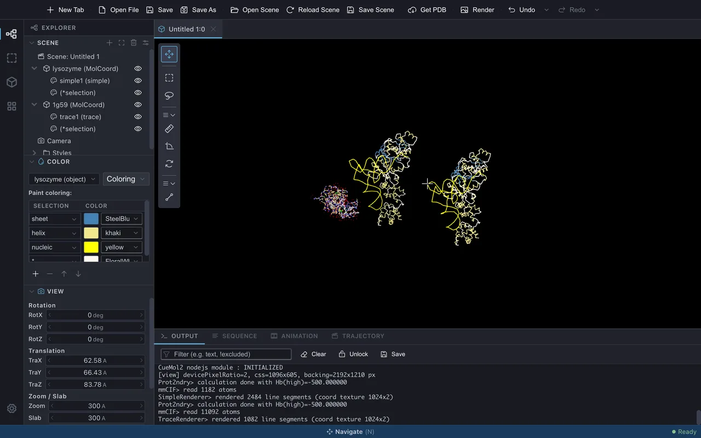{ .on-glb }

To view only a particular Object, select its row in the scene tree and press the **Focus**
button at the top of the panel. Zoom and Slab are adjusted automatically to fit that Object.

## 4. Scene, Object, Renderer and View

This section summarizes the concepts that have appeared so far.

Object
:   **Data** such as molecular coordinates, electron density, or electrostatic potential.
    It does not appear on screen by itself

Renderer
:   Responsible for **displaying** an Object on screen. Multiple Renderers can be attached to one Object,
    so the same molecule can be displayed as ribbon and ballstick at the same time, for example

Scene
:   A unit of work that groups Objects and Renderers. The **tabs** at the top of the window
    correspond to scenes, and scenes opened side by side do not interfere with each other

View
:   The screen that shows a scene (the molecular view). Multiple Views can also be
    connected to one scene (→ New Tab in the [File menu](../../menu/file.md))

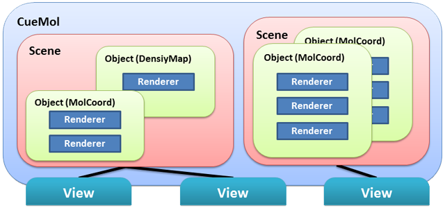{ .on-glb }

Think of a scene as the whole that contains multiple Objects and the Renderers attached to them.

## 5. Get an overview in the scene tree

The **Explorer &gt; Scene** tree (scene tree) in the left side panel shows the Objects in the
scene and their Renderers in a hierarchy (→ [Side panels](../../ui/side-panels.md)).

Rows are written as **`name (type)`**. Click the **triangle** to the left of a name to expand or collapse
the list of Renderers attached to that Object. The current tree reads as follows.

- The scene `Untitled 1` has two Objects, `lysozyme` and `1g59`
  (when loaded with Get PDB, the Object name is the lowercase PDB ID)
- `1g59 (MolCoord)` — The type of Object `1g59` is MolCoord (molecular coordinates)
- `trace1 (trace)` — The Renderer `trace1` attached to `1g59` is of type trace
- `(*selection)` — A Renderer without a name is shown with only parentheses and its type. This is the
  Renderer for highlighting the selected part, and it is created automatically when a molecule is loaded
- `(*namelabel)` — The Renderer for labels, created when an atom was clicked to show its name in §2.
  The row remains even after the label is hidden

**Camera** and **Styles** at the bottom are the places where saved views and styles are kept
(→ [Saving the camera and the scene](camera-scene.md)).

### Eye icons and buttons at the top of the panel

- The **eye icon** on a row toggles the visibility of a Renderer. Toggling it on an Object row
  toggles all Renderers under it together
- There are four buttons at the top of the panel (names appear when the pointer is placed over them)

| Button | Action |
|---|---|
| **Add** | Adds a Renderer to the selected Object (same as New Renderer in the right-click menu) |
| **Focus** | Adjusts the view (Zoom and Slab) to fit the selected Object or Renderer |
| **Delete** | Deletes the selected Object or Renderer. It can be restored with Undo |
| **Property** | Shows the selected item in the property inspector |

Right-clicking the scene row lets you change the background color from **Background color**.

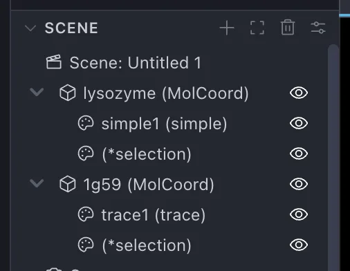{ width="253" .on-glb }

## Next steps

- [Selecting part of a molecule](selection.md) — How to choose what to operate on
- [Mouse and trackpad input](../../ui/mouse-input.md) / [Side panels](../../ui/side-panels.md)

---

*Verified against: CueMol3 2.3.8.495*
