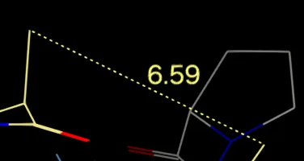
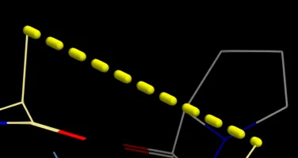

<!-- source: ja/tutorials/basic/measure.md @ dcf70c1 -->

# Measurement and interaction display

This tutorial shows how to measure distances, angles and dihedral angles between atoms, and how to adjust their display as part of a figure.
The example is again lysozyme (`lysozyme`, simple display).

!!! abstract "About this tutorial"
    - **Subject**: Lysozyme (`lysozyme`)
    - **What you learn**: Measuring distances, angles and dihedral angles, the atomintr Renderer, styles for measurement display
    - **Prerequisites**: [Loading and displaying a structure](loading.md)

## 1. Measure distances

Measurements use the Measure group in the **tool palette** at the left edge of the molecular view
(→ [Toolbar and tool palette](../../ui/toolbar-tools.md)).

1. Select the **Distance** tool in the tool palette (shortcut ++d++)
2. Click the first atom of the distance to measure. A cross mark shows the progress.
3. Click the second atom. A dotted line is drawn between the atoms and a distance label is shown.

Keep clicking to measure several distances in succession.
To stop partway, press ++esc++ or switch to another tool such as Navigate.

{ width="282" .on-glb }

## 2. Measure angles and dihedral angles

- **Angle** tool (++a++) — click three atoms in order to display their angle.
- **Torsion** tool (++t++) — click four atoms in order to display their dihedral angle.

For practice, try measuring the coordination angles of the Na⁺ ion (Na130) in 1QIO
and its ligands (the side-chain oxygen of Ser72, the main-chain carbonyl oxygen of Ser60, and so on).

## 3. Behind the measurement display: the atomintr Renderer

The dotted lines and labels of measurements are drawn by a Renderer called **atomintr**.
In the scene tree, an atomintr Renderer named `measure` is
created automatically.

- The eye icon temporarily hides only the measurement display.
- Select the row and press **Delete** to remove all measurements at once (can be undone)

Opening the **option knob** of the Measure group in the tool palette lets you choose
the **label set** to which labels are added. Each set becomes a separate
atomintr Renderer, so interactions can be grouped, for example as "active-site distances" or "coordination bonds",
and shown, hidden or deleted group by group.

## 4. Adjust the appearance with a style

Measurement dotted lines are thin lines by default, but they can be switched all at once
to a three-dimensional display suited to figures in papers.

1. Right-click `measure` (atomintr) in the scene tree.
2. Choose **Style &gt; Dashed stick1**.

The dotted lines change to a yellow dashed three-dimensional display, and the distance labels are no longer shown (**Dashed stick2** is a cyan preset with a different dash pattern).
To adjust the line thickness or the dash spacing individually, edit the atomintr
properties in the inspector (→ [atomintr](../../reference/renderers/atomintr.md)).

{ width="282" .on-glb }
{ width="282" .on-glb }

## 5. Delete individual measurements

To remove only a measurement clicked by mistake, delete it from the list
instead of deleting the whole Renderer.

1. Right-click `measure` (atomintr) in the scene tree and
   choose **Edit interaction list...**
2. A list of the measurements (interactions) belonging to that Renderer is shown.
3. Select the unwanted rows and delete them. The operation can be undone.

!!! note "Differences from CueMol2"
    In CueMol2, the measurement mode was switched with the ribbon at the top of the window (Measure tab),
    but in CueMol3 it has moved to the **tool palette** at the left edge of the molecular view
    (→ [Toolbar and tool palette](../../ui/toolbar-tools.md)).

## Next steps

This is the end of the basic course. From here, follow
the task-oriented tutorials to see the actual flow of figure making.

- [Making a protein ribbon figure](../figures/ribbon-figure.md) — basic course on figure making
- [atomintr](../../reference/renderers/atomintr.md) — settings of the measurement display

---

*Verified against: CueMol3 3.0.2.560*
