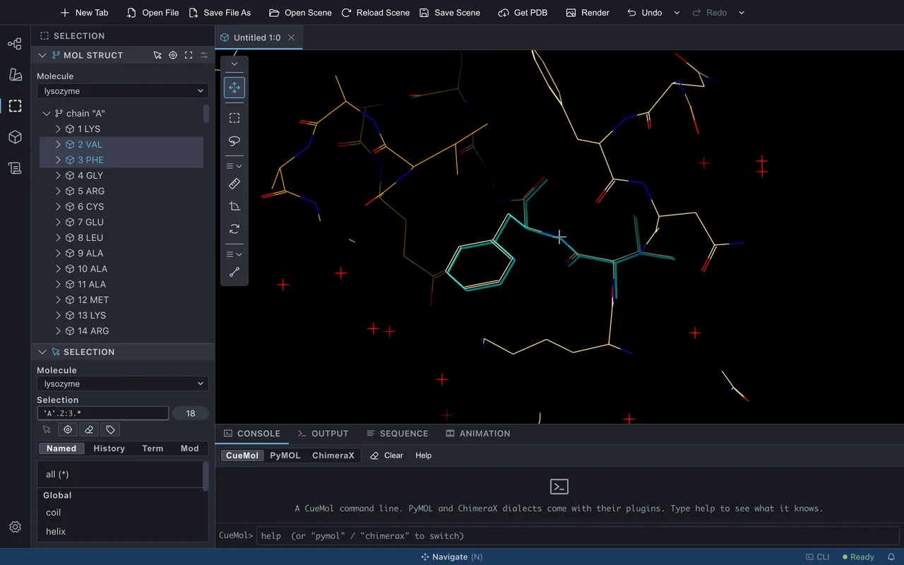
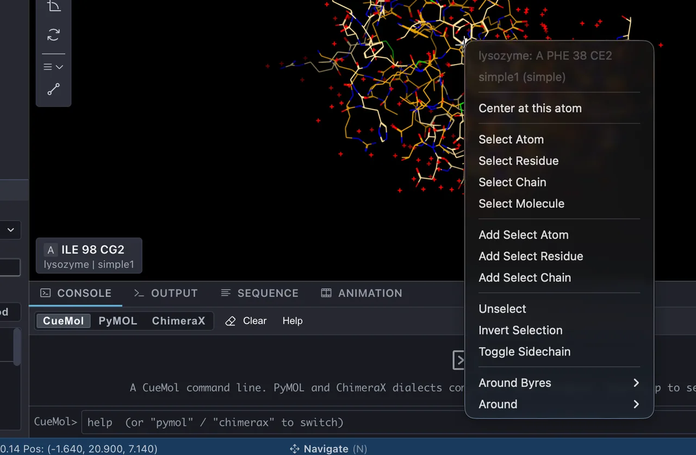
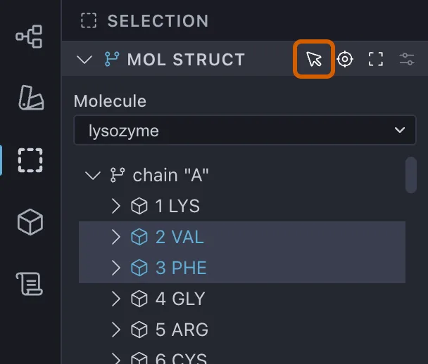
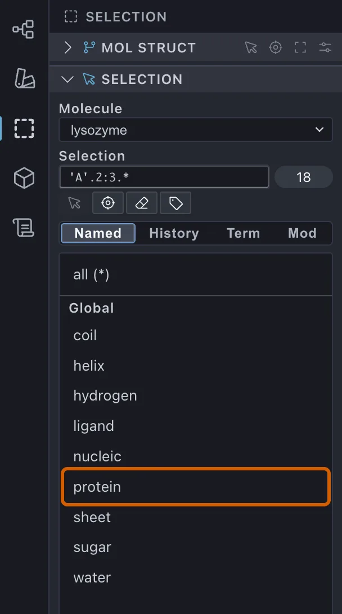
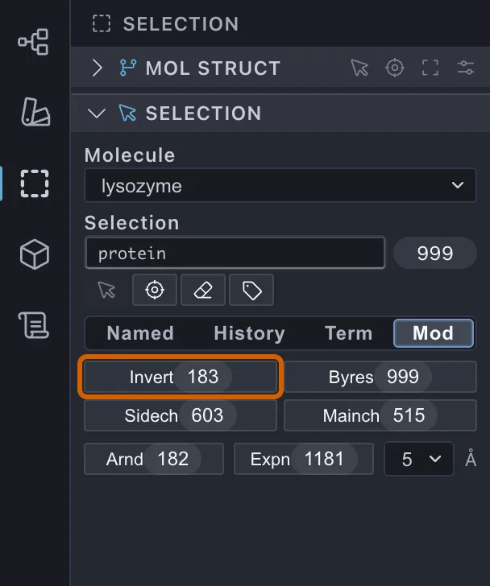
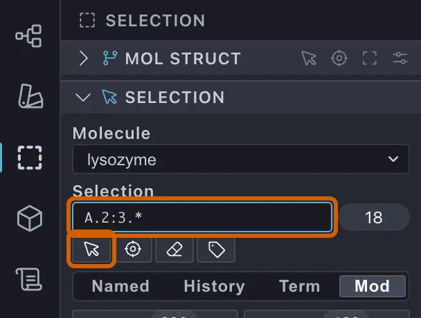

<!-- source: ja/tutorials/basic/selection.md @ b9950c9 -->

# Selecting part of a molecule

In CueMol, to operate on part of a molecule (for example, to change the display
style of only that part or to color it), first **select** that part and then
apply the operation. There are several ways to make a selection, and this page
practices them together.
It uses `lysozyme` from the previous page ([Loading and displaying a structure](loading.md)).

!!! abstract "About this tutorial"
    - **Subject**: Lysozyme (`lysozyme`)
    - **What you learn**: Selecting by double-click, the context menu, the Mol Struct panel, the selection builder and selection expressions
    - **Prerequisites**: [Loading and displaying a structure](loading.md)

The selected part is highlighted with a semi-transparent overlay in the molecular view.

{ .on-glb }

## 1. Select by double-clicking

Double-clicking an atom in the molecular view selects its **residue**.
Double-clicking another residue adds it to the selection, and double-clicking
an already selected residue deselects it.

## 2. Select from the right-click menu

Right-clicking an atom opens a menu with selection-related items.
At the top of the menu are also the names of the clicked atom and the Renderer, and
**Center at this atom**, which moves the atom to the center of the view (→ [Loading and displaying a structure](loading.md)).

| Item | What is selected |
|---|---|
| **Select Atom** / **Select Residue** / **Select Chain** | The clicked atom / residue / chain |
| **Select Molecule** | The whole molecule that was clicked |
| **Add Select Atom / Residue / Chain** | Adds to the selection while keeping the current one |
| **Unselect** | Clears the whole selection |
| **Invert Selection** | Inverts the selection |
| **Toggle Sidechain** | Limits the current selection to side chains (choosing it again restores it. → [BYSIDECH operator](../../reference/selection.md#bysidech-operator)) |
| **Around** / **Around Byres** | The surroundings of the clicked position (3 to 10 Å), by atom / by residue |

To select the entire molecule, **Select Molecule** is the quickest way;
to start over with a clean slate, use **Unselect**.

{ width="300" .on-glb }

## 3. Select in the Mol Struct panel

To choose by residue number or atom name, use the
**Selection &gt; Mol Struct** panel in the left side panel
(→ [Side panels](../../ui/side-panels.md)).

1. Choose the target molecule (`lysozyme`) at the top of the panel.
2. The tree is shown as a chain, residue, atom hierarchy. Select residues Val2 and Phe3
   (++cmd++ / ++ctrl++ + click for multiple selection, ++shift++ + click for range selection).
3. Click the **Select atoms** button to the right of the panel heading to select the corresponding part of the molecule.

    { width="304" .on-glb }

Choosing items in the tree does not yet select the molecule.
Note that the selection takes effect only after you click **Select atoms**.

The **Center at** button moves the chosen range to the center of the view, and **Zoom at**
centers it and then zooms to fit the size of the range. The heading buttons are icons; hovering the pointer over one shows its name.

## 4. The Selection panel and the selection builder

The panel dedicated to building selections is the **Selection &gt; Selection**
panel in the left side panel (→ [Side panels](../../ui/side-panels.md)).

1. Choose the target molecule (`lysozyme`) in **Molecule**.
2. The **Selection** field shows the **current selection** of that molecule as a selection expression.
   The selection made in the steps so far should already be there as an expression.

Operations in this panel are applied to the molecule's selection immediately and can be undone with Undo.

### Build a selection with the selection builder

The **selection builder** below the Selection field lets you build a selection
without writing an expression. It has four tabs.

- **Named** — applies predefined selections such as `protein` and `water` with **one click**.
- **History** — reapplies previously used expressions with a click.
- **Term** — creates a single condition such as chain, residue number, or residue name, and combines it
  with the current selection using **Set** (replace) / **Add** (add) / **Sub** (subtract) /
  **Intsec** (intersection). Value candidates are completed automatically from the loaded molecule.
- **Mod** — transforms the current selection: **Invert** / **Byres** (expand to whole residues) /
  **Sidech** / **Mainch** (side chains / main chains only) / **Arnd** / **Expn** (expand to the surroundings within a given distance).

Each button shows the **number of atoms** that would be selected if it were applied,
so you can predict the result as you work. As an experiment, click `protein` in the **Named** tab,
then click **Invert** in the **Mod** tab. The protein selection is inverted, and
only the water molecules and ions (Na⁺ and Cl⁻) are selected.

{ width="304" .on-glb }
{ width="304" .on-glb }

The same selection builder opens from the ▼ button in almost every place where a
selection expression is entered, starting with the Selection field of New Renderer.
For details on each tab, see
[Selection builder](../../ui/selection-builder.md).

### Write a selection expression directly

The **Selection** field can also be edited by hand. For example, the same
Val2 to Phe3 as in step 3 is the following expression.

```
A.2:3.*
```

It means "all atoms of residues 2 to 3 in chain A". The expression is validated
as you type, and a warning is shown if it is invalid. Apply an expression typed by hand
with the **Apply selection** button below the field or by pressing ++enter++.
Expressions built with the builder also appear in this field as they are,
which is a shortcut to learning the syntax (→ [Selection expression syntax](../../reference/selection.md)).

{ width="304" .on-glb }

!!! note "Differences from CueMol2"
    The hierarchical editor in the CueMol2 selection panel (Hierarchical / Terminal /
    Around-Expand) has been replaced by the **selection builder** described above.
    Its functions are enhanced, for example one-click application of predefined selections
    and a preview of the atom count.

## Next steps

The next page uses the selection, so keep Val2 to Phe3 (`A.2:3.*`) selected.

- [Adding, removing and configuring Renderers](renderers.md) — display only the selected part in a different style
- [Selection expression syntax](../../reference/selection.md) — all the conditions an expression can describe

---

*Verified against: CueMol3 3.0.6.577*
