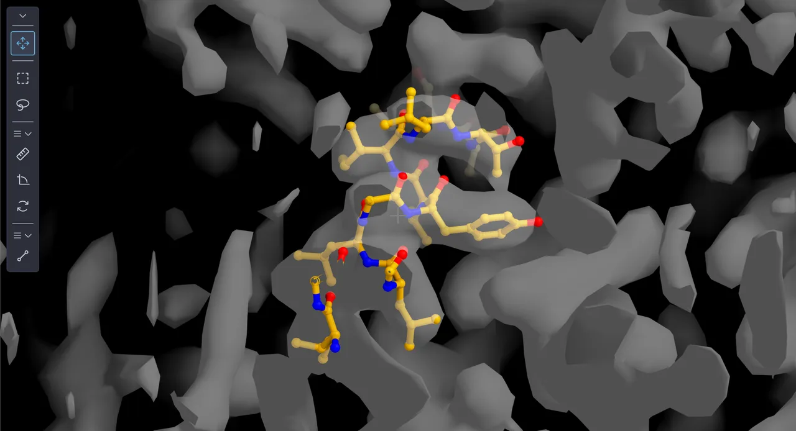
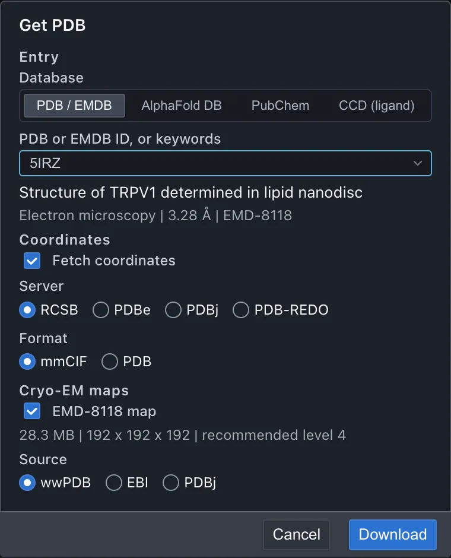
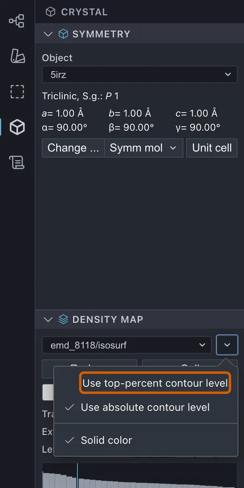
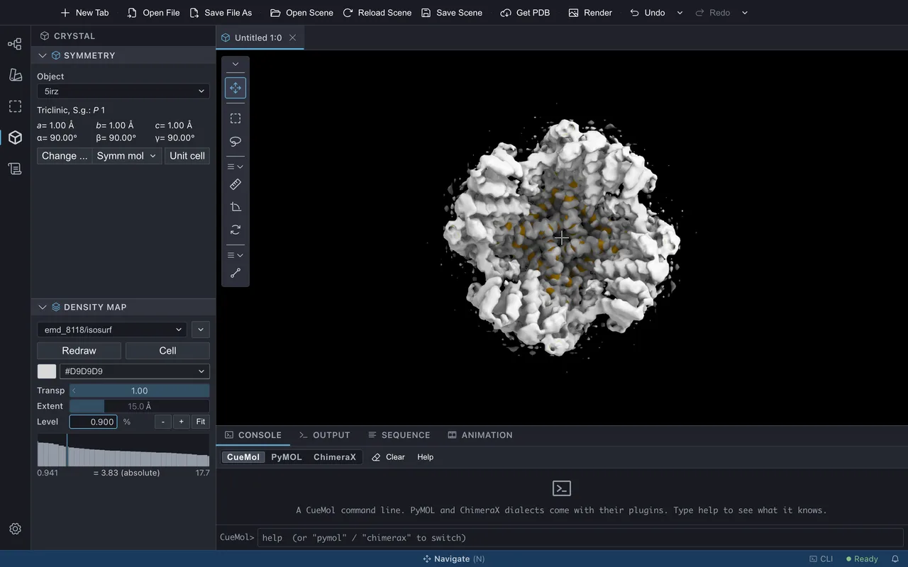
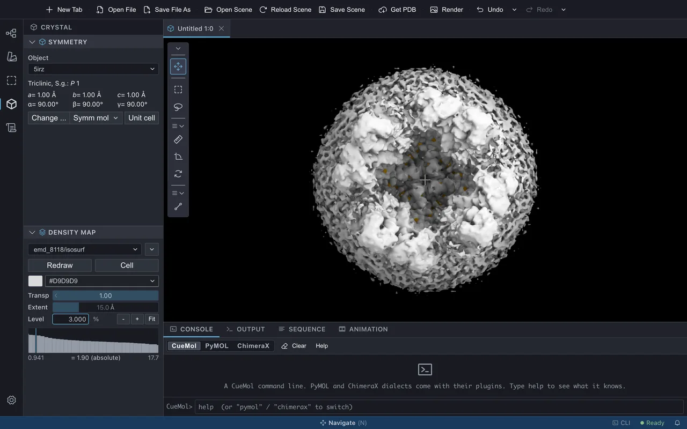
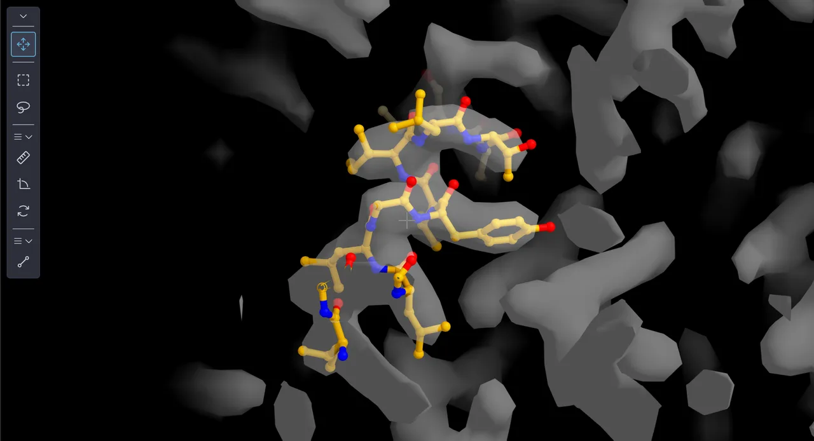
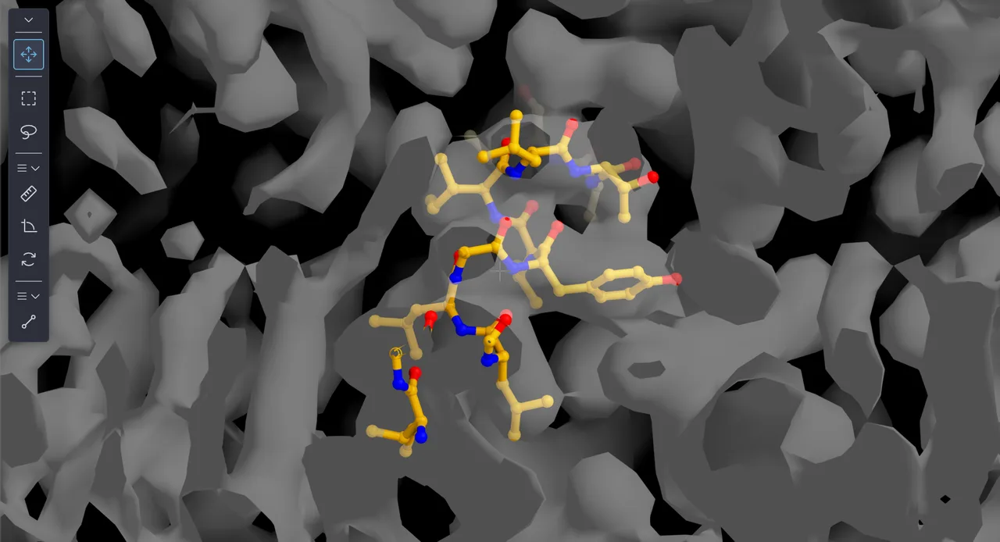

<!-- source: ja/tutorials/experimental/cryoem-map.md @ dcf70c1 -->

# Displaying a cryo-EM map and model

This tutorial fetches a cryo-electron microscopy (cryo-EM) map and the atomic model fitted to it, displays them,
and checks how the appearance changes with the contour level (Level).
The example is the rat TRPV1 channel reconstituted in nanodiscs (EMDB: **EMD-8118**, PDB ID: **5IRZ**).
The resolution is 3.28 Å, a range often encountered in actual analyses. The main chain can be traced and the shapes of large side chains are visible,
but not all side chains are clearly visible.

!!! abstract "About this tutorial"
    - **Subject**: TRPV1 in nanodiscs (EMDB: EMD-8118, PDB ID: 5IRZ)
    - **What you learn**: Fetching a cryo-EM map and model with Get PDB, specifying the level as a top percentage, how Level affects the appearance of side-chain density, cutting out a region with the slab
    - **Prerequisites**: [Displaying an electron density map](density-map.md) (how to use the Density map panel)

{ .on-glb }

## 1. Fetch the map and model

Enter `5IRZ` with **File &gt; Get PDB...**. Because this is a cryo-EM entry, the **Coordinates** and
**Cryo-EM maps** items appear below the input field (→ [Fetching from the PDB (Get PDB)](../../reference/get-pdb.md#cryo-em-maps)).

1. Make sure **Fetch coordinates** under **Coordinates** is ON.
2. Make sure **EMD-8118 map** under **Cryo-EM maps** is ON. Below the row,
   the file size (about 28 MB), grid size (192 on each side) and recommended level are shown.
   They take a moment to appear. Pressing Download while `Reading map information...` is shown
   leaves the recommended level unread, and the level becomes the top 1 %.
3. Press **Download** and select **cartoon** as the Renderer.

    { width="380" .on-glb }

The model becomes an Object named `5irz` (a tetramer made of the four chains B–E), and the map an Object named `emd_8118`.
The map is displayed as an isosurface ([isosurf](../../reference/renderers/isosurf.md)) at the level recommended by the depositors.

!!! note "Default display of cryo-EM maps"
    Unlike crystallographic maps, a cryo-EM map is drawn in its entirety (Region is *Full map*).
    For this reason, **Extent** and **Redraw** in the Density map panel are not used
    (→ [isosurf](../../reference/renderers/isosurf.md)).

## 2. Set the level unit to top percentage

Open the **Crystal &gt; Density map** panel in the left side panel and select `emd_8118/isosurf` at the top.

When loaded, a cryo-EM map holds its level as an absolute value (a density value of the map).
The **Level** input field shows a value around 4, and the value in the other unit (about the top 0.9 %) is shown below it.

1. Press ▼ to the right of the Renderer selection and select **Use top-percent contour level**.

    { width="304" .on-glb }

The input field changes to a top-percentage value. The unit means "what top percentage of grid point values to enclose", and the **smaller the value,
the narrower the enclosed range** (the higher the level). Even when the magnitude of density values differs between maps, they can be compared on the same scale
(→ [DensityMap](../../reference/objects/densitymap.md#map-type)).

## 3. Change the level over the whole map

While looking at the whole map, change **Level** (enter a value in the input field and press ++enter++).

| Level (top %) | Appearance |
|---|---|
| 0.9 (near the recommended level) | The shape of the tetramer and the helices of the transmembrane part are visible. |
| 3 | Even the noise inside the mask (the region outside of which the map is set to 0) is enclosed, and the whole map becomes a spherical lump. |

**Top 0.9 % (near the recommended level)**

{ .on-glb }

**Top 3 %**

{ .on-glb }

If the level is lowered too far, the noise can no longer be distinguished from the protein density.
After checking, return **Level** to near the recommended level (0.9).

## 4. Look at side-chain density in a short range

Check the correspondence between the map and the fitted model in a short range. Here, part of the pore-forming S6 helix
(residues 660–672 of chain B) is used. This range includes large side chains such as tyrosine.

1. Right-click `5irz` in the scene tree and select **ballstick** from **New Renderer**.
   Check **Selection**, enter `B.660:672.*` in **Atoms**, and press **Create**.
2. Close the eye icon of `cartoon1` in the scene tree to hide the cartoon.
3. Select the `ballstick1` row and press **Focus**.
4. In the **Explorer &gt; View** panel in the left side panel, enter `10` in **Slab**.
   Only 5 Å in front of and behind the view center are displayed, and the density of the surrounding helices is cut away.
5. Set **Transp** in the Density map panel to around 0.5 so that the model inside the isosurface is visible.

Rotate the molecule so that the helix is seen from the side. Then change **Level** and
compare how far the side chains are enclosed by the density.

| Level (top %) | Appearance |
|---|---|
| 0.3 | The density becomes thin, and the tips of side chains such as leucine stick out. The tyrosine rings remain mostly enclosed. |
| 0.9 (near the recommended level) | The tyrosine rings are enclosed by the density, and the main chain of the helix also appears continuous. |
| 3 | The density thickens and connects to other density, and the shapes of the side chains can no longer be read. |

**Top 0.3 %**

{ .on-glb }

**Top 0.9 % (near the recommended level)**

{ .on-glb }

**Top 3 %**

{ .on-glb }

At a resolution in the low 3 Å range, even within the same helix, large rigid side chains such as aromatic rings are clearly visible,
while small or flexible side chains are not. When checking the orientations of the side chains in a model,
it is important to look while raising and lowering the level, not at a single level.

## The same with commands

The steps on this page can be written as native-mode commands of the [Console](../../reference/plugins/console/index.md) as follows. Enter them in the Console one line at a time (they can also be run from [tritium_cli](../../reference/plugins/console/cli.md)). To check the arguments of each command, run `help <command>` in the Console (→ [Console command list](../../reference/plugins/console/commands.md)).

```
# 1. Fetch the map and model
fetch_pdb 5IRZ, mmcif, cartoon
fetch_emdb EMD-8118
# 2. Set the level unit to top percentage (GUI only)
list_map_contours
# 3. Change the level over the whole map
set_map_contour emd_8118/isosurf, level=3
set_map_contour emd_8118/isosurf, level=0.9
# 4. Look at side-chain density in a short range
create_renderer 5irz, ballstick, selection="B.660:672.*"
hide 5irz/cartoon1
focus_nodes 5irz/ballstick1
set_view slab=10
set_map_contour emd_8118/isosurf, alpha=0.5
set_map_contour emd_8118/isosurf, level=0.3
```

- `fetch_emdb` displays the map at the level recommended by EMDB. `list_map_contours` shows
  that level as a top percentage (`unit=percent`).
- For cryo-EM maps, the `level` of `set_map_contour` is always specified as a top percentage
  (independent of the unit setting in the Density map panel).

## Next steps

- [Displaying an electron density map](density-map.md) — displaying crystallographic maps (2Fo-Fc / Fo-Fc)
- [isosurf](../../reference/renderers/isosurf.md) — settings for cryo-EM maps such as Region / Level of detail
- [Exporting high-resolution images for publication](../figures/publication-images.md)

---

*Verified against: CueMol3 3.0.6.577*
