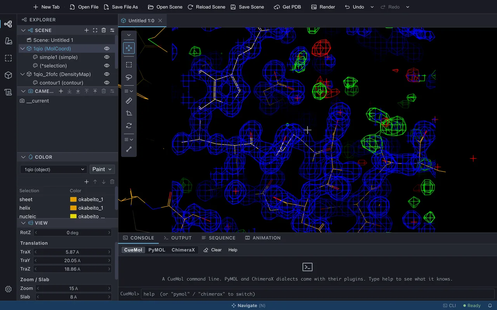
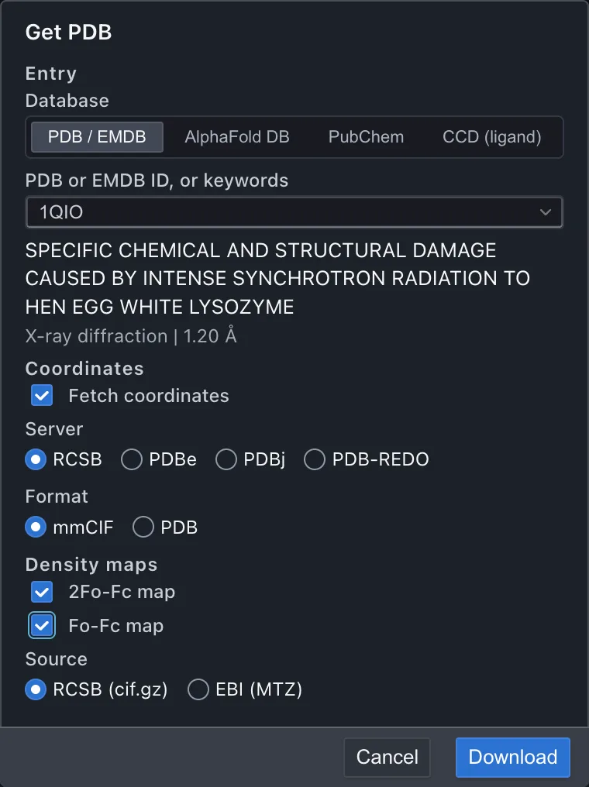
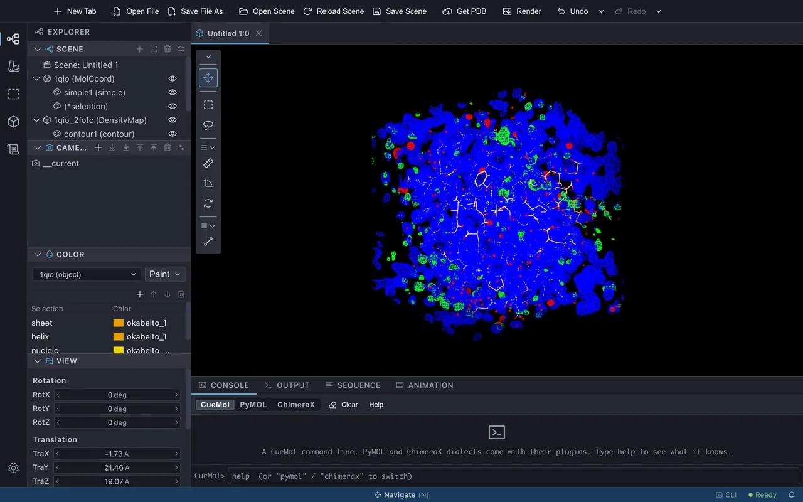
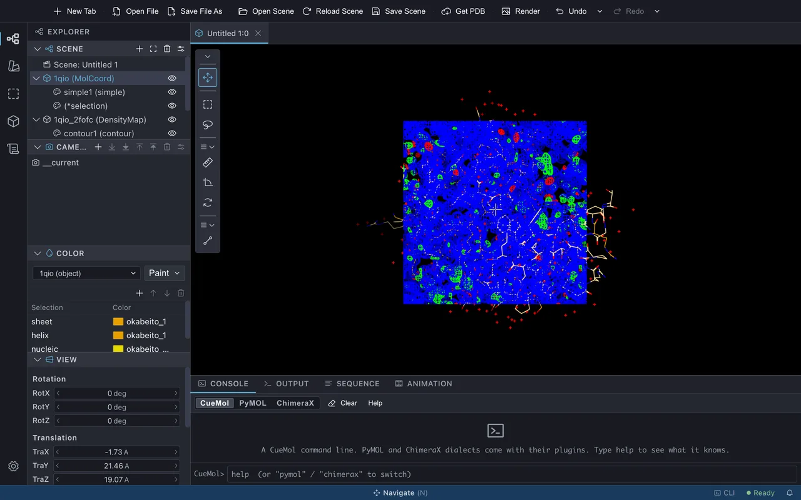
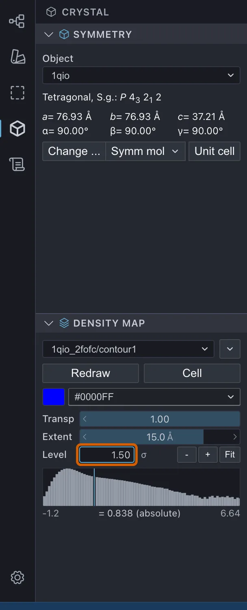
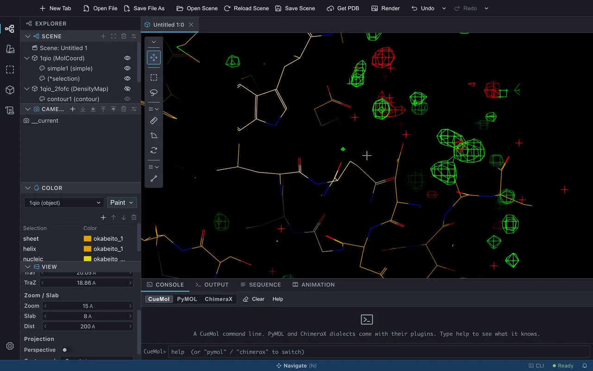

<!-- source: ja/tutorials/experimental/density-map.md @ 1002eeb -->

# Displaying an electron density map

This tutorial shows how to overlay an electron density map on an X-ray crystal structure and check how the model fits the density.
The example is the crystal structure of lysozyme (PDB ID: **1QIO**); the 2Fo-Fc map and the Fo-Fc map are downloaded from the network together with the coordinates.

!!! abstract "About this tutorial"
    - **Subject**: The 2Fo-Fc / Fo-Fc maps of lysozyme (PDB ID: 1QIO)
    - **What you learn**: Fetching maps with Get PDB, adjusting the level and range in the Density map panel, checking a region of interest
    - **Prerequisites**: [Loading and displaying a structure](../basic/loading.md) in the basic course

{ .on-glb }

## 1. Fetch the coordinates and density maps together

**File &gt; Get PDB...** can fetch electron density maps in addition to coordinates.

1. Enter `1QIO` in **PDB or EMDB ID, or keywords**.
2. In addition to **Fetch coordinates**, check **2Fo-Fc map** and **Fo-Fc map**.
3. Leave the map source at the default **RCSB (cif.gz)** (**EBI (MTZ)** also works).
4. When the download finishes, a dialog appears for specifying the Object name and Renderer of the coordinates.
   Choosing **simple** (line drawing) here makes it easier to see the correspondence between density and atoms.

{ width="380" .on-glb }

No Renderer dialog appears for the maps; they are displayed automatically with the following configuration.

| Object | Renderer | Color | Level |
|---|---|---|---|
| `1qio_2fofc` | contour1 | Blue | +1.0σ |
| `1qio_fofc` | pos-cont | Green | +3.0σ |
| `1qio_fofc` | neg-cont | Red | −3.0σ |

The 2Fo-Fc map (blue) is the density that envelops the whole model. The Fo-Fc map shows the difference between the observed data and the model: green indicates places where there is density but no model, and red indicates places where there is a model but no density.

## 2. Check the display

In the **Explorer &gt; Scene** tree in the left side panel (scene tree →
[Side panels](../../ui/side-panels.md)), the map Objects (`1qio_2fofc` / `1qio_fofc`) and their contour Renderers are listed separately from the coordinate Object. The eye icons toggle their visibility individually.

Right after loading, the view may move to the center of the map's range (near the center of the unit cell), and the map may be drawn away
from the molecule. In that case, select `1qio` in the scene tree and press **Focus** at the top of the panel, then press
**Redraw** for each Renderer in the **Crystal &gt; Density map** panel to redraw the map at the molecule's position.

{ .on-glb }
{ .on-glb }

Crystallographic maps are drawn **only around the view center**. When the molecular view is translated, the displayed map region follows (a cryo-EM map is drawn in its entirety, and the display range adjustment below is not needed
→ **Region** in [contour](../../reference/renderers/contour.md#contour)).

The name "contour" comes from extending the familiar two-dimensional contour lines of maps to three dimensions. For how the display works, see
[contour](../../reference/renderers/contour.md);
for the map Object, see [DensityMap](../../reference/objects/densitymap.md).

## 3. Adjust the level and extent

The map display is adjusted in the **Crystal &gt; Density map** panel in the left side panel
(→ [Side panels](../../ui/side-panels.md)).

1. At the top, select the target Renderer (such as `1qio_2fofc/contour1`).
2. Change the contour level by dragging the marker on the **Level** histogram
   (a value can also be typed into the input field). Raise it when noise is distracting, and lower it to see weak density. Here, set the Level of 2Fo-Fc to `1.5`.
3. Change the display range (distance from the center) with the **Extent** slider.
4. Change the transparency with the **Transp** slider.

By default, the level of a crystallographic map is in σ units (the standard deviation of the map taken as 1).
As a guide, view the 2Fo-Fc map at 1 to 1.5σ and the Fo-Fc map at around ±3σ.
The ▼ menu item **Use absolute contour level** switches to specifying an absolute value
(the value in the other unit is shown below Level). For a cryo-EM map, the unit is the top percentage of grid point values instead of σ, and the level is specified as an absolute value when the map is loaded.
Note that the upper limit of **Extent** is determined by the **Buffer size** property of the contour; to extend it further, increase it in the inspector.

{ width="304" .on-glb }

## 4. Focus on a region of interest

This is the procedure for zooming in on a region of interest such as the active site.

1. Move the view so that the region of interest is at the center. Here we look at Glu35 and Asp52 in the active site.
   In the **Selection &gt; Mol Struct** panel, choose residues 35 and 52 (++cmd++ / ++ctrl++ + click),
   and press **Zoom at**.
2. Lower **Extent** to about 10 Å to reduce the surrounding mesh.
3. If the display has not followed, **Redraw** in the panel updates the display center to the current view center.
4. Narrowing the **Slab** (the width of the depth range displayed) to about 8 Å also reduces the mesh in front of and behind the region of interest, making it easier to see (→ the View panel in [Side panels](../../ui/side-panels.md)).

{ .on-glb }

To see only the green and red Fo-Fc meshes, close the eye icon of
`1qio_2fofc` in the scene tree to hide the 2Fo-Fc map temporarily.

{ .on-glb }

## 5. Finish as a figure

A figure containing a density map can be exported in the same way as an ordinary scene
(→ [Exporting high-resolution images for publication](../figures/publication-images.md)).

## The same with commands

The steps on this page can be written as native-mode commands of the [Console](../../reference/plugins/console/index.md) as follows. Enter them in the Console one line at a time (they can also be run from [tritium_cli](../../reference/plugins/console/cli.md)). To check the arguments of each command, run `help <command>` in the Console (→ [Console command list](../../reference/plugins/console/commands.md)).

```
# 1. Fetch the coordinates and the density maps together
fetch_pdb 1QIO, mmcif, simple
fetch_map 1QIO, 2fofc
fetch_map 1QIO, fofc
# 2. Check the display (list the map Renderers and their levels)
list_map_contours
# 3. Adjust the level and range
set_map_contour 1qio_2fofc/contour1, level=1.5, alpha=0.6
# 4. Focus on a region of interest (the active-site Glu35 and Asp52)
zoom 1qio, "A.35,52.*"
set_map_contour 1qio_*/*, extent=10
recenter_map 1qio_*/*
set_view slab=8
hide 1qio_2fofc
# 5. Finish as a figure (→ Exporting high-resolution images for publication)
```

- `1qio_*/*` is a wildcard that specifies the contour Renderers (three of them) of the two map Objects at once.
- The `alpha` of `set_map_contour` is the opacity (0 to 1) that corresponds to **Transp** in the Density map panel.
- Enclose selection expressions that contain commas (`A.35,52.*`) in quotes.

## Next steps

- [Displaying symmetry mates and the unit cell](symmetry.md) — look at the crystal packing of the same 1QIO
- [contour](../../reference/renderers/contour.md) / [DensityMap](../../reference/objects/densitymap.md) — details of the display settings
- [Side panels](../../ui/side-panels.md) — each item of the Density map panel

---

*Verified against: CueMol3 3.0.6.577*
