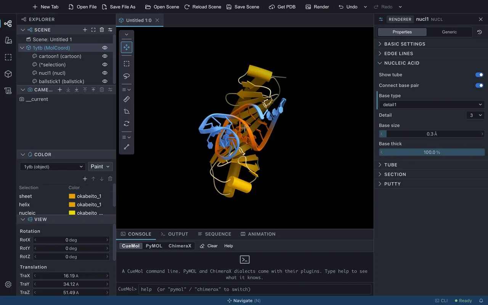
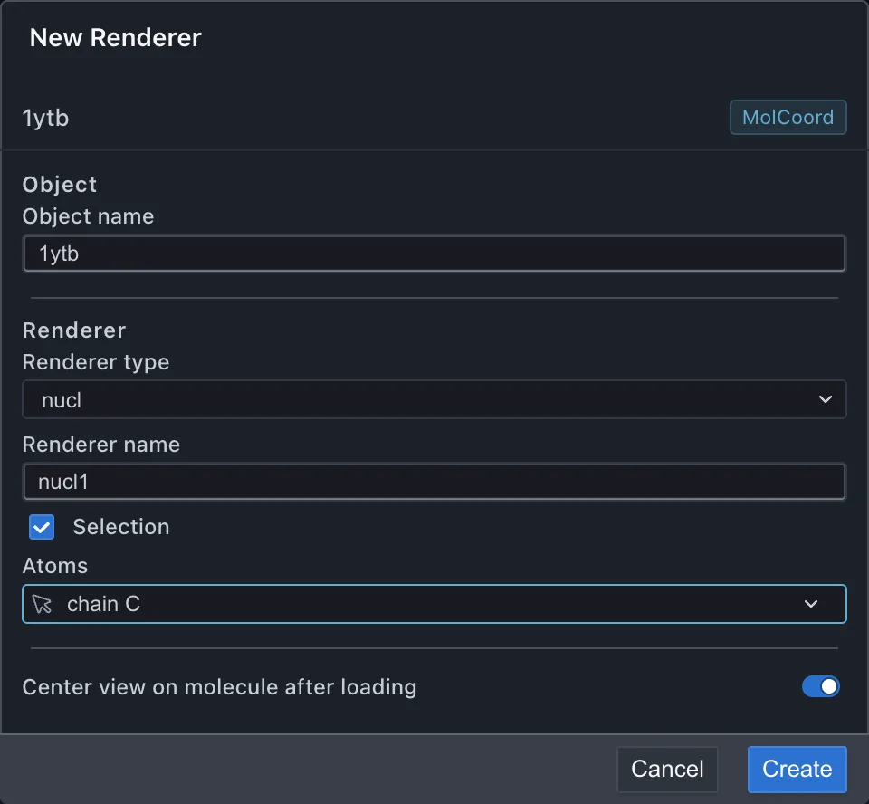
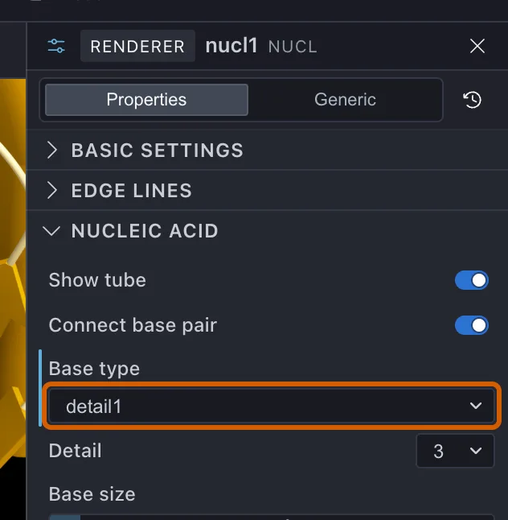
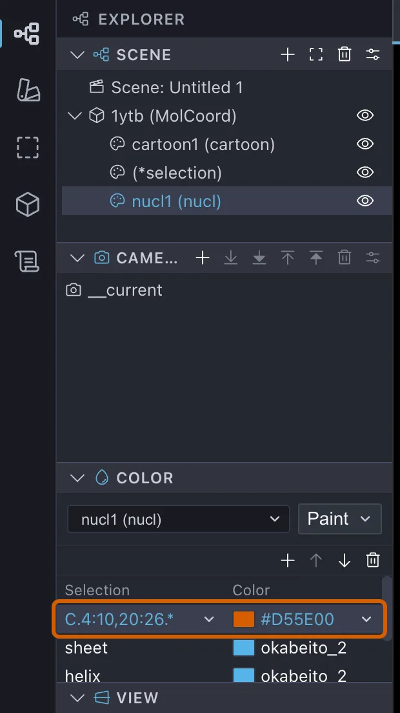

<!-- source: ja/tutorials/figures/protein-dna.md @ 53a8286 -->

# Displaying a protein-DNA complex

This tutorial shows how to display a protein as a cartoon and DNA as nucl, and build a figure that colors the DNA recognition sequence and key protein residues differently.
The example is the complex of yeast TATA-binding protein (TBP) and DNA containing a TATA box (PDB ID: **1YTB**).
TBP is shaped like a saddle, sits on the minor groove side of the DNA, and bends the DNA sharply.

!!! abstract "About this tutorial"
    - **Subject**: Complex of yeast TBP and DNA (PDB ID: 1YTB)
    - **What you learn**: Displaying DNA with nucl, switching the Base type, coloring a sequence with Paint, showing side chains with `bysidech`
    - **Prerequisites**: The basic course up to [Coloring Renderers](../basic/coloring.md)

{ .on-glb }

## 1. Load the structure

Fetch `1YTB` with **File &gt; Get PDB...**. Select **cartoon** as the Renderer,
check **Selection**, and enter `chain A` in **Atoms**.

The asymmetric unit of 1YTB contains two TBP-DNA complexes (TBP is chain A / B, DNA is chain C / D).
This tutorial uses the first one (chain A and chain C). The DNA is a single 29-base strand that folds back at the end
to form a double helix as a hairpin (bases 1-12 pair with 18-29, and 13-17 form the loop).

## 2. Display the DNA with nucl

cartoon is a Renderer that draws the protein main chain. For nucleic acids, use the dedicated nucl
(→ [nucl (nucleic acid)](../../reference/renderers/nucl.md)).

1. Right-click `1ytb` in the scene tree and select **New Renderer...**.
2. Select **nucl** from **Renderer type**, check **Selection**, and enter `chain C` in **Atoms**.
3. Press **Create**.

    { width="480" .on-glb }

The DNA backbone is shown as a tube and the bases as sticks. Two bases that form a base pair
are connected by a single stick.

## 3. Change the base shape

1. Select `nucl1` in the scene tree.
2. In the **Nucleic acid** section of the property inspector, set **Base type** to **detail1**.

    { width="316" .on-glb }

The bases become plate-shaped, which makes the base stacking easier to see.
Try the other shapes (simple1 / detail2 / None) as well.

## 4. Color the DNA

Renderers are colored with the default color of each molecule, so right after loading, TBP and DNA have similar colors.
Give the DNA a different color, and the TATA box an even more prominent one.

1. Open the **Explorer &gt; Color** panel in the left side panel, and select `1ytb/nucl1` at the top.
2. From the Coloring types, select **Paint coloring** &gt; **Okabe-Ito** &gt; **Sky blue**.
3. Add a row at the top of the table, and set the selection expression to `C.4:10,20:26.*` and the color to the Okabe-Ito **Vermillion** (`#D55E00`).

    { width="310" .on-glb }

The DNA turns sky blue, and the TATA box (`TATAAAA` at bases 4-10, and 20-26 that pair with it) turns vermillion
(→ [Coloring Renderers](../basic/coloring.md)).

## 5. Show the phenylalanines that wedge into the DNA

TBP inserts the side chains of four phenylalanines (Phe99, Phe116, Phe190 and Phe207), two near each end of the TATA box,
between the DNA bases. The DNA bends at these positions.

1. Select **ballstick** from **New Renderer...** of `1ytb`.
2. Check **Selection**, enter `bysidech A.99,116,190,207.*` in **Atoms**, and press **Create**.

`bysidech` limits the selection to the side chain (and Cα) (→ [Selection expression syntax](../../reference/selection.md#bysidech-operator)).
Because the main chain is left out, only the side chains extend from the cartoon.

Rotate the molecule and check how the DNA bends and how the Phe side chains wedge between the bases.
The β-sheet of TBP contacts the minor groove side of the DNA over a wide area, and the DNA bends away from TBP.

{ .on-glb }

## The same with commands

The steps on this page can be written as native-mode commands of the [Console](../../reference/plugins/console/index.md) as follows. Enter them in the Console one line at a time (they can also be run from [tritium_cli](../../reference/plugins/console/cli.md)). To check the arguments of each command, run `help <command>` in the Console (→ [Console command list](../../reference/plugins/console/commands.md)).

```
# 1. Load the structure
fetch_pdb 1YTB, mmcif, cartoon, selection="chain A"
# 2. Display the DNA with nucl
create_renderer 1ytb, nucl, selection="chain C"
focus_nodes 1ytb/cartoon1 1ytb/nucl1
# 3. Change the base shape
set 1ytb/nucl1.base_type, detail1
# 4. Color the DNA
set_renderer_coloring 1ytb/nucl1, paint-type-paint, paintColor=okabeito_2
add_paint 1ytb/nucl1, "C.4:10,20:26.*", #D55E00
# 5. Show the phenylalanines that wedge into the DNA
create_renderer 1ytb, ballstick, selection="bysidech A.99,116,190,207.*"
```

- `focus_nodes` sets the view so that all the given Renderers fit, the same as selecting several rows in the scene tree and pressing **Focus**.

## Next steps

- [nucl (nucleic acid)](../../reference/renderers/nucl.md) — settings such as Base type and Pivot atom name
- [Making a protein ribbon figure](ribbon-figure.md) — finishing touches such as outlines and background
- [Exporting high-resolution images for publication](publication-images.md)

---

*Verified against: CueMol3 3.0.7.578*
