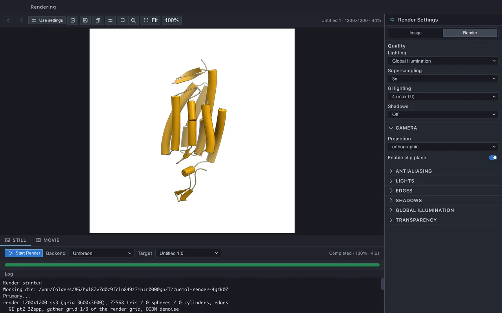
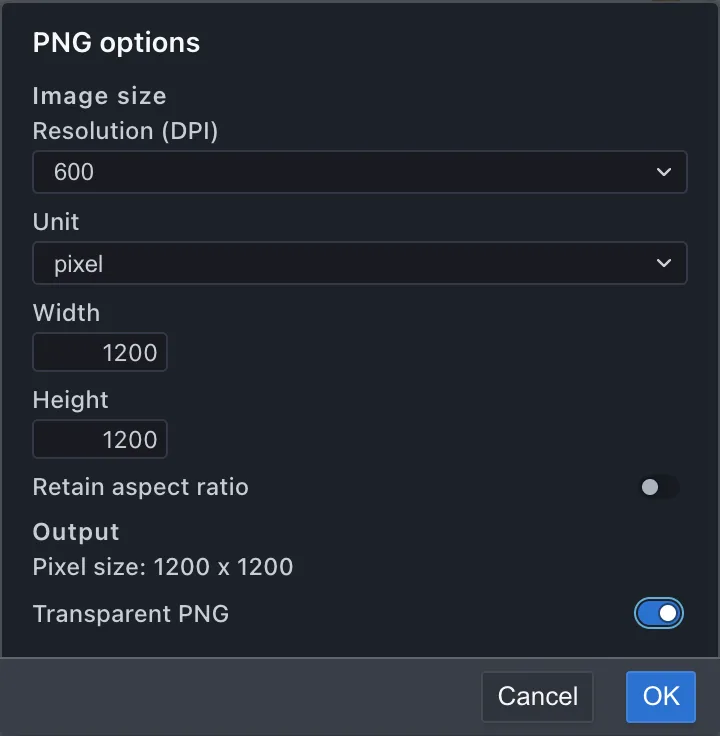
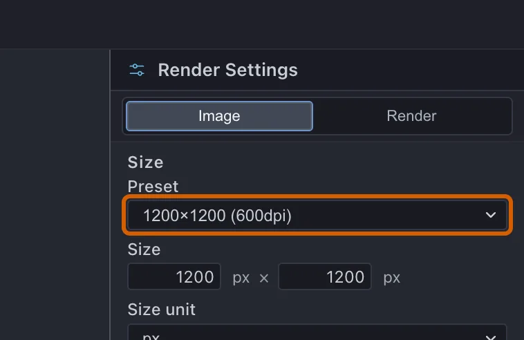
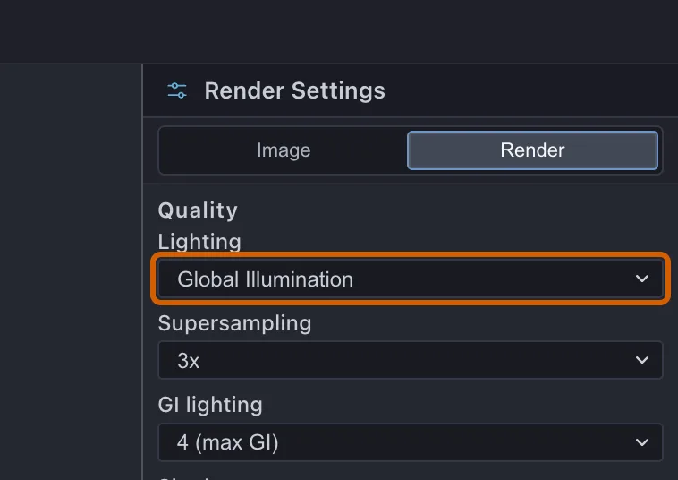
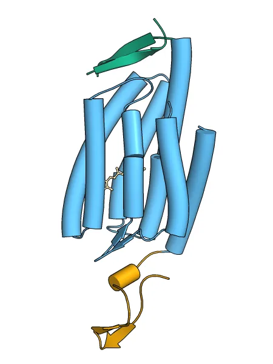
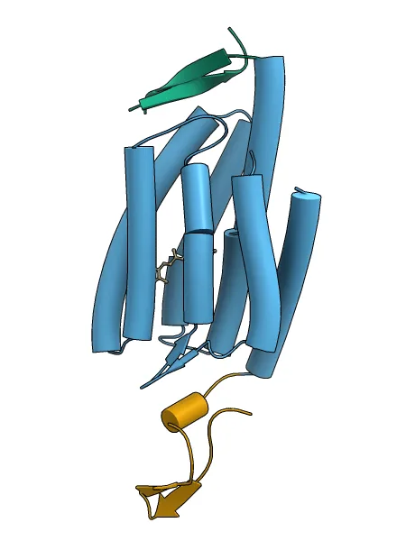

<!-- source: ja/tutorials/figures/publication-images.md @ 1002eeb -->

# Exporting high-resolution images for publication

This tutorial walks through exporting a scene as an image of publication or presentation quality.
It uses the scene finished in [Making a protein ribbon figure](ribbon-figure.md) as the example,
but the procedure is the same for any scene.

!!! abstract "About this tutorial"
    - **Subject**: The scene finished in [Making a protein ribbon figure](ribbon-figure.md) (any scene will do)
    - **What you learn**: When to export a PNG as shown on screen and when to finish with ray tracing
    - **Prerequisites**: [Making a protein ribbon figure](ribbon-figure.md)

{ .on-glb }

## 1. The two output methods and when to use them

| Method | Characteristics | Suited for |
|---|---|---|
| **Rendering &gt; Export scene &gt; PNG image...** | Exports the on-screen rendering as is. Fast | Working records, slides, checking |
| **Rendering &gt; Image rendering...** (rendering window) | High-quality rendering by ray tracing. Higher quality shading and outlines | Figures for papers, posters |

A quick and reliable workflow is to check the composition with Export scene first,
then finish the final version in the rendering window. The finished image is normally pasted
into presentation software or figure-making software to assemble a composite figure.

## 2. Exporting the screen as PNG

When **Rendering &gt; Export scene &gt; PNG image...** is selected, an options screen appears
after the destination is specified.

- The **size** (**Width** / **Height**) and **resolution** (**Resolution (DPI)**) can be specified.
- Enabling **Transparent PNG** produces a PNG with a transparent background (useful for overlaying on slides).

{ width="360" .on-glb }

DPI does not affect the number of pixels in the image. It determines the **physical size on paper**
when the exported PNG is pasted into other software and printed (for example, a 1200×1200 pixel
image exported at 600 DPI prints at 2×2 inches, about 5 cm square).

For other output formats (POV-Ray SDL / STL / MQO, etc.), see the
[Rendering menu](../../menu/rendering.md).

## 3. Finishing with ray tracing

When **Rendering &gt; Image rendering...** is selected, a separate **rendering window** opens
in Still mode. The window is modeless, so the view can be adjusted in the main window while
it stays open (→ [Rendering window](../../ui/rendering-window.md)).

1. In the run bar at the bottom, select the view to render in **Target**.
   **Backend** can be left at the default, **Umbreon**
2. Select the output size in the **Image** tab. Choose a preset (for example, **1200×1200 (600dpi)**)
   or specify the width and height directly with **Custom**
3. In the **Quality** section of the **Render** tab, check that **Lighting** (how shading is applied) is the default
   **Global Illumination**. Shading by global illumination adds a sense of depth, even where the tubes of
   the cartoon's helices overlap.
   **Supersampling** (the setting that smooths outlines) can be left at the default
4. Press **Start Render** to start rendering. Progress is displayed.

{ width="380" .on-glb }
{ width="380" .on-glb }

!!! tip "Raytrace only when speed comes first"
    Setting **Lighting** to **Raytrace only** skips the global illumination calculation, so rendering is faster.
    In exchange, the shading is weaker and a cartoon loses some of its depth (see below). Figures of thin ribbons or lines
    show little difference, so it is a good choice for checking the composition or for trial renders.

    { width="300" .on-glb }
    { width="300" .on-glb }

For the meaning of each quality item and how to choose among them, see [Rendering](../../reference/rendering.md).

!!! note "Differences from CueMol2"
    High-quality output in CueMol2 called an external POV-Ray, but in CueMol3 the built-in
    ray tracer **Umbreon** is the default, and neither preparing an external program nor
    setting a path is needed (→ [Rendering window](../../ui/rendering-window.md)).

## 4. Checking and saving the result

When rendering completes, the resulting image is displayed in the image area at the upper left
of the window.

- **Save** in the image area toolbar saves it as a PNG file.
- **Copy** copies it to the clipboard.
- The arrow buttons step back through the history of past rendering results. The history also
  records the settings used at the time, and pressing **Use settings** restores them.

If the composition or quality is not satisfactory, adjust in the main window and run
**Start Render** again. Settings remain in the result history, so results can be compared
while experimenting.

!!! note "Rendering window settings are saved in the scene"
    The settings are saved together with the scene file and are still there the next time the
    scene is opened. Changes to the settings can be reverted with Undo. To return to past
    settings, use **Use settings** in the result history (→ [Rendering](../../reference/rendering.md#saving-settings)).

## The same with commands

The steps on this page can be written as native-mode commands of the [Console](../../reference/plugins/console/index.md) as follows. Enter them in the Console one line at a time (they can also be run from [tritium_cli](../../reference/plugins/console/cli.md)). To check the arguments of each command, run `help <command>` in the Console (→ [Console command list](../../reference/plugins/console/commands.md)).

```
# 2. Export a PNG as shown on screen (1200×1200 pixels, 600 DPI)
export_scene ~/3ug9.png, png, 1200, 1200, dpi=600
# 3. Finish with ray tracing (export at 1200×1200 with the default Global Illumination)
render_image ~/3ug9-rt.png, 1200, 1200
# 4. Check and save the result (GUI only)
```

- Adding `transparent=true` to `export_scene` gives a PNG with a transparent background.
- To use **Raytrace only**, run
  `set_render_settings "umbreon.useGI=false; umbreon.aoEnabled=false; umbreon.lightIntensity=1.55; umbreon.flashFraction=0.6; umbreon.ambientFraction=0.16"`
  before `render_image`. The values are the same as choosing **Raytrace only** for **Lighting** in the rendering window.
  The settings are saved in the scene and are also reflected in the rendering window.
- `render_image` writes the result directly to a file. It does not appear in the result history of the rendering window.

## Next steps

- [Rendering](../../reference/rendering.md) — Details and default values of the quality items
- [Rendering window](../../ui/rendering-window.md) — Description of each part of the window

---

*Verified against: CueMol3 3.0.6.577*
