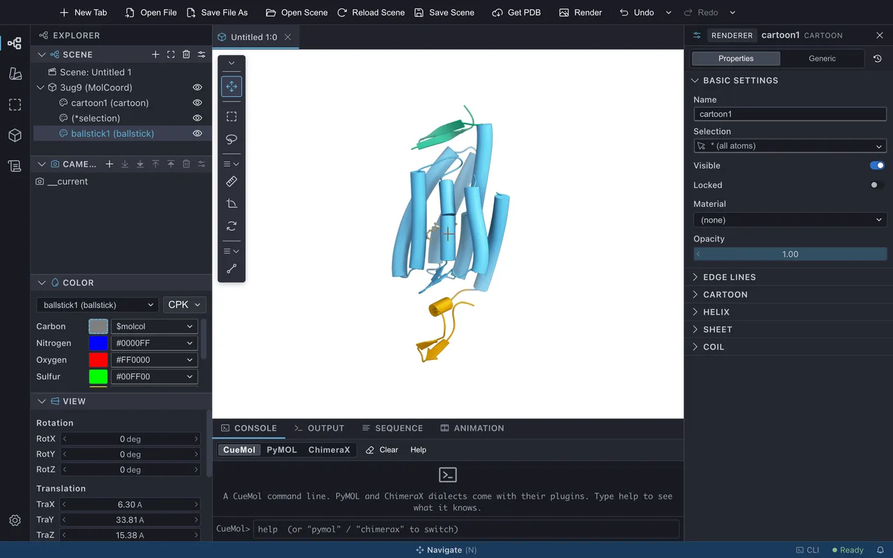
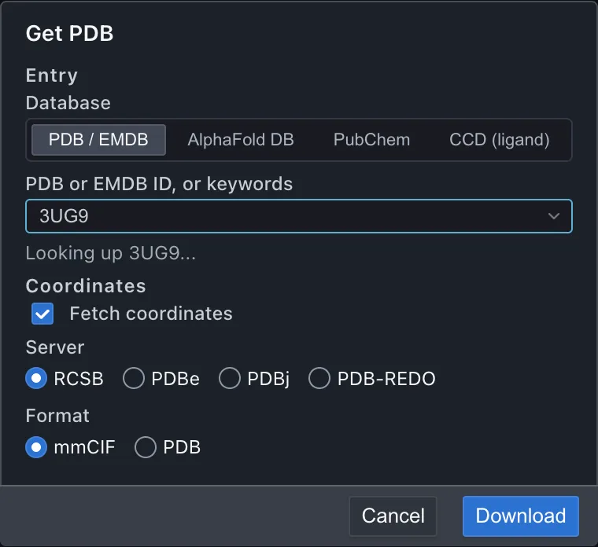
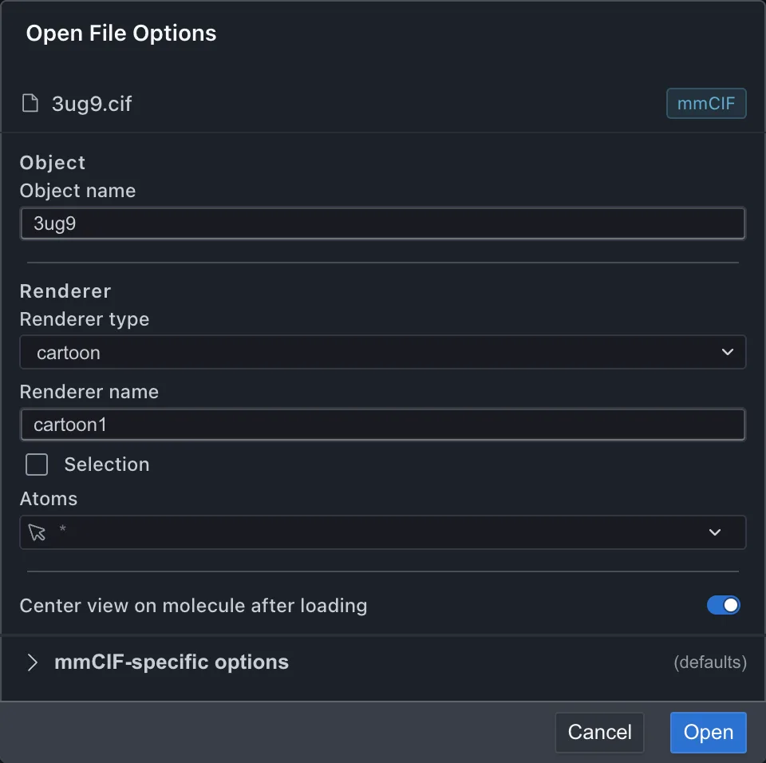
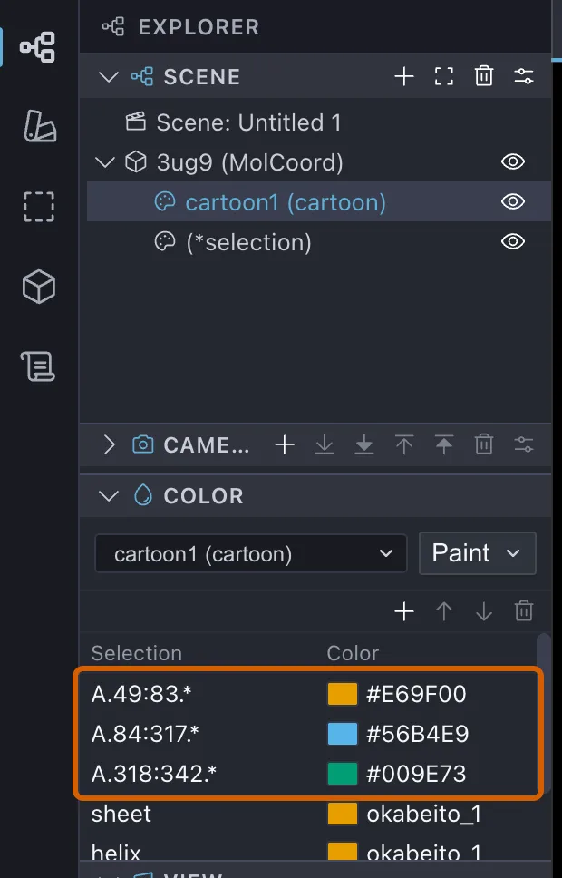
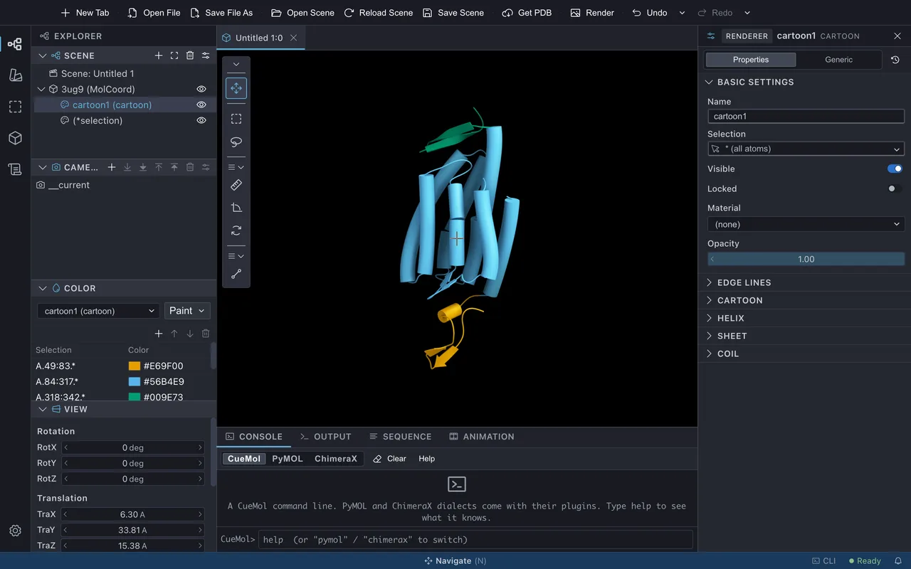
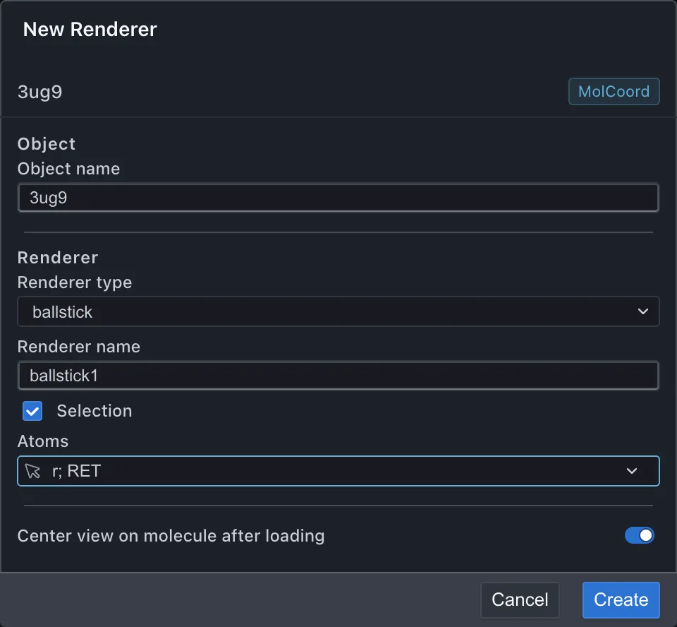
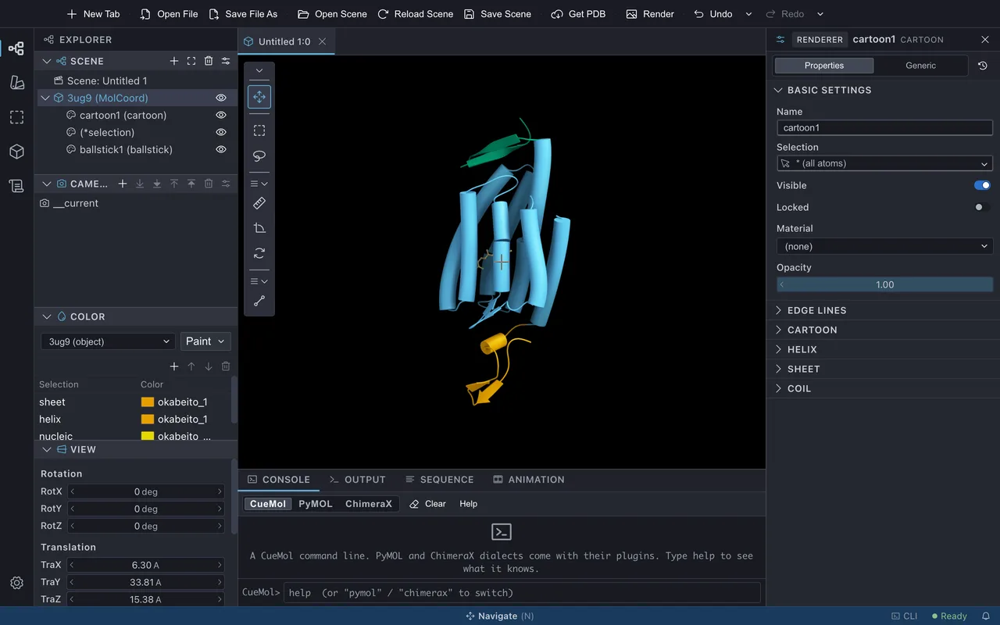

<!-- source: ja/tutorials/figures/ribbon-figure.md @ 1002eeb -->

# Making a protein ribbon figure

This tutorial follows the whole process of building a single figure: display a protein as a cartoon (a so-called ribbon diagram), overlay a ligand as a ballstick, and finish the figure by adjusting colors and outlines. The example is the crystal structure of channelrhodopsin (PDB ID: **3UG9**).

This tutorial assumes you have gone through the [Quick tour](../../getting-started/quick-tour.md) (startup, loading, and basic view operations).

!!! abstract "About this tutorial"
    - **Subject**: Channelrhodopsin (PDB ID: 3UG9)
    - **What you learn**: Adjusting cartoon, coloring by domain, ballstick for the ligand, finishing with the background and outlines
    - **Prerequisites**: [Quick tour](../../getting-started/quick-tour.md)

{ .on-glb }

## 1. Fetch the structure

Use **File &gt; Get PDB...** to fetch the structure from the network.

1. Enter `3UG9` in **PDB or EMDB ID, or keywords**.
2. Make sure **Fetch coordinates** is checked (leave **Server** at the default **RCSB** and **Format** at the default **mmCIF**)
3. When the download finishes, a screen for specifying the Object name and Renderer appears.
4. Select **cartoon** from **Renderer type**, and create it with everything else at the defaults.

    { width="380" .on-glb }
    { width="480" .on-glb }

The protein part is drawn as a cartoon that reflects the secondary structure
(→ [cartoon](../../reference/renderers/cartoon.md)).

!!! tip "A preset does it in one step"
    If you select **Default preset 2** under Presets in **Renderer type**, a Renderer group is created at once, combining a cartoon for the protein, a ballstick for nucleic acids, and a ballstick for everything else (ligands and so on).
    In this tutorial, Renderers are created one by one to show how it works.

## 2. Adjust the view

Rotate with a left drag on the molecular view and zoom with the wheel until the whole molecule is visible
(→ [Mouse and trackpad input](../../ui/mouse-input.md)).

To fit the view to the whole molecule again, select the
Object (3UG9) in the **Explorer &gt; Scene** tree of the left side panel
(the scene tree → [Side panels](../../ui/side-panels.md)), and press the **Focus** button at the top of the panel.

## 3. Adjust the appearance of the cartoon

When you select the cartoon Renderer in the scene tree, its settings appear in the **property inspector** on the right. Changes are reflected in the molecular view immediately and can be undone with ++cmd+z++ / ++ctrl+z++.

The width and thickness of helices are adjusted in the **Helix** section, those of sheets in **Sheet**, and those of loops in **Coil**. For example, if the ligand overlaid in a later step is hard to see because it is hidden by a helix, making the **Helix** width thinner lets you see inside. For the meaning and default of each property, see
[cartoon](../../reference/renderers/cartoon.md).

## 4. Color each domain differently

3UG9 contains a single molecule (chain A). Three regions, the N-terminal domain, the transmembrane part, and the C-terminal domain, are colored separately by residue number range.

1. Open the **Explorer &gt; Color** panel in the left side panel.
2. Select the cartoon Renderer at the top.
3. Select **Paint coloring** &gt; **Okabe-Ito** &gt; **Orange** as the Coloring type.
   A table with the standard coloring by secondary structure (four rows: sheet / helix / nucleic / `*`) appears.
4. Add the following three rows at the top of the table and specify their selection expressions and colors (selecting the top row
   and pressing the add button inserts a row above it).

| Region | Selection expression | Example color |
|---|---|---|
| N-terminal domain | `A.49:83.*` | `#E69F00` (orange) |
| Transmembrane part | `A.84:317.*` | `#56B4E9` (sky blue) |
| C-terminal domain | `A.318:342.*` | `#009E73` (bluish green) |

Paint is evaluated from the top row down, and the color of the first matching row is used
(→ [Coloring](../../reference/coloring.md)). The three rows are above the secondary-structure rows,
so the region colors are used in these ranges. The ranges do not overlap, so the order of the three rows does not matter. `A.49:83.*` means "all atoms of residues 49 to 83 in chain A" (→ [Selection expression syntax](../../reference/selection.md)).

{ width="310" .on-glb }

{ .on-glb }

!!! note "Differences from CueMol2"
    CueMol2 also had a Paint panel, but rows (entries) had to be edited in a separate dialog. In CueMol3, **table cells can be edited directly**
    (→ [Merged, renamed, and removed features](../../changes/features.md)).

!!! tip "For a single chain, Rainbow is also a classic"
    **Rainbow**, which changes color like a rainbow from the N terminus to the C terminus, is also a classic way to show the course of the chain.
    Just select Rainbow as the Coloring type to apply it.

!!! tip "Styles can keep colors consistent across figures"
    Giving names to color and selection definitions and sharing them lets you make figures with a consistent color scheme across multiple scenes (→ [Styles](../../reference/styles.md)).

## 5. Show the ligand as a ballstick

A cartoon draws only the course of the main chain, so the ligand is not displayed.
Overlay the retinal (residue name `RET`) of 3UG9 as a ballstick (ball-and-stick model).

1. Right-click the Object (3UG9) in the scene tree and select **New Renderer...**.
2. Select **ballstick** from **Renderer type**.
3. Check **Selection** and enter `r; RET` as the selection expression.
4. Press **Create**, and the retinal is drawn as a ballstick over the cartoon.
   **Center view on molecule after loading** in the dialog is on by default, so the view moves to the new
   Renderer (the retinal).
5. To see the whole molecule, select the Object (3UG9) and press **Focus**, as in step 2.

Multiple Renderers can be stacked on one Object in this way. What each Renderer displays is narrowed down with a selection expression (`r;` is a shorthand for selection by residue name →
[Selection expression syntax](../../reference/selection.md)).

If you do not know the residue name, you can also find and select the residue in the tree of the **Selection &gt; Mol Struct** panel (→ [Side panels](../../ui/side-panels.md)).
If the ligand is too small to see in an overview figure, displaying it as **cpk** (space-filling model) instead of ballstick is also a classic choice.

{ width="480" .on-glb }

{ .on-glb }

## 6. Finish with a background and outlines

In figures for papers, combining a white background with outlines (edge lines) is a classic choice.
Edge lines make the boundaries of each element clear even on a white background.

1. Set the background to white with **Scene &gt; Background &gt; White**.
2. Right-click the cartoon Renderer in the scene tree.
3. Select **Style &gt; Edge line (normal)**. The edge line type and width are set together.
4. Repeat the same operation (steps 2-3) for the ballstick Renderer.

To make the lines thicker or thinner, select **Edge line (thick)** /
**Edge line (thin)** from the same menu. To remove them, select **No edge line**
(→ [Edge lines](../../reference/renderers/edge-lines.md)).

!!! tip "Check the ligand colors on a white background"
    On a white background, light-colored atoms may blend into the background and become hard to see.
    If this bothers you, darken the carbon color with **CPK** in the **Color** panel (for example `#404040`)
    (→ [Color syntax](../../reference/color-syntax.md)).

{ .on-glb }

## 7. Save the camera and scene

Once the view is decided, save it as a camera so that you can return to the same composition later.

1. Click **Explorer** in the activity bar to open the **Camera** panel.
2. Press the **New camera from view** button, and create a camera with a name.

Double-clicking a camera row returns to that view at any time
(→ [Camera](../../reference/camera.md)).

Finally, save the scene to a `.qsc` file with **File &gt; Save Scene** (++cmd+s++ / ++ctrl+s++). On saving, the current view is also recorded as a camera named `__current` and is applied the next time the file is opened. If you enable **Embed possible** in the **Scene options** dialog that opens on saving, the molecular data is also included in the `.qsc`, so the file can be carried around by itself
(→ [File menu](../../menu/file.md)).

## The same with commands

The steps on this page can be written as native-mode commands of the [Console](../../reference/plugins/console/index.md) as follows. Enter them in the Console one line at a time (they can also be run from [tritium_cli](../../reference/plugins/console/cli.md)). To check the arguments of each command, run `help <command>` in the Console (→ [Console command list](../../reference/plugins/console/commands.md)).

```
# 1. Fetch the structure
fetch_pdb 3UG9, mmcif, cartoon
# 2. Adjust the view
focus 3ug9
# 3. Adjust the look of the cartoon (list the properties that can be set)
props 3ug9/cartoon1
# 4. Color by domain
set_renderer_coloring 3ug9/cartoon1, paint-type-paint
add_paint 3ug9/cartoon1, A.49:83.*, #E69F00
add_paint 3ug9/cartoon1, A.84:317.*, #56B4E9
add_paint 3ug9/cartoon1, A.318:342.*, #009E73
set_mol_selection 3ug9, ""
# 5. Show the ligand as ballstick
create_renderer 3ug9, ballstick, selection="r; RET"
# 6. Finish with the background and outlines
set bgcolor, #FFFFFF
apply_renderer_style 3ug9/cartoon1, EgLineNormal
apply_renderer_style 3ug9/ballstick1, EgLineNormal
# 7. Save the camera and the scene
save_camera view1
save_scene ~/3ug9.qsc, embedAll=true
```

- `add_paint` also makes the painted range the molecule's selection. So that the selection highlight does not
  remain in the figure, `set_mol_selection` clears the selection at the end.
- Enclose selection expressions that contain `;` or commas (such as `r; RET`) in quotes.
- `save_scene` is not executed when it is run as part of a script file. Enter it on its own line,
  or run it by itself.

## Next steps

- [Exporting high-resolution images for publication](publication-images.md) — finish this figure by ray tracing
- [Coloring](../../reference/coloring.md) / [Selection expression syntax](../../reference/selection.md) — details of coloring and selection
- [Renderer list](../../reference/renderers/index.md) — learn about other display methods

---

*Verified against: CueMol3 3.0.6.577*
