<!-- source: ja/tutorials/index.md @ 5f16888 -->

# Tutorials

There is a basic course that teaches the operations step by step, and task-oriented tutorials grouped by field.
If you are new to CueMol3, start with the [Quick tour](../getting-started/quick-tour.md)
to get an overview, then move on to the basic course.

The task-oriented tutorials can be started in any order. The top of each page lists the subject, what you learn,
and the pages it assumes.

## Basic course

A course that practices the basic operations of CueMol3 using lysozyme (1QIO) as the example.
If you proceed in order, each page picks up the state left by the previous one.

- [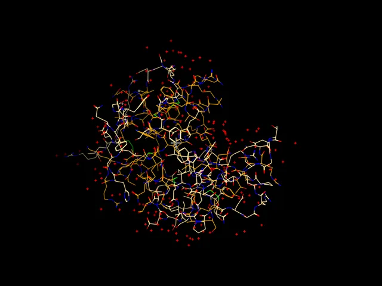{ width="200" }](basic/loading.md)

    **[Loading and displaying a structure](basic/loading.md)** — Loading, view manipulation, and the concepts of Scene / Object / Renderer

- [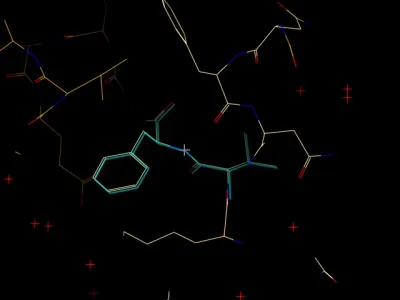{ width="200" }](basic/selection.md)

    **[Selecting part of a molecule](basic/selection.md)** — Selecting by clicking, with panels, and with selection expressions

- [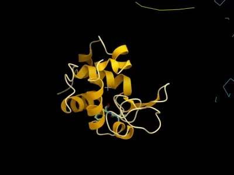{ width="200" }](basic/renderers.md)

    **[Adding, removing and configuring Renderers](basic/renderers.md)** — Layering representations and the property inspector

- [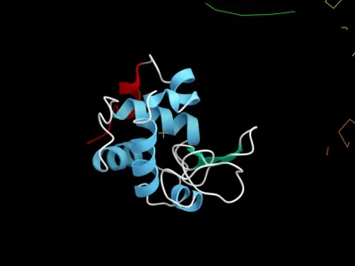{ width="200" }](basic/coloring.md)

    **[Coloring Renderers](basic/coloring.md)** — CPK / B-factor / Rainbow / Paint

- [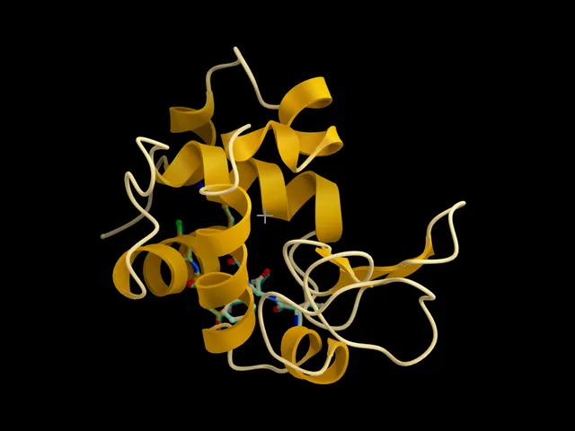{ width="200" }](basic/camera-scene.md)

    **[Saving the camera and the scene](basic/camera-scene.md)** — Handling views and scene files

- [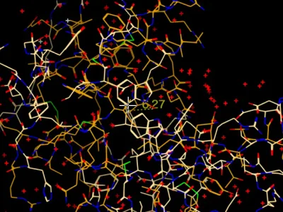{ width="200" }](basic/measure.md)

    **[Measurement and interaction display](basic/measure.md)** — Measuring distances and angles, and atomintr

## Figures

- [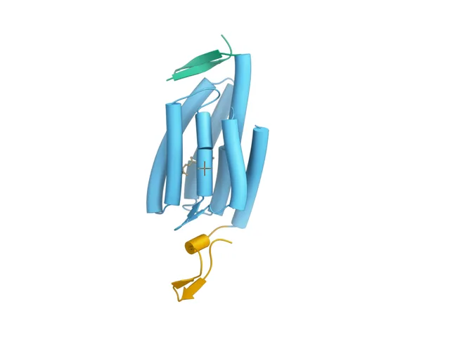{ width="200" }](figures/ribbon-figure.md)

    **[Making a protein ribbon figure](figures/ribbon-figure.md)** — The basic figure-making course, from fetching a structure to coloring and outlines

- [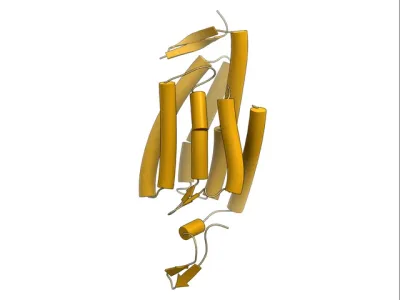{ width="200" }](figures/publication-images.md)

    **[Exporting high-resolution images for publication](figures/publication-images.md)** — Choosing between Export scene and ray tracing

- [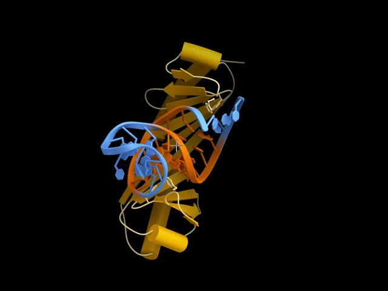{ width="200" }](figures/protein-dna.md)

    **[Displaying a protein-DNA complex](figures/protein-dna.md)** — Showing DNA with nucl and coloring by sequence

## Structure analysis

- [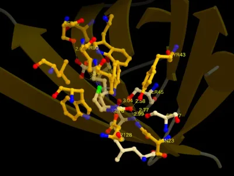{ width="200" }](structure/binding-site.md)

    **[Displaying a ligand binding site](structure/binding-site.md)** — Selecting the surrounding residues and showing hydrogen bond candidates

- [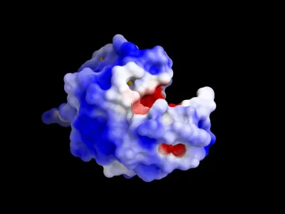{ width="200" }](structure/surface-elepot.md)

    **[Coloring a molecular surface by electrostatic potential](structure/surface-elepot.md)** — From surface generation to APBS calculation and coloring

- [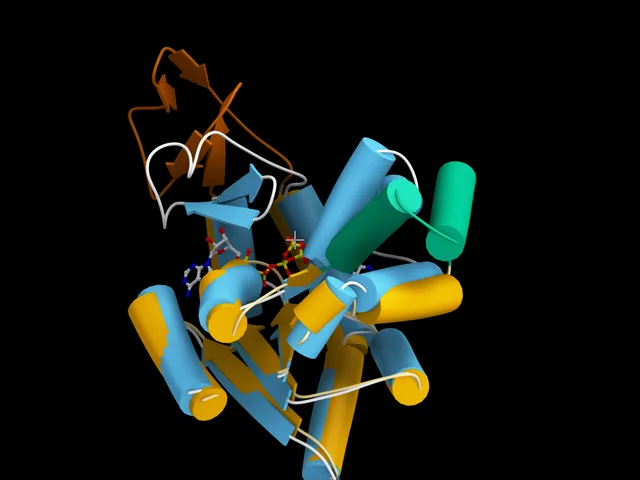{ width="200" }](structure/superpose.md)

    **[Superposing and comparing structures](structure/superpose.md)** — Choosing the atoms to superpose on, and domain motion

## Experimental data

- [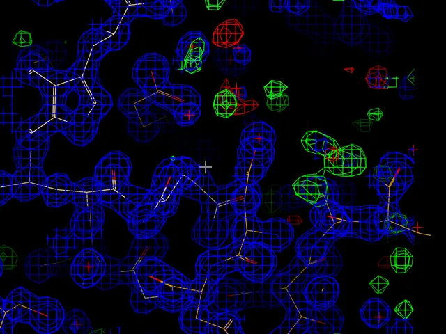{ width="200" }](experimental/density-map.md)

    **[Displaying an electron density map](experimental/density-map.md)** — Fetching a map with Get PDB and the Density map panel

- [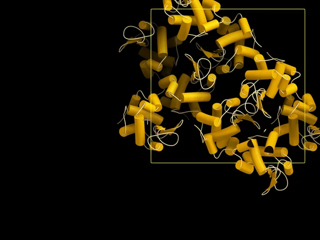{ width="200" }](experimental/symmetry.md)

    **[Displaying symmetry mates and the unit cell](experimental/symmetry.md)** — Showing crystal packing and Create SYMM mol

- [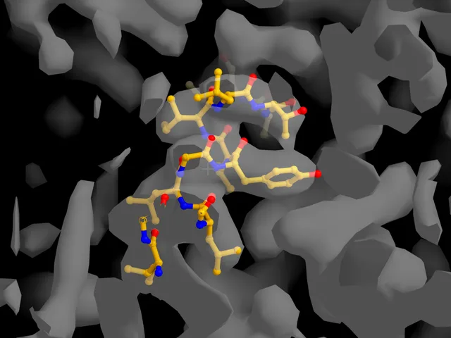{ width="200" }](experimental/cryoem-map.md)

    **[Displaying a cryo-EM map and model](experimental/cryoem-map.md)** — Levels in top % and how side-chain density looks

## Predicted structures

- [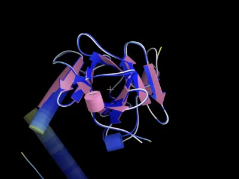{ width="200" }](prediction/alphafold.md)

    **[Evaluating an AlphaFold predicted structure](prediction/alphafold.md)** — Visualizing pLDDT values and superposing on an experimental structure

## Animation

- [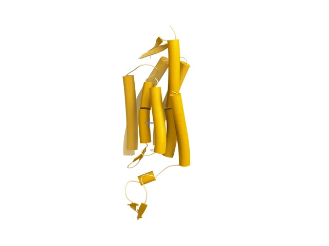{ width="200" }](animation/animation-movie.md)

    **[Making an animation and exporting a movie](animation/animation-movie.md)** — Timeline editing, morphing, and movie output

## Scripting

- [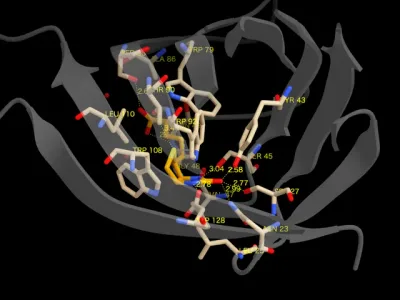{ width="200" }](scripting/chx-console.md)

    **[Making figures with the ChX console](scripting/chx-console.md)** — Making figures with ChimeraX commands and `.cxc` scripts

