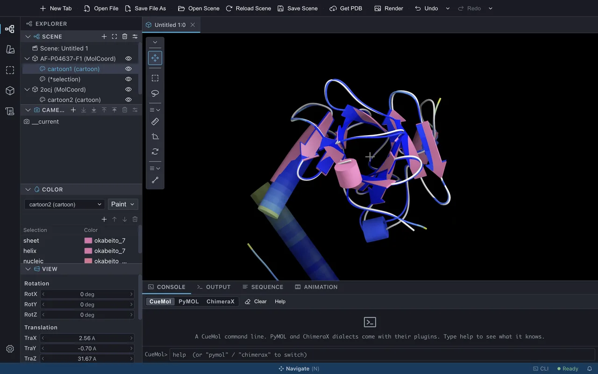
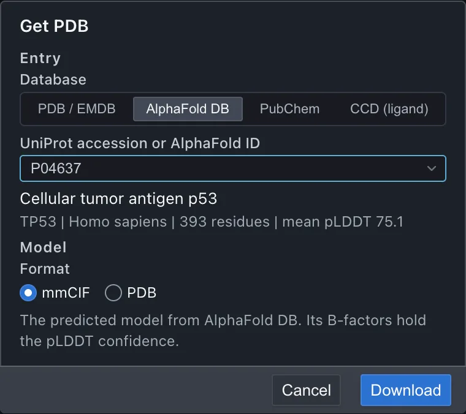
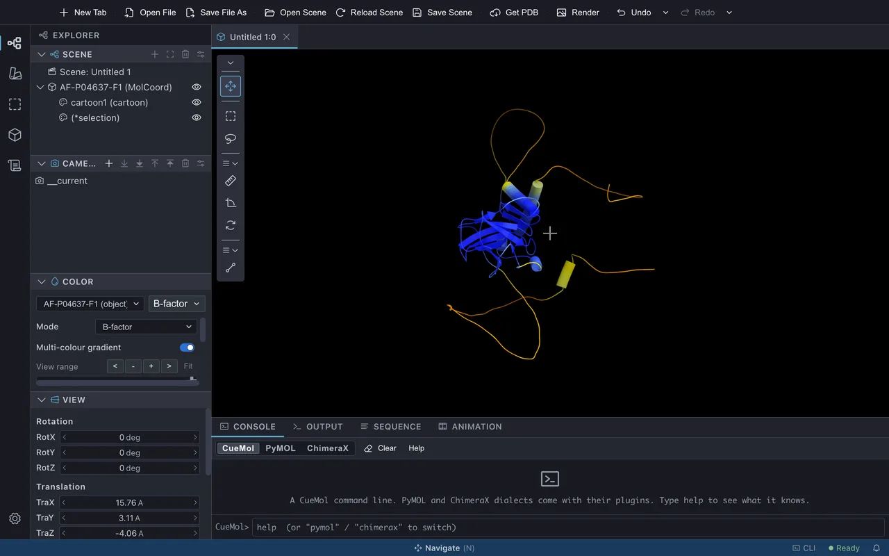
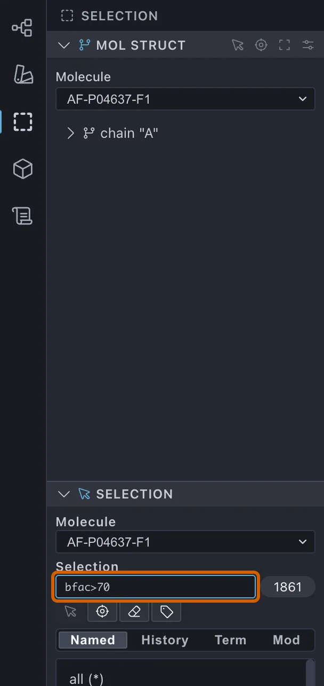
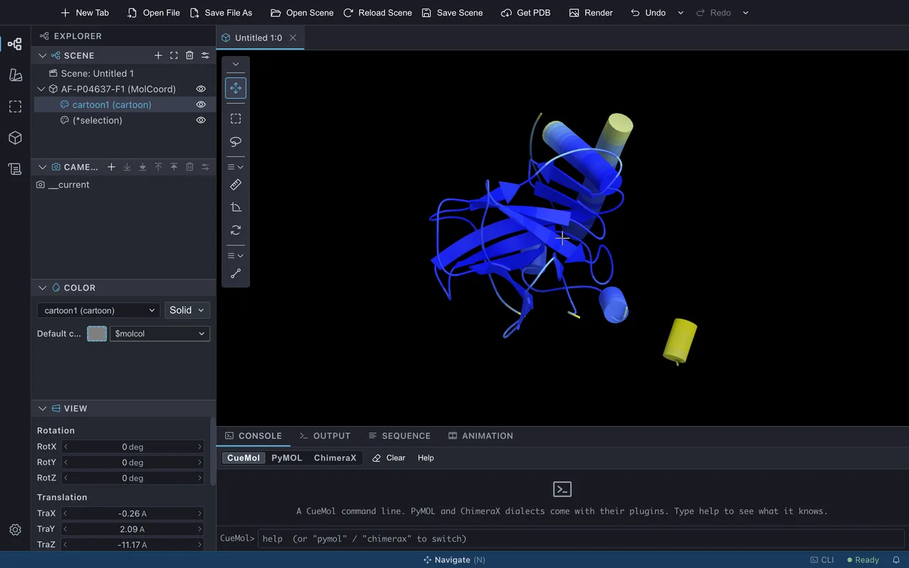
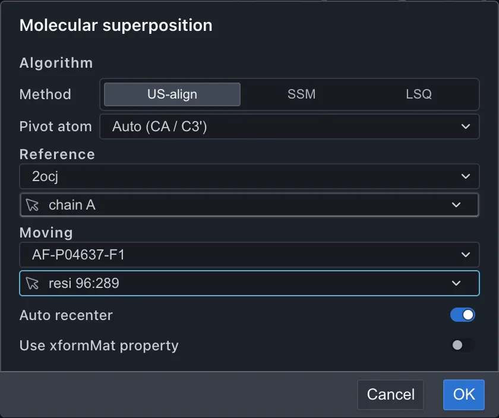

<!-- source: ja/tutorials/prediction/alphafold.md @ 53a8286 -->

# Evaluating an AlphaFold predicted structure

This tutorial fetches a predicted structure from AlphaFold DB, visualizes the prediction confidence (pLDDT) values with color,
and then compares the high-confidence parts with an experimental structure.
The example is the human tumor suppressor protein p53 (UniProt accession: **P04637**).
Of its 393 residues, the structured domains and the regions without a fixed structure are clearly separated.
The experimental structure for comparison is the crystal structure of the p53 DNA-binding domain (PDB ID: **2OCJ**).

!!! abstract "About this tutorial"
    - **Subject**: The AlphaFold predicted structure of human p53 (UniProt: P04637) and the crystal structure of its DNA-binding domain (PDB ID: 2OCJ)
    - **What you learn**: Fetching from AlphaFold DB with Get PDB, visualizing pLDDT values, selection by B-factor, superposition with US-align
    - **Prerequisites**: The basic course up to [Coloring Renderers](../basic/coloring.md)

{ .on-glb }

## 1. Fetch from AlphaFold DB

1. Open the **Get PDB** dialog with **File &gt; Get PDB...**.
2. Select **AlphaFold DB** in **Database**.
3. Enter `P04637` in **UniProt accession or AlphaFold ID**.
   Below the input field, the protein name is shown together with the gene, organism, number of residues (393) and mean pLDDT.

    { width="380" .on-glb }

4. Leave **Format** at the default **mmCIF** and press **Download**.
5. Select **cartoon** as the Renderer.

The Object name is `AF-P04637-F1`. The loaded structure is displayed in colors according to the prediction
confidence (pLDDT) (→ [Fetching from the PDB (Get PDB)](../../reference/get-pdb.md#alphafold-db)).

!!! note "Accepted ID forms"
    In addition to the UniProt accession (`P04637`), the full form of an AlphaFold ID (such as `AF-P04637-F1-v6`) can be entered.
    A partial form such as `AF-P04637` is not accepted.

## 2. Visualizing pLDDT values

pLDDT is the per-residue prediction confidence (0 to 100) that AlphaFold outputs. AlphaFold models
store pLDDT in the B-factor field, and CueMol3 colors by that value as follows
(→ [Coloring](../../reference/coloring.md#bfacocc)).

| pLDDT | Color |
|---|---|
| 100 | Blue |
| 90 | Light-tinged blue |
| 70 | Yellow |
| 50 | Orange |
| 0 | Red |

The color changes continuously between the values in the table. The closer to blue, the higher the confidence; the closer to orange or red, the lower. Clicking an atom shows the pLDDT of that residue in **B** on the status bar.

Rotating the P04637 model shows that the colors are divided by region as follows.

| Residues | Main colors | Region |
|---|---|---|
| 1–95 | Orange and yellow (partly yellow-green) | Transactivation domain and proline-rich region |
| Around 96–290 | Blue | DNA-binding domain |
| Around 291–325 | Orange and yellow | Linker between the DNA-binding domain and the tetramerization domain |
| Around 326–356 | Blue | Tetramerization domain (one helix and one strand) |
| 357–393 | Orange | C-terminal region |

{ .on-glb }

The DNA-binding domain is predicted as a compact three-dimensional structure.
The orange and yellow parts, on the other hand, form string-like shapes that loop widely around the molecule.

!!! warning "Interpreting pLDDT"
    - A low pLDDT indicates that AlphaFold could not predict the shape of that region with confidence.
      The N- and C-termini of p53 are experimentally known to lack a fixed structure, but
      a low pLDDT alone does not establish that a region is unstructured.
      Regions that become structured only when bound to other molecules can also have low values.
    - pLDDT is a local, per-residue confidence. It does not indicate whether the relative positions of domains
      (for example, between the DNA-binding domain and the tetramerization domain) are correct.
    - The shape of the string-like parts itself has no meaning.

## 3. Display only the high-confidence parts

Display only the parts with pLDDT above 70 as cartoon.

1. Open the **Selection &gt; Selection** panel in the left side panel and select `AF-P04637-F1` in **Molecule**.
2. Enter `bfac>70` in the **Selection** field and press ++enter++ (pressing the apply button below the field does the same).
   Atoms with a B-factor (here, pLDDT) greater than 70 are selected
   (→ [Selection expression syntax](../../reference/selection.md#selection-by-b-factor)).

    { width="304" .on-glb }

3. Right-click `cartoon1` in the scene tree and select **Change sel &gt; Current**.

The display range of the cartoon is replaced with the selected part. Besides the DNA-binding domain and the tetramerization domain,
a few short fragments remain.

{ .on-glb }

!!! note "Comparison operators"
    Selection by B-factor supports three comparisons: `<` / `>` / `=`. `>=` cannot be used.

## 4. Load the experimental structure

1. Fetch `2OCJ` with **File &gt; Get PDB...** (**Database** returns to **PDB / EMDB** each time the dialog is opened).
2. Select **cartoon** as the Renderer, check **Selection**, and enter `chain A` in **Atoms**.

The asymmetric unit of 2OCJ contains four DNA-binding domains (chains A–D).
Here only chain A (residues 96–289) is displayed.

Right after loading, 2OCJ has the default per-molecule color (light blue), which is hard to tell apart from the blue of pLDDT, so change its color.

1. Open the **Explorer &gt; Color** panel in the left side panel and select `cartoon2` of `2ocj` at the top.
   Renderers created in the GUI are named so that names do not overlap across the whole scene, so the second cartoon is `cartoon2`.
2. Select **Paint coloring** &gt; **Okabe-Ito** &gt; **Reddish purple** as the Coloring type.

2OCJ turns reddish purple (→ [Coloring Renderers](../basic/coloring.md)).

## 5. Superpose the predicted structure on the experimental structure

Open the **Molecular superposition** dialog with **Tools &gt; Molecular superposition...**
(→ [Superposing molecules (Molecular superposition)](../../reference/tools/superpose.md)).

1. Leave **Method** at the default **US-align**.
2. In **Reference**, select `2ocj` as the Molecule and specify `chain A` as the Selection.
3. In **Moving**, select `AF-P04637-F1` as the Molecule and specify `resi 96:289` as the Selection.
   Only the residues in the same range as chain A of 2OCJ are used for the superposition.
4. Press **OK**. The predicted structure moves to the position of 2OCJ.

    { width="420" .on-glb }


The result is shown in **Output** in the bottom panel. The **RMSD** (RMSD of the aligned Cα atoms) is about 0.51 Å,
and the **TM-score** is about 0.99, a value close to 1. The blue DNA-binding domain should appear almost overlapping
the reddish purple 2OCJ.

{ .on-glb }

Rotate the molecule and check whether the strands and loops overlap and whether any parts are shifted.
The DNA-binding domain also contains loops with somewhat lower pLDDT (light blue or yellow). Looking at how well
the two structures overlap in those parts shows the relationship between pLDDT and the actual deviation.

!!! note "Agreement with known structures"
    PDB structures are used to train AlphaFold. Good agreement with a structure deposited long ago, such as 2OCJ,
    does not independently confirm the prediction performance. When using a predicted structure for a protein
    without an experimental structure, use pLDDT as a guide to determine the reliable range.

## The same with commands

The steps on this page can be written as native-mode commands of the [Console](../../reference/plugins/console/index.md) as follows. Enter them in the Console one line at a time (they can also be run from [tritium_cli](../../reference/plugins/console/cli.md)). To check the arguments of each command, run `help <command>` in the Console (→ [Console command list](../../reference/plugins/console/commands.md)).

```
# 1. Fetch from AlphaFold DB
fetch_entry alphafold, P04637, mmcif, cartoon
# 2. Visualizing pLDDT values
count AF-P04637-F1, "bfac>70 and name CA"
count AF-P04637-F1, "bfac<50 and name CA"
# 3. Display only the high-confidence parts
set_renderer_selection AF-P04637-F1/cartoon1, "bfac>70"
# 4. Load the experimental structure
fetch_pdb 2OCJ, mmcif, cartoon, selection="chain A"
set_renderer_coloring 2ocj/cartoon2, paint-type-paint, paintColor=okabeito_7
# 5. Superpose the predicted structure on the experimental structure
superpose AF-P04637-F1, 2ocj, movSel="resi 96:289", refSel="chain A"
```

- `count` counts the atoms that match the condition. Restricting to Cα atoms with `name CA` gives the number of residues.
  In the P04637 model, 233 residues have pLDDT greater than 70, and 117 residues have pLDDT less than 50.
- The Object name created by `fetch_entry` is `AF-<accession>-F1`.
- `superpose` prints the superposition result (such as the RMSD, the number of aligned residues and the TM-score).

## Next steps

- [Superposing molecules (Molecular superposition)](../../reference/tools/superpose.md) — details of the methods and result items
- [Fetching from the PDB (Get PDB)](../../reference/get-pdb.md) — sources other than AlphaFold DB
- [Coloring](../../reference/coloring.md#bfacocc) — multi-color gradients by B-factor

---

*Verified against: CueMol3 3.0.7.578*
