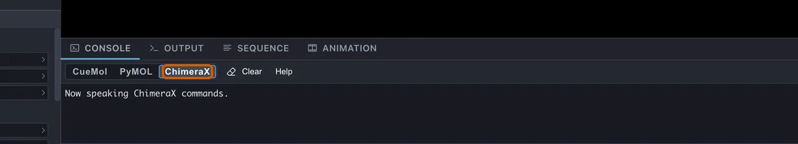
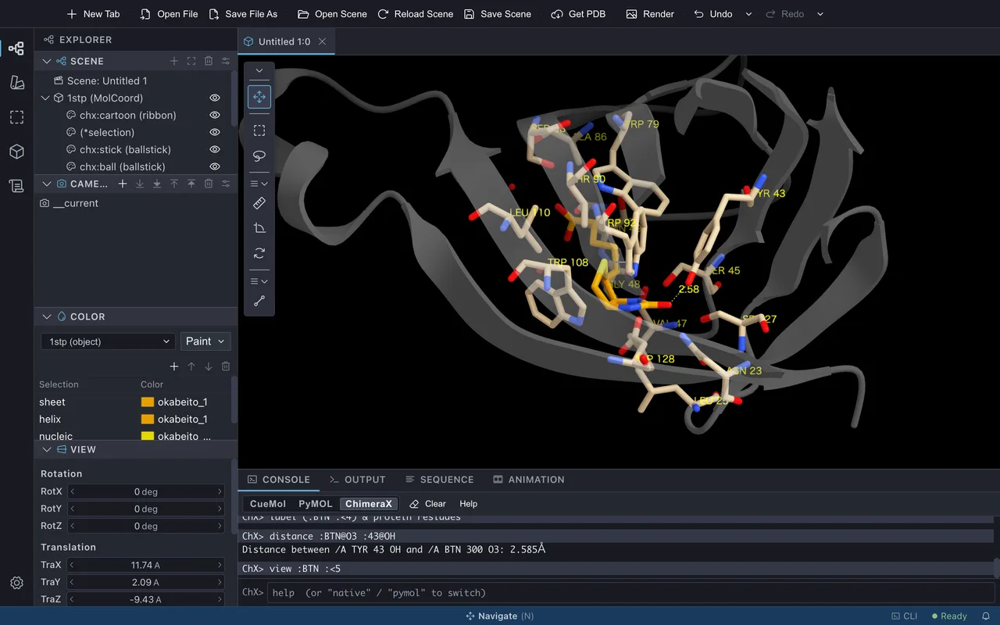
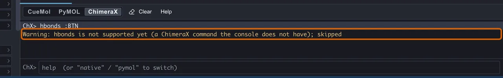
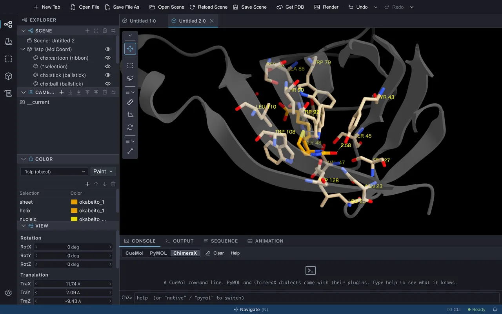

<!-- source: ja/tutorials/scripting/chx-console.md @ dcf70c1 -->

# Making figures with the ChX console

This tutorial shows how to make a figure of a ligand binding site with ChimeraX commands.
The [ChX console](../../reference/plugins/console/chx_console.md) is the ChimeraX-compatible console,
and accepts the commands and atom specifications you used in ChimeraX as they are.
Try the commands one line at a time, collect them in a `.cxc` file, and finally finish and save the figure in the GUI.
The example is the same as in [Displaying a ligand binding site](../structure/binding-site.md):
the complex of streptavidin and biotin (PDB ID: **1STP**).

!!! abstract "About this tutorial"
    - **Subject**: Complex of streptavidin and biotin (PDB ID: 1STP)
    - **What you learn**: Switching to the ChX console, ChimeraX commands and atom specifications, how unsupported commands are handled, running a `.cxc` script (Console and tritium_cli), finishing and saving in the GUI
    - **Prerequisites**: Familiarity with the basics of ChimeraX commands. For GUI operations, the basic course up to [Adding, removing and configuring Renderers](../basic/renderers.md)

{ .on-glb }

## 1. Switch to the ChX console

1. Prepare an empty scene with **File &gt; New Tab** (press **OK** in the **New Tab/Window** dialog, leaving the defaults).
2. Open the **Console** tab in the bottom panel.
3. Select **ChimeraX** with the switch at the left end of the toolbar (typing just `chimerax` on a line and running it also switches the mode).

The prompt becomes `ChX>` (→ [Console](../../reference/plugins/console/index.md#switching-modes)).

{ width="640" .on-glb }

## 2. Run commands one line at a time

Enter the following commands one line at a time, and check how the display changes.

```
open 1stp
color #1 lightgray target c
transparency #1 60 target c
show (:BTN :<4) & protein
style stick
color :BTN orange
color byhetero
label (:BTN :<4) & protein residues
distance :BTN@O3 :43@OH
view :BTN :<5
```

{ .on-glb }

| Command | Result |
|---|---|
| `open 1stp` | Fetches 1STP in mmCIF format and opens it as model **#1**. Following ChimeraX's automatic display (auto style), it is shown as a cartoon with sticks around the ligand. |
| `color #1 lightgray target c` | Makes the cartoon light gray. |
| `transparency #1 60 target c` | Makes the cartoon 60 % transparent. Biotin sits inside the β-barrel, so this lets it show through the cartoon. |
| `show (:BTN :<4) & protein` | Shows the protein residues within 4 Å of biotin (residue name BTN). |
| `style stick` | Shows the atoms as sticks. |
| `color :BTN orange` / `color byhetero` | Colors biotin orange, then gives non-carbon atoms their element colors. |
| `label (:BTN :<4) & protein residues` | Adds labels with the residue name and number to the surrounding residues. |
| `distance :BTN@O3 :43@OH` | Measures the distance between O3 of biotin and OH of Tyr43 (2.585 Å) and shows it as a dotted line. |
| `view :BTN :<5` | Fits the area around biotin in the view without changing the orientation. |

ChX console commands are translated into CueMol operations before they run. Like any other edit, they can be undone with Undo
(one run is grouped into one Undo step). Atom specifications (such as `:BTN :<4`) are translated into CueMol selection expressions
(→ [Atom specification in the ChX console](../../reference/plugins/console/chx_console.md#atom-specification)).

!!! note "Differences from ChimeraX"
    - For distance-based specifications, the boundary is "less than or equal to" in ChimeraX and "less than" in CueMol.
      If an atom is exactly 4 Å away, the selected residues may differ from ChimeraX.
    - `show` / `style` / `color` and similar commands operate only on the Renderers that the ChX console creates for each molecule,
      whose names start with `chx:` (`chx:cartoon` / `chx:stick` and so on in the scene tree).
      They do not affect Renderers created in the GUI.

## 3. How unsupported commands are handled

Try the ChimeraX `hbonds` command.

```
hbonds :BTN
```

The following warning is shown, and this command is not run.

```
Warning: hbonds is not supported yet (a ChimeraX command the console does not have); skipped
```

{ width="640" .on-glb }

The ChX console supports only part of the ChimeraX commands. Unsupported commands, values and atom specifications
are skipped with a warning like this, and the rest of the script runs. On the other hand, commands that ChimeraX does not have either,
and syntax errors (such as a typo like `colr`), produce an error and stop the script there.
For the list of supported commands, see [ChX console](../../reference/plugins/console/chx_console.md#supported-commands).

Hydrogen bond candidates are shown in 5. with the Interaction tool in the GUI.

## 4. Collect the commands in a script

Save the commands from 2. and 3. in a text file named `binding-site.cxc`
(here it is placed in the home directory). Everything from `#` to the end of the line is a comment.

```
# Biotin binding site of streptavidin (PDB 1STP)
open 1stp
color #1 lightgray target c
transparency #1 60 target c
show (:BTN :<4) & protein
style stick
color :BTN orange
color byhetero
label (:BTN :<4) & protein residues
distance :BTN@O3 :43@OH
hbonds :BTN
view :BTN :<5
```

Prepare an empty scene, and run the following in the ChX console.

```
open ~/binding-site.cxc
```

A warning is shown at the `hbonds` line, but all the other commands run, and the same figure as in 2. is produced.

{ .on-glb }

From a terminal, the file can also be passed to [tritium_cli](../../reference/plugins/console/cli.md) to run it.
It runs on the scene of the front tab of the running CueMol3.

```
tritium_cli ~/binding-site.cxc
```

## 5. Finish and save in the GUI

A figure made with a script can be edited further in the GUI as is.

1. Use **Tools &gt; Interaction...** to show hydrogen bond candidates between biotin and the protein
   (the steps are the same as in [Displaying a ligand binding site](../structure/binding-site.md#5-show-the-candidate-hydrogen-bonds)).
2. Save the scene to a `.qsc` file with **File &gt; Save Scene** (→ [Saving the scene (Save Scene)](../../reference/save-scene.md)).

The ChX console `save` command can also save. It supports `.png` (image), `.qsc` (scene) and others.
It cannot save to a ChimeraX session (`.cxs`).

```
save ~/binding-site.qsc
save ~/binding-site.png width 1200 height 900
```

!!! note "Model numbers in a saved scene"
    Model numbers (such as `#1`) are reassigned when the scene is saved and reopened. To continue running scripts
    on a reopened scene, check the numbers with `info models`.

## Next steps

- [ChX console](../../reference/plugins/console/chx_console.md) — list of supported commands and atom specifications
- [tritium_cli](../../reference/plugins/console/cli.md) — running from a terminal
- [Displaying a ligand binding site](../structure/binding-site.md) — steps for making the same figure in the GUI

---

*Verified against: CueMol3 3.0.6.577*
