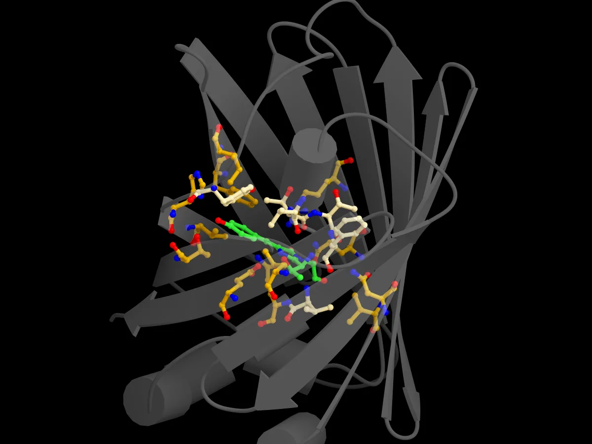
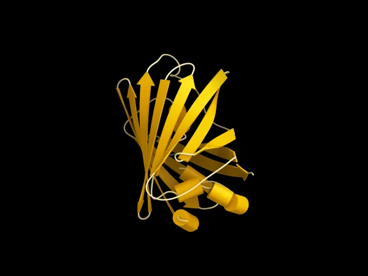

<!-- source: ja/tutorials/scripting/mcp-client.md @ 5008883 -->

# Driving CueMol3 from AI clients (MCP)

This tutorial shows how to make a figure in CueMol3 by asking an AI client such as Claude Code in plain words.
When the [MCP Server](../../reference/plugins/mcp-server.md) plugin of CueMol3 is enabled,
an AI client running on the same computer can call CueMol3 operations as tools.
The subject is the green fluorescent protein GFP (PDB ID: **1EMA**); you display the chromophore inside the β-barrel and its surroundings.

!!! abstract "About this tutorial"
    - **Subject**: Green fluorescent protein GFP (PDB ID: 1EMA)
    - **What you learn**: Enabling the MCP Server, registering an AI client (Claude Code / Claude Desktop / Codex / Antigravity CLI), how to ask the AI, checking and undoing what the AI did, saving the image and the scene
    - **Prerequisites**: Being able to use one of the AI clients. For the GUI, the Basics course up to [Adding, removing and configuring Renderers](../basic/renderers.md)

{ .on-glb }

For the same request, the operations the AI chooses, and the resulting colors and orientation, vary a great deal
with the client and the model you use (even the same model differs a little from one try to the next).
Sending the example requests on this page does not necessarily give the same figure.
You can check what the AI did on the CueMol3 screen
(→ [5. Checking and undoing what the AI did](#5-checking-and-undoing-what-the-ai-did)).

!!! note "To stay inside CueMol3"
    CueMol3 also has the [AI Agent](../../reference/plugins/ai-agent.md) plugin, which takes instructions in a chat panel.
    It needs no external AI client, but it requires an API key for OpenAI, Anthropic or Google.

## 1. Enabling the MCP Server

1. Enable **MCP Server** in **Settings &gt; Plugins &gt; Installed**.
2. Check that **MCP** appears at the right end of the status bar.

Clicking **MCP** lets you check that the state is **Ready** (waiting for connections from a client)
(→ [MCP in the status bar](../../reference/plugins/mcp-server.md#mcp-in-the-status-bar)).

## 2. Registering the AI client

Choose the tab of the AI client you use. The dialog opened with **Set up...** is under **Clients**
in the popover that opens when you click **MCP** in the status bar.

=== "Claude Code"

    1. Open the **Connect a client** dialog with **Set up...**, choose **Claude Code** and press **Copy**.
    2. Paste the copied command (`claude mcp add --transport http cuemol ...`) into a terminal in the directory
       where you use Claude Code, and run it.
    3. Run `claude mcp list` and check that the `cuemol` line shows **Connected**.

    By default the registration applies only to the directory where you ran the command. To use it in any directory,
    add `--scope user` after `claude mcp add` when you run it.

    !!! tip "Registering with tritium_cli"
        If [tritium_cli](../../reference/plugins/console/cli.md) is on your PATH, you can also register it as follows.
        No token is needed, and there is no need to register again after the token or port changes.

        ```
        claude mcp add cuemol -- tritium_cli mcp
        ```

=== "Claude Desktop"

    Register tritium_cli in Claude Desktop's configuration file `claude_desktop_config.json`.
    This needs no terminal.

    1. In Claude Desktop, press **Edit Config** in **Settings &gt; Developer** to open the configuration file
       (`~/Library/Application Support/Claude/claude_desktop_config.json` on macOS,
       `%APPDATA%\Claude\claude_desktop_config.json` on Windows).
    2. Add the following `"mcpServers"` and save. If the file has other settings, keep them and
       add only `"mcpServers"`.

        ```json
        {
          "mcpServers": {
            "cuemol": {
              "command": "/Applications/CueMol3.app/Contents/Resources/cli/tritium_cli",
              "args": ["mcp"]
            }
          }
        }
        ```

    3. Quit Claude Desktop once and start it again (on macOS, quit with ++cmd+q++;
       closing the window does not load the settings).

    The `"command"` is a macOS example. The path of tritium_cli can be checked under **Command line tool**
    in **Settings &gt; Plugins &gt; Console** of CueMol3 (it can be copied with **Copy**).
    With this method, there is no need to register again after the token or port changes.

=== "Codex"

    1. Open the **Connect a client** dialog with **Set up...**, choose **Codex** and press **Copy**.
    2. Paste the copied text at the end of `~/.codex/config.toml` and save.
    3. Run `codex mcp list` and check that `cuemol` is listed.

    Do not remove `tool_timeout_sec` from the pasted text. Without it, Codex cuts off a tool
    after 60 seconds, so a long-running render stops midway.

=== "Antigravity CLI"

    1. Open the **Connect a client** dialog with **Set up...**, choose **Antigravity** and press **Copy**.
    2. Paste the copied text into `~/.gemini/config/mcp_config.json` and save. If other servers are
       registered in the file, add only the `"cuemol"` entry inside `"mcpServers"`.
    3. Run `agy mcp list` and check that `cuemol` is `enabled`.

    This configuration file belongs to Antigravity CLI (`agy`).

Once registered, ask the AI client the following to check that it is connected to CueMol3.

> List the scenes open in CueMol.

If the names of the scenes (tabs) open in CueMol3 come back, it is connected.

## 3. Having the AI load the structure

Ask the AI client the following.

> Create a new scene in CueMol, load PDB 1EMA (GFP), and show it as a cartoon.

The first time it uses a CueMol3 tool, the AI client may ask whether it may use it.
Allow it.

The AI calls, for example, scene creation (`create_scene`) and fetching from the PDB (`fetch_pdb`) in turn,
and a new tab appears in CueMol3 with 1EMA displayed. While a tool is running, the status bar shows
**MCP: &lt;tool name&gt;**.

{ width="400" .on-glb }

Check that `1ema` and `cartoon1` appear in the scene tree.

## 4. Making the figure through conversation

Go on asking one thing at a time. You can decide the next request after seeing the result of the previous one.

> Show the chromophore (CRO) as ballstick, and also show the residues within 4 Å of it as ballstick.

> Make the cartoon light gray and semi-transparent. Give the chromophore a color that stands out.

> Turn the view so that the chromophore is easy to see, and show me the current screen.

The AI proceeds while checking the display with a tool that returns the current screen as an image (`capture_view`).
When you ask to see the current screen, it may also show that image in the client.

The chromophore of 1EMA is a single residue formed by the cyclization of the three residues Thr65-Tyr66-Gly67,
with the residue name **CRO** and residue number 66 (residues 65 and 67 do not exist). When the AI gets the residues wrong,
giving it the residue name and number, or a selection expression (such as `resn CRO`; → [Selection expression syntax](../../reference/selection.md)),
concretely like this makes the request easier to get across.

## 5. Checking and undoing what the AI did

The operations the AI performed are kept in CueMol3's Undo history, like any other edit.

1. Open **Actions** in the activity bar.
2. Check that the **History** panel lists the tool calls, one line per call.
   At the right of each line, `mcp` shows that the edit was made through MCP.
3. Double-click a line and check the arguments of that call (selection expressions, colors, etc.) in the inspector.
4. Press ++cmd+z++ / ++ctrl+z++ to undo the last call.

One call is grouped into one Undo step. When the AI's result is not what you wanted,
check in History what was called, go back as far as needed, and try again with a different request
(→ [Recording and replaying operations (Actions)](../../reference/actions.md#history-panel)).
If changing the request does not help, switching to another model in the client is also an option.

Undo is done on the CueMol3 side. The AI client cannot undo.
When you continue asking after undoing, telling the AI to re-check the current state,
for example "check the current screen first", makes it reliable.

## 6. Saving the image and the scene

When writing to a file, ask with the output path.

> Save the current screen as a 1600×1200 PNG to 1ema_chromophore.png on the desktop.

> Save this scene to 1ema_mcp.qsc on the desktop.

The AI writes files only when asked. It tells you in its reply where the saved file went.

To repeat these operations without the AI, select the lines in the **History** panel and press **Save as qax**
to save them to a qax file (→ [Recording and replaying operations (Actions)](../../reference/actions.md)).

## 7. Troubleshooting

`CueMol is busy` comes back
:   Only one client can operate CueMol3 at a time. Wait until a Console command, an AI Agent instruction,
    or another MCP client or tritium_cli has finished, then try again.

MCP in the status bar shows **Error**
:   The server could not start. If another program is using the port (27182 by default),
    change **Port** in **Settings &gt; Plugins &gt; MCP Server**
    (→ [MCP Server](../../reference/plugins/mcp-server.md#enabling-it)).

It no longer connects after the token or port changed
:   Register again the clients registered with what **Set up...** showed (Claude Code / Codex / Antigravity CLI).
    Those registered with tritium_cli (Claude Desktop, and the method in the Claude Code tip)
    do not need to be registered again.

## Next steps

- [MCP Server](../../reference/plugins/mcp-server.md) — settings, registering clients, security
- [Recording and replaying operations (Actions)](../../reference/actions.md) — History and qax files
- [tritium_cli](../../reference/plugins/console/cli.md) — running commands from a terminal, and the description for AI agents (`tritium_cli skill`)
- [AI Agent](../../reference/plugins/ai-agent.md) — the chat panel inside CueMol3

---

*Verified against: CueMol3 3.0.6.577*
