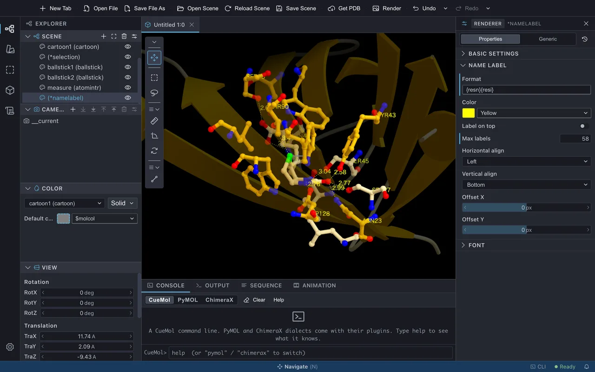
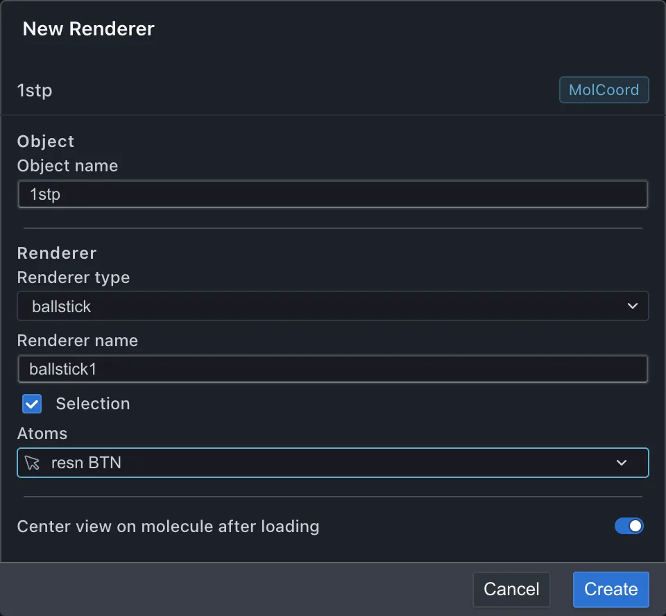
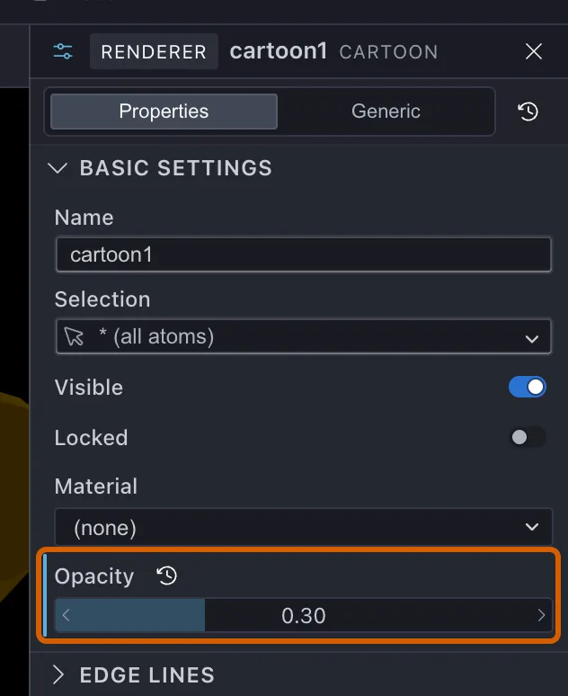
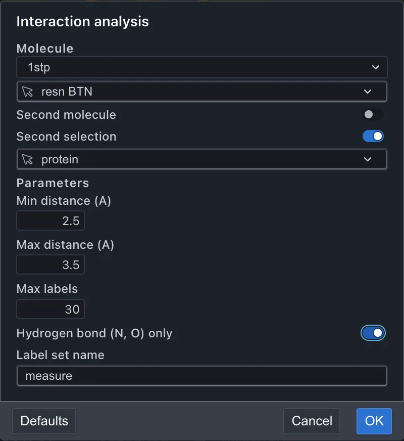
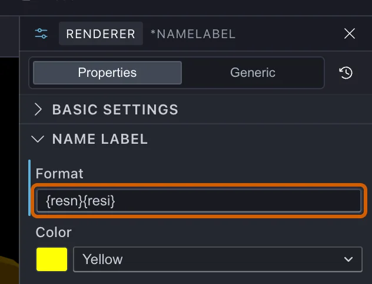

<!-- source: ja/tutorials/structure/binding-site.md @ dcf70c1 -->

# Displaying a ligand binding site

This tutorial extracts a ligand bound to a protein together with the residues around it, and
makes a figure that shows candidate hydrogen bonds as dotted lines.
The example is the complex of streptavidin and biotin (PDB ID: **1STP**).
Biotin is known for its extremely tight binding, and it forms hydrogen bonds with many residues in the pocket.

!!! abstract "About this tutorial"
    - **Subject**: The complex of streptavidin and biotin (PDB ID: 1STP)
    - **What you learn**: Selecting surrounding residues with selection expressions (`around` / `byres`), showing candidate hydrogen bonds with the Interaction tool, the format of atom labels
    - **Prerequisites**: [Selecting part of a molecule](../basic/selection.md) and [Adding, removing and configuring Renderers](../basic/renderers.md) in the basic course

{ .on-glb }

## 1. Load the structure

Fetch `1STP` with **File &gt; Get PDB...**. Select **cartoon** as the Renderer.

1STP contains one streptavidin chain (chain A), one biotin molecule, and water molecules.
The residue name of biotin is **BTN** (residue number 300).

## 2. Show the ligand in ballstick

1. In the scene tree, right-click `1stp` and choose **New Renderer**.
2. Choose **ballstick** from **Renderer type**.
3. Check **Selection** and enter `resn BTN` in **Atoms**.
   The atoms with the residue name BTN (the 16 atoms of biotin) become the target.
4. Press **Create**. Biotin is displayed in ballstick (the Renderer name is `ballstick1`).

    { width="480" .on-glb }

5. In the scene tree, select the `ballstick1` row and press **Focus** at the top of the panel.
   The view moves so that biotin fits on the screen.

## 3. Show the surrounding residues

Display the residues that have atoms within 4 Å of biotin with a second ballstick.

1. Again, choose **ballstick** from **New Renderer** of `1stp`.
2. Check **Selection** and enter the following expression in **Atoms**.

    ```
    byres (resn BTN around 4.0) and protein
    ```

3. Press **Create**. The surrounding residues are displayed in ballstick (the Renderer name is `ballstick2`).
4. In the scene tree, select the `ballstick2` row and press **Focus**.

The expression combines the following three parts (→ [Selection expression syntax](../../reference/selection.md)).

| Part | Meaning |
|---|---|
| `resn BTN around 4.0` | Atoms within 4 Å of biotin. Biotin itself is not included. |
| `byres (...)` | Extends the selection to all atoms of the residues containing those atoms. This prevents a broken display in which only part of a side chain is selected. |
| `... and protein` | Limits the selection to protein atoms. Water molecules near biotin are excluded. |

In 1STP, 16 residues are selected, including Asn23, Ser27, Tyr43, Ser45, Asn49, Ser88, Thr90 and Asp128.
The three tryptophans that form the walls of the pocket (Trp79, Trp92 and Trp108) are also included.

## 4. Make the cartoon translucent

Streptavidin has a β-barrel structure (a β-sheet rolled into a cylinder), and biotin binds inside the barrel.
Because of this, in some orientations the binding site is hidden behind the sheets of the cartoon.
Making the cartoon translucent keeps the position of the sheets while showing the inside.

1. Select `cartoon1` in the scene tree.
2. In the **Basic settings** section of the property inspector, lower **Opacity** to about 0.3.

    { width="316" .on-glb }


Drag the molecule to rotate it and find an orientation in which biotin and the surrounding residues are visible without overlapping.

## 5. Show the candidate hydrogen bonds

Open the **Interaction analysis** dialog with **Tools &gt; Interaction...**
(→ [Extracting interactions (Interaction)](../../reference/tools/interaction.md)).

1. Select `1stp` in **Molecule** and specify `resn BTN` in the selection below it.
2. Turn on **Second selection** and specify `protein` in the second selection.
   Only pairs between biotin and the protein become the target.
3. Turn on **Hydrogen bond (N, O) only**. Pairs involving carbon atoms are excluded.
4. Leave **Min distance (A)** (2.5), **Max distance (A)** (3.5) and **Max labels** (30) at their defaults.
5. Press **OK**.

    { width="400" .on-glb }


The atom pairs that meet the conditions are displayed with dotted lines and distance labels. In 1STP there are the following 8 pairs.

| Biotin atom | Partner residue and atom | Distance (Å) |
|---|---|---|
| O3 (carbonyl of the ureido ring) | Asn23 ND2 | 2.99 |
| O3 | Ser27 OG | 2.77 |
| O3 | Tyr43 OH | 2.58 |
| N2 | Ser45 OG | 3.04 |
| O12 (carboxy group) | Asn49 N (main chain) | 2.95 |
| O11 (carboxy group) | Ser88 OG | 2.69 |
| S1 (sulfur of the tetrahydrothiophene ring) | Thr90 OG1 | 3.44 |
| N1 | Asp128 OD2 | 2.78 |

What is displayed are the atom pairs that meet the distance conditions (candidate hydrogen bonds). The direction of
the hydrogen bonds is not taken into account. **Hydrogen bond (N, O) only** only excludes carbon, so pairs with atoms
other than N and O also remain, such as the pair of Thr90 and the sulfur of biotin.

The dotted lines and distance labels are added to the atomintr Renderer (`measure`) of `1stp`.
The line color and label size can be changed in the properties of this Renderer
(→ [atomintr (measurement display)](../../reference/renderers/atomintr.md)).

!!! tip "Without Second selection"
    If step 2 is skipped, pairs such as those between biotin and water molecules are added as well.
    Use this to look at networks of water-mediated hydrogen bonds.

## 6. Label the residues

Add labels with the residue name and number to the 8 residues that form the candidate hydrogen bonds.

1. In the molecular view, click the Cα atoms of the 8 residues in the table one by one. A name such as
   `A ASN23 CA` appears on each clicked atom (clicking it again removes it).
2. A `(*namelabel)` row for the labels has been created in the scene tree. Select this row.
3. In the **Name label** section of the property inspector, enter `{resn}{resi}` in **Format**.

    { width="316" .on-glb }


The labels change to a short form such as `ASN23`. For the items available in the format, see
[namelabel (name label)](../../reference/renderers/namelabel.md).
If the labels are hidden by the ballstick, turn on **Label on top** in the same section.

{ .on-glb }

## The same with commands

The steps on this page can be written as native-mode commands of the [Console](../../reference/plugins/console/index.md) as follows. Enter them in the Console one line at a time (they can also be run from [tritium_cli](../../reference/plugins/console/cli.md)). To check the arguments of each command, run `help <command>` in the Console (→ [Console command list](../../reference/plugins/console/commands.md)).

```
# 1. Load the structure
fetch_pdb 1STP, mmcif, cartoon
# 2. Show the ligand in ballstick
create_renderer 1stp, ballstick, selection="resn BTN"
focus_nodes 1stp/ballstick1
# 3. Show the surrounding residues
create_renderer 1stp, ballstick, selection="byres (resn BTN around 4.0) and protein"
focus_nodes 1stp/ballstick2
# 4. Make the cartoon translucent
set 1stp/cartoon1.alpha, 0.3
# 5. Show the candidate hydrogen bonds
analyze_interactions 1stp, "resn BTN", 3.5, false, 2.5, 30, measure, selection2=protein
list_interactions 1stp/measure
# 6. Label the residues
set_atom_labels 1stp, "A.23,27,43,45,49,88,90,128.CA", "{resn}{resi}"
```

- The arguments of `analyze_interactions` give, in order, the same values as the dialog (Max distance 3.5,
  carbon excluded, Min distance 2.5, Max labels 30). Note that the defaults used when they are omitted
  differ from the dialog (check them with `help analyze_interactions`).
- `list_interactions` lists the added pairs.
- `set_atom_labels` adds labels to the selected atoms in one step. The format is set per label,
  so the Format change in step 6 is not needed.

## Next steps

- [Extracting interactions (Interaction)](../../reference/tools/interaction.md) — details of the dialog items
- [Selection expression syntax](../../reference/selection.md) — operators such as `around` / `expand` / `byres`
- [Exporting high-resolution images for publication](../figures/publication-images.md) — finish this figure by ray tracing

---

*Verified against: CueMol3 3.0.6.577*
