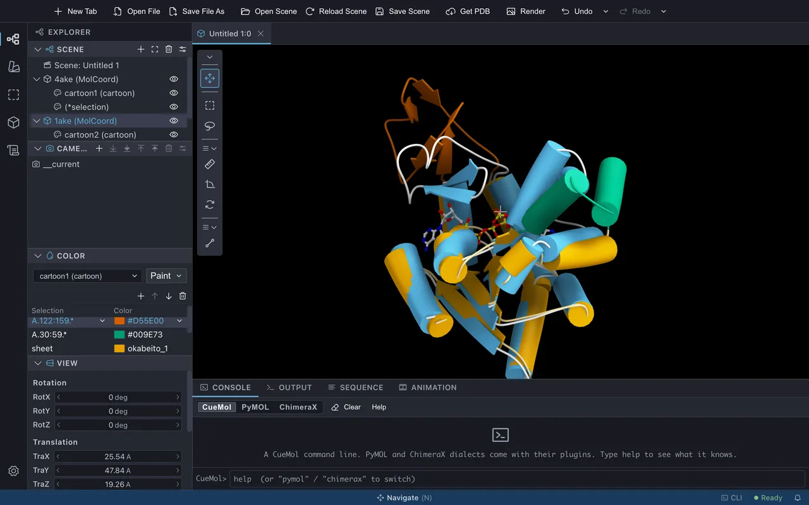
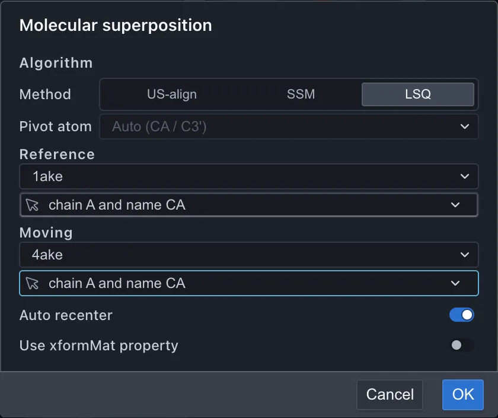
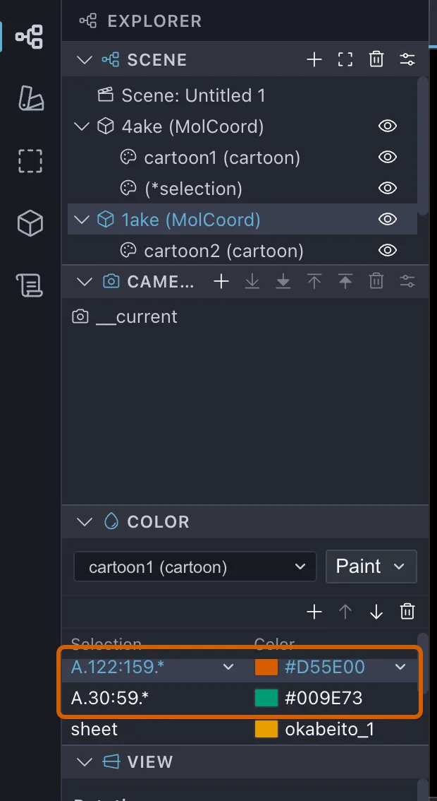

<!-- source: ja/tutorials/structure/superpose.md @ dcf70c1 -->

# Superposing and comparing structures

This tutorial superposes two crystal structures of the same protein and compares which parts move and by how much.
The example is adenylate kinase: the open structure without substrate (PDB ID: **4AKE**) and
the closed structure with the inhibitor Ap5A bound (PDB ID: **1AKE**).
Two domains move substantially, which makes it easy to see how the result changes with the choice of atoms used for the superposition.

!!! abstract "About this tutorial"
    - **Subject**: The open (PDB ID: 4AKE) and closed (PDB ID: 1AKE) structures of adenylate kinase
    - **What you learn**: Superposition by LSQ, choosing the atoms used for superposition and reading the RMSD, coloring domains with Paint
    - **Prerequisites**: The basic course up to [Coloring Renderers](../basic/coloring.md)

{ .on-glb }

## 1. Load the two structures

1. Fetch `4AKE` with **File &gt; Get PDB...**. Select **cartoon** as the Renderer,
   check **Selection** and enter `chain A` in **Atoms**.
2. Fetch `1AKE` in the same way (Renderer **cartoon**, **Atoms** `chain A`).

Both contain two chains (chain A / B) in the asymmetric unit, so only chain A (residues 1-214) is displayed.
The loaded molecules are colored with the default color for each molecule. 4AKE, the first molecule in the scene, is orange,
and 1AKE, the second, is light blue.

The inhibitor Ap5A (residue name **AP5**) is bound to chain A of 1AKE. Display it in
ballstick so that its position is visible.

1. In the scene tree, right-click `1ake` and choose **New Renderer**.
2. Choose **ballstick** from **Renderer type**, check **Selection** and
   enter `chain A and resn AP5` in **Atoms**.
3. Press **Create**.

## 2. Superpose on all Cα atoms

First, superpose using all Cα atoms of chain A.

Open the **Molecular superposition** dialog with **Tools &gt; Molecular superposition...**
(→ [Superposing molecules (Molecular superposition)](../../reference/tools/superpose.md)).

1. Choose **LSQ** in **Method**.
2. Choose `1ake` in Molecule under **Reference** and specify `chain A and name CA` in Selection.
3. Choose `4ake` in Molecule under **Moving** and specify `chain A and name CA` in Selection.
4. Press **OK**. 4AKE moves so that it overlaps 1AKE.

    { width="420" .on-glb }


LSQ pairs up the atoms chosen by the two Selections in order and superposes them so that the sum of squared deviations is minimal
(the two structures have the same sequence and residue numbers, so 214 Cα atoms each are listed in the same order).
The **RMSD** shown in **Output** in the bottom panel is about 7.1 Å.

Rotating the molecule shows deviations spread evenly everywhere, and it is not possible to tell which parts moved.
This is because reducing the deviation of the parts that moved a lot also drags along the parts that did not move.

## 3. Superpose on the part that does not move

Adenylate kinase consists of three domains.

| Domain | Residues | Role |
|---|---|---|
| CORE | 1-29, 60-121, 160-214 | The framework of the protein |
| NMP | 30-59 | The part where AMP binds |
| LID | 122-159 | The part that closes over ATP like a lid |

Redo the superposition using only the Cα atoms of the CORE, which does not move.

1. Open the **Molecular superposition** dialog again (the previous settings are kept).
2. Set both the **Reference** and **Moving** Selections to the following expression.

    ```
    A.1:29,60:121,160:214.CA
    ```

    These are the CA atoms (146 atoms) of residues 1-29, 60-121 and 160-214 of chain A
    (→ [Selection expression syntax](../../reference/selection.md#hierarchical-notation)).

3. Press **OK**.

The **RMSD** becomes about 2.0 Å. The CORE overlaps well, and NMP and LID can now be seen apart from each other.

!!! note "Comparing RMSD values"
    The RMSD is a value only for the atoms used in the superposition. About 7.1 Å in section 2 (214 atoms) and
    about 2.0 Å in section 3 (146 atoms) are for different atoms, so they do not mean that "the superposition improved".
    The value in section 3 shows how similar the shape of the CORE is between the two structures.

## 4. Color the domains

Color NMP and LID of 4AKE to make the moved parts stand out.

1. Open the **Explorer &gt; Color** panel in the left side panel and select `4ake/cartoon1` at the top.
2. From the Coloring types, choose **Paint coloring** &gt; **Okabe-Ito** &gt; **Orange**.
3. Add a row at the top of the table, and specify `A.30:59.*` as the selection expression and Okabe-Ito **Bluish green** (`#009E73`) as the color.
4. Add another row at the top of the table, and specify `A.122:159.*` as the selection expression and Okabe-Ito **Vermillion** (`#D55E00`) as the color.

NMP of 4AKE becomes green and LID vermillion (→ [Coloring Renderers](../basic/coloring.md)).

{ width="310" .on-glb }

{ .on-glb }

Rotate the molecule to check the movement of the domains.

- In the closed 1AKE (light blue), LID and NMP enclose Ap5A from both sides.
- In the open 4AKE, LID (vermillion) and NMP (green) are opened away from the CORE.
  At the tip of LID, the Cα positions of the same residues are more than 20 Å apart.

## The same with commands

The steps on this page can be written as native-mode commands of the [Console](../../reference/plugins/console/index.md) as follows. Enter them in the Console one line at a time (they can also be run from [tritium_cli](../../reference/plugins/console/cli.md)). To check the arguments of each command, run `help <command>` in the Console (→ [Console command list](../../reference/plugins/console/commands.md)).

```
# 1. Load the two structures
fetch_pdb 4AKE, mmcif, cartoon, selection="chain A"
fetch_pdb 1AKE, mmcif, cartoon, selection="chain A"
create_renderer 1ake, ballstick, selection="chain A and resn AP5"
# 2. Superpose on all Cα atoms
superpose 4ake, 1ake, movSel="chain A and name CA", refSel="chain A and name CA", algo=LSQ
# 3. Superpose on the part that does not move
superpose 4ake, 1ake, movSel="A.1:29,60:121,160:214.CA", refSel="A.1:29,60:121,160:214.CA", algo=LSQ
# 4. Color the domains
set_renderer_coloring 4ake/cartoon1, paint-type-paint, paintColor=okabeito_1
add_paint 4ake/cartoon1, "A.30:59.*", #009E73
add_paint 4ake/cartoon1, "A.122:159.*", #D55E00
set_mol_selection 4ake, ""
```

- `superpose` does not return the result of the superposition (such as the RMSD) in the command output. Check the values in the Output panel.
- `add_paint` also makes the painted range the selection of the molecule. To keep the selection highlight out of the figure,
  the selection is cleared with `set_mol_selection` at the end.

## Next steps

A movie connecting the open and closed structures can be made by morphing
(→ [Making an animation and exporting a movie](../animation/animation-movie.md). The morphing section uses a different example.)

- [Superposing molecules (Molecular superposition)](../../reference/tools/superpose.md) — the differences between US-align / SSM / LSQ and the Output items
- [Morphing structural changes (Mol morphing animation)](../../reference/tools/morphing.md)

---

*Verified against: CueMol3 3.0.6.577*
