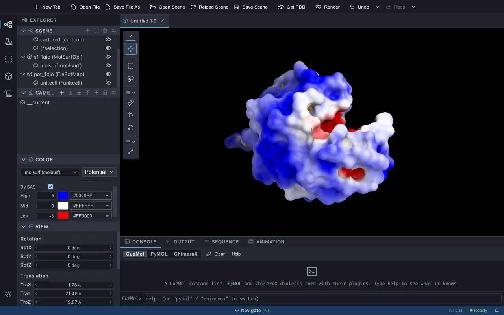
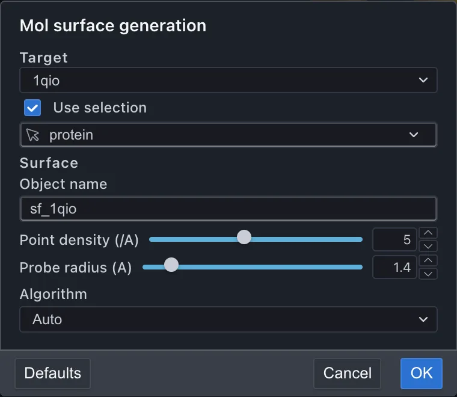
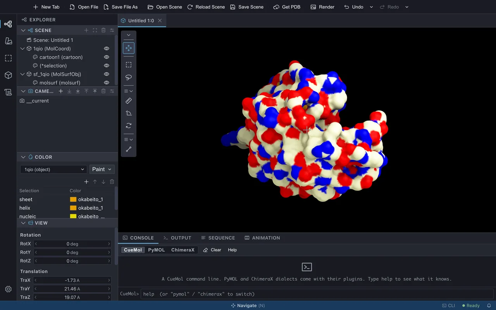
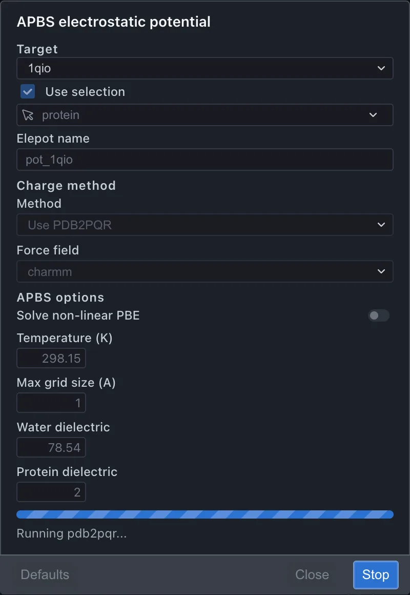
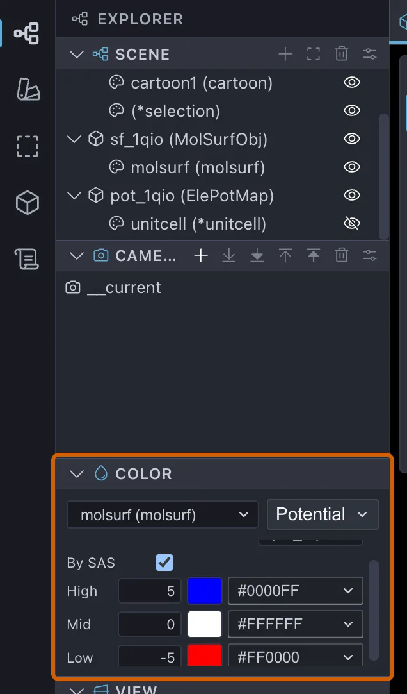
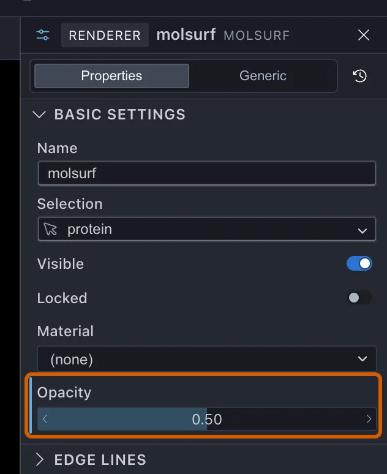
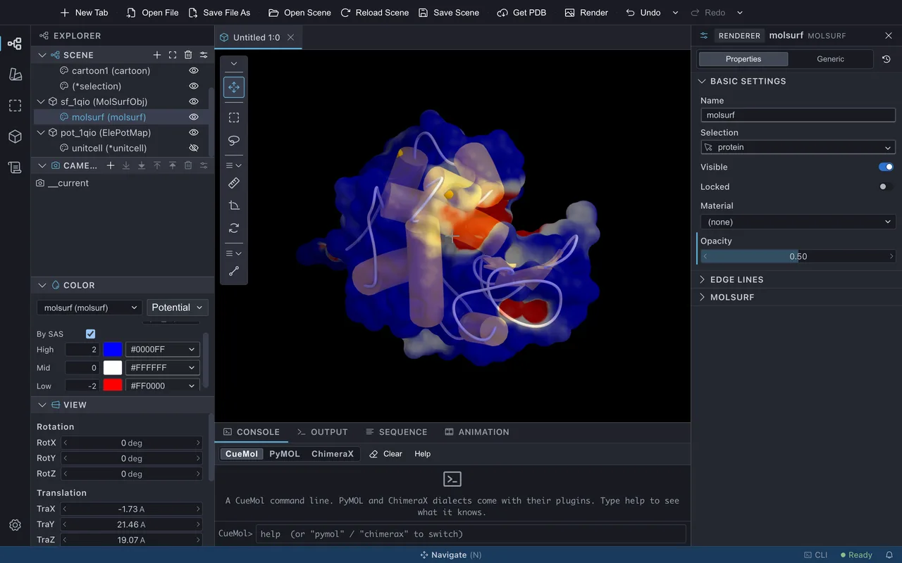

<!-- source: ja/tutorials/structure/surface-elepot.md @ 1002eeb -->

# Coloring a molecular surface by electrostatic potential

This tutorial generates a molecular surface, colors it by the electrostatic potential
calculated with APBS, and produces a figure showing the charge distribution of the molecule.
The example is lysozyme (PDB ID: **1QIO**). It is a basic protein, so the
positively charged regions of its surface stand out clearly.

!!! abstract "About this tutorial"
    - **Subject**: Lysozyme (PDB ID: 1QIO)
    - **What you learn**: Generating a molecular surface, calculating the electrostatic potential with APBS, coloring the surface, overlaying a translucent surface on the cartoon
    - **Prerequisites**: The basic course up to [Coloring Renderers](../basic/coloring.md)

{ .on-glb }

## 1. Load the structure

Fetch `1QIO` with **File &gt; Get PDB...** (coordinates only is fine).
Select **cartoon** as the Renderer.

## 2. Generate the molecular surface

Open **Tools &gt; Mol surface generation...**.

1. Select 1QIO in **Molecule** under **Target**.
2. Enable **Use selection** and enter `protein` as the selection expression. Crystal structures
   contain water molecules, and without this the surface would be calculated around the waters as well.
3. Raise **Point density (/A)** to **5**. This sets the fineness of the surface, and raising it
   gives a smoother surface for a small protein such as 1QIO (for very large molecules,
   the default of 2 is faster).
4. **Object name** and **Probe radius (A)** (1.4 Å, the radius of a water molecule) can be left at their defaults.
5. **Algorithm** can also be left at the default **Auto** (→
   [MolSurfObj (molecular surface)](../../reference/objects/molsurf.md#generation-algorithm-algorithm))
6. Click OK. A molecular surface Object and a molsurf Renderer are created, and the surface is displayed.

{ width="380" .on-glb }

{ .on-glb }

The MolSurf Object holds only the shape of the surface. The molsurf Renderer refers to the molecule
specified in **Selection mol** in the inspector (here, 1QIO, from which the surface was generated)
for coloring and selection.
To display only part of the surface, specify the range in **Selection**.
For details, see [MolSurf](../../reference/objects/molsurf.md) /
[molsurf](../../reference/renderers/molsurf.md).

## 3. Calculate the electrostatic potential

Open **Tools &gt; APBS elepot calculation...**.

1. Select 1QIO in **Molecule** under **Target**.
2. Enable **Use selection** here as well and enter `protein`
   (the calculation is normally done without water and ions).
3. **Elepot name** (the name of the electrostatic potential map Object to be created) can be left at the default.
4. Leave **Method** under **Charge method** at the default **Use PDB2PQR**.
5. Click **Start**. The calculation runs in the order pdb2pqr, then apbs, and the progress is displayed.
   It takes time for large molecules. When it finishes, an electrostatic potential map (ElePotMap)
   Object is added to the scene.

APBS and pdb2pqr are bundled with the macOS / Windows release assets, so installation and
configuration are normally not needed. For builds that do not bundle them (such as Linux), install them
separately and specify the paths in Settings (→ [Configuring external tools](../../install/external-tools.md)).

{ width="400" .on-glb }

Calculation conditions such as temperature and dielectric constants can be changed in **APBS options**.
A box showing the region over which the map was calculated (a `*unitcell` Renderer) is also added to the scene.
Once you have confirmed that the region is large enough, you can hide it.
For details on the electrostatic potential map Object, see [ElePotMap](../../reference/objects/elepot.md).

## 4. Color the surface by electrostatic potential

1. Open the **Explorer &gt; Color** panel in the left side panel.
2. Select the molsurf Renderer at the top.
3. Select **Electrostatic potential** as the Coloring type.
4. In **Potential**, select the electrostatic potential map created in step 3.
5. Enable **By SAS**. The values on the surface itself (SES) are too close to the charged atoms
   and tend to give a mottled coloring, so the surface is colored with the values on the
   solvent-accessible surface (SAS), which lies outside the surface by the radius of a water molecule (1.4 Å).
6. Set **High** to about **5** and **Low** to about **-5**. The unit of the values is kT/e.
   The narrower the range, the stronger the contrast, but if it is too narrow most of the surface
   turns deep blue or red and the distribution can no longer be seen (in this example, ±2 to 3 leans toward blue).
   With the default of ±10 the colors are faint. Try a few values and choose a range that shows the distribution.

For details on the settings, see [Coloring](../../reference/coloring.md).

{ width="318" .on-glb }

{ .on-glb }

## 5. Overlay a translucent surface and the cartoon

To show the structure inside the surface as well, make the surface translucent and overlay it on the cartoon.

1. Select the molsurf Renderer in the **Explorer &gt; Scene** tree (scene tree)
   in the left side panel.
2. In the **Basic settings** section of the property inspector, lower **Opacity** to about 0.5.

This gives the classic overlay in which the path of the main chain is visible through the surface.
For finishing and export, see [Exporting high-resolution images for publication](../figures/publication-images.md).

{ width="316" .on-glb }

{ .on-glb }

## The same with commands

The steps on this page can be written as native-mode commands of the [Console](../../reference/plugins/console/index.md) as follows. Enter them in the Console one line at a time (they can also be run from [tritium_cli](../../reference/plugins/console/cli.md)). To check the arguments of each command, run `help <command>` in the Console (→ [Console command list](../../reference/plugins/console/commands.md)).

```
# 1. Load the structure
fetch_pdb 1QIO, mmcif, cartoon
# 2. Generate the molecular surface
create_surface 1qio, protein, density=5
# 3. Calculate the electrostatic potential
calc_elepot 1qio, protein
hide pot_1qio/unitcell
# 4. Color the surface by the electrostatic potential
set_elepot_coloring sf_1qio/molsurf, pot_1qio, -5, 5
set sf_1qio/molsurf.ramp_above, true
# 5. Overlay a translucent surface and the cartoon
set sf_1qio/molsurf.alpha, 0.5
```

- When made with commands, the molecular surface Object is named `sf_1qio` and the electrostatic potential map
  Object is named `pot_1qio`.
- `ramp_above` corresponds to **By SAS** in the Color panel, and `alpha` to **Opacity** in the inspector.

## Next steps

- [Exporting high-resolution images for publication](../figures/publication-images.md) — finish this figure by ray tracing
- [Coloring](../../reference/coloring.md) — settings for electrostatic potential
- [MolSurf](../../reference/objects/molsurf.md) / [ElePotMap](../../reference/objects/elepot.md) — details of the generated Objects

---

*Verified against: CueMol3 3.0.6.577*
