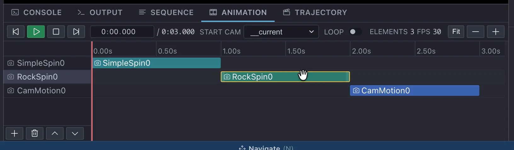

<!-- source: ja/ui/bottom-panels/animation.md @ f8502b6 -->

# Animation panel

The **Animation** tab of the bottom panel edits the animation timeline.
It uses a strip layout like Blender's, with each animation element shown as one strip.
For the element types and their settings, see [Animation](../../reference/animation/index.md).

## Panel layout

{ width="816" .on-glb }

| Area | Contents |
|---|---|
| Header | Playback controls, the current time and total length, the start camera (**Start cam**), looping (**Loop**), the number of elements (**Elements**) and the frame rate (**FPS**), and zooming the display in and out |
| Left column | The list of element names, and a toolbar for adding, deleting and reordering elements |
| Right area | The time ruler and the element strips |

## Editing elements

- Choosing a type from **Add element** (+) on the toolbar of the left column adds an element.
  **Delete element** deletes it, and **Move up** / **Move down** reorder it.
- Drag a strip to move its start position, or drag its edge to change its length.
  While dragging, the length and the start and end times are shown near the strip.
  The start time (when moving or dragging the left edge) and the length (when dragging the right edge) snap to intervals of 1/10 of the time ruler.
  Dragging with ++alt++ (++option++) held moves them freely without snapping.
  Dragging past the end of the timeline extends the timeline.
- Selecting a strip shows the detailed settings of that element in the inspector on the right
  (type-specific settings and the generic property list).
- An element whose start-time reference (Relative to) cannot be resolved is shown with diagonal stripes
  and cannot be played until this is fixed.

### Copy &amp; paste

The selected strip can be duplicated with **Edit &gt; Cut** / **Copy** / **Paste** (++cmd+x++ / ++cmd+c++ / ++cmd+v++).
A pasted element is inserted right after the selected strip (or at the end when no strip is selected).
Its length is the same as the original. If its name collides with an existing one, it is renumbered. Pasting into another scene is also possible.

## Playing

- The playback buttons in the header play the animation in the molecular view.
  The buttons are, from the left, **Skip to start** / **Play** (**Pause** during playback) / **Stop** / **Skip to end**.
- The current time display is editable. Type a time and press ++enter++ to jump to that point
  (→ [Entering times](../inspector.md#entering-times)).
- Turning **Loop** ON plays the whole timeline repeatedly.
- **Fit** fits the whole timeline to the panel width, and **-** / **+** zoom the display out and in.

!!! note
    While animation properties are being edited, the molecular view does not follow in real time.
    Play the animation to check the result.

## Start camera

The start camera can be chosen with **Start cam** in the header. When an element is added or pasted while there is no start camera,
`__current` (the current view) becomes the start camera. `__current` is updated to the view at that moment just before playback
starts from the stopped state, so playback starts from the view currently shown (it is not updated when resuming from a pause).
To start from a fixed view, choose a named camera as the start camera
(→ [Camera](../../reference/camera.md#__current)).

## Exporting a movie

To export the created animation as a movie file,
use **Rendering &gt; Movie rendering...** (→ [Rendering window](../rendering-window.md)).

## See also

- [Animation](../../reference/animation/index.md) — element types and common properties
- [Making an animation and exporting a movie](../../tutorials/animation/animation-movie.md)
- [Bottom panel](index.md)
- [Property inspector](../inspector.md)

---

*Verified against: CueMol3 3.0.3.565*
