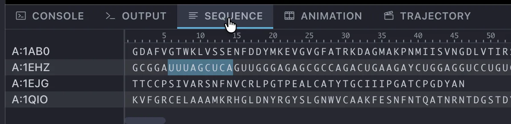

<!-- source: ja/ui/bottom-panels/index.md @ f8502b6 -->

# Bottom panel

The panel at the bottom of the window has four tabs by default.

{ width="598" .on-glb }

| Tab | Contents |
|---|---|
| **Console** | Command line (→ [Console](../../reference/plugins/console/index.md)) |
| **Output** | Log display |
| **Sequence** | Display and selection of the amino acid / nucleotide sequences of molecules (→ [Sequence panel](sequence.md)) |
| **Animation** | Timeline editing for animations (→ [Animation panel](animation.md)) |

Enabling a [plugin](../../reference/plugins/index.md) adds the following tab.
The **Console** tab is also part of the Console plugin, and it disappears when the plugin is disabled.

| Tab | Contents | Plugin |
|---|---|---|
| **Trajectory** | Playback of MD trajectories (→ [Trajectory panel](trajectory.md)) | MD Tools |

## Output

Shows the application log. File loading results and error messages appear here.

- ++cmd+a++ (Edit &gt; Select All) selects the whole log so that it can be copied.

## Sequence

Shows the sequences of the loaded molecules, one grid row per chain. Residues can be selected by
clicking or dragging. For details, see [Sequence panel](sequence.md).

## Animation

Edits the animation timeline. Each animation element is shown as one strip, and strips can be added,
moved, copied and pasted, and played. For details, see
[Animation panel](animation.md).

## Console

A command line for running CueMol operations as commands. Switching to PyM console on the toolbar
allows PyMOL commands such as `fetch 1crn` to be typed as they are. ChX console accepts ChimeraX
commands such as `open 1crn`.

This tab is part of the **Console** plugin, which is **enabled by default**
(→ [Console](../../reference/plugins/console/index.md)). It is the first tab of the bottom panel and
stays in front until another tab is selected.

## Trajectory

Plays MD trajectories. Frame blocks are shown on the timeline, with playback, frame stepping,
seeking and block editing. For details, see [Trajectory panel](trajectory.md).

This tab is part of the **MD Tools** plugin, which is **disabled by default**
(→ [Plugins](../../reference/plugins/index.md)).

---

*Verified against: CueMol3 3.0.2.560*
