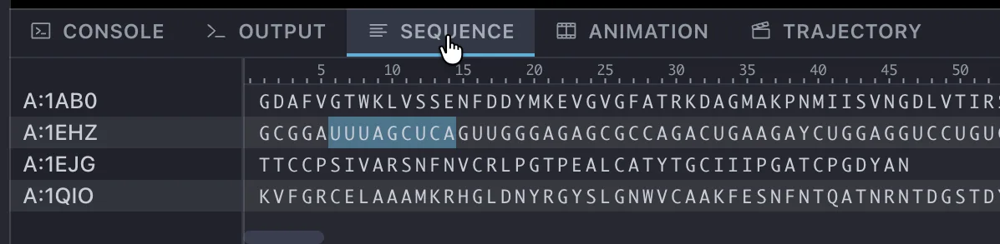

<!-- source: ja/ui/bottom-panels/sequence.md @ dcf70c1 -->

# Sequence panel

The **Sequence** tab of the bottom panel shows the sequences of the loaded molecules and is used to select residues.

## Display

{ width="598" .on-glb }

Shows the sequences of the loaded molecules, one grid row per chain.
There is no per-molecule switching; the chains of all molecules in the scene are listed together.

- The name column on the left shows the chain and molecule name of each row in the form `<chain>:<molecule name>`.
- A ruler showing residue positions is shown above the grid.
- Selected residues are shown in color, and the most recently clicked position has a frame around it.

The boundary between the name column on the left and the sequence grid can be dragged to change the column width.

## Operations

| Operation | Action |
|---|---|
| Click | Toggles the selection of that residue and moves the molecular view to the position of that residue. |
| Drag | Toggles the selection of the residues from the start point to the end point. |
| ++shift++ + click | Selects from the most recently marked position to the clicked position. |
| Right-click | Opens the menu described below. |

## Right-click menu

| Item | Action |
|---|---|
| Toggle sel | Toggles the selection of that residue. |
| Around 3 / 5 / 7 / 10 | Selects atoms within the given distance of the selection. |
| Around Byresid 3 / 5 / 7 / 10 | Same as above, but selects whole residues. |
| Unselect all | Clears the selection. |
| Invert sel | Inverts the selection. |
| Copy sequence | Copies the sequence to the clipboard in one-letter code (residues without a one-letter code become `*`). |
| Center here | Brings that residue to the center of the molecular view. |

!!! warning "Known issue: selection updates are delayed"
    After the selection is changed, the highlight in the molecular view may take about 0.5 seconds to update.
    This is a known issue under investigation.

## See also

- [Bottom panel](index.md)
- [Selecting part of a molecule](../../tutorials/basic/selection.md)
- [Selection syntax](../../reference/selection.md)

---

*Verified against: CueMol3 3.0.2.560*
