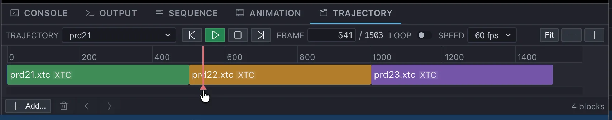

<!-- source: ja/ui/bottom-panels/trajectory.md @ f8502b6 -->

# Trajectory panel

The **Trajectory** tab of the bottom panel plays MD trajectories.
Frame blocks are shown on the timeline, with playback, frame stepping and seeking.

This tab is part of the **MD Tools** plugin, which is **disabled by default**.
Enable it in Settings &gt; Plugins &gt; Installed
(→ [Plugins](../../reference/plugins/index.md)).

## Opening a trajectory

**File &gt; Open MD Trajectory...** opens a topology file (`.gro` / `.prmtop` / `.psf`) followed by
coordinate and trajectory files in order.

A trajectory can also be attached to a molecule that is already open. Dropping a trajectory file
(`.xtc` / `.dcd` / `.trr` / `.nc`) or a coordinate file (`.rst7` / `.inpcrd` / `.restrt` / `.coor`)
onto the window opens the **Attach Trajectory** dialog, where the target can be chosen from the molecules with a matching atom count.

- Choosing an ordinary molecule converts it into a trajectory, and its original coordinates become the first frame.
- Choosing a molecule that is already a trajectory appends the frames to the end.
- Molecules moved by superposition or similar operations, edited molecules, and molecules without their original file cannot be chosen.
- A topology-only file (`.prmtop` / `.psf`) can be opened with **Open File...** as a molecule without coordinates.
  Coordinates are attached afterwards by dropping a coordinate or trajectory file.

## Panel layout

{ width="854" .on-glb }

| Area | Contents |
|---|---|
| Header | The target trajectory (**Trajectory**), playback controls, the current frame (**Frame**) and the last frame, looping (**Loop**), playback speed (**Speed**), and zooming the display in and out |
| Center | The frame ruler and one block per file |
| Bottom edge | A toolbar for adding, deleting and reordering blocks, and the number of blocks |

## Playing

- The playback buttons in the header are, from the left, **Skip to start** / **Play** (**Pause** during playback) / **Stop** / **Skip to end**.
- Entering a frame number in **Frame** moves to that frame. Clicking or dragging on the ruler or on an area without blocks also moves the position.
- Turning **Loop** ON repeats playback. **Speed** sets the number of frames per second.
- **Fit** fits the whole trajectory to the panel width, and **-** / **+** zoom the display out and in.

## Editing blocks

Each file becomes one block, and the frames are joined in block order.

| Button | Action |
|---|---|
| **Add...** | Chooses a file and appends it as a block at the end. |
| Delete | Deletes the selected block. |
| ◀ / ▶ | Moves the selected block backward / forward. Blocks can also be reordered by dragging. |

## See also

- [Bottom panel](index.md)
- [File menu](../../menu/file.md)
- [Plugins](../../reference/plugins/index.md)

---

*Verified against: CueMol3 3.0.2.560*
