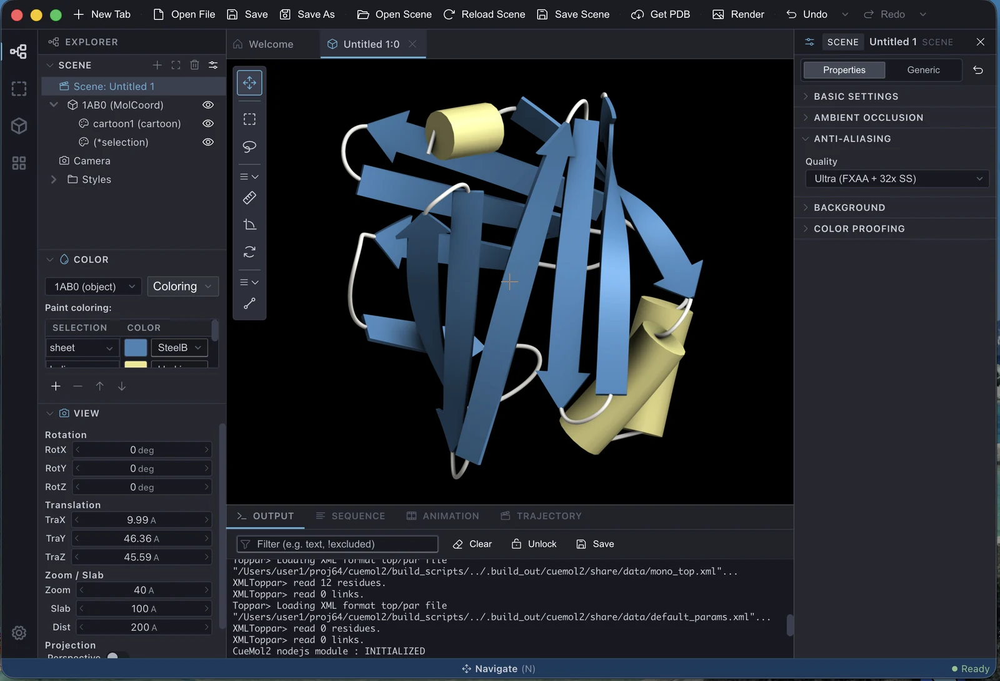

<!-- source: ja/ui/index.md @ 6cacee7 -->

# User interface

The CueMol3 main window brings all operating surfaces together in a single window.
Unlike CueMol2, no separate windows open for individual functions.

## Area names

The numbers in the figure correspond to the # column in the table below.

{ .on-glb }

| # | Area | Role | Details |
|---|---|---|---|
| 1 | **Toolbar** | Buttons for frequently used operations (New Tab / file operations / Get PDB / Render / Undo and Redo) | [Toolbar and tool palette](toolbar-tools.md) |
| 2 | **Activity bar** | The vertical column of icons at the left edge. Switches what the side panel shows (Explorer / View / Selection / Crystal / Actions, etc.). The gear at the bottom opens the Settings tab | [Side panels](side-panels.md) |
| 3 | **Side panel (left)** | The group of panels for the purpose selected in the activity bar: scene tree, color settings, molecular structure tree, etc. | [Side panels](side-panels.md) |
| 4 | **Tab bar** | Switches between the open scenes / views and the Settings tab. Tabs can be reordered by dragging | |
| 5 | **Molecular view (MolView)** | The main 3D display. The viewpoint is moved with the mouse | [Mouse and trackpad input](mouse-input.md) |
| 6 | **Tool palette** | A vertical column of tool buttons floating at the left edge of the molecular view. Switches between the viewpoint / region selection / measurement / bond editing modes | [Toolbar and tool palette](toolbar-tools.md) |
| 7 | **Property inspector (right)** | Displays and edits the settings of the element selected in the scene tree. Changes are reflected immediately in the molecular view | [Property inspector](inspector.md) |
| 8 | **Bottom panel** | Tabs for Console (command line) / Output (log) / Sequence (sequence) / Animation (timeline). Enabling a plugin adds more tabs | [Bottom panel](bottom-panels.md) |
| 9 | **Status bar** | Status display. Plugin items (**CLI** for Console, **MCP** for MCP Server) are also listed here. The bell at the right end opens the notification center | [tritium_cli](../reference/plugins/console/cli.md#ステータスバーの-cli) / [MCP Server](../reference/plugins/mcp-server.md#ステータスバーの-mcp) / [Notification center](../install/update.md#notification-center) |
| — | **Menu bar** | Menus such as File / Edit. On macOS it is in the system menu bar at the top of the screen, so it does not appear in the figure. On Windows / Linux it is at the top of the window | [Menus](../menu/index.md) |

## Tabs

In CueMol3, scenes and views are arranged as **tabs**.

- **File &gt; New Tab** adds a tab for a new scene, or a tab for another view of an existing scene.
- Tabs can be reordered by dragging.
- Settings also opens as a tab (only one in the app).
- The window title is `CueMol3 - <scene name>:<view name>` and follows the
  active tab. CueMol3 does not draw a title bar inside the window, so the title is visible
  only in macOS Mission Control and the Dock, and in the Windows / Linux taskbar and Alt-Tab.

!!! info "Difference from CueMol2's multiple windows"
    There is no equivalent of CueMol2's File &gt; New Window.
    Because the structure shares a single backend, multiple OS windows cannot be opened.
    Use **New Tab** instead
    (→ [Merged, renamed and removed features](../changes/features.md)).

## Showing, hiding and resizing panels

- **Clicking the selected icon again** in the activity bar closes the side panel.
  Clicking it again opens the panel.
- Each panel within the side panel can be collapsed and expanded by clicking its header.
- Panels can be resized by dragging their borders. The sizes are remembered.

## The other window

The **rendering window**, used for ray tracing and movie output, opens as a top-level window
independent of the main window. It is modeless, so the molecular view can be manipulated
in the main window while it remains open (→ [Rendering window](rendering-window.md)).

Windows can be switched from the **Window** menu
(→ [Window / Help menu](../menu/window-help.md)).

---

*Verified against: CueMol3 2.4.0.546*
