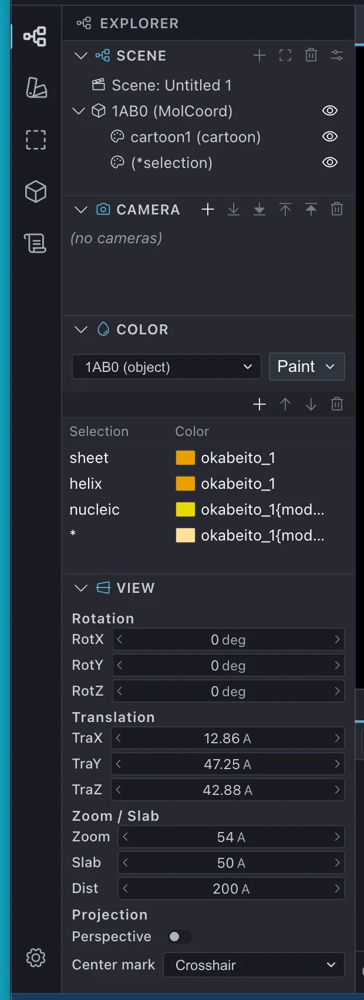
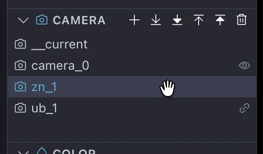

<!-- source: ja/ui/side-panels.md @ 1002eeb -->

# Side panels

The side panel on the left of the window switches between views using the **activity bar** at the far left.
Clicking the selected icon again closes the side panel.

{ width="155" .on-glb }

## Activity bar layout

| Icon | View | Panels |
|---|---|---|
| Explorer | Scene structure and display settings | Scene / Camera / Color / View |
| Styles | Style sets and their named colors and selections | Style Sets / Colors / Selections |
| Selection | Molecule selection | Mol Struct / Selection |
| Crystal | Crystallographic information | Symmetry / Density map |
| Actions | Recording and replaying operations | History / Actions |
| Gear (at the bottom) | Opens the Settings tab (not a side panel). | |

## Explorer

### Scene panel (scene tree)

Shows the contents of the scene as a tree. It corresponds to the workspace panel of CueMol2.

- **Node types**: scene / Object / Renderer / Renderer group
- **Toggling visibility**: The eye icon on each row shows or hides it.
  A row that is not drawn because a parent node is hidden has a grayed-out icon.
- **Selection**: Click to select; ++cmd++ / ++ctrl++ + click selects multiple rows.
  ++shift++ + click selects a range from the previously selected row, **in the order rows appear on screen**
  (the contents of collapsed nodes are not included). The anchor does not move, so repeated
  ++shift++ + click extends or shrinks the range from the same anchor. ++shift++ + ++cmd++ / ++ctrl++ + click
  adds a range without replacing the current selection.
- **Keyboard**: ++up++ / ++down++ move one row at a time, and ++home++ / ++end++ move to the first / last row.
  Adding ++shift++ extends the selected range, and ++shift++ + ++cmd++ / ++ctrl++ extends it
  in addition to the current selection. ++left++ / ++right++ collapse / expand a row;
  when it cannot be collapsed or expanded any further, the focus moves to the parent row / the first child row.
- **Renaming**: Press ++f2++ or choose **Rename...** from the context menu to edit the name in place.
  ++enter++ or moving the focus away confirms, and ++esc++ cancels. Clicking a row only selects it
  and does not start editing the name.
- **Reordering**: Drag and drop to change the order or the group membership.
- **Double-click**: Shows the contents in the [property inspector](inspector.md).
- **Right-click**: Opens a menu for each node type (see below).

The toolbar at the top of the panel has **Add** / **Focus** / **Delete** / **Property** buttons.
Property is unavailable while multiple nodes are selected. **Focus** fits all selected nodes in the view
(for a molecule Object, it fits the atoms drawn by the displayed Renderers; for a density map Object, the displayed contours;
even for something small, the width of the view is not made narrower than 15 Å), and
**Delete** removes all selected nodes and can be undone in one step with a single Undo. The ++delete++ / ++backspace++ keys do the same.

#### Main context menu operations

| Target | Main operations |
|---|---|
| Scene | Background color (White / Black), toggling color proofing, renaming, pasting an Object |
| Object | Specifying a selection, renaming, copy &amp; paste, creating a new Renderer / Renderer group, setting colors, Save As, regenerating molecular surfaces |
| Renderer | Renaming, copy &amp; paste (pastes into the same Object and the same group), setting colors, applying / creating / editing styles, changing the selection, generating a surface Object, changing the Renderer type, editing the interaction list |
| Renderer group | Show / hide (applies to its members), renaming, copy &amp; paste, creating a new Renderer |

When multiple nodes are selected, **copy** is available in addition to show, hide and delete.
Selecting a Renderer group targets its member Renderers. Copying is not possible when nodes of
different types are mixed, or when two or more Objects are selected.

Copy &amp; paste can also be done with the shortcuts of the Edit menu
(→ [Edit menu](../menu/edit.md#clipboard)).

#### Creating a Renderer

Use **New Renderer...** in the context menu of an Object row or a Renderer group row
to choose the Renderer type and target.

- Choosing a **preset** creates a group of several predefined Renderers at once.
- Creation is performed **immediately with default values**; fine adjustments are made afterwards in the inspector.
  To cancel, use Undo.

### Color panel

Sets the **Coloring** of each Renderer. Choose a Renderer at the top (Renderers that can handle colors and
their parent Objects are listed; when you select an Object or a Renderer in the scene tree, this list follows),
then choose a Coloring type, and the settings for that type are shown below.
The button for choosing the type shows the current type of that Renderer (Paint / Solid / CPK / B-factor /
Rainbow / Potential / Multi-gradient).

| Type | Settings |
|---|---|
| Solid | Specifies a single default color. |
| Paint | Specifies pairs of a selection and a color in a table. Rows can be added, deleted, cleared and reordered, and Cut / Copy / Paste are available. |
| CPK | Color for each element (C / N / O / S / P / H / others) |
| Rainbow | Mode, quantity to vary, start and end hue, brightness, saturation |
| B-factor | Mode (B-factor / occupancy / distance), lower and upper colors, lower and upper values (editable only when Auto is set to Manual) |
| Electrostatic potential | Target potential map, whether to color by SAS, low / middle / high values and colors |
| Multi-gradient | Edit the stops (color breakpoints) directly on the map histogram and the gradient bar. |

The Paint table supports multiple selection. ++cmd++ / ++ctrl++ + click adds a row to or removes it from the selection,
and ++shift++ + click selects a range. Delete, Cut and Copy apply to all selected rows.
Reordering (Move up / Move down) is available when exactly one row is selected.
Rows can also be reordered by dragging. Dropping a row below the last row moves it to the end.
Rows can also be moved and selected with the same keys as the scene tree (++up++ / ++down++ / ++home++ / ++end++ and
their combinations with ++shift++).

The toolbar above the table has four buttons: add a row (**Add**), reorder (**Move up** / **Move down**), and
delete (**Delete**). **Delete all** and **Cut** / **Copy** /
**Paste** are in the right-click menu of a row. The selected rows can also be deleted with
the ++delete++ / ++backspace++ keys. The boundary between the Selection column and the Color column
can be dragged to change the column width.

Clicking a row only selects it. To edit a cell, start with any of double-clicking the cell, ++enter++,
++f2++, or **Edit selection...** in the right-click menu, and confirm with ++enter++ or cancel with
++esc++. For colors, click the color swatch to open the color picker.
Because the displayed rows have no text input field, ++cmd+c++ / ++cmd+v++ / ++cmd+z++ act on
**rows**, not on text.

A Paint Cut can be undone in one step with a single Undo. Paste is unavailable when the clipboard is empty.
Pasted rows keep the order in which they were copied.

### Camera panel

{ width="270" .on-glb }

A list of [cameras](../reference/camera.md) (saved named viewpoints).
Click a row to select it, and use the toolbar or the right-click menu to operate on it.

The toolbar at the top of the panel has seven buttons.

| Button | Action |
|---|---|
| New camera from view | Creates a new camera from the current view. A dialog asks for the name. |
| Save from view | Overwrites the selected camera with the current view. |
| Save from view with show/hide | Same as above. The show / hide state is also saved. |
| Apply to view | Restores the view of the selected camera. |
| Apply to view with show/hide | Same as above. The saved show / hide state is also restored. |
| Delete | Deletes the selected camera. |
| Property | Shows the selected camera in the [inspector](inspector.md). |

- **Double-click**: Applies the camera, including its show / hide state.
- **Renaming**: Press ++f2++ or choose **Rename...** from the right-click menu to edit in place.
- **Deleting**: The ++delete++ / ++backspace++ keys also delete it.
- **Reordering**: Drag rows to change the order. Dropping a row below the last row of the list
  moves it to the end. The order is saved in the scene file (`.qsc`).
- **`__current`**: A special camera that represents the current view. Every scene has it from the moment it is created.
  It is pinned to the top of the list and cannot be moved by dragging. It cannot be overwritten, applied, deleted, renamed or
  copied, and its right-click menu offers only New, Paste, loading a camera file, **Save As...** and **Properties...**.
- **Inspector**: **Property** on the toolbar or **Properties...** in the right-click menu shows the camera in
  the inspector. While it is shown, selecting another row in the list switches the inspector to
  that camera as well.
- **Row badges**: A camera that holds a show / hide state has an eye icon, and a camera
  loaded from a camera file has a link icon.

In addition to the above, the right-click menu offers **copy &amp; paste**,
**loading, reloading and saving camera files (`.cam`)**, and
**editing and clearing display flags** (→ [Camera](../reference/camera.md)).
Editing the display flags (**Edit vis flags**) opens **Visibility** in the inspector.
Right-clicking on an empty area opens a menu with only New, Paste and loading a camera file.

!!! warning "Creating a camera with an existing name overwrites it"
    Running **New camera from view** with the same name as an existing camera overwrites
    that camera without confirmation.

### View panel

Controls the viewpoint numerically. It corresponds to the fake dial (View panel) of CueMol2.

| Section | Contents |
|---|---|
| Rotation | Rotation about X / Y / Z. Dragging rotates relatively. |
| Translation | Translation |
| Zoom / Slab | Zoom, slab (width of the visible depth), distance |
| Projection | Projection mode (Perspective / Orthographic) and the center mark |

!!! note
    Changes of the view are not subject to Undo.
    The background color is a scene setting, so set it from the [Scene menu](../menu/scene.md) or the
    inspector, not from this panel.

## Styles

Handles the style sets of [styles](../reference/styles.md) and the named colors and selections in them.

### Style Sets panel

A list of the style sets visible from the scene. In the order in which names are looked up (highest priority first), the scene's style sets
are listed, followed by the application-wide style sets (shown as `global`). Read-only style sets have
a lock icon, and style sets loaded from a file have a link icon.

The toolbar at the top of the panel has **New style set** / **Load style file** / **Style entries** / **Delete**
buttons. Double-clicking a row or pressing **Style entries** opens the list of styles contained in that style set
(deletion only).

In addition to the above, the right-click menu offers copy &amp; paste, loading, reloading and saving style files
(**Style file**), and toggling read-only (**Read-only**). The `global` style sets
cannot be copied, deleted, saved or toggled read-only.

- The style sets bundled with the app and those loaded from `~/.cuemol/styles/` are read-only.
  The `user` style set can be edited and is saved when CueMol3 quits.
- Edits to `global` style sets cannot be undone with Undo (because they do not belong to a scene).

### Colors panel / Selections panel

Lists of the named colors (Colors) and named selections (Selections) of the style set chosen in the Style Sets panel.
The values of rows can be edited in place. Colors are entered from the color swatch, and selections from the ▼ at the right end, using named selections, the history or the selection builder.
**Add** in the header adds an entry after a name is entered, and **Delete** deletes the selected rows.
Read-only style sets are display-only and cannot be edited (`(read-only)` is shown next to the target name).

## Selection

### Mol Struct panel

Shows a molecule as a chain → residue → atom hierarchical tree and builds selections.

- Choose the target molecule at the top.
- The tree is loaded when a node is expanded.
- Multiple selection is supported (++cmd++ / ++ctrl++ + click, ++shift++ + click).
- With the buttons to the right of the heading, **Select atoms** / **Center at** / **Zoom at**, the range chosen in the tree
  can be made the molecule's selection / brought to the center / centered and zoomed in on. The buttons are icons;
  hovering the pointer over one shows its name. Choosing in the tree alone does not change the molecule's selection.

### Selection panel

A dedicated panel for displaying and editing the selection of a molecule.

- When you choose the target molecule in **Molecule**, the current selection of that molecule is shown
  in the **Selection** field as a selection expression. Operations in the panel are applied to the selection immediately
  and can be undone with Undo.
- The **selection builder** (four tabs: Named / History / Term / Mod) lets you build a selection without writing an expression.
  You can apply a named selection or a history entry with one click, combine conditions
  (Set / Add / Sub / Intsec), and transform the current selection (Invert / Byres / Sidech / Mainch /
  Arnd / Expn). Each operation shows the number of atoms that would result if it were applied
  (→ [Selection builder](selection-builder.md)).
- The **Selection** field can also be edited by hand. The expression is validated as you type,
  and a warning is shown if it is invalid. Apply a hand-typed expression with the **Apply selection** button below the field
  or by pressing ++enter++.
- The buttons below the field are, from the left, **Apply selection** (apply the expression), **Center view on selection**
  (center the view on the selection), **Clear selection** (clear the selection) and **Define name** (name the selection
  so that it can be reused in the scene as a named selection). The buttons are icons; hovering the pointer over one shows its description.
- The history is saved in the application and shared with the selection fields of Renderers and elsewhere.

!!! note "Differences from CueMol2"
    The hierarchical editor (Hierarchical / Terminal / Around-Expand) of the CueMol2 selection panel
    has been replaced by the selection builder.

## Crystal

### Symmetry panel

Handles crystallographic symmetry.

- When you choose the target Object (molecular coordinates / density map), the lattice type, space group and cell constants are shown.
- **Change...** changes the crystal system and the space group. When "restriction by symmetry" is enabled,
  the input of cell constants is linked according to the constraints of the crystal system.
- **Symm mol** displays symmetry mates. The range can be chosen from 20 / 50 / 100 / 200 Å or the unit cell.
- **Unit cell** displays the frame of the unit cell.

### Density map panel

Adjusts the display of density map Renderers (contour / isosurface, etc.).

- Choose a Renderer, adjust the transparency / display extent with the sliders, and adjust the contour level with **Level**.
- **Level** consists of a value input field and a histogram of the map density. The histogram
  shows the current level as a marker.
    - Drag the marker or click the histogram to set the level. While dragging,
      ++shift++ moves it finely and ++esc++ cancels. Each operation becomes a single Undo step.
    - Dragging, pinching or scrolling on the histogram moves and zooms the displayed value range.
      The **-** / **+** / **Fit** buttons also change the range.
- The level can be specified either in a unit that depends on the map type (σ for crystallographic maps, the top % of
  grid point values for cryo-EM maps) or as an absolute value (switch with the ▼ menu).
  The input field is shown in this unit, and the value in the other unit is shown below it.
  A cryo-EM map is in absolute values from the moment it is loaded.
- **Redraw** updates the center of the display to the current view center. **Cell** displays the unit cell.
- When the whole map is displayed (the **Region** of the Renderer is *Full map*),
  operating the **Extent** slider and **Redraw** does not change the display
  (→ [contour](../reference/renderers/contour.md#contour)).

<!-- TODO(screenshot): the Density map panel, with the Level input field and the density histogram (marker) -->

## Actions

Handles the recording of performed operations and their replay. For details, see
[Recording and replaying operations (Actions)](../reference/actions.md).

### History panel

Shows the Undo history of the active scene, one step per row. A step that contains two or more
operations can be expanded to list the operations performed. From the toolbar you can move to the state of the selected row
(**Go to step**), copy it as commands (**Copy as commands**), save it to a qax file
(**Save as qax**), or save it to the Actions panel (**Save to Actions**).
Double-clicking a step shows its contents read-only in the inspector.

### Actions panel

Lists the **Presets** bundled with the app and the **User Actions** you saved. Select one and press **Run**
to apply it to the Object selected in the scene tree.

---

*Verified against: CueMol3 3.0.6.577*
