# マテリアル

Renderer が描画する 3D 物体について、色とは別に**マテリアル (質感)** を指定できます。
すべての Renderer の共通プロパティとして、プロパティインスペクタの **Basic settings**
セクションから設定します。

!!! note "分子ビューとレンダリングウィンドウの両方に反映されます"
    マテリアルは、分子ビュー (WebGL のリアルタイム表示) と、レンダリングウィンドウで
    書き出す画像の両方に反映されます。ただし、一部のマテリアル (下表) と
    [色ごとの指定](#色ごとの指定)は、レンダリングウィンドウでだけ反映されます。

## マテリアルの種類

指定できるマテリアルは次のとおりです。**指定した色はどのマテリアルにも効きます**。

| 名前 | 質感 | 分子ビュー |
|---|---|---|
| `default` | 既定の質感。`matte_plastic` と同じ、つや消しのプラスチック | 反映 |
| `matte_plastic` | つや消しのプラスチック。弱く広いハイライト | 反映 |
| `plastic` | 磨いたプラスチック。小さな白いハイライト | 反映 |
| `ceramic` | 釉薬のかかった陶器。鋭いハイライトと、輪郭の明るい照り | 反映 |
| `matte` | つや消しの質感 | 反映 |
| `spec_metal` | 非常に「テカリ」が強い金属質感 | 反映 |
| `diff_metal` | つや消し金属質感 | 反映 |
| `metallic_chrome` | クロムのような、鋭く反射する金属 | `default` と同じ見た目 |
| `metallic_copper` | 銅のような、やや粗い金属 | `default` と同じ見た目 |
| `stone35` | 石のようにざらついたつや消し | `default` と同じ見た目 |
| `wood31` | 木のような、ややつやのある質感 | `default` と同じ見た目 |
| `shadow` | 「テカリ」のない影のような質感 | 反映 |
| `nolighting` | 陰影付けなしのべた塗り | 反映 |
| `toon1` / `toon2` | トゥーン調の陰影 | 反映 |

`shadow` はハイライト (テカリ) がないため、半透明にして他のものと重ねて表示するときに
向いています。

金属質感のマテリアルは周囲の環境光を映すため、環境によっては暗く見えることがあります。

存在しないマテリアル名を指定した場合は `default` が使われます。

!!! note "POV-Ray バックエンドとは見え方が異なります"
    上表のレンダリングウィンドウでの質感は、既定のレンダリングバックエンドである **Umbreon** でのものです。
    非推奨の POV-Ray バックエンドでは次の点が異なります
    (→ [レンダリング](../rendering.md))。

    - `stone35` / `wood31` は石目・木目の**模様**として描かれます。Umbreon には
      模様を生成する機能がないため、粗さの違うつや消しになります。
    - `metallic_chrome` / `metallic_copper` / `stone35` / `wood31` は
      **色の指定が無視されます**。
    - `metallic_chrome` / `metallic_copper` は金属ではなくプラスチックの質感になります。

## 見え方の比較

1CRN の分子表面 (dsurface、灰色) のマテリアルだけを変えて比べた図です。左が分子ビュー
(Fast GI のアンビエントオクルージョンが有効)、右がレンダリングウィンドウ
(Umbreon、Global Illumination) で書き出した画像です。`default` は `matte_plastic` と同じ見た目なので
省いています。

### プラスチックの系統

色 (拡散光) が主で、ハイライトは白く光ります。`matte_plastic` (`default`) のハイライトは弱く広く、
`plastic` は小さく鋭く、`ceramic` はさらに鋭くなります。`ceramic` は、視線に対して寝た面
(輪郭の近く) ほど周りを映して白く照ります。レンダリングウィンドウでは、この輪郭の照りは
分子ビューほど強くは出ません。

| 名前 | 分子ビュー | レンダリングウィンドウ (Umbreon) |
|---|---|---|
| `matte_plastic` | 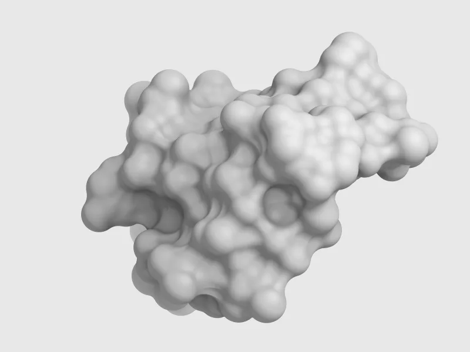{ width="200" .on-glb } | { width="200" .on-glb } |
| `plastic` | { width="200" .on-glb } | 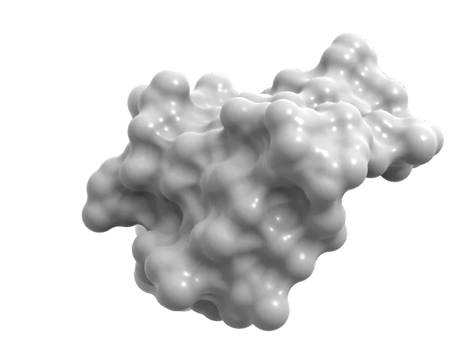{ width="200" .on-glb } |
| `ceramic` | 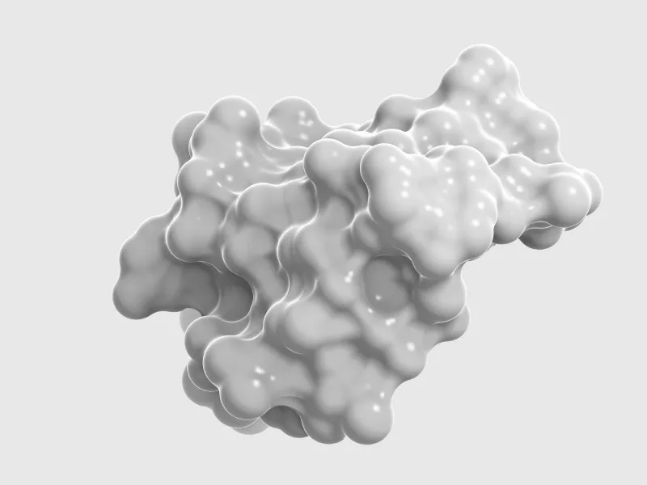{ width="200" .on-glb } | { width="200" .on-glb } |

### つや消し

`matte` にはハイライトがありません。

| 名前 | 分子ビュー | レンダリングウィンドウ (Umbreon) |
|---|---|---|
| `matte` | 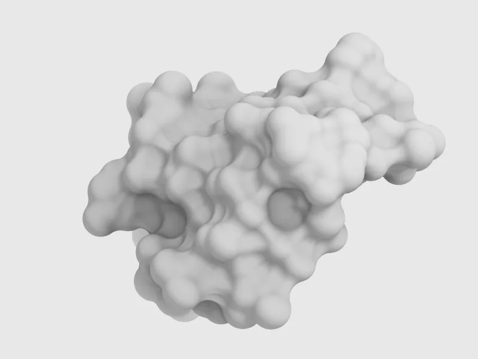{ width="200" .on-glb } | 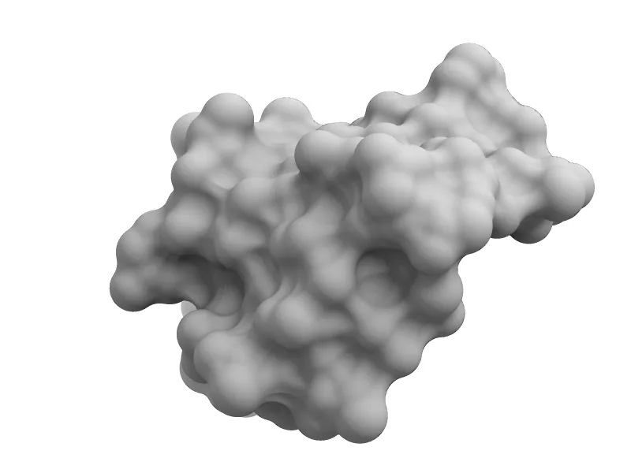{ width="200" .on-glb } |

### 金属の系統

地の色 (拡散光) を弱め、強いハイライトを付けます。`diff_metal` のハイライトは広く、
`spec_metal` は強く鋭くなります。分子ビューでは、ハイライトに地の色が付き、上が明るく下が暗い
空のグラデーションを映します (周りの分子は映りません)。

| 名前 | 分子ビュー | レンダリングウィンドウ (Umbreon) |
|---|---|---|
| `diff_metal` | { width="200" .on-glb } | 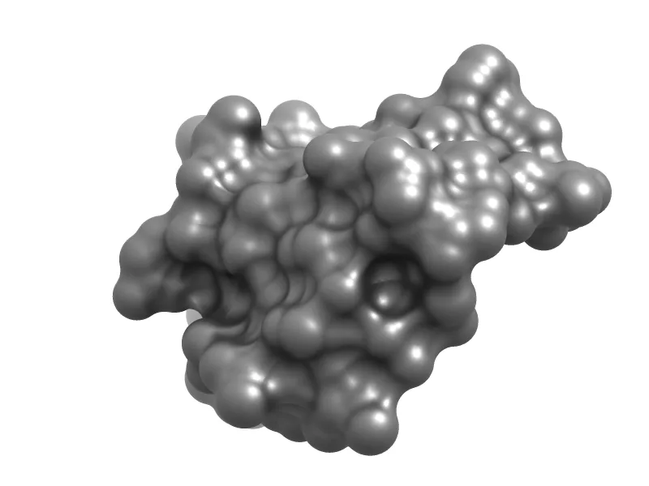{ width="200" .on-glb } |
| `spec_metal` | 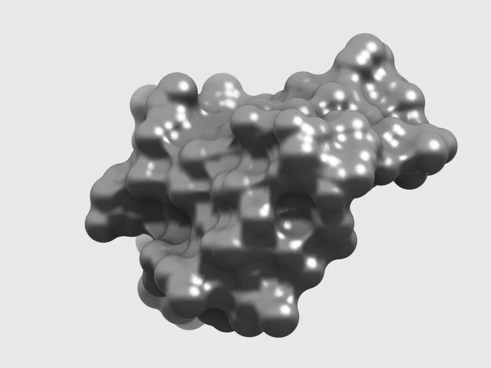{ width="200" .on-glb } | { width="200" .on-glb } |

### トゥーン

陰影を、光の当たる側と反対側の 2 段の平らな色にします。`toon2` には白い点のハイライトが付きます。
分子ビューでは、アンビエントオクルージョンが無効のとき、POV-Ray のトゥーン調に近い見え方になります
(下の図の分子ビューは、アンビエントオクルージョンを無効にしています)。有効のときは、ほかの
マテリアルと同じ光のもとで 2 段にし、アンビエントオクルージョンも掛かります。
レンダリングウィンドウ (Umbreon) では、POV-Ray より暗くなります。

| 名前 | 分子ビュー | レンダリングウィンドウ (Umbreon) |
|---|---|---|
| `toon1` | 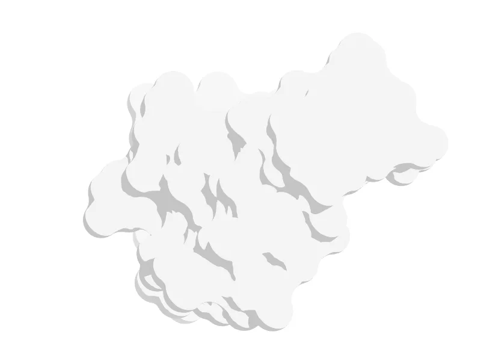{ width="200" .on-glb } | 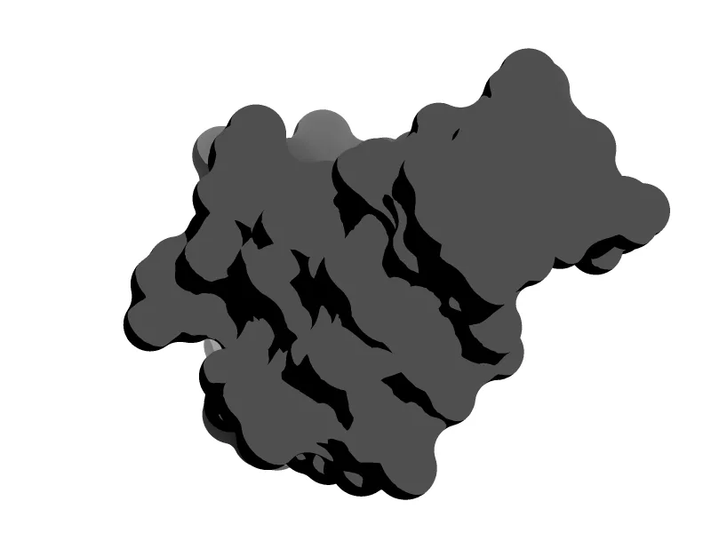{ width="200" .on-glb } |
| `toon2` | 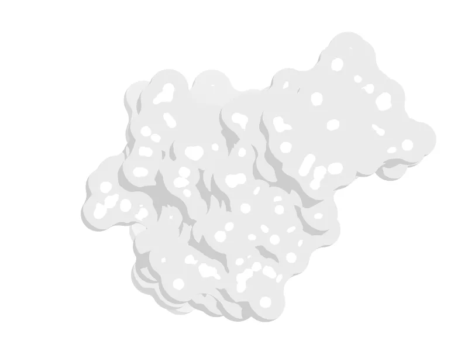{ width="200" .on-glb } | 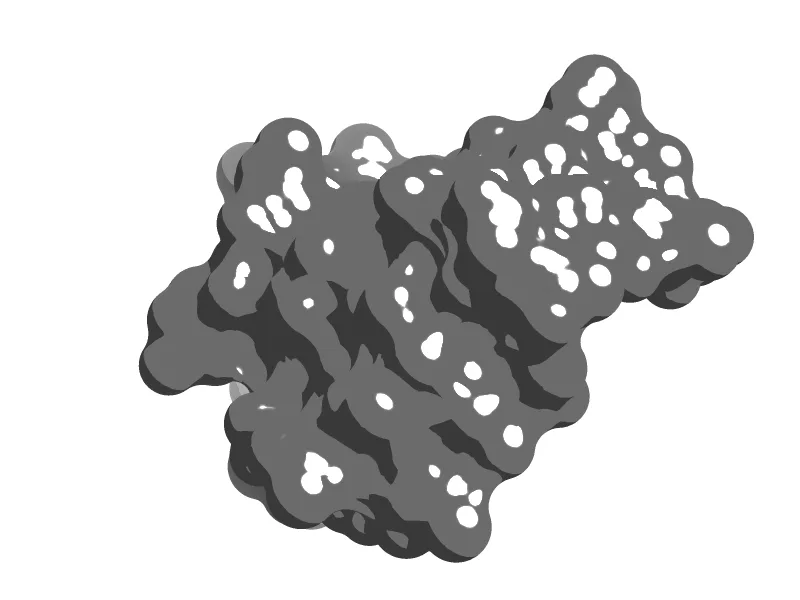{ width="200" .on-glb } |

### 陰影なし

`shadow` は環境光だけで照らし、`nolighting` は陰影を付けずにべた塗りにします。
分子ビューでは、この 2 つにはアンビエントオクルージョンが掛かりません。

| 名前 | 分子ビュー | レンダリングウィンドウ (Umbreon) |
|---|---|---|
| `shadow` | 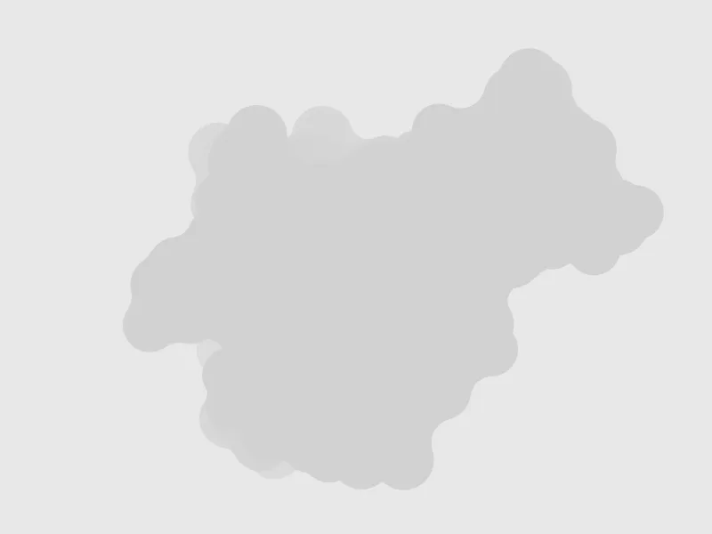{ width="200" .on-glb } | 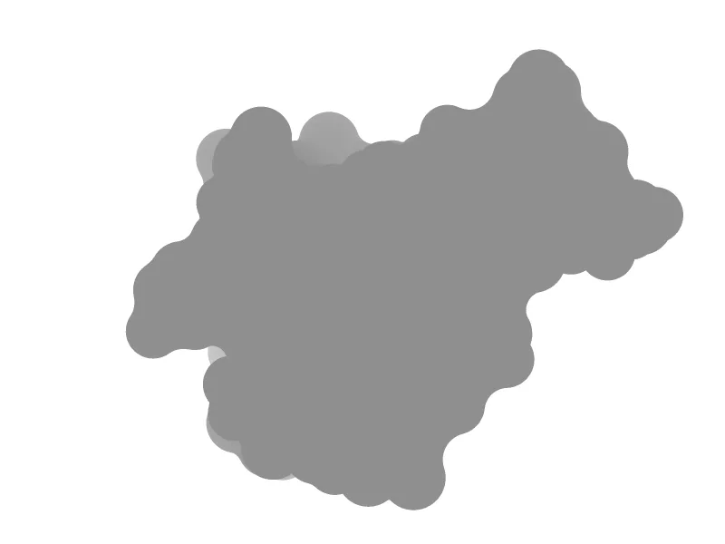{ width="200" .on-glb } |
| `nolighting` | { width="200" .on-glb } | { width="200" .on-glb } |

分子ビューでは、明るい色やハイライトは白に向かってなだらかに収まり、白く潰れません。
シーン全体の明るさは、Scene の **Lighting &gt; Brightness** で変えることができます
(→ [Scene](../scene.md#lighting))。

## 指定方法

### Renderer 全体に対する指定

プロパティインスペクタの **Basic settings** セクションの **Material** で指定します。
既定では空 (指定なし) で、この場合は `default` マテリアルが適用されます。

### 色ごとの指定

色を指定する際の[修飾子](../color-syntax.md#修飾子)としてマテリアルを指定できます。

```
<色指定>{material: <マテリアル名>}
```

色を黄色、マテリアルを `shadow` にする場合は次のように指定します
(色の指定方法が違うだけで、3 つとも同じ純色の黄色です)。

```
yellow{material:shadow}
rgb(1,1,0){material:shadow}
#FF0{material:shadow}
```

Coloring の Paint の各行に別々のマテリアルを指定すれば、
二次構造ごとに質感を変えるといったこともできます。

シート (sheet)
:   `SteelBlue{material:ceramic}`

ヘリックス (helix)
:   `khaki{material:diff_metal}`

その他 (`*`)
:   `FloralWhite{material:matte}`

マテリアルだけを指定することはできないため、必ず色とあわせて指定してください。

色ごとに指定したマテリアルは、分子ビューには反映されません (分子ビューは Renderer 全体の
マテリアルで描かれます)。レンダリングウィンドウで書き出す画像にだけ反映されます。

!!! tip "POV-Ray での模様の細かさ"
    POV-Ray バックエンドで `wood31` や `stone35` を使う場合、木目や石の模様が細かいため、
    かなり拡大しないと模様が見えません。Umbreon では模様そのものが描かれません。

## 関連項目

- [Renderer 共通プロパティ](common.md)
- [色の記法](../color-syntax.md)
- [エッジライン](edge-lines.md)
- [レンダリング](../rendering.md) — バックエンドと品質の設定
- [レンダリングウィンドウ](../../ui/rendering-window.md)
- [Scene](../scene.md) — アンビエントオクルージョンと明るさ

---

*確認対象: CueMol3 3.0.5.576*
