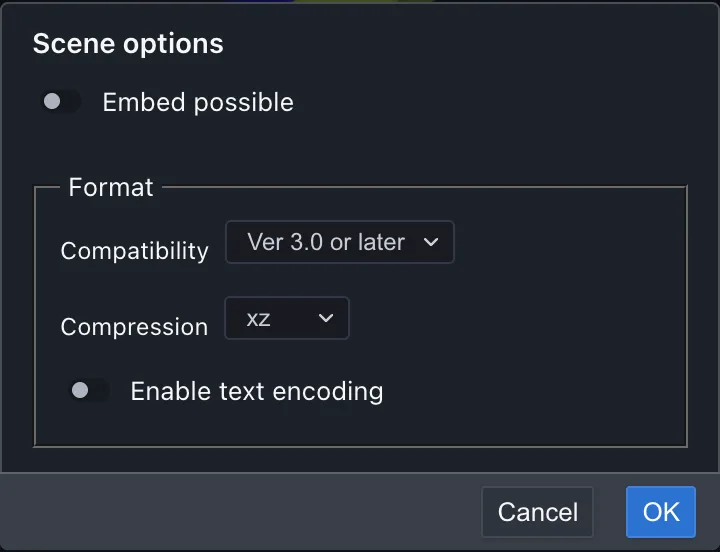

# シーンの保存 (Save Scene)

シーン全体 (Object・Renderer・色・カメラ・アニメーションなど) を、シーンファイル (`.qsc`) に保存します。

| メニュー | 動作 |
|---|---|
| **File &gt; Save Scene** (++cmd+s++) | シーンを読み込んだファイル (または前回保存したファイル) に上書き保存します。保存先が無いとき (新しいシーン)、またはそのファイルが無くなっているときは、**Save Scene As...** と同じ動作になります。 |
| **File &gt; Save Scene As...** (++cmd+shift+s++) | 保存先のファイルを選んだあと、**Scene options** ダイアログで保存のオプションを指定して保存します。 |

- ファイル名に `.qsc` が付いていなければ、付けて保存します。
- 既にあるファイルに保存するときは、元のファイルを `<ファイル名>.bak` に名前を変えて残してから書き込みます。
- 保存すると、シーン名がファイル名になります。
- **保存すると、そのシーンの Undo / Redo の履歴は消えます。**
- 保存の直前に、現在の視点が `__current` カメラに記録されます。シーンを開くと、この視点で表示されます
  (→ [カメラ](camera.md#__current))。

## Scene options ダイアログ

{ width="360" .on-glb }

| 項目 | 既定値 | 説明 |
|---|---|---|
| **Embed possible** | OFF | 埋め込むことのできるデータをすべてシーンファイルに埋め込みます (→ [データの埋め込み](#データの埋め込み-embed-possible))。 |
| **Format &gt; Compatibility** | Ver 3.0 or later | どのバージョンで開けるファイルにするか (→ [互換性](#互換性-compatibility))。 |
| **Format &gt; Compression** | xz | 埋め込んだデータの圧縮方式。**xz** / **gzip** / **none** から選びます。 |
| **Format &gt; Enable text encoding** | OFF | 埋め込んだデータを base64 でテキストにして書き込みます。 |

ダイアログは開くたびに上表の既定値に戻ります。**Cancel** を押すと保存しません。

**File &gt; Save Scene** で上書き保存するときはダイアログは出ず、前回そのシーンを保存したときの
Compatibility・Compression・Enable text encoding が使われます (これらの値はシーンファイルに記録されます)。
Embed possible は記録されないので、上書き保存では OFF として扱われます。
設定が記録されていないシーンファイルを上書き保存したときは、埋め込みデータは旧形式 (QDF0)・圧縮なしで
書き込まれます。

## データの埋め込み (Embed possible)

シーンファイルには、Object のデータ (分子の座標、密度マップ、分子表面など) を、元のファイルへの
参照として保存するか、シーンファイルの中に埋め込んで保存するかの 2 通りがあります。

**Embed possible** が OFF でも、次の Object は埋め込まれます。

- 元のファイルを持たない Object (シーン内で作った分子表面など)
- すでに埋め込まれている Object (埋め込んで保存したシーンから読み込んだもの)
- 読み込んだあとに変更した Object

それ以外の Object は、元のファイルへの参照として保存されます。元のファイルを移動・削除すると、
シーンを開いたときにその Object を読み込めなくなります。**Embed possible** を ON にすると、
すべての Object を埋め込むので、シーンファイル 1 つで持ち運ぶことができます。

埋め込んだデータは、シーンファイルの XML の後ろにまとめて書き込まれます。**Compression** と
**Enable text encoding** の対象はこの埋め込んだデータだけで、XML の部分はそのまま書き込まれます。
埋め込むデータが無いシーンでは、この 2 つの設定は結果に影響しません。

## 互換性 (Compatibility)

| Compatibility | 埋め込みデータの形式 | 内容 |
|---|---|---|
| **Ver 3.0 or later** (既定) | QDF1 | CueMol3 の見た目 (→ [Scene](scene.md#compatibility)) を、アプリに同梱のスタイルファイルへの参照として書きます。 |
| **Ver 2.3 or later** | QDF1 | CueMol3 の見た目をシーンファイルに埋め込みます。 |
| **Ver 2.2 or later** | QDF0 | 同上。埋め込みデータは旧形式 (QDF0) で書きます。 |

埋め込みデータの形式によって、使える設定が変わります。

QDF1
:   分子の座標を CueMol 独自のバイナリ形式で埋め込みます。**Compression** (xz / gzip) と
    **Enable text encoding** を使うことができます。

QDF0
:   CueMol2 の古いバージョン向けの形式です。分子の座標は PDB 形式のテキストで埋め込みます。
    圧縮とテキストのエンコーディングには対応していないため、**Ver 2.2 or later** を選ぶと
    **Compression** と **Enable text encoding** は選択できなくなり、圧縮なし・エンコーディングなしで
    保存されます。

**Ver 3.0 or later** で保存したシーンファイルは、3.0.3.565 より前の CueMol2 では開けません。
古い CueMol2 で開く必要があるときは、**Ver 2.3 or later** 以前を選んで保存します。

!!! tip "圧縮方式と保存にかかる時間"
    xz は最もファイルが小さくなりますが、圧縮に時間がかかります。大きな分子表面などを埋め込むと、
    保存に十数秒かかることがあります。時間を優先するときは gzip か none を選びます。

## 関連項目

- [File メニュー](../menu/file.md)
- [シーンファイル (`.qsc`)](qsc-format.md)
- [Scene](scene.md)

---

*確認対象: CueMol3 3.0.3.565*
