# アニメーションの作成と動画の出力

分子の回転・視点の移動・表示の切り替えをタイムラインに並べてアニメーションを作り、
動画ファイルとして書き出すまでの流れを追います。
前半は [タンパク質のリボン図の表示](../figures/ribbon-figure.md) で仕上げたシーン (3UG9) を、
後半のモーフィングでは transducin-α の 2 つの構造 (1TND / 1TAG) を使います。

!!! abstract "このチュートリアルについて"
    - **題材**: チャネルロドプシン (3UG9) のシーン、transducin-α (1TND / 1TAG)
    - **学ぶこと**: タイムラインの編集、カメラモーション、表示の切り替え、モーフィング、動画の書き出し
    - **前提**: [タンパク質のリボン図の表示](../figures/ribbon-figure.md) (前半で仕上げたシーンを使う)

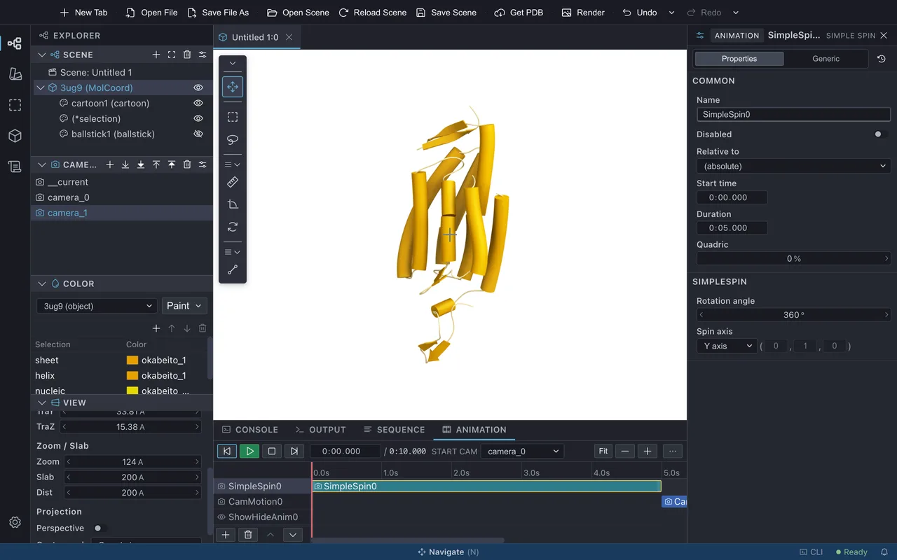{ .on-glb }

## 1. アニメーションのしくみ

アニメーションは、**アニメーション要素** (回転・カメラ移動・表示切り替えなど) を
タイムラインに並べて構成します。1 つの要素が 1 本の帯 (ストリップ) として表示され、
帯の位置が開始時刻、長さが継続時間を表します
(→ [アニメーション](../../reference/animation/index.md))。

## 2. Animation パネルを開く

3UG9 のシーンを開いた状態で、下部パネルの **Animation** タブを開きます
(→ [Animation パネル](../../ui/bottom-panels/animation.md))。

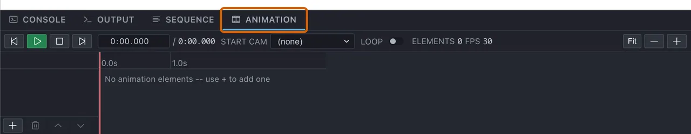{ .on-glb }

## 3. 分子を回転させる

まず、分子がその場で回り続ける定番のアニメーションを作ります。

1. パネル左下の **+** ボタン (Add element) を押し、メニューから **Simple spin** を選びます。

    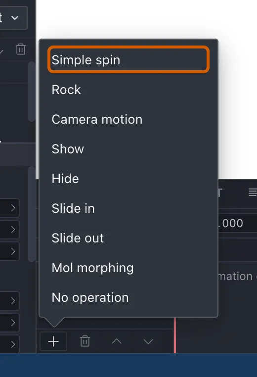{ width="260" .on-glb }

2. ストリップが追加されるので、選択して右側のインスペクタを確認します。
3. **Rotation angle** (回転角) と **Spin axis** (回転軸) を調整します。ここでは 360° と **Y axis** にします。
   360° にすると 1 周して元の向きに戻ります (→ [SimpleSpin](../../reference/animation/simplespin.md))。
4. **Common** セクションの **Duration** (回転にかける時間) を 5 秒にします。時刻の欄は、クリックして
   ++enter++ を押すと `5s` のように入力できます (→ [時刻の入力](../../ui/inspector.md#時刻の入力))。

    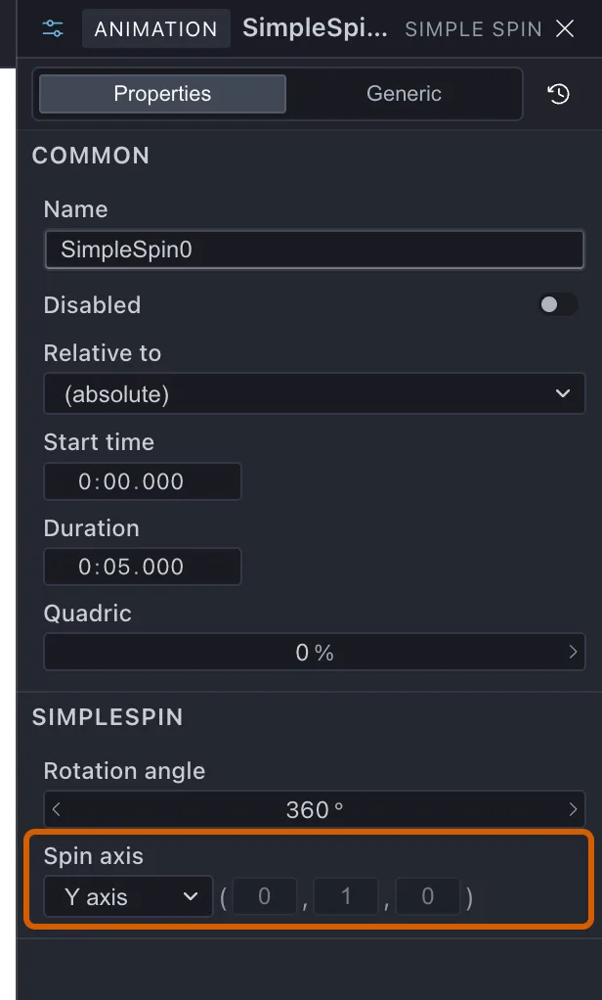{ width="308" .on-glb }

タイムラインの帯をドラッグすると開始位置を、端をドラッグすると長さを変えることもできます。

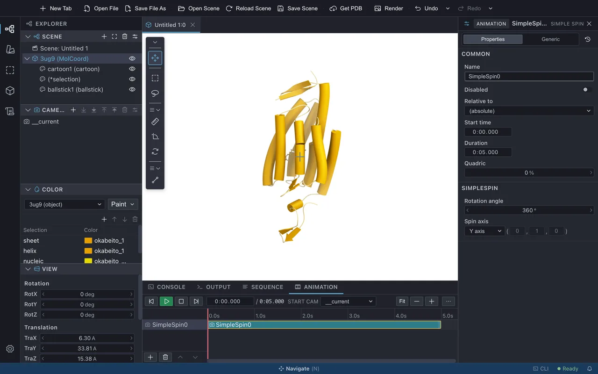{ .on-glb }

## 4. 再生して確認する

パネル左上の再生ボタン (▷) を押すと、アニメーションが分子ビュー上で実際に再生されます。
タイムラインの現在位置をドラッグするか、現在時刻の欄に時刻を打ち込んで ++enter++ を押して、
任意の時点の状態を確かめることもできます。

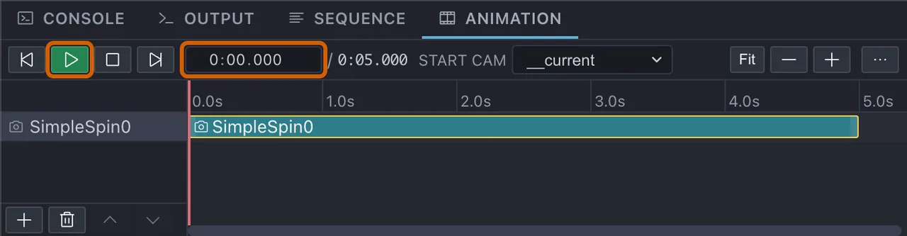{ .on-glb }

## 5. カメラモーションを加える

保存したカメラへ視点を滑らかに移動させます。全体像から注目部位へズームする、
といった演出に使います。

1. 背景が白のシーンでは、奥がフォグで白くかすまないように、**Explorer &gt; View** パネルの **Slab**
   (表示する奥行きの幅) を 200 Å 程度に広げておきます。カメラには Slab も保存されます。
2. 分子ビューで始点にしたい視点 (ここでは分子全体) に合わせ、左サイドパネルの **Explorer &gt; Camera** パネルで
   **New camera from view** (**+** ボタン) を押して保存します (→ [カメラ](../../reference/camera.md))。

    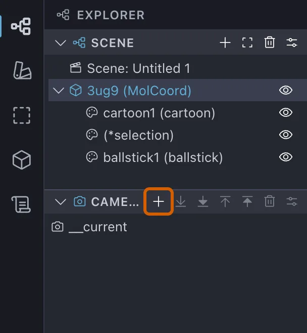{ width="304" .on-glb }

3. 同様に、終点にしたい視点 (ここではレチナールのあたりに寄せた視点) に合わせて、もう 1 つカメラを保存します。
4. タイムラインのヘッダの **Start cam** で、始点のカメラ (`camera_0`) を指定します。

    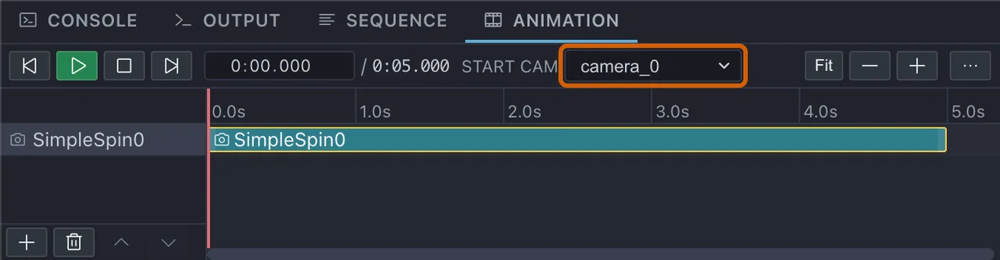{ .on-glb }

5. **+** ボタンのメニューから **Camera motion** を選びます。追加した要素は、直前の要素 (Simple spin) の
   終わりから始まるように置かれます (インスペクタの **Relative to**)。
6. 追加されたストリップを選び、インスペクタの **Target camera** に終点のカメラ (`camera_1`) を
   指定します (→ [CamMotion](../../reference/animation/cammotion.md))。
7. **Duration** を 3 秒にします。

    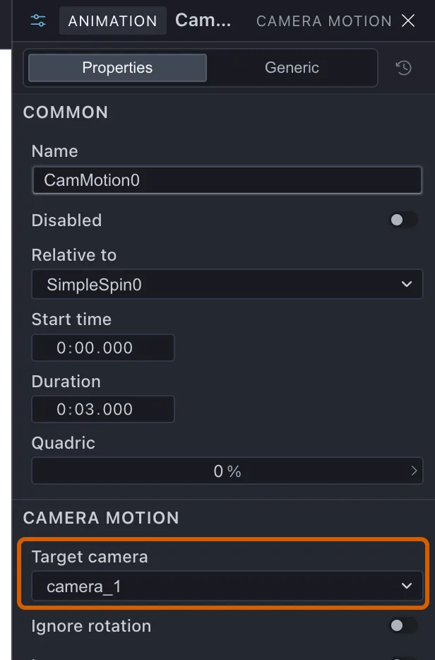{ width="308" .on-glb }

再生すると、ストリップの区間で視点が始点から終点へ補間されます。開始カメラを
指定しておくと、再生を押したときの視点にかかわらず、常にそのカメラの視点から
アニメーションが始まります。視点の動きに加減速を付けたいときは、共通プロパティの
**Quadric** を設定します (→ [アニメーション](../../reference/animation/index.md))。

## 6. 表示の切り替えを加える

途中でリガンドの ballstick を出現させる、といった表示の切り替えです。
Show / Hide は、ストリップの区間で Renderer が徐々に**フェードイン / フェードアウト**
するアニメーションです。

1. **+** ボタンのメニューから **Show** (フェードイン) または **Hide** (フェードアウト) を選びます。ここでは **Show** です。
2. インスペクタの **Target renderers** で、対象の Renderer (`3ug9/ballstick1`) にチェックを入れます
   (→ [Show / Hide](../../reference/animation/showhide.md))。
3. **Duration** を 2 秒にします。

    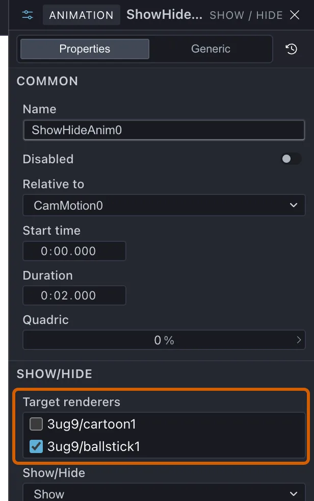{ width="308" .on-glb }

ここまでで、分子が 1 周回り (5 秒)、レチナールのあたりへズームし (3 秒)、レチナールの ballstick が
現れる (2 秒)、計 10 秒のアニメーションができます。Show の対象の Renderer は、ストリップより前の区間では
表示されません。

画面外からの移動を伴って出し入れする **Slide in / Slide out** もあります
(→ [SlideInOutAnim](../../reference/animation/slideinout.md))。また、要素を置いて
いない区間を作りたいときは、何もしない **No operation** 要素で長さを確保します。

## 7. モーフィングを加える

同じ分子の 2 つの構造の間で、対応する原子どうしの座標を線形補間して、
構造変化をアニメーション化します。ここでは transducin-α の
GTP 結合型 (**1TND**) と GDP 結合型 (**1TAG**) の間の構造変化を例にします。

### 2 つの構造を読み込む

1. **File &gt; New Tab** を選び、**New Scene** で新しいシーンを作ります。
2. **File &gt; Get PDB...** で `1TND` を取得します。Renderer の指定画面では **cartoon** を選び、
   **Selection** に `c; A` を指定します (1TND には同じ分子が 3 つ (chain A / B / C)
   含まれているため、chain A だけを表示します)。
3. 同様に **File &gt; Get PDB...** で `1TAG` も取得します (Renderer は **cartoon**。
   こちらは chain A のみなので Selection の指定は不要です)。

### 1TAG を 1TND に重ね合わせる

2 つの構造は分子としてはほとんど同じですが、PDB エントリに含まれる分子の位置は
ばらばらです。モーフィングの補間は座標をそのまま使うため、まず両者を重ね合わせます。

1. **Tools &gt; Molecular superposition...** を開きます。
2. **Algorithm** の **Method** で **SSM** を選びます。
3. **Reference** の **Molecule** で 1TND を選び、**Selection** に `c; A` を指定します。
4. **Moving** の **Molecule** で 1TAG を選びます。

    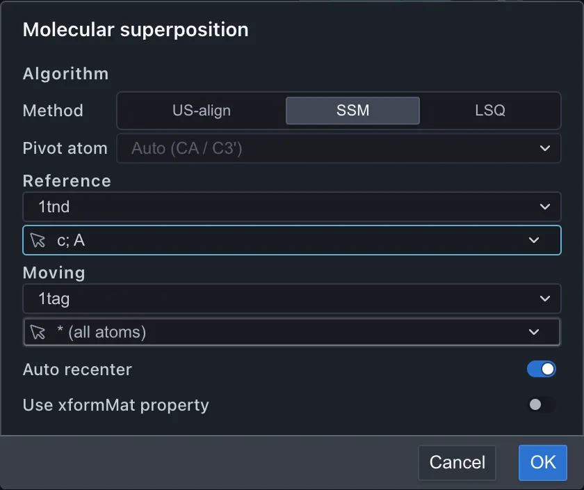{ width="420" .on-glb }

5. **OK** を押すと、1TAG が 1TND の chain A に重なる位置へ移動します。

重ね合わせの結果 (RMSD や対応づけられた残基数) は、下部パネルの **Output** のログで
確認できます。なお SSM は二次構造の対応づけで重ね合わせる方式のため、
タンパク質どうしにのみ使えます。

### MorphMol に変換してフレームを追加する

1. **Tools &gt; Mol morphing animation...** を開きます。
2. **Target** で、変化の始点にする 1TND を選びます。
3. **Convert to MorphMol** を押します。分子が、複数のフレーム (構造) を保持できる
   **MorphMol** に変換されます。

    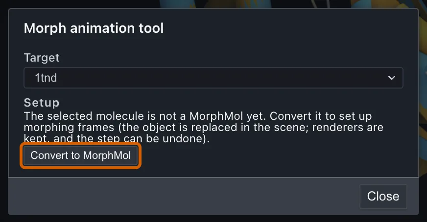{ width="436" .on-glb }

4. **Add mol...** を押し、**Molecule to add** で変化の終点となる 1TAG を選んで **Add as frame** を押します。
   座標がフレームとしてコピーされます。
5. フレームの一覧に、元の構造 (`(this)`) と追加した構造が並んだことを確認して、
   ダイアログを閉じます。

コピー元の 1TAG の Object はもう使わないので、シーンツリーで削除するか
非表示にして構いません。

### タイムラインに載せて再生する

1. Animation パネルの追加メニューから **Mol morphing** を選びます。
2. 追加されたストリップを選び、インスペクタの **Target MorphMol** で
   変換した 1TND を指定します (→ [MolAnim](../../reference/animation/molanim.md))。
3. 再生すると、GTP 結合型と GDP 結合型の間で分子が変形します。

1TND 側にしかない chain B・C やリガンド・水分子は、対応が取れないため
静止したままですが、chain A の cartoon しか表示していないため見えません。

!!! tip "行って戻るループにするには"
    **Mol morphing** のストリップをもう 1 つ後ろに追加し、インスペクタの
    **Start value** を 1、**End value** を 0 にすると逆方向の変化になります。
    2 本並べると「行って戻る」ループアニメーションが作れます
    (→ [MolAnim](../../reference/animation/molanim.md))。

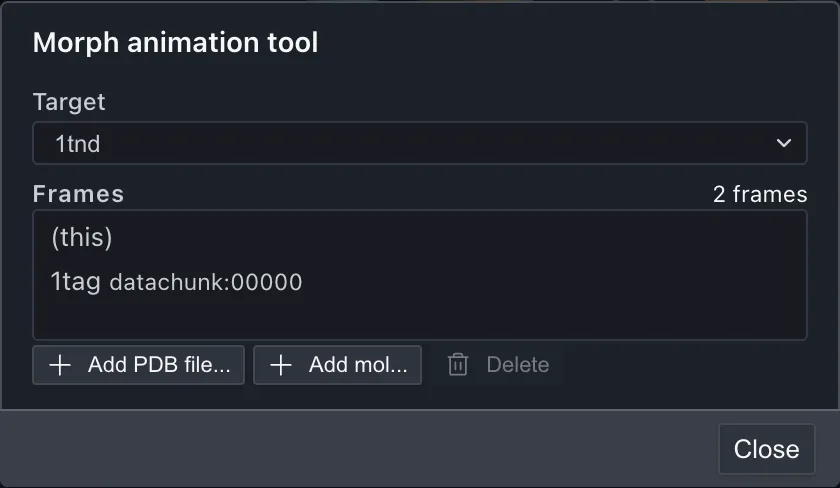{ width="420" .on-glb }
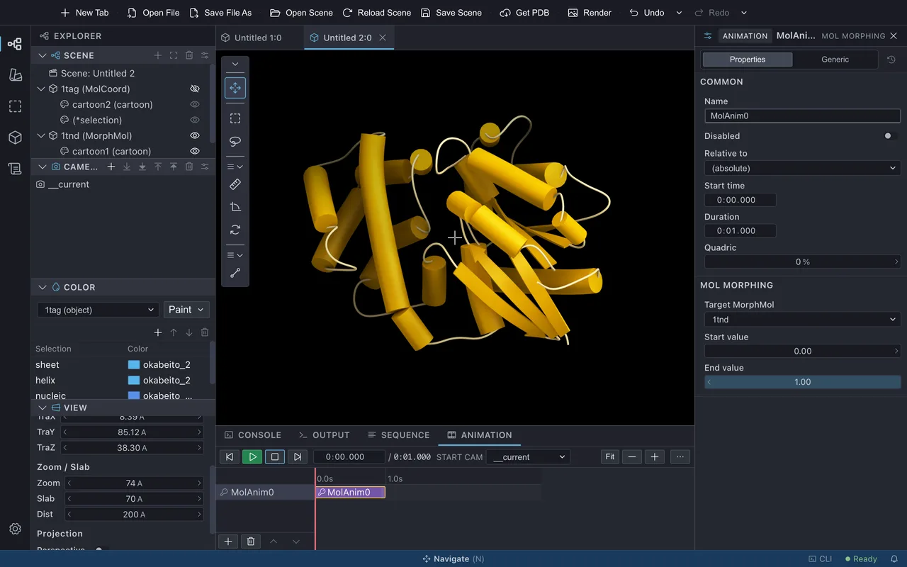{ .on-glb }

!!! note "自分の構造でモーフィングを作るには"
    フレーム間の原子の対応づけは、**チェイン名・残基番号・原子名**の一致で行われます
    (ファイル内の原子の並び順は関係ありません)。対応が取れなくてもエラーにはならず、
    元の構造 (`(this)`) にしかない原子は**動かずに静止したまま**になり、追加した構造に
    しかない原子は無視されます。全体をきれいに変形させるには、水・リガンド・水素などを
    取り除き、チェイン名と残基番号を揃えた構造を用意してください。
    また、線形補間は局所的な構造変化の表現に向いた方式です。大きなドメイン運動を
    扱うときは、途中の構造を別のソフトウェアで作成し、フレームとして挟むと自然に
    つながります。

!!! note "CueMol2 との違い"
    CueMol2 ではメニューを選ぶと対象の選択プロンプトが出て、暗黙のうちに MorphMol へ
    変換されましたが、CueMol3 ではダイアログ内の **Target** で対象を選び、
    **Convert to MorphMol** ボタンで明示的に変換します (Undo で戻せます)。

## 8. 動画に出力する

**Rendering &gt; Movie rendering...** を選ぶと、レンダリングウィンドウが
動画 (Movie) モードで開きます (→ [レンダリングウィンドウ](../../ui/rendering-window.md))。

1. **Target** で、動画にするシーンのビューを選びます。ここでは前半で作った 3UG9 のシーンのビュー
   (`Untitled 1:0` など、シーン名とビューの番号) を選びます。**Backend** は既定の **Umbreon** のままで構いません。

    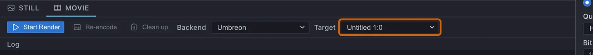{ .on-glb }

2. **Image** タブでサイズ (例: **VGA (640×480)**) を選びます。
3. **Start Render** を押すと、フレームを 1 枚ずつレンダリングし、完了すると
   ffmpeg で動画ファイルにエンコードされます (macOS / Windows の配布物には同梱、
   → [外部ツールの設定](../../install/external-tools.md))
4. 出力は既定では一時フォルダに作られます。**Save movie as...** で
   完成した動画を好きな場所に保存します。

**Frame rate** は通常 24〜30 で十分です。動画のレンダリングには
「フレーム数 × 静止画 1 枚の時間」がかかるため、サイズや品質は先に静止画 1 枚で
試してから決めるのが確実です。プレゼン用なら VGA / SVGA 程度のサイズでも十分です。
フレームレートや動画形式などの出力設定は次回も記憶されます。
品質を上げたいときの設定は静止画と共通です
(→ [論文用の高解像度画像の書き出し](../figures/publication-images.md))。

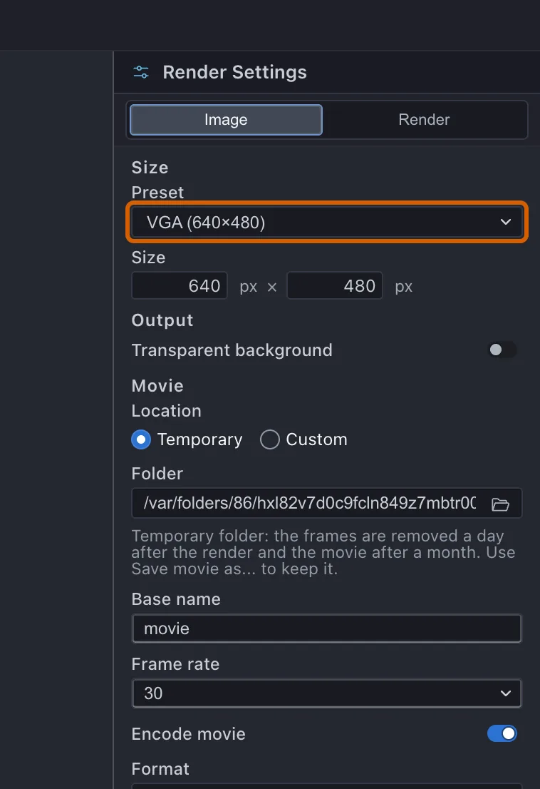{ width="380" .on-glb }
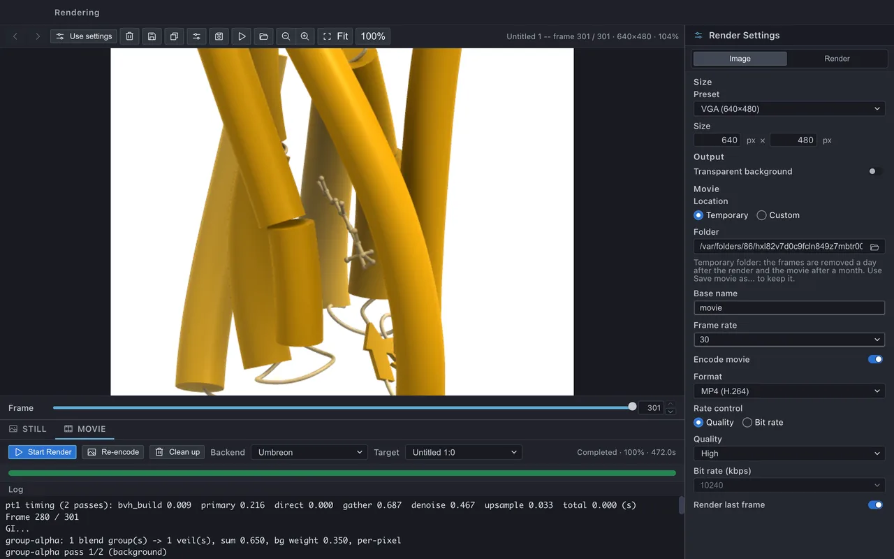{ .on-glb }

## 同じことをコマンドで

本文の操作を [Console](../../reference/plugins/console/index.md) の native モードのコマンドで書くと、
次のようになります。Console に 1 行ずつ入力します ([tritium_cli](../../reference/plugins/console/cli.md)
からも実行できます)。各コマンドの引数は Console で `help <コマンド>` を実行すると確認できます
(→ [Console のコマンド一覧](../../reference/plugins/console/commands.md))。

```
# 3. 分子を回転させる (5 秒で 1 周)
add_anim spin, name=spin1
set_anim_prop spin1, angle, 360
set_anim_prop spin1, axis, "0 1 0"
set_anim_time spin1, 0, 5000
# 4. 再生して確認する
animate play
# 5. カメラモーションを加える (視点を合わせてから、それぞれ保存する)
save_camera start
save_camera end
set_anim_options startCamera=start
add_anim camera, name=cam1
set_anim_prop cam1, endcam, end
set_anim_time cam1, 0, 3000
# 6. 表示の切り替えを加える
add_anim show, name=show1
set_anim_prop show1, rend, 3ug9/ballstick1
set_anim_time show1, 0, 2000
# 7. モーフィングを加える
create_scene
fetch_pdb 1TND, mmcif, cartoon, selection="c; A"
fetch_pdb 1TAG, mmcif, cartoon
superpose 1tag, 1tnd, refSel="c; A", algo=SSM
convert_to_morph 1tnd
add_morph_frame 1tnd, fromObjId=1tag
hide 1tag
add_anim mol, name=morph1
set_anim_prop morph1, mol, 1tnd
animate play
# 8. 動画に出力する (GUI のみ)
```

- 手順 2 (Animation パネルを開く) にあたるコマンドはありません。要素の一覧は `list_anims` で表示します。
- `add_anim` は、要素をタイムラインの末尾 (直前の要素の後ろ) に追加します。`set_anim_time` の開始と終了は、
  直前の要素の終わりからの時間 (ミリ秒) です。
- `;` を含む選択式 (`c; A`) は、引用符で囲みます。

## 次のステップ

- [アニメーション](../../reference/animation/index.md) — 要素の種類と共通プロパティ
- [レンダリングウィンドウ](../../ui/rendering-window.md) — 動画モードの各設定
- [カメラ](../../reference/camera.md) — 視点の保存と表示フラグ

---

*確認対象: CueMol3 3.0.6.577*
