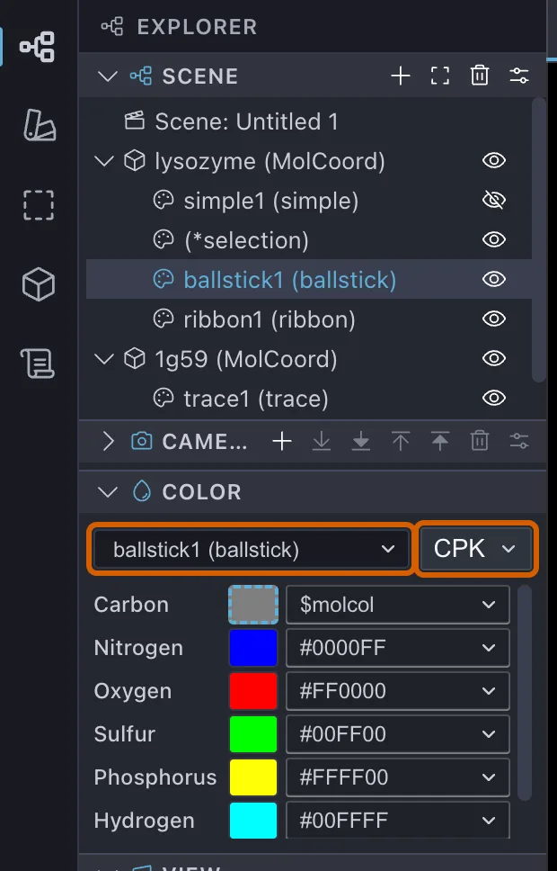
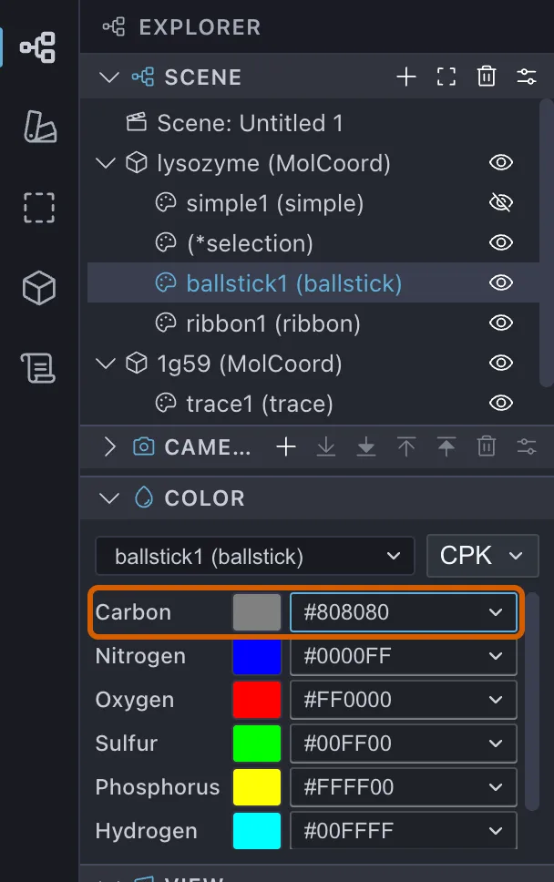
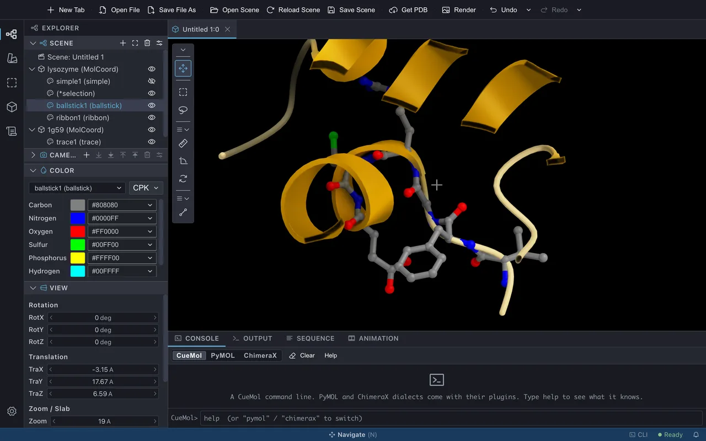
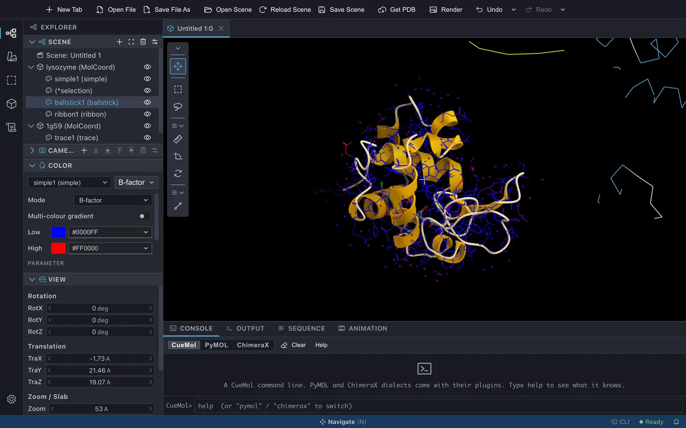
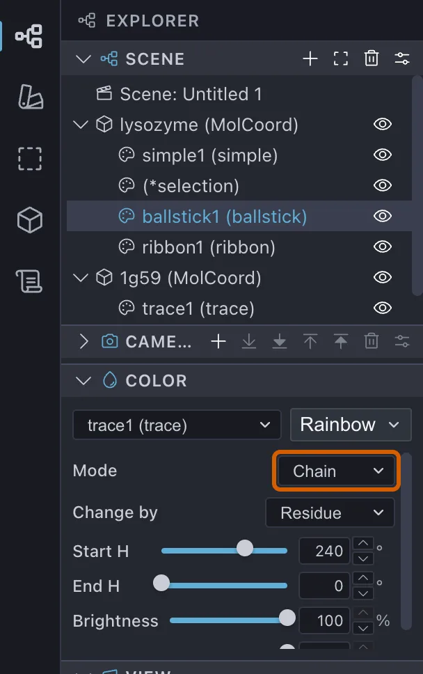
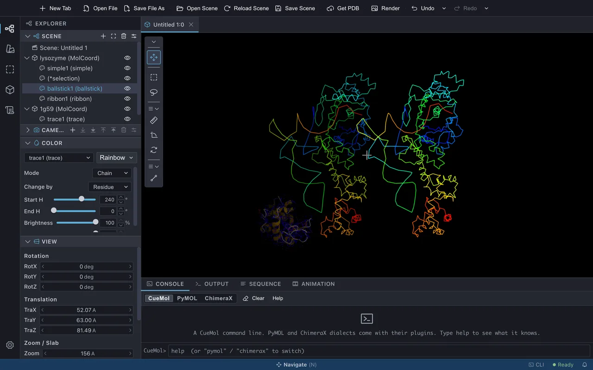
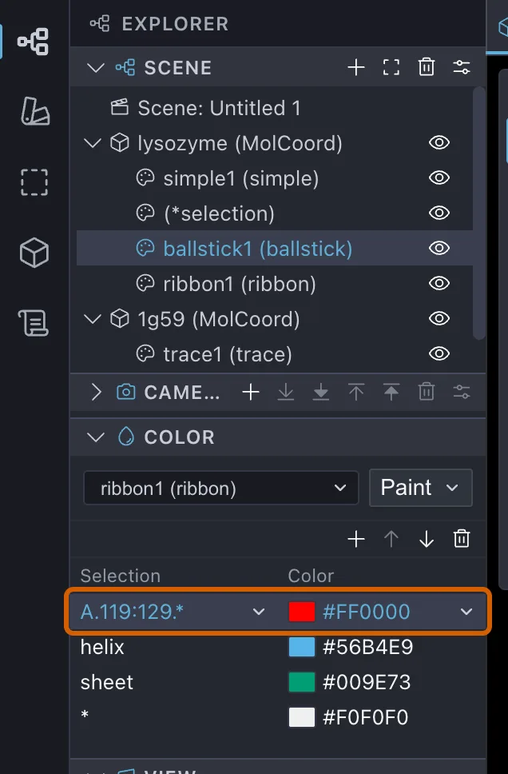
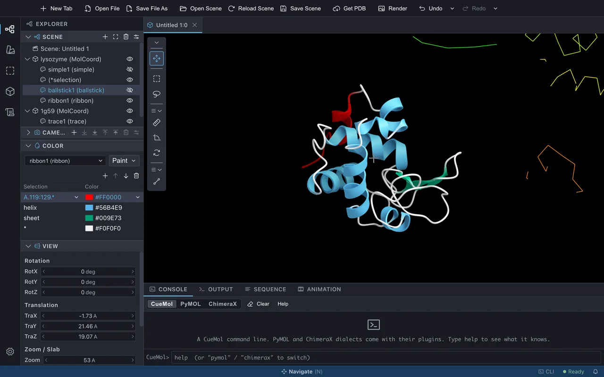

# Renderer の着色

Renderer の色は、設定のうち着色 (Coloring) だけを独立して扱う
**Color パネル**で変更します。代表的な Coloring の種類を順に試します。
前のページ ([Renderer の追加・削除と設定](renderers.md)) の
`lysozyme` (simple + ballstick + ribbon) と `1G59` (trace) を使います。

!!! abstract "このチュートリアルについて"
    - **題材**: リゾチーム (`lysozyme`) と 1G59
    - **学ぶこと**: Color パネル、CPK / B-factor / Rainbow / Paint による着色
    - **前提**: [Renderer の追加・削除と設定](renderers.md)

## 1. Color パネルの使い方

左サイドパネルの **Explorer &gt; Color** パネルを開きます
(→ [サイドパネル](../../ui/side-panels.md))。

1. 上部で操作対象の Renderer を選びます (シーンツリーで Renderer を選ぶと、ここも追従します)。
2. 続いて隣のボタンで Coloring の**種類**を選ぶと、種類に応じた設定欄が下に表示されます。
   ボタンには、いまの種類が表示されています。

{ width="310" .on-glb }

種類の一覧と各設定は [Coloring](../../reference/coloring.md) を参照してください。

## 2. CPK — 元素ごとの色

**CPK** は元素の種類ごとに色を割り当てる、simple や ballstick の定番です。

1. 対象に `lysozyme/ballstick1` を選びます。
2. Coloring の種類から **CPK coloring** を選びます。
3. **Carbon** (炭素) の色を灰色 (例: `#808080`) に変えてみてください。

    { width="304" .on-glb }

ballstick の炭素部分だけが灰色に変わります。色の指定方法 (色名・カラーコードなど) は
[色の記法](../../reference/color-syntax.md) を参照してください。

{ .on-glb }

## 3. B-factor — 値に応じたグラデーション

**B-factor** は温度因子などの値に応じて色を連続的に変化させます。

1. 対象に `lysozyme/simple1` を選びます (非表示にしていた場合は目のアイコンで戻します)。
2. Coloring の種類から **Bfac/Occ coloring** を選びます。

温度因子の低い部分から高い部分へ、グラデーションで塗られます。
下限・上限の色 (**Low** / **High**) と値の範囲 (**Auto** / **Manual**) も設定できます。

{ .on-glb }

## 4. Rainbow — 端から端への虹色

**Rainbow** は残基の並びに沿って色相を変化させます。

1. 対象に `1g59/trace1` を選びます。
2. Coloring の種類から **Rainbow coloring** を選びます。
3. **Mode** を **Molecule** (分子全体) から **Chain** (チェインごと) に切り替えます。

    { width="304" .on-glb }

1G59 はタンパク質と tRNA が別のチェインなので、それぞれが独立に
(タンパク質は N 末端から C 末端へ、RNA は 5' 末端から 3' 末端へ)
虹色で塗られるようになります。

{ .on-glb }

## 5. Paint — 選択と色の組で塗り分ける

もっとも自由度が高いのが **Paint** です。「選択式と色」の組を表の行として並べ、
**上の行から順に評価して、最初にマッチした行の色**で塗ります。

1. 対象に `lysozyme/ribbon1` を選びます。
2. Coloring の種類から **Paint coloring** &gt; **Okabe-Ito** &gt; **Orange** を選びます。二次構造ごとの標準の塗り分け
   (sheet / helix / nucleic / `*` の 4 行) が入った表が現れます。
3. 表を次の 3 行に書き換えます (上から順)

| 選択式 | 色の例 |
|---|---|
| `helix` | 薄い青 |
| `sheet` | 緑 |
| `*` | 白系 |

`helix` / `sheet` は二次構造を表す定義済みの選択です
(→ [選択式の文法](../../reference/selection.md))。`*` (全体) の行は一番下に
あるので、ヘリックスでもシートでもないコイル部分だけがこの色になります。

### 塗りを追加する

C 末端のヘリックス (残基 119〜129) だけ色を変えてみます。

1. 表の**一番上**に行を追加します。
2. 選択式に `A.119:129.*`、色に赤を指定します。

C 末端部分が赤に変わります。`helix` の行より上にあるため、この範囲では
赤が優先されるわけです。このように、行の順序を意識しながら塗りを重ねて
いくのが Paint の使い方です。不要になった行は削除できます。

{ width="318" .on-glb }

{ .on-glb }

!!! tip "プリセットも用意されています"
    Paint coloring のサブメニューには、上で使った Okabe-Ito のほかのパレットの色や、
    **CueMol2 default** / **CueMol1 (woody)**、単色の配色 (Red など) が並びます。まずプリセットを適用してから行を書き換えるのも
    手早い方法です。

## 次のステップ

- [カメラとシーンの保存](camera-scene.md) — 視点と作業状態を残す
- [Coloring](../../reference/coloring.md) / [色の記法](../../reference/color-syntax.md)

---

*確認対象: CueMol3 3.0.6.577*
