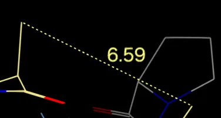
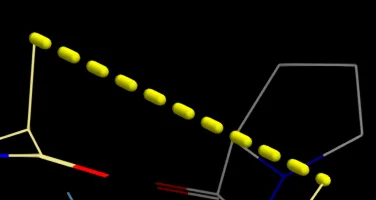

# 計測と相互作用の表示

原子間の距離・角度・二面角を測り、その表示を図の一部として整える方法を学びます。
題材は引き続きリゾチーム (`lysozyme`、simple 表示) です。

!!! abstract "このチュートリアルについて"
    - **題材**: リゾチーム (`lysozyme`)
    - **学ぶこと**: 距離・角度・二面角の計測、atomintr Renderer、計測表示のスタイル
    - **前提**: [構造の読み込みと表示](loading.md)

## 1. 距離を測る

計測には、分子ビュー左端の**ツールパレット**の Measure グループを使います
(→ [ツールバーとツールパレット](../../ui/toolbar-tools.md))。

1. ツールパレットで **Distance** ツールを選びます (ショートカット ++d++)
2. 距離を測りたい 1 つめの原子をクリックします。途中経過は十字マークで示されます。
3. 2 つめの原子をクリックすると、原子間に点線が引かれ、距離のラベルが表示されます。

続けてクリックしていけば、複数の距離を次々に測れます。
途中でやめたいときは ++esc++ を押すか、Navigate など他のツールに切り替えます。

{ width="282" .on-glb }

## 2. 角度と二面角を測る

- **Angle** ツール (++a++) — 3 つの原子を順にクリックすると、その角度が表示されます。
- **Torsion** ツール (++t++) — 4 つの原子を順にクリックすると、二面角が表示されます。

たとえば 1QIO では、Na⁺ イオン (Na130) とその配位子
(Ser72 の側鎖酸素、Ser60 の主鎖カルボニル酸素など) の配位角を測ってみると
練習になります。

## 3. 計測表示の正体 — atomintr Renderer

計測の点線とラベルは、**atomintr** という Renderer が描いています。
シーンツリーを見ると、`measure` という名前の atomintr Renderer が
自動で作られているのがわかります。

- 目のアイコンで、計測表示だけを一時的に隠せます。
- 行を選んで **Delete** を押せば、計測表示をまとめて削除できます (Undo 可)

ツールパレットの Measure グループの**オプションのつまみ**を開くと、
ラベルを追加する対象の**ラベルセット**を選べます。セットごとに別の
atomintr Renderer になるため、「活性部位の距離」「配位結合」のように
相互作用をグループ分けして、グループ単位で表示・非表示や削除ができます。

## 4. 見た目をスタイルで整える

計測の点線は、既定では細い線ですが、論文の図に向いた立体的な表示に
まとめて切り替えられます。

1. シーンツリーで `measure` (atomintr) を右クリックします。
2. **Style &gt; Dashed stick1** を選びます。

点線が黄色の破線状の立体表示に変わり、距離のラベルは表示されなくなります
(**Dashed stick2** は水色で、破線の模様が異なるプリセットです)。
線の太さや破線の間隔などを個別に調整したい場合は、インスペクタで atomintr の
プロパティを編集します (→ [atomintr](../../reference/renderers/atomintr.md))。

{ width="282" .on-glb }
{ width="282" .on-glb }

## 5. 計測項目を個別に削除する

誤ってクリックした計測だけを消したいときは、Renderer ごと消すのではなく
一覧から削除します。

1. シーンツリーで `measure` (atomintr) を右クリックし、
   **Edit interaction list...** を選びます。
2. その Renderer に属する計測 (相互作用) の一覧が表示されます。
3. 不要な行を選んで削除します。操作は Undo で戻せます。

!!! note "CueMol2 との違い"
    CueMol2 では計測モードの切り替えはウィンドウ上部のリボン (Measure タブ) で
    行いましたが、CueMol3 では分子ビュー左端の**ツールパレット**に移りました
    (→ [ツールバーとツールパレット](../../ui/toolbar-tools.md))。

## 次のステップ

基本操作コースはここまでです。ここからは目的別のチュートリアルで、
実際の作図の流れを追ってみてください。

- [タンパク質のリボン図を作る](../figures/ribbon-figure.md) — 作図の基本コース
- [atomintr](../../reference/renderers/atomintr.md) — 計測表示の設定項目

---

*確認対象: CueMol3 3.0.2.560*
