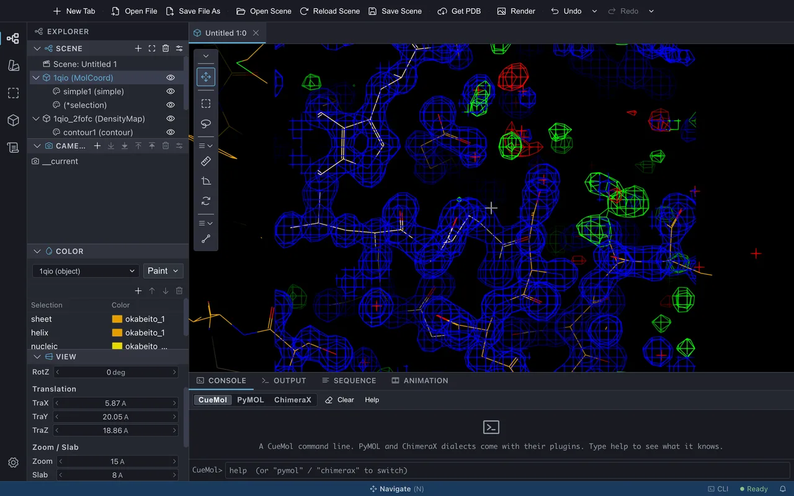
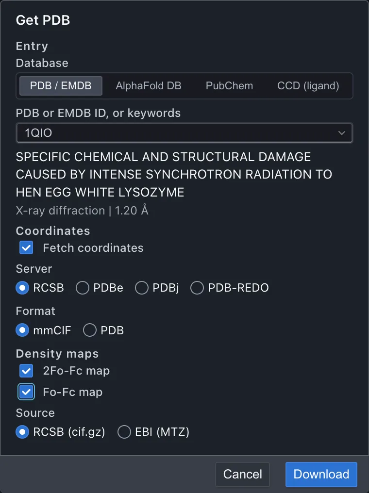
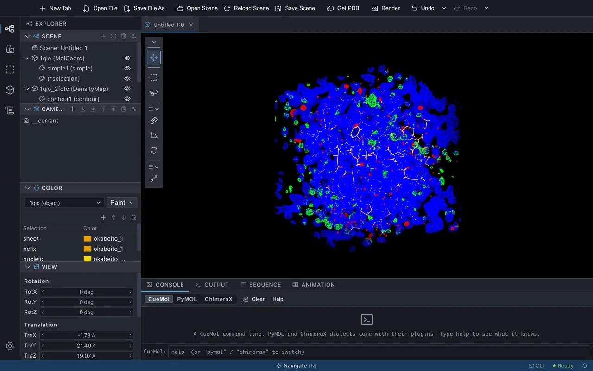
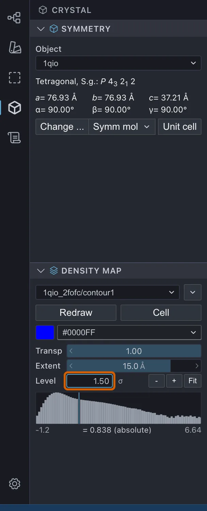
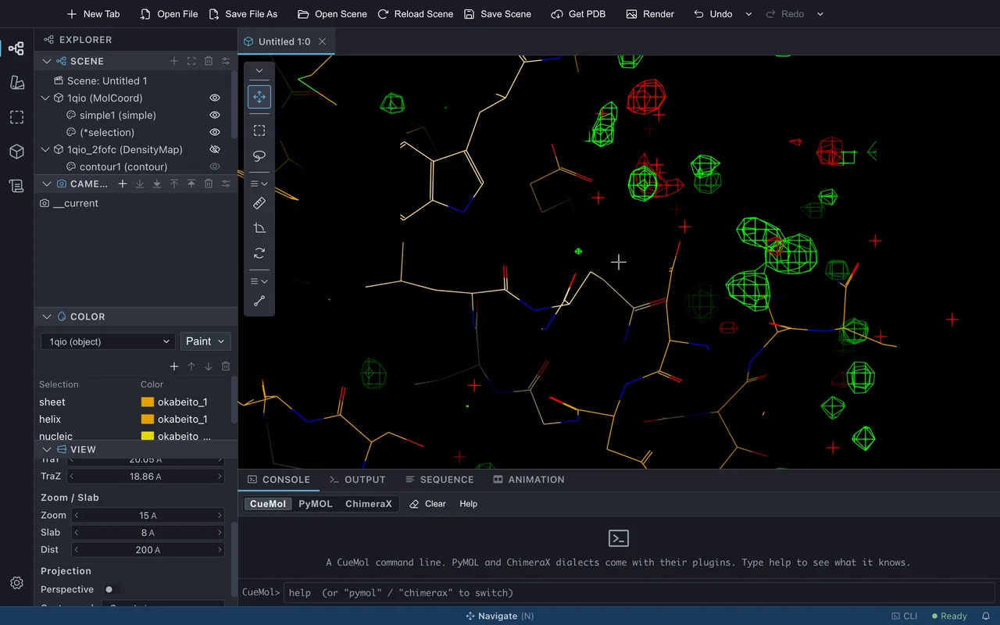

# 電子密度マップの表示

X 線結晶構造に電子密度マップを重ねて、モデルと密度の対応を確かめる手順を追います。
題材にはリゾチームの結晶構造 (PDB ID: **1QIO**) を使い、2Fo-Fc マップと Fo-Fc マップを
座標と一緒にネットワークから取得します。

!!! abstract "このチュートリアルについて"
    - **題材**: リゾチーム (PDB ID: 1QIO) の 2Fo-Fc / Fo-Fc マップ
    - **学ぶこと**: Get PDB でのマップの取得、Density map パネルでのレベルと範囲の調整、注目部位の確認
    - **前提**: 基本操作コースの [構造の読み込みと表示](../basic/loading.md)

{ .on-glb }

## 1. 座標と密度マップをまとめて取得する

**File &gt; Get PDB...** は、座標に加えて電子密度マップも取得できます。

1. **PDB or EMDB ID, or keywords** に `1QIO` を入力します。
2. **Fetch coordinates** に加えて、**2Fo-Fc map** と **Fo-Fc map** にも
   チェックを入れます。
3. マップの取得元は既定の **RCSB (cif.gz)** のままにします (**EBI (MTZ)** でも取得できます)。
4. 取得が終わると、座標の Object 名と Renderer を指定する画面が出ます。
   ここでは **simple** (線画) を選ぶと、密度と原子の対応が見やすくなります。

{ width="380" .on-glb }

マップには Renderer 指定の画面は出ず、次の構成で自動的に表示されます。

| Object | Renderer | 色 | レベル |
|---|---|---|---|
| `1qio_2fofc` | contour1 | 青 | +1.0σ |
| `1qio_fofc` | pos-cont | 緑 | +3.0σ |
| `1qio_fofc` | neg-cont | 赤 | −3.0σ |

2Fo-Fc マップ (青) はモデル全体を包む密度です。Fo-Fc マップは観測データとモデルの
差を表す密度で、緑は「モデルがないのに密度がある」部分、赤は「モデルはあるのに
密度がない」部分の目安になります。

## 2. 表示を確認する

左サイドパネルの **Explorer &gt; Scene** ツリー (シーンツリー →
[サイドパネル](../../ui/side-panels.md)) には、座標の Object とは別に、
マップの Object (`1qio_2fofc` / `1qio_fofc`) とその contour Renderer が並びます。目のアイコンで個別に表示・非表示を切り替えられます。

マップは、取得したときのビュー中心 (先に読み込んだ分子) の周りに描かれます。視点は動きません。

{ .on-glb }

結晶学的マップは**ビュー中心の周囲だけ**が描かれます。分子ビューを平行移動すると、
表示されるマップの範囲も追従します (クライオ電子顕微鏡マップではマップ全体が描かれ、
以下の表示範囲の調整は必要ありません
→ [contour](../../reference/renderers/contour.md#contour) の **Region**)。

contour という名前は、地図でおなじみの 2 次元の等高線 (contour) 表示を 3 次元に
拡張したものであることに由来します。表示の仕組みは
[contour](../../reference/renderers/contour.md)、
マップ Object の詳細は [DensityMap](../../reference/objects/densitymap.md) を参照してください。

## 3. レベルと範囲を調整する

マップの表示は、左サイドパネルの **Crystal &gt; Density map** パネルで調整します
(→ [サイドパネル](../../ui/side-panels.md))。

1. 上部で対象の Renderer (`1qio_2fofc/contour1` など) を選びます。
2. **Level** のヒストグラム上のマーカーをドラッグして、等高線レベルを変えます
   (入力欄に値を打ち込むこともできます)。ノイズが目立つときは上げ、
   密度の弱い部分を見たいときは下げます。ここでは 2Fo-Fc の Level を `1.5` にします。
3. **Extent** スライダで表示範囲 (中心からの距離) を変えます。
4. **Transp** スライダで透明度を変えます。

結晶学的マップのレベルは既定では σ 単位 (マップの標準偏差を 1 とする単位) です。
2Fo-Fc マップは 1〜1.5σ、Fo-Fc マップは ±3σ 前後で見るのが目安です。
▼ メニューの **Use absolute contour level** で絶対値指定にも切り替えられます
(もう一方の単位での値が Level の下に表示されます)。クライオ電子顕微鏡マップでは
σ の代わりに格子点の値の上位何 % かを単位とし、読み込んだ時点では絶対値指定になっています。
なお **Extent** の上限は contour の **Buffer size** プロパティで決まっており、
もっと広げたいときはインスペクタで増やします。

{ width="304" .on-glb }

## 4. 注目部位に絞って表示する

活性部位などの注目箇所を拡大して確かめるときの流れです。

1. 注目部位が中心に来るように視点を動かします。ここでは活性部位の Glu35 と Asp52 を見ます。
   **Selection &gt; Mol Struct** パネルで残基 35 と 52 を選び (++cmd++ / ++ctrl++ + クリック)、
   **Zoom at** を押します。
2. **Extent** を 10 Å 程度まで下げて、周囲のメッシュを減らします。
3. 表示が追従していないときは、パネルの **Redraw** で表示中心を現在のビュー中心に
   更新できます。
4. **Slab** (表示する奥行きの幅) を 8 Å 程度に狭めると、注目部位の前後のメッシュも減って
   さらに見やすくなります (→ [サイドパネル](../../ui/side-panels.md) の View パネル)。

{ .on-glb }

Fo-Fc の緑・赤のメッシュだけを見たいときは、シーンツリーで
`1qio_2fofc` の目のアイコンを閉じて 2Fo-Fc を一時的に隠すと確認しやすくなります。

{ .on-glb }

## 5. 図として仕上げる

密度マップ入りの図も、通常のシーンと同じ手順で書き出せます
(→ [論文用の高解像度画像の書き出し](../figures/publication-images.md))。

## 同じことをコマンドで

本文の操作を [Console](../../reference/plugins/console/index.md) の native モードのコマンドで書くと、
次のようになります。Console に 1 行ずつ入力します ([tritium_cli](../../reference/plugins/console/cli.md)
からも実行できます)。各コマンドの引数は Console で `help <コマンド>` を実行すると確認できます
(→ [Console のコマンド一覧](../../reference/plugins/console/commands.md))。

```
# 1. 座標と密度マップをまとめて取得する
fetch_pdb 1QIO, mmcif, simple
fetch_map 1QIO, 2fofc
fetch_map 1QIO, fofc
# 2. 表示を確認する (マップの Renderer とレベルの一覧を表示する)
list_map_contours
# 3. レベルと範囲を調整する
set_map_contour 1qio_2fofc/contour1, level=1.5, alpha=0.6
# 4. 注目部位に絞って表示する (活性部位の Glu35 と Asp52)
zoom 1qio, "A.35,52.*"
set_map_contour 1qio_*/*, extent=10
recenter_map 1qio_*/*
set_view slab=8
hide 1qio_2fofc
# 5. 図として仕上げる (→ 論文用の高解像度画像の書き出し)
```

- `1qio_*/*` は、2 つのマップ Object の contour Renderer (3 つ) をまとめて指定するワイルドカードです。
- `set_map_contour` の `alpha` は、Density map パネルの **Transp** にあたる不透明度 (0〜1) です。
- カンマを含む選択式 (`A.35,52.*`) は、引用符で囲みます。

## 次のステップ

- [対称分子・単位格子の表示](symmetry.md) — 同じ 1QIO で結晶パッキングを見る
- [contour](../../reference/renderers/contour.md) / [DensityMap](../../reference/objects/densitymap.md) — 表示設定の詳細
- [サイドパネル](../../ui/side-panels.md) — Density map パネルの各項目

---

*確認対象: CueMol3 3.0.7.578*
