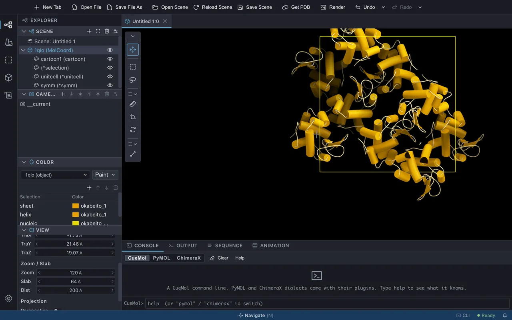
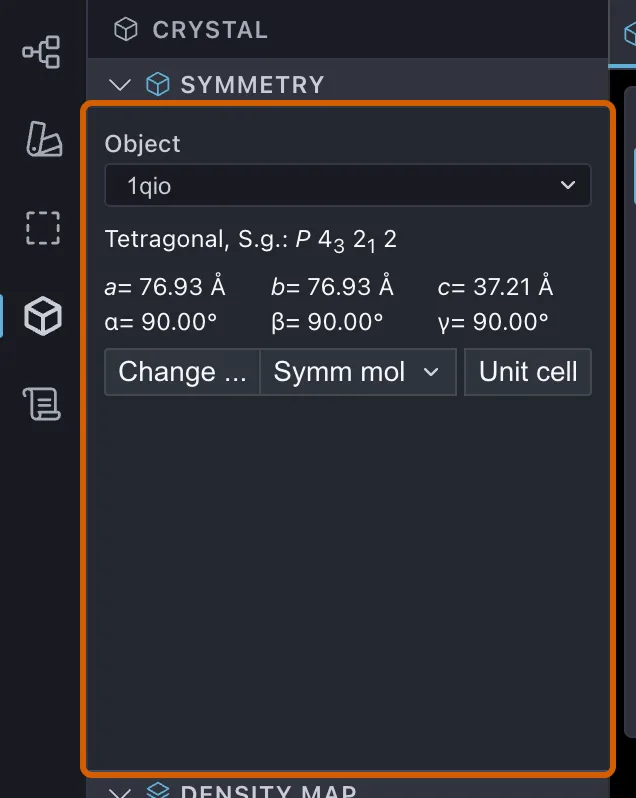
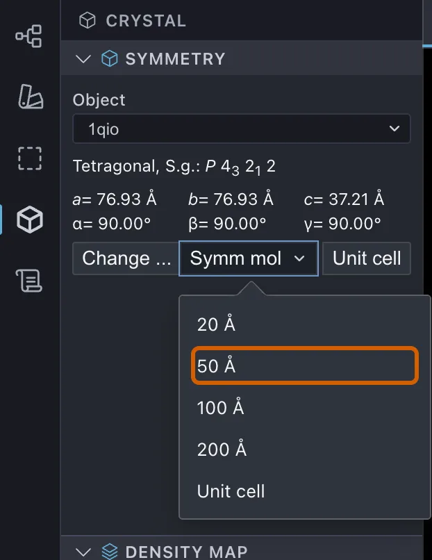
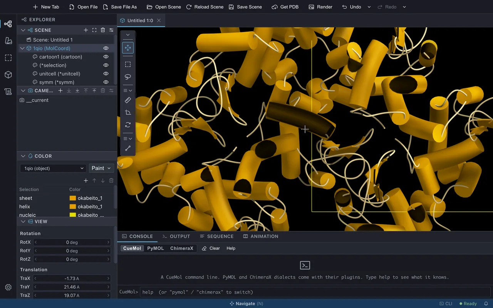
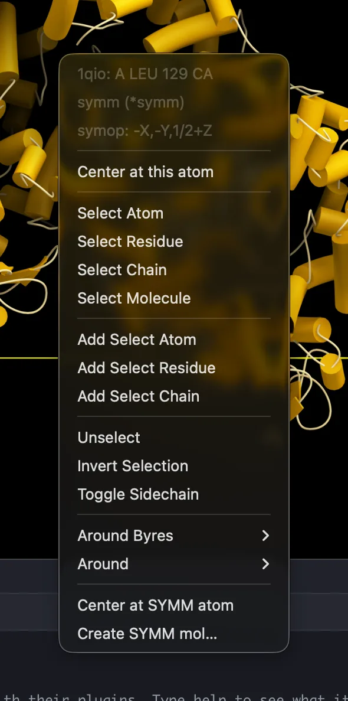
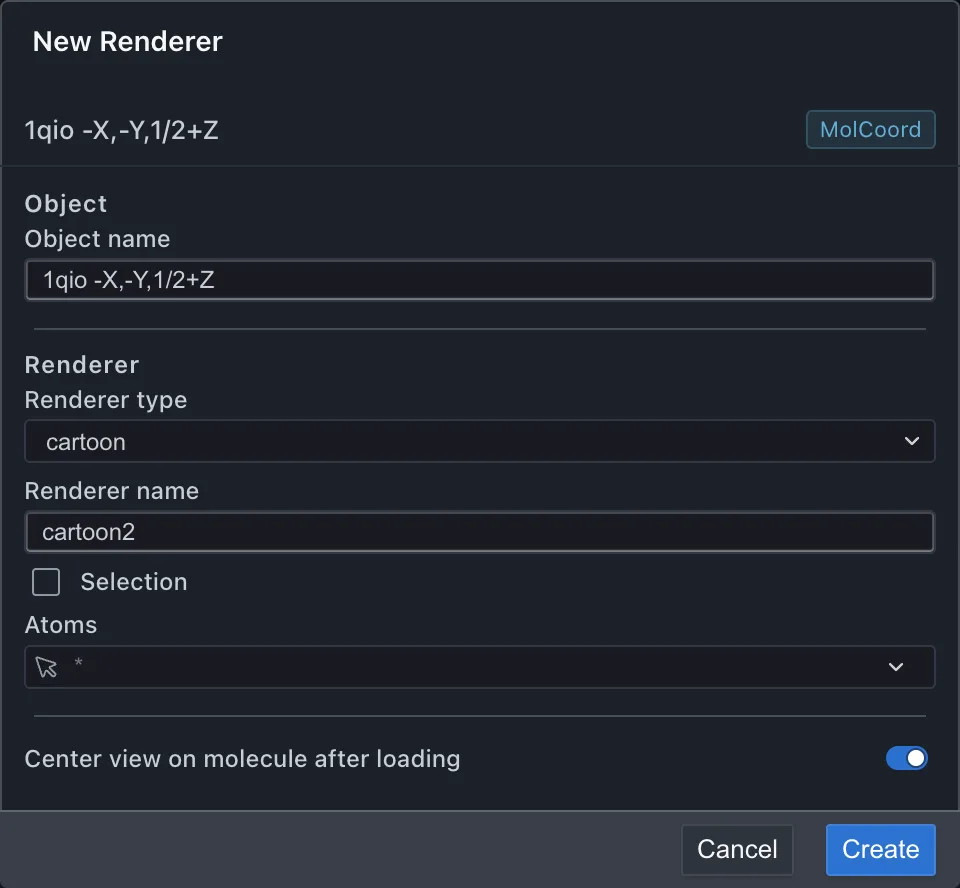

# 対称分子・単位格子の表示

結晶中で対称操作により生じる隣の分子 (対称分子) と単位格子の枠を表示して、
結晶パッキングを確かめる手順を追います。題材は前のチュートリアルと同じ
リゾチーム (PDB ID: **1QIO**) です。
[電子密度マップの表示](density-map.md) の続きとして進めても構いません。

!!! abstract "このチュートリアルについて"
    - **題材**: リゾチーム (PDB ID: 1QIO)
    - **学ぶこと**: 結晶学的情報の確認、単位格子と対称分子の表示、Create SYMM mol
    - **前提**: 基本操作コースの [構造の読み込みと表示](../basic/loading.md)

{ .on-glb }

## 1. 結晶構造を読み込む

**File &gt; Get PDB...** で `1QIO` を取得します (座標のみで構いません)。
Renderer は **cartoon** など、分子の輪郭がわかるものを選びます。

## 2. 結晶学的情報を確認する

左サイドパネルの **Crystal &gt; Symmetry** パネルを開きます
(→ [サイドパネル](../../ui/side-panels.md))。

1. **Object** で対象 (1QIO) を選びます。
2. 格子定数 (*a* / *b* / *c* / *α* / *β* / *γ*) と空間群が表示されます。

PDB から取得した構造には結晶学的情報が含まれているため、通常はそのまま
次のステップに進めます。

{ width="318" .on-glb }

!!! note "表示された値が実際と違うときは"
    PDB ファイルによっては、ここに表示される値が意図したものと違っていることがあります。
    その場合や、対称性の情報がないファイルを読み込んだ場合は、パネルの **Change...** から
    結晶系と空間群を設定し直せます (→ [サイドパネル](../../ui/side-panels.md))。

## 3. 単位格子を表示する

パネルの **Unit cell** ボタンを押すと、単位格子の枠がシーンに追加されます。
左サイドパネルの **Explorer &gt; Scene** ツリー (シーンツリー) には
`unitcell (*unitcell)` という Renderer の行として現れ、目のアイコンで
表示・非表示を切り替えられます。

## 4. 対称分子を表示する

パネルの **Symm mol** ボタンから表示範囲を選びます。

- **20 Å / 50 Å / 100 Å / 200 Å** — 現在のビュー中心から、分子の中心がその距離以内にある
  対称分子を表示します。視点を動かすと表示は自動で追従します。
- **Unit cell** — 単位格子 1 つ分の対称分子を表示します。

{ width="311" .on-glb }

対称分子はシーンツリーに `symm (*symm)` という Renderer の行として追加され、
元の Renderer と同じ表示方法・色で描かれます。`*symm` は元の Renderer の表示を
対称操作して映しているだけで、鏡に映った像のように**実体 (座標データ) を持ちません**。
対称分子をいくつ表示しても、元の Object は変化していません。

1QIO の空間群 P4~3~2~1~2 には 8 つの対称操作があるため、**Unit cell** を選ぶと
単位格子あたり 8 分子が表示されます。

まず **50 Å** で接している分子だけを確かめ、パッキング全体を見るときに
**Unit cell** や大きな距離に切り替える、という使い方が見通しやすいです。
距離は分子の中心どうしで測るので、分子の大きさより短い距離 (1QIO では **20 Å**) では、
ビュー中心を分子の中心に置いたときに対称分子は表示されません。

{ .on-glb }

単位格子 1 つ分を表示したときは、**View** パネルの **Zoom** を 120 Å 程度に広げると
全体が見えます。

{ .on-glb }

## 5. 対称分子を独立した Object にする

表示された対称分子の 1 つを、座標を持つ独立した Object として取り出せます。
接触面の解析や、対称分子だけ色を変えた図を作りたいときに使います。

1. 分子ビューで、対称分子の原子を右クリックします (Navigate ツールのとき)
2. メニューの上部 (原子と Renderer の名前の下) に対称操作 (`symop: ...`) が表示されるので、
   対称分子を指していることを確かめます。
3. **Create SYMM mol...** を選びます。
4. **New Renderer** ダイアログが開きます。新しい Object の名前 (既定は `1qio 1/2-Y,1/2+X,3/4+Z` のように
   元の名前と対称操作) と Renderer の種類を指定して **Create** を押します。

対称操作を適用した座標を持つ新しい分子 Object が作られます。以降は通常の
Object と同じように Renderer の追加や色の設定ができます。操作は Undo で
取り消せます。

同じメニューの **Center at SYMM atom** では、クリックした対称分子の原子にビュー中心を
移せます。よく似た名前の **Center at this atom** は対称操作する**前**の原子 (実体) が
対象なので、対称分子を見ているときに選ぶと視点が離れた場所へ飛んでしまいます。

{ width="295" .on-glb }

{ width="480" .on-glb }

## 6. 表示を調整・解除する

- 表示範囲を変えるには、もう一度 **Symm mol** から選び直します。
- 対称分子や単位格子を消すには、シーンツリーで `symm` / `unitcell` の Renderer を
  削除するか、目のアイコンで非表示にします。

## 同じことをコマンドで

本文の操作を [Console](../../reference/plugins/console/index.md) の native モードのコマンドで書くと、
次のようになります。Console に 1 行ずつ入力します ([tritium_cli](../../reference/plugins/console/cli.md)
からも実行できます)。各コマンドの引数は Console で `help <コマンド>` を実行すると確認できます
(→ [Console のコマンド一覧](../../reference/plugins/console/commands.md))。

```
# 1. 結晶構造を読み込む
fetch_pdb 1QIO, mmcif, cartoon
# 2. 結晶学的情報を確認する (GUI のみ)
# 3. 単位格子を表示する
show_unit_cell 1qio
# 4. 対称分子を表示する (ビュー中心から 50 Å 以内)
show_symmetry 1qio, 50
# 5. 対称分子を独立した Object にする (GUI のみ)
# 6. 表示を調整・解除する (単位格子 1 つ分に切り替えてから、両方を削除する)
show_symmetry 1qio
delete 1qio/symm 1qio/unitcell
```

- `show_symmetry` で距離を省くと、Symm mol の **Unit cell** と同じく単位格子 1 つ分を表示します。

## 次のステップ

- [電子密度マップの表示](density-map.md) — 同じ 1QIO で密度を確かめる
- [論文用の高解像度画像の書き出し](../figures/publication-images.md) — パッキング図を書き出す
- [サイドパネル](../../ui/side-panels.md) — Symmetry パネルの各項目

---

*確認対象: CueMol3 3.0.6.577*
