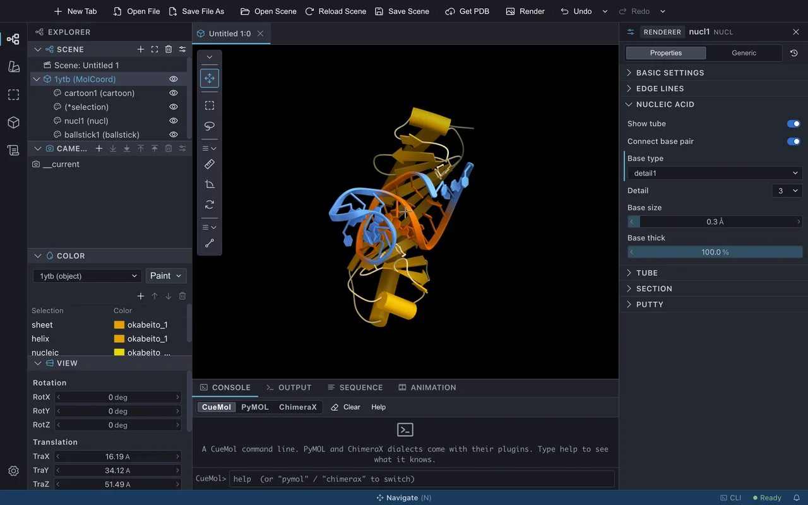
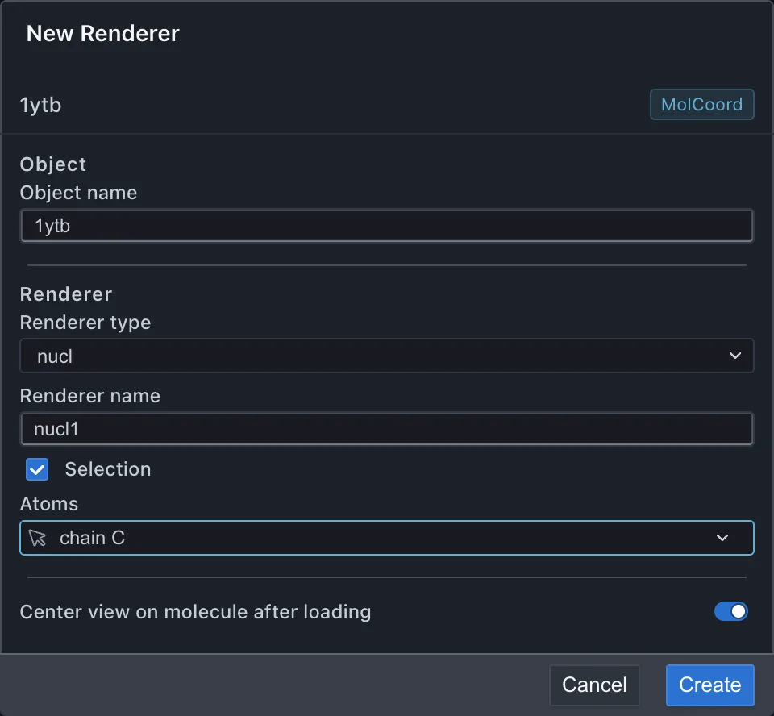
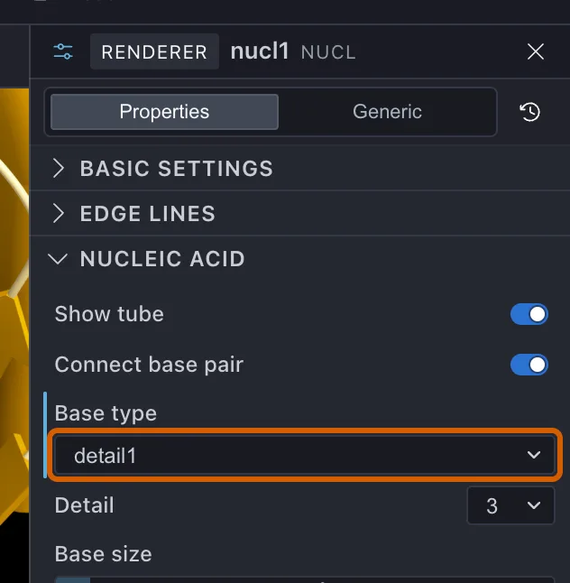
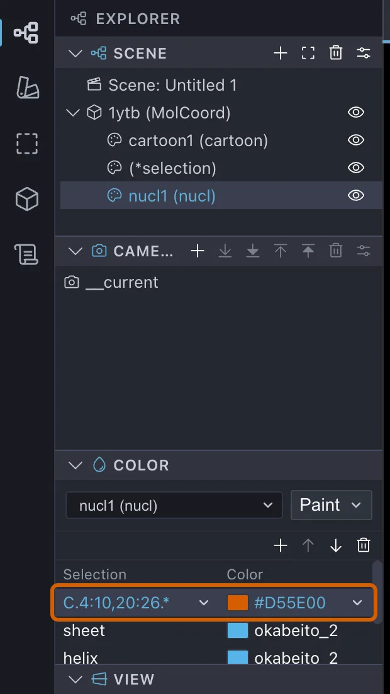

# タンパク質と DNA の複合体の表示

タンパク質を cartoon、DNA を nucl で表示し、DNA の認識配列とタンパク質の重要な残基を
塗り分けた図を作る手順を追います。
題材には、酵母の TATA 結合タンパク質 (TBP) と TATA ボックスを含む DNA の複合体 (PDB ID: **1YTB**) を使います。
TBP は馬の鞍のような形で DNA の副溝側に乗り、DNA を大きく折り曲げています。

!!! abstract "このチュートリアルについて"
    - **題材**: 酵母の TBP と DNA の複合体 (PDB ID: 1YTB)
    - **学ぶこと**: nucl による DNA の表示、Base type の切り替え、Paint による配列の塗り分け、`bysidech` による側鎖の表示
    - **前提**: 基本操作コースの [Renderer の着色](../basic/coloring.md) まで

{ .on-glb }

## 1. 構造を読み込む

**File &gt; Get PDB...** で `1YTB` を取得します。Renderer は **cartoon** を選び、
**Selection** にチェックを入れて **Atoms** に `chain A` を入力します。

1YTB の非対称単位には、TBP と DNA の複合体が 2 組含まれています (TBP が chain A / B、DNA が chain C / D)。
ここでは 1 組目 (chain A と chain C) を使います。DNA は 29 塩基の 1 本鎖で、端で折り返して
二重らせんを作るヘアピンになっています (塩基 1〜12 と 18〜29 が対を作り、13〜17 が折り返しのループです)。

## 2. DNA を nucl で表示する

cartoon はタンパク質の主鎖を描く Renderer です。核酸には、専用の nucl を使います
(→ [nucl (核酸)](../../reference/renderers/nucl.md))。

1. シーンツリーで `1ytb` を右クリックし、**New Renderer...** を選びます。
2. **Renderer type** から **nucl** を選び、**Selection** にチェックを入れて **Atoms** に `chain C` を入力します。
3. **Create** を押します。

    { width="480" .on-glb }

DNA の主鎖がチューブで、塩基がスティックで表示されます。塩基対を作っている 2 つの塩基は、
1 本のスティックでつながります。

## 3. 塩基の形を変える

1. シーンツリーで `nucl1` を選びます。
2. プロパティインスペクタの **Nucleic acid** セクションで、**Base type** を **detail1** にします。

    { width="316" .on-glb }

塩基が板状の形になり、塩基の重なり (スタッキング) が見やすくなります。
ほかの形 (simple1 / detail2 / None) も試してみてください。

## 4. DNA を塗り分ける

Renderer は分子ごとの既定の色で塗られるので、読み込んだ直後は TBP と DNA が似た色です。
DNA を別の色にし、TATA ボックスをさらに目立つ色にします。

1. 左サイドパネルの **Explorer &gt; Color** パネルを開き、上部で `1ytb/nucl1` を選びます。
2. Coloring の種類から **Paint coloring** &gt; **Okabe-Ito** &gt; **Sky blue** を選びます。
3. 表の一番上に行を追加し、選択式に `C.4:10,20:26.*`、色に Okabe-Ito の **Vermillion** (`#D55E00`) を指定します。

    { width="310" .on-glb }

DNA が水色になり、TATA ボックス (塩基 4〜10 の `TATAAAA` と、それと対を作る 20〜26) が朱色になります
(→ [Renderer の着色](../basic/coloring.md))。

## 5. DNA に入り込むフェニルアラニンを表示する

TBP は、TATA ボックスの両端付近で 2 つずつ、計 4 つのフェニルアラニン (Phe99・Phe116・Phe190・Phe207) の
側鎖を DNA の塩基の間に差し込んでいます。DNA はこの位置で折れ曲がります。

1. `1ytb` の **New Renderer...** から **ballstick** を選びます。
2. **Selection** にチェックを入れ、**Atoms** に `bysidech A.99,116,190,207.*` を入力して **Create** を押します。

`bysidech` は、選択を側鎖 (と Cα) に限ります (→ [選択式の文法](../../reference/selection.md#bysidech-演算子))。
主鎖を省くので、cartoon から側鎖だけが伸びた表示になります。

分子を回して、DNA の曲がり方と、Phe の側鎖が塩基の間に入り込んでいる様子を確かめてください。
TBP の β シートが DNA の副溝側に広く接し、DNA が TBP から離れる向きに曲がっているのがわかります。

{ .on-glb }

## 同じことをコマンドで

本文の操作を [Console](../../reference/plugins/console/index.md) の native モードのコマンドで書くと、
次のようになります。Console に 1 行ずつ入力します ([tritium_cli](../../reference/plugins/console/cli.md)
からも実行できます)。各コマンドの引数は Console で `help <コマンド>` を実行すると確認できます
(→ [Console のコマンド一覧](../../reference/plugins/console/commands.md))。

```
# 1. 構造を読み込む
fetch_pdb 1YTB, mmcif, cartoon, selection="chain A"
# 2. DNA を nucl で表示する
create_renderer 1ytb, nucl, selection="chain C"
focus_nodes 1ytb/cartoon1 1ytb/nucl1
# 3. 塩基の形を変える
set 1ytb/nucl1.base_type, detail1
# 4. DNA を塗り分ける
set_renderer_coloring 1ytb/nucl1, paint-type-paint, paintColor=okabeito_2
add_paint 1ytb/nucl1, "C.4:10,20:26.*", #D55E00
set_mol_selection 1ytb, ""
# 5. DNA に入り込むフェニルアラニンを表示する
create_renderer 1ytb, ballstick, selection="bysidech A.99,116,190,207.*"
```

- `focus_nodes` は、シーンツリーで複数の行を選んで **Focus** を押したときと同じく、
  指定した Renderer がすべて収まるように視点を合わせます。
- `add_paint` は、塗った範囲を分子の選択にもします。選択のハイライトが図に残らないように、
  `set_mol_selection` で選択を解除しています。

## 次のステップ

- [nucl (核酸)](../../reference/renderers/nucl.md) — Base type や Pivot atom name などの設定
- [タンパク質のリボン図の表示](ribbon-figure.md) — 輪郭線や背景など、作図の仕上げ
- [論文用の高解像度画像の書き出し](publication-images.md)

---

*確認対象: CueMol3 3.0.6.577*
