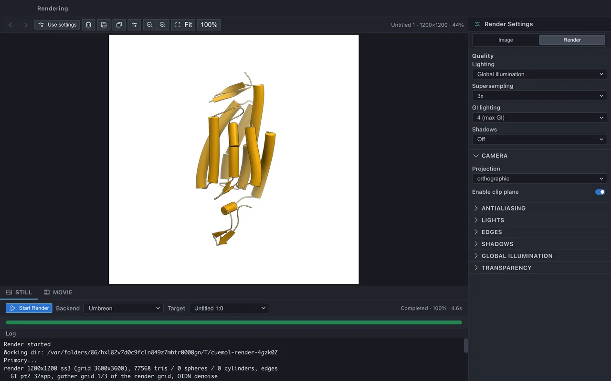
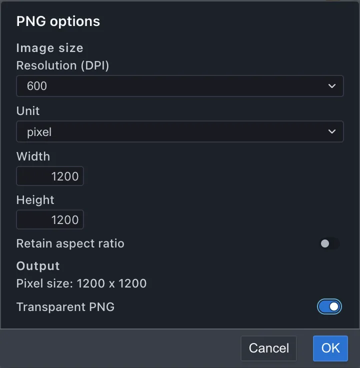
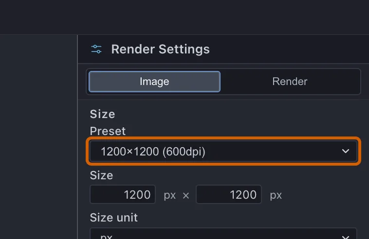
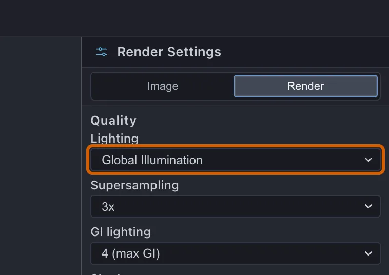
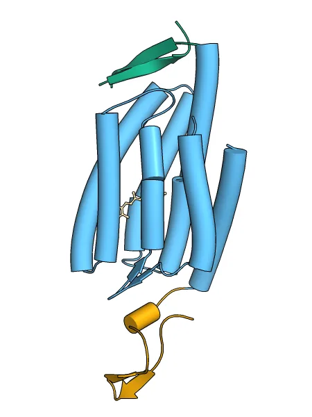
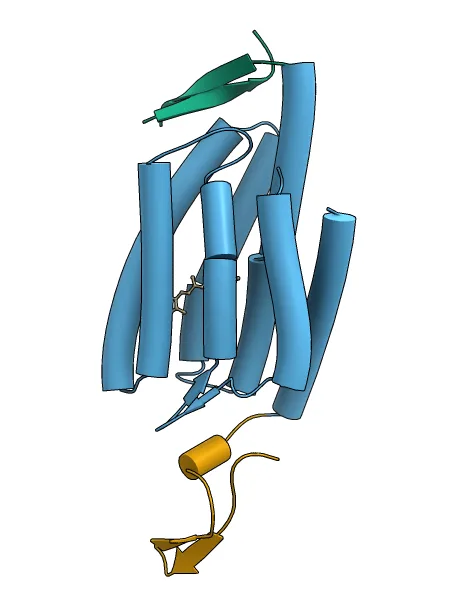
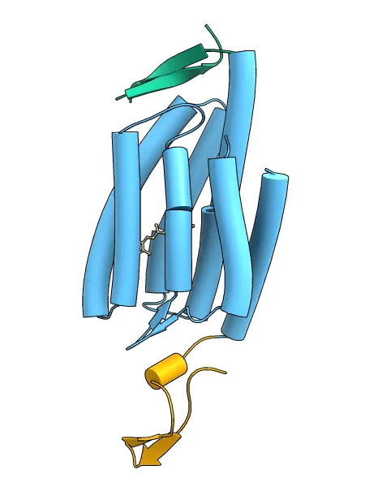

# 論文用の高解像度画像の書き出し

作成したシーンを、論文や発表資料に使える品質の画像として書き出す手順を追います。
[タンパク質のリボン図の表示](ribbon-figure.md) で仕上げたシーンを題材にしますが、
どのシーンでも手順は同じです。

!!! abstract "このチュートリアルについて"
    - **題材**: [タンパク質のリボン図の表示](ribbon-figure.md) で仕上げたシーン (どのシーンでも可)
    - **学ぶこと**: 画面のままの PNG の書き出しと、レイトレースによる仕上げの使い分け
    - **前提**: [タンパク質のリボン図の表示](ribbon-figure.md)

{ .on-glb }

## 1. 2 つの出力方法と使い分け

| 方法 | 特徴 | 向いている用途 |
|---|---|---|
| **Rendering &gt; Export scene &gt; PNG image...** | 画面表示と同じ描画をそのまま書き出す。速い | 作業中の記録、スライド、確認用 |
| **Rendering &gt; Image rendering...** (レンダリングウィンドウ) | レイトレーシングによる高品位な描画。陰影・輪郭線の品質が高い | 論文の図、ポスター |

まず Export scene で構図を確かめ、最終版をレンダリングウィンドウで仕上げる、
という流れが手早く確実です。仕上がった画像は、プレゼンテーションソフトや図版作成
ソフトに貼り付けて組み図にするのが通常の使い方です。

## 2. 画面のまま PNG に書き出す

**Rendering &gt; Export scene &gt; PNG image...** を選ぶと、保存先の指定に続いて
オプション画面が出ます。

- **サイズ** (**Width** / **Height**) と**解像度** (**Resolution (DPI)**) を指定できます。
- **Transparent PNG** を有効にすると、背景が透明な PNG になります (スライドの重ね合わせに便利です)。

{ width="360" .on-glb }

DPI は画像のピクセル数には影響しません。書き出した PNG を他のソフトウェアに貼り付けて
印刷するときの**紙面上の実寸**を決める値です (例: 1200×1200 ピクセルを 600 DPI で
書き出すと、印刷時の実寸は 2×2 インチ = 約 5 cm 角になります)。

そのほかの出力形式 (POV-Ray SDL / STL / MQO など) は
[Rendering メニュー](../../menu/rendering.md) を参照してください。

## 3. レイトレースで仕上げる

**Rendering &gt; Image rendering...** を選ぶと、独立した**レンダリングウィンドウ**が開き、
静止画 (Still) モードになります。ウィンドウはモードレスなので、開いたまま
メインウィンドウで視点を調整できます (→ [レンダリングウィンドウ](../../ui/rendering-window.md))。

1. 下部の実行バーで、**Target** にレンダリングしたいビューを選びます。
   **Backend** は既定の **Umbreon** のままで構いません。
2. **Image** タブで出力サイズを選びます。プリセット (例: **1200×1200 (600dpi)**) から選ぶか、
   **Custom** で幅・高さを直接指定します。
3. **Render** タブの **Quality** セクションで、**Lighting** (陰影の付け方) が既定の
   **Global Illumination** になっていることを確かめます。大域照明による陰影づけで、cartoon の
   ヘリックスの筒が重なる部分にも奥行き感が出ます。
   **Supersampling** (輪郭を滑らかにする設定) は既定のままで構いません。
4. **Start Render** を押すとレンダリングが始まり、進捗が表示されます。

{ width="380" .on-glb }
{ width="380" .on-glb }

!!! tip "速さを優先するなら Raytrace only"
    **Lighting** を **Raytrace only** にすると、大域照明の計算を省くぶん速く仕上がります。
    そのかわり陰影が弱くなり、cartoon では奥行き感が減ります (下図)。細い ribbon や線の図では
    差が出にくいので、構図の確認や試し出しに使うとよいでしょう。

    { width="220" .on-glb }
    { width="220" .on-glb }
    { width="220" .on-glb }

!!! tip "Global Illumination で全体が暗く見えるときは"
    Global Illumination では、光が遮られる奥や隙間が暗くなるぶん、図全体も Raytrace only より
    暗く見えます。明るくしたいときは、**Render** タブの **Lights** セクションで **Light intensity**
    (光源全体の強さ、既定 1.3) を 1.7 程度に上げます (上図の右)。陰影の付き方はそのままで、全体が
    明るくなります。上げすぎると明るい色が白く飛ぶので、結果を見ながら調整してください
    (→ [レンダリング](../../reference/rendering.md#lights))。

各品質項目の意味と使い分けは [レンダリング](../../reference/rendering.md) を参照してください。

!!! note "CueMol2 との違い"
    CueMol2 の高品位出力は外部の POV-Ray を呼び出す方式でしたが、CueMol3 では内蔵
    レイトレーサの **Umbreon** が既定になり、外部プログラムの用意もパスの設定も不要です
    (→ [レンダリングウィンドウ](../../ui/rendering-window.md))。

## 4. 結果を確認して保存する

レンダリングが完了すると、結果画像がウィンドウ左上の画像領域に表示されます。

- 画像領域のツールバーの **Save** で PNG ファイルとして保存します。
- **Copy** でクリップボードにコピーできます。
- 矢印ボタンで過去のレンダリング結果の履歴をさかのぼれます。履歴には実行時の設定も
  一緒に記録されており、**Use settings** を押すとその設定に戻せます。

構図や品質が気に入らなければ、メインウィンドウで調整して **Start Render** し直します。
設定は結果の履歴に残るので、試行錯誤しながら比較できます。

!!! note "レンダリングウィンドウの設定はシーンに保存されます"
    設定はシーンファイルと一緒に保存され、次にシーンを開いたときにも残ります。
    設定の変更は Undo で戻せます。過去の設定に戻りたいときは結果の履歴の
    **Use settings** を使ってください (→ [レンダリング](../../reference/rendering.md#設定の保存))。

## 同じことをコマンドで

本文の操作を [Console](../../reference/plugins/console/index.md) の native モードのコマンドで書くと、
次のようになります。Console に 1 行ずつ入力します ([tritium_cli](../../reference/plugins/console/cli.md)
からも実行できます)。各コマンドの引数は Console で `help <コマンド>` を実行すると確認できます
(→ [Console のコマンド一覧](../../reference/plugins/console/commands.md))。

```
# 2. 画面のまま PNG に書き出す (1200×1200 ピクセル、600 DPI)
export_scene ~/3ug9.png, png, 1200, 1200, dpi=600
# 3. レイトレースで仕上げる (既定の Global Illumination で、1200×1200 で書き出す)
render_image ~/3ug9-rt.png, 1200, 1200
# 4. 結果を確認して保存する (GUI のみ)
```

- `export_scene` に `transparent=true` を付けると、背景が透明な PNG になります。
- **Raytrace only** にするには、`render_image` の前に
  `set_render_settings "umbreon.useGI=false; umbreon.aoEnabled=false; umbreon.lightIntensity=1.55; umbreon.flashFraction=0.6; umbreon.ambientFraction=0.16"`
  を実行します。値はレンダリングウィンドウの **Lighting** で **Raytrace only** を選んだときと同じです。
  設定はシーンに保存され、レンダリングウィンドウにも反映されます。
- `render_image` は結果をファイルに直接書き出します。レンダリングウィンドウの結果の履歴には残りません。

## 次のステップ

- [レンダリング](../../reference/rendering.md) — 品質項目の詳細と既定値
- [レンダリングウィンドウ](../../ui/rendering-window.md) — ウィンドウ各部の説明

---

*確認対象: CueMol3 3.0.6.577*
