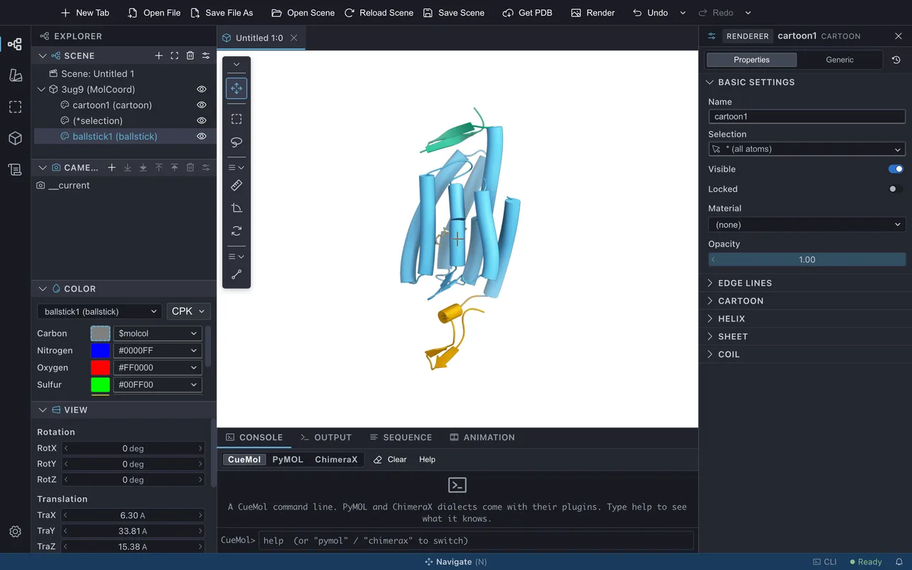
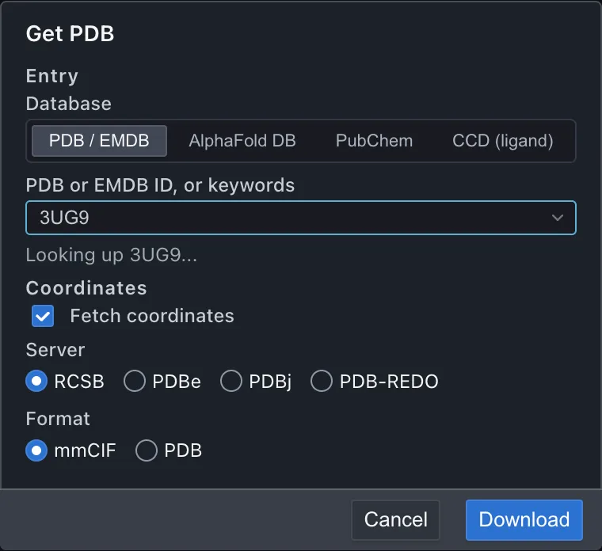
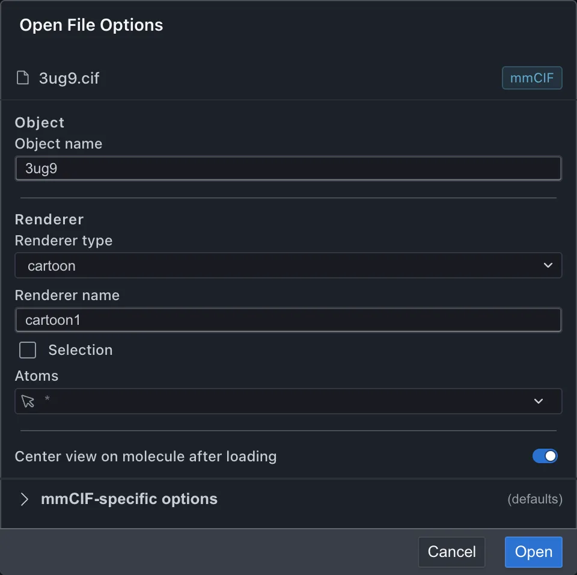
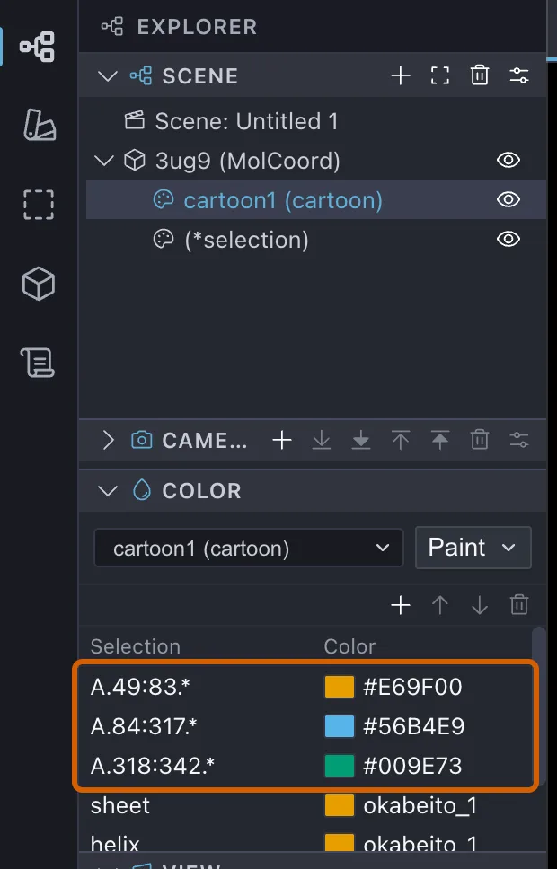
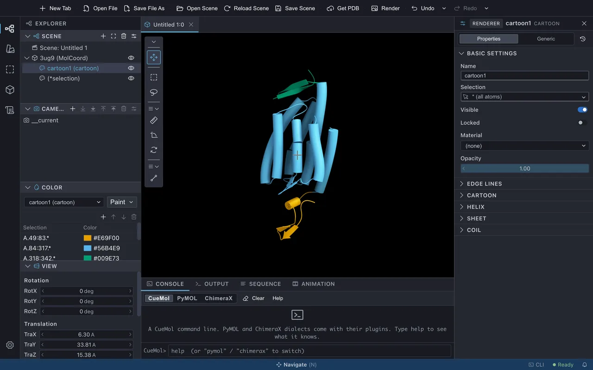
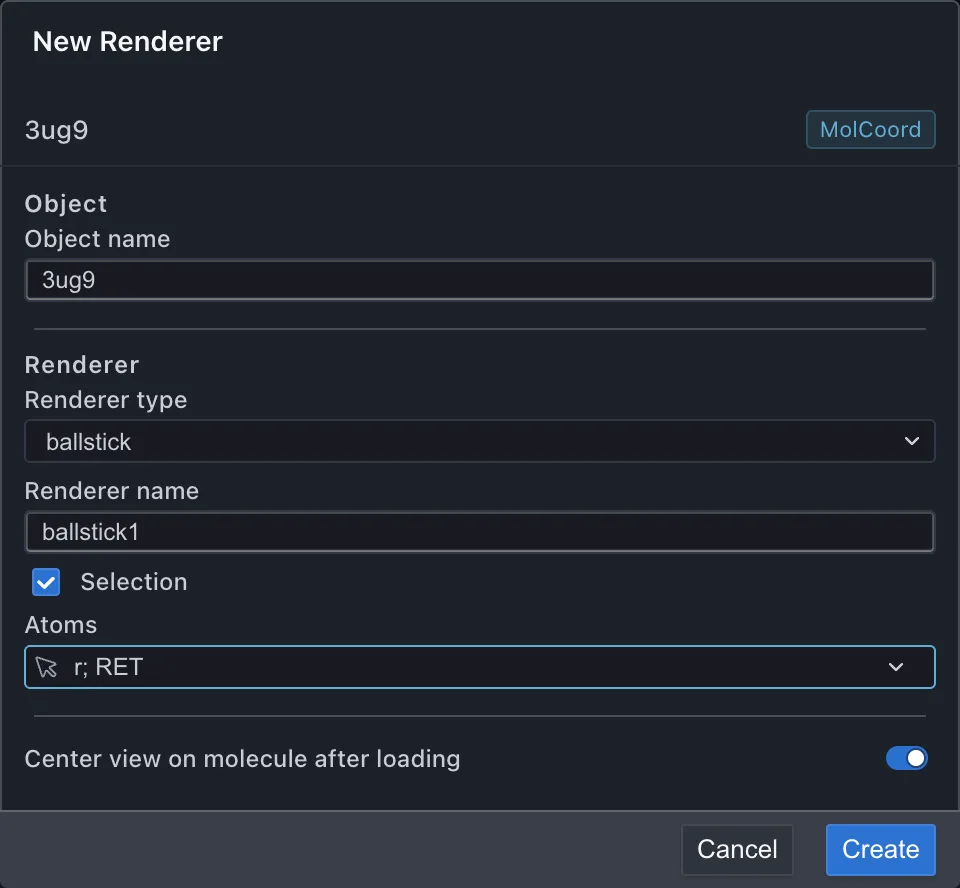
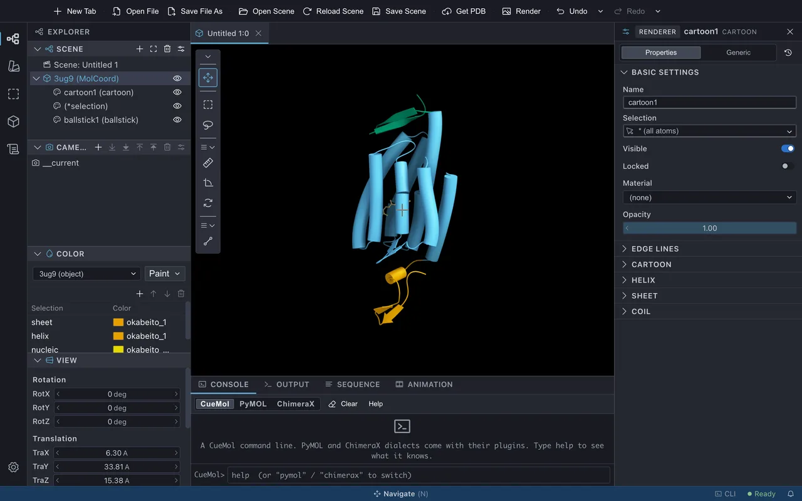

# タンパク質のリボン図の表示

タンパク質を cartoon (いわゆるリボン図) で表示し、リガンドを ballstick で重ね、
色と輪郭線を整えて 1 枚の図に仕上げるまでの流れを追います。題材にはチャネルロドプシンの結晶構造
(PDB ID: **3UG9**) を使います。

このチュートリアルは、[クイックツアー](../../getting-started/quick-tour.md) の内容
(起動・読み込み・視点操作の基本) を前提にしています。

!!! abstract "このチュートリアルについて"
    - **題材**: チャネルロドプシン (PDB ID: 3UG9)
    - **学ぶこと**: cartoon の調整、ドメインごとの塗り分け、リガンドの ballstick、背景と輪郭線による仕上げ
    - **前提**: [クイックツアー](../../getting-started/quick-tour.md)

{ .on-glb }

## 1. 構造を取得する

**File &gt; Get PDB...** で構造をネットワークから取得します。

1. **PDB or EMDB ID, or keywords** に `3UG9` を入力します。
2. **Fetch coordinates** にチェックが入っていることを確認します (**Server** は既定の **RCSB**、**Format** は既定の **mmCIF** のまま)
3. 取得が終わると、Object 名と Renderer を指定する画面が出ます。
4. **Renderer type** から **cartoon** を選び、そのほかは既定のまま作成します。

    { width="380" .on-glb }
    { width="480" .on-glb }

タンパク質部分が、二次構造を反映した cartoon 表示で描かれます
(→ [cartoon](../../reference/renderers/cartoon.md))。

!!! note "ribbon と cartoon"
    「リボン図」は、タンパク質の主鎖を二次構造ごとに帯や筒で描く図の一般的な呼び名です。
    CueMol にはそのための Renderer が 2 種類あります。**ribbon** はヘリックスをらせん状の帯で、
    **cartoon** はヘリックスを主鎖に沿ってうねる筒で描きます。このチュートリアルでは cartoon を
    使いますが、ribbon でも同じ手順で作ることができます
    (→ [ribbon](../../reference/renderers/ribbon.md) / [cartoon](../../reference/renderers/cartoon.md))。

!!! tip "プリセットなら一度で作れます"
    **Renderer type** の Presets にある **Default preset 2** を選ぶと、タンパク質の cartoon・
    核酸・それ以外 (リガンドなど) の ballstick をまとめた Renderer グループが一度に作られます。
    このチュートリアルでは仕組みを追うため、Renderer を 1 つずつ作っていきます。

## 2. 視点を合わせる

分子ビュー上の左ドラッグで回転、ホイールでズームして、分子全体が見える向きにします
(→ [マウス・トラックパッド操作](../../ui/mouse-input.md))。

視点を分子全体に合わせ直すには、左サイドパネルの **Explorer &gt; Scene** ツリー
(シーンツリー → [サイドパネル](../../ui/side-panels.md)) で
Object (3UG9) を選び、パネル上部の **Focus** ボタンを押します。

## 3. cartoon の見た目を調整する

シーンツリーで cartoon の Renderer を選ぶと、右側の**プロパティインスペクタ**に設定が
表示されます。値を変えると分子ビューに即座に反映され、++cmd+z++ / ++ctrl+z++ で
取り消せます。

ヘリックスの幅・厚みは **Helix**、シートは **Sheet**、ループは **Coil** の各セクションで
調整します。たとえば、後の手順で重ねるリガンドがヘリックスに隠れて見えにくいときは、
**Helix** の幅を細めにすると内側が見通せます。各プロパティの意味と既定値は
[cartoon](../../reference/renderers/cartoon.md) を参照してください。

## 4. ドメインごとに色を塗り分ける

3UG9 に含まれる分子は 1 つ (chain A) です。N 末端ドメイン・膜貫通部・C 末端ドメインの
3 つの領域を、残基番号の範囲で塗り分けます。

1. 左サイドパネルの **Explorer &gt; Color** パネルを開きます。
2. 上部で cartoon の Renderer を選びます。
3. Coloring の種類から **Paint coloring** &gt; **Okabe-Ito** &gt; **Orange** を選びます。
   二次構造ごとの標準の塗り分け (sheet / helix / nucleic / `*` の 4 行) が入った表が現れます。
4. 表の一番上に次の 3 行を追加し、選択式と色を指定します (一番上の行を選んで追加ボタンを押すと、
   その上に行が入ります)。

| 領域 | 選択式 | 色の例 |
|---|---|---|
| N 末端ドメイン | `A.49:83.*` | `#E69F00` (オレンジ) |
| 膜貫通部 | `A.84:317.*` | `#56B4E9` (空色) |
| C 末端ドメイン | `A.318:342.*` | `#009E73` (青緑) |

Paint は上の行から順に評価され、最初にマッチした行の色が使われます
(→ [Coloring](../../reference/coloring.md))。3 行は二次構造の行より上にあるので、
この範囲では領域の色が使われます。範囲は重ならないので、3 行どうしの順序は問いません。`A.49:83.*` は「chain A の残基番号 49〜83 の
全原子」を表す書き方です (→ [選択式の文法](../../reference/selection.md))。

{ width="310" .on-glb }

{ .on-glb }

!!! note "CueMol2 との違い"
    CueMol2 にも Paint のパネルはありましたが、行 (エントリ) の編集は別のダイアログで
    行う必要がありました。CueMol3 では**表のセルを直接編集**できます
    (→ [機能の統合・改名・廃止](../../changes/features.md))。

!!! tip "1 本鎖なら Rainbow も定番です"
    N 末端から C 末端へ虹色に変化させる **Rainbow** も、鎖の走行を示す図の定番です。
    Coloring の種類から Rainbow を選ぶだけで適用されます。

!!! tip "複数の図で色を揃えるにはスタイルが使えます"
    色や選択の定義に名前を付けて共通化しておくと、複数のシーンを通して一貫した
    色遣いの図を作れます (→ [スタイル](../../reference/styles.md))。

## 5. リガンドを ballstick で表示

cartoon は主鎖の走行だけを描くため、リガンドは表示されません。
3UG9 が持つレチナール (残基名 `RET`) を、ballstick (棒と球のモデル) で重ねて表示します。

1. シーンツリーで Object (3UG9) を右クリックし、**New Renderer...** を選びます。
2. **Renderer type** から **ballstick** を選びます。
3. **Selection** にチェックを入れ、選択式に `r; RET` を入力します。
4. **Create** を押すと、cartoon に重ねてレチナールが ballstick で描かれます。
   ダイアログの **Center view on molecule after loading** が既定でオンなので、視点は新しい
   Renderer (レチナール) に合います。
5. 分子全体を見るには、手順 2 と同じく Object (3UG9) を選んで **Focus** を押します。

1 つの Object には、このように複数の Renderer を重ねられます。各 Renderer の表示対象は
選択式で絞り込みます (`r;` は残基名による選択の省略形です →
[選択式の文法](../../reference/selection.md))。

残基名がわからないときは、**Selection &gt; Mol Struct** パネルのツリーから
残基を探して選択することもできます (→ [サイドパネル](../../ui/side-panels.md))。
また、全体図でリガンドが小さすぎて見えにくい場合は、ballstick の代わりに
**cpk** (空間充填モデル) で表示するのも定番です。

{ width="480" .on-glb }

{ .on-glb }

## 6. 背景と輪郭線で仕上げる

論文の図では、白い背景に輪郭線 (エッジライン) を組み合わせるのが定番です。
エッジラインを付けると、白背景でも各要素の境界がはっきりします。

1. **Scene &gt; Background &gt; White** で背景を白にします。
2. シーンツリーで cartoon の Renderer を右クリックします。
3. **Style &gt; Edge line (normal)** を選びます。エッジ線の種類と太さがまとめて設定されます。
4. ballstick の Renderer にも、同じ操作 (手順 2〜3) を繰り返します。

線を太く / 細くしたいときは、同じメニューから **Edge line (thick)** /
**Edge line (thin)** を選び直します。外すときは **No edge line** を選びます
(→ [エッジライン](../../reference/renderers/edge-lines.md))。

!!! tip "白背景ではリガンドの色を確かめてください"
    白背景にすると、明るい色の原子が背景に溶け込んで見えにくいことがあります。
    気になるときは **Color** パネルの **CPK** で炭素の色を暗め (例: `#404040`) にします
    (→ [色の記法](../../reference/color-syntax.md))。

{ .on-glb }

## 7. カメラとシーンを保存する

視点が決まったら、カメラとして保存しておくと、後で同じ構図に戻せます。

1. アクティビティバーの **Explorer** をクリックし、**Camera** パネルを開きます。
2. **New camera from view** ボタンを押し、名前を付けて作成します。

カメラ行のダブルクリックで、いつでもその視点に戻れます
(→ [カメラ](../../reference/camera.md))。

最後に **File &gt; Save Scene** (++cmd+s++ / ++ctrl+s++) でシーンを `.qsc` ファイルに
保存します。保存すると、そのときの視点も `__current` という名前のカメラとして記録され、
次に開いたときに適用されます。また、保存時に開く **Scene options** ダイアログで **Embed possible** を有効にすると、
分子データも `.qsc` に取り込まれ、ファイル単体で持ち運べるようになります
(→ [File メニュー](../../menu/file.md))。

## 同じことをコマンドで

本文の操作を [Console](../../reference/plugins/console/index.md) の native モードのコマンドで書くと、
次のようになります。Console に 1 行ずつ入力します ([tritium_cli](../../reference/plugins/console/cli.md)
からも実行できます)。各コマンドの引数は Console で `help <コマンド>` を実行すると確認できます
(→ [Console のコマンド一覧](../../reference/plugins/console/commands.md))。

```
# 1. 構造を取得する
fetch_pdb 3UG9, mmcif, cartoon
# 2. 視点を合わせる
focus 3ug9
# 3. cartoon の見た目を調整する (設定できるプロパティの一覧を表示する)
props 3ug9/cartoon1
# 4. ドメインごとに色を塗り分ける
set_renderer_coloring 3ug9/cartoon1, paint-type-paint
add_paint 3ug9/cartoon1, A.49:83.*, #E69F00
add_paint 3ug9/cartoon1, A.84:317.*, #56B4E9
add_paint 3ug9/cartoon1, A.318:342.*, #009E73
# 5. リガンドを ballstick で表示
create_renderer 3ug9, ballstick, selection="r; RET"
# 6. 背景と輪郭線で仕上げる
set bgcolor, #FFFFFF
apply_renderer_style 3ug9/cartoon1, EgLineNormal
apply_renderer_style 3ug9/ballstick1, EgLineNormal
# 7. カメラとシーンを保存する
save_camera view1
save_scene ~/3ug9.qsc, embedAll=true
```

- `;` やカンマを含む選択式 (`r; RET` など) は、引用符で囲みます。
- `save_scene` は、まとめて実行するときは最後に置きます (それまでの変更を確定してから保存します)。

## 次のステップ

- [論文用の高解像度画像の書き出し](publication-images.md) — この図をレイトレースで仕上げる
- [Coloring](../../reference/coloring.md) / [選択式の文法](../../reference/selection.md) — 塗り分けと選択の詳細
- [Renderer 一覧](../../reference/renderers/index.md) — 他の表示方法を知る

---

*確認対象: CueMol3 3.0.7.578*
