# チュートリアル

操作を順に学ぶ基本操作コースと、分野ごとの目的別チュートリアルがあります。
はじめての方は、まず [クイックツアー](../getting-started/quick-tour.md) で
全体の流れをつかんでから、基本操作コースに進んでください。

目的別チュートリアルは、どれからでも始めることができます。各ページの冒頭に、題材・学ぶこと・
前提となるページをまとめています。

## 基本操作

リゾチーム (1QIO) を題材に、CueMol3 の操作をひととおり練習するコースです。
順に進めると前のページの状態を引き継げます。

- [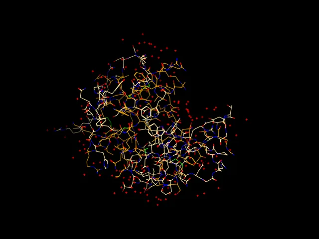](basic/loading.md)

    **[構造の読み込みと表示](basic/loading.md)** — 読み込み・視点操作・Scene / Object / Renderer の考え方
- [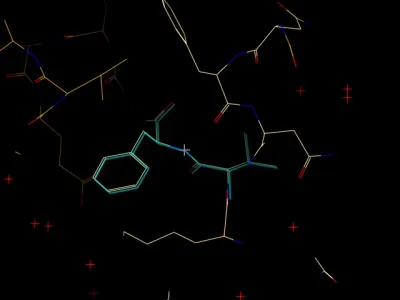](basic/selection.md)

    **[分子の一部の選択](basic/selection.md)** — クリック・パネル・選択式による選択
- [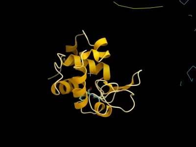](basic/renderers.md)

    **[Renderer の追加・削除と設定](basic/renderers.md)** — 表示の重ね方とインスペクタ
- [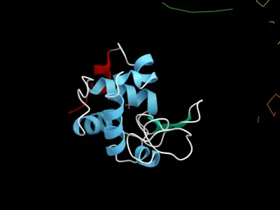](basic/coloring.md)

    **[Renderer の着色](basic/coloring.md)** — CPK / B-factor / Rainbow / Paint
- [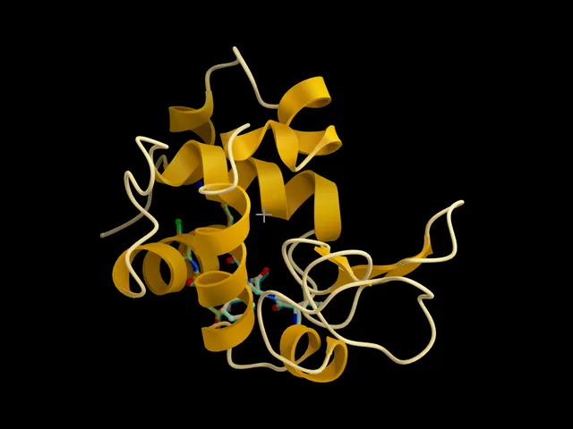](basic/camera-scene.md)

    **[カメラとシーンの保存](basic/camera-scene.md)** — 視点とシーンファイルの扱い
- [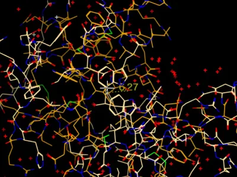](basic/measure.md)

    **[計測と相互作用の表示](basic/measure.md)** — 距離・角度の測定と atomintr

## 作図

- [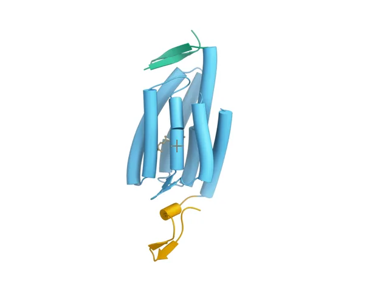](figures/ribbon-figure.md)

    **[タンパク質のリボン図の表示](figures/ribbon-figure.md)** — 構造の取得から塗り分け・輪郭線まで、作図の基本コース
- [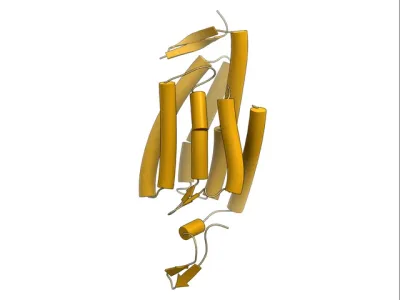](figures/publication-images.md)

    **[論文用の高解像度画像の書き出し](figures/publication-images.md)** — Export scene とレイトレースの使い分け
- [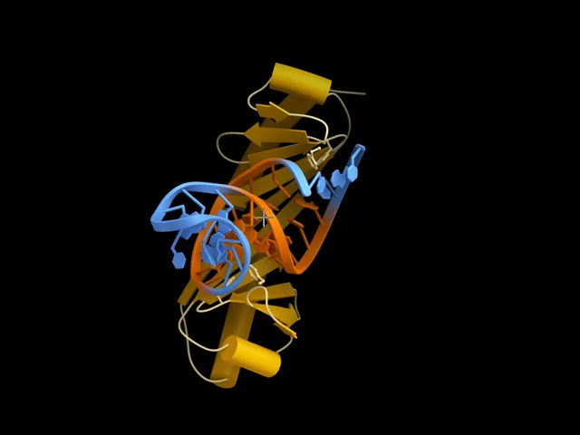](figures/protein-dna.md)

    **[タンパク質と DNA の複合体の表示](figures/protein-dna.md)** — nucl による DNA の表示と配列の塗り分け

## 構造の解析

- [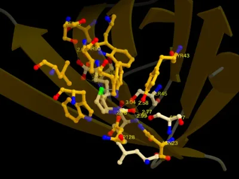](structure/binding-site.md)

    **[リガンド結合部位の表示](structure/binding-site.md)** — 周辺残基の選択と水素結合の候補の表示
- [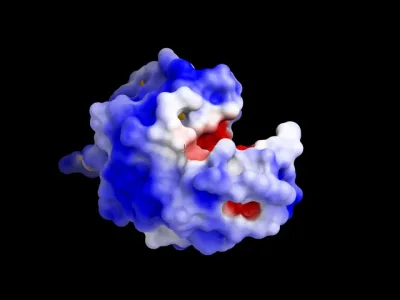](structure/surface-elepot.md)

    **[分子表面の静電ポテンシャル表示](structure/surface-elepot.md)** — 表面生成から APBS 計算・着色まで
- [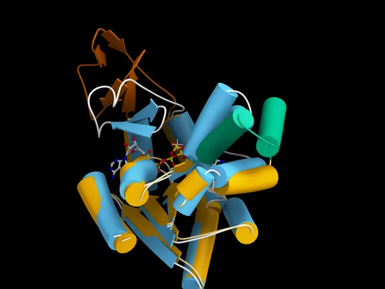](structure/superpose.md)

    **[構造の重ね合わせと比較](structure/superpose.md)** — 重ね合わせに使う原子の選び方とドメインの動き

## 実験データ

- [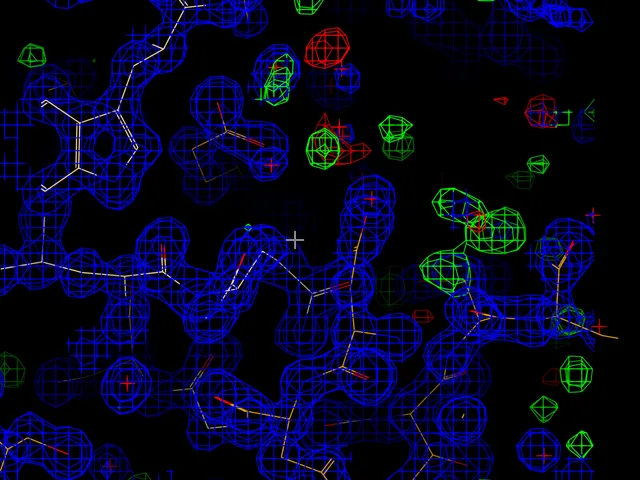](experimental/density-map.md)

    **[電子密度マップの表示](experimental/density-map.md)** — Get PDB でのマップ取得と Density map パネル
- [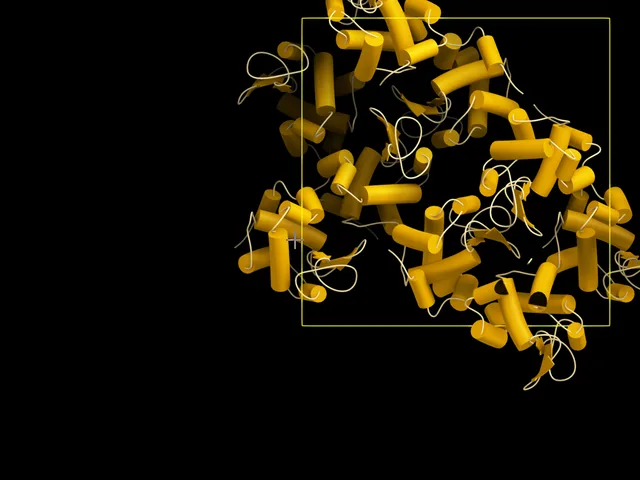](experimental/symmetry.md)

    **[対称分子・単位格子の表示](experimental/symmetry.md)** — 結晶パッキングの表示と Create SYMM mol
- [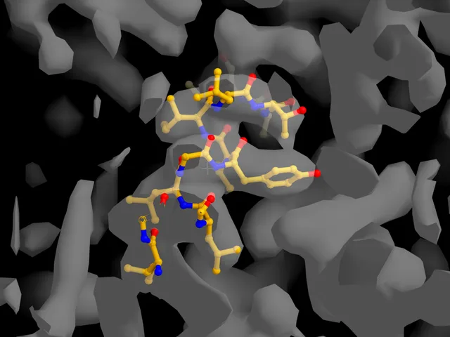](experimental/cryoem-map.md)

    **[cryo-EM マップとモデルの表示](experimental/cryoem-map.md)** — 上位 % のレベルと側鎖の密度の見え方

## 予測構造

- [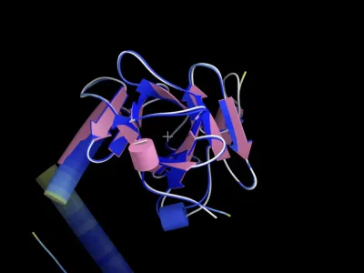](prediction/alphafold.md)

    **[AlphaFold の予測構造の評価](prediction/alphafold.md)** — pLDDT 値の可視化と実験構造との重ね合わせ

## 動画

- [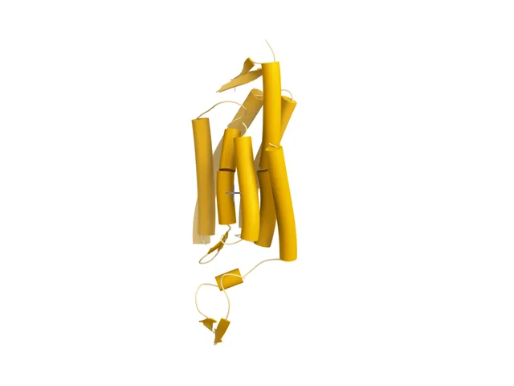](animation/animation-movie.md)

    **[アニメーションの作成と動画の出力](animation/animation-movie.md)** — タイムライン編集・モーフィング・動画出力

## スクリプト

- [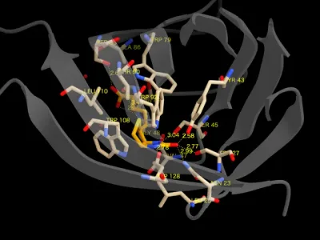](scripting/chx-console.md)

    **[ChX console による作図](scripting/chx-console.md)** — ChimeraX のコマンドと `.cxc` スクリプトで図を作る

